# Game check

**Nov 14, 2026, 4:28 PM (Central)** · main @ `624116a` · played side by side

**0 pass · 8 to check · 3 fail** out of 11 games (1 played this run, 10 kept from the last check).

## 🔴 FAIL — Apex F1 Racing

`apexf1.html`

- 🔴 LAYOUT: buttons too small to tap on a sideways phone (844x390) (menu) - #quickBtn (300x30), #careerBtn (300x30), #tournBtn (300x30), #taBtn (300x30) - make each at least 32 px (Apple asks 44) so a thumb hits it
- 🔴 NOT RUN (robot time cap, robot side) - owner's fix not proven: "play-test entries are shaped right: play-start-on-car-with-lights exposes test and ask, not run and title"
- 🔴 NOT RUN (robot time cap, robot side) - owner's fix not proven: "on the upright phone the stick, REV and CAM never overlap: the landscape compact rules do not apply upright, so portrait needs its own compact block"
- 🔴 NOT RUN (robot time cap, robot side) - owner's fix not proven: "in the cockpit camera the world ahead stays visible: the driver-eye view never goes black while the HUD stays live (G-369 masher point)"
- 🔴 NOT RUN (robot time cap, robot side) - owner's fix not proven: "A pit stop really happens: the car stops in its box, the crew changes the tyres (wheels come off) and fills the fuel (the gauge rises from what the car burned), then the car is released fully drivable (owner Nov 8 2026: "create a realistic pit with a crew that does a quick simulated pit stop tires and fuel")"
- 🔴 NOT RUN (robot time cap, robot side) - owner's fix not proven: "The full pit complex (10 booths with seated desk chiefs, booth crews, dressed working spots, pad) stands on EVERY circuit in the menu: the Grand Prix kit circuit built none of it (0 booths, 0 env figures) while the built-in tracks got it from buildPits (owner Nov 9 2026: "This needs to be in all track options")"
- 🔴 NOT RUN (robot time cap, robot side) - owner's fix not proven: "Every pit box has its own garage door on the pit building face behind the boxes on EVERY circuit in the menu: ten roller-shutter doors aligned to the ten box centres, each in its team colour with its box number, a window band and an APEX ARCADE sign band above - the measured audit found no doors at all: the only pit building is a blank dark slab standing by the pit entry, and nothing stands behind the boxes but the booths (owner Nov 10 2026 missing-list item 3)"
- 🔴 NOT RUN (robot time cap, robot side) - owner's fix not proven: "play-test entries are shaped right: play-car-holds-heading-at-speed and play-car-grew-20-percent expose test, not run"
- 🔴 NOT RUN (robot time cap, robot side) - owner's fix not proven: "on the upright phone teamMenu fits with no scrolling"
- 🔴 NOT RUN (robot time cap, robot side) - owner's fix not proven: "The SKIP STOP button (owner Nov 9 2026: "add a skip button player can press to jump back into game"): hidden on track, shown while the car is in the pits (shown/hidden by its hidden class, the pit HUD mechanism - offsetParent is always null in the ?test path, whose #hud stays class-hidden), and one press - during the 6 s hold OR on the roll-in - finishes the service at once (fresh tyres, full tank) and releases the car fully drivable, with no hold on the roll-in press"
- 🔴 NOT RUN (robot time cap, robot side) - owner's fix not proven: "The pit buttons answer a real tap on the phone (owner Nov 9 2026: "fix Pit button cause it does not working"): PIT and SKIP STOP must be the top element at their own centre (nothing eats the tap), must answer a pointer-event tap the way some phone browsers and webviews deliver taps (they used to listen only for touchstart/mousedown), and SKIP STOP must sit above the touch-controls layer, clear of the phone home indicator (it used to live inside the lower HUD layer with no safe-area inset)"
- 🔴 NOT RUN (robot time cap, robot side) - owner's fix not proven: "A marshal stands at EVERY marshal post on EVERY circuit in the menu: the fetched crew figure at the pit crews' real size (2.63 m standing) in orange marshal overalls, beside the post's orange hut facing the track, poses varying post to post with some holding a flag in the post's own flag colour - the audit found the posts (an orange hut, a pole and a flag every ~130 m on all tracks) standing completely empty, with no people at them at all (owner Nov 10 2026 missing-list item 2)"
- 🔴 Owner's fix NOT done yet: "Start button on the screen: LIGHTS OUT and every menu fits 844x390 with no scrolling (the owner had to scroll to start the race)" [test id: never-g-119-p1] (team menu (teamMenu) needs scrolling: content is 455px tall on a 390px screen)
- 🔴 NOT RUN (robot time cap, robot side) - owner's fix not proven: "Arming a pit stop in qualifying must not follow the car onto the grid: no crew at the start line, no 49 MPH limiter trap with dead controls after GO (owner Nov 8 2026: "no pit stop happened, the pit crew showed up late around my car on the racetrack, then it would not let me drive - stuck in the grass at 49 MPH")"
- 🔴 NOT RUN (robot time cap, robot side) - owner's fix not proven: "A continuous pit wall stands between the pit lane and the race track on EVERY circuit in the menu: about 1 m of concrete running the whole box stretch (15 m before the first box to 15 m past the last), tight against the road edge on the pit side, clear of the pit driving line - the audit found only low barrier panels at the box boundaries and no wall anywhere (owner Nov 9 2026 missing-list item 1)"
- 🔴 NOT RUN (robot time cap, robot side) - owner's fix not proven: "Owner Nov 10 2026 9:29 PM "Yes do all them complete 1-6": EVERY circuit in the menu carries the race furniture, placed from its own track - braking boards 150 / 100 / 50 before each real braking zone, a DRS board where each DRS zone opens, a pair of sector boards for sectors 1, 2 and 3, the pit limit sign (80, the limiter's own speed) where the limit starts and the struck-out one where it ends with a white line across the lane at both (and on the built-in circuits the solid entry and exit lines), a podium and a parc ferme with three bays, the ten team motorhomes, and the pit board at the pit wall. No board stands on the road."
- 🟡 No owner-approved venue - build it from venues/circuit.md (real sizes, stands all around, crowd) with venues/kit in tools/venue-viewer.html, add it to MODELS.md as WAITING OWNER
- 🟡 Busy play screen: about 24 words during play (biggest: "TAP TO CHOOSE NEXT") - aim for only button labels and the score; instructions go behind How to play (STUDIO-STANDARD.md "Clean screen")
- 🟡 LINT fixes/apexf1.mjs: 5 h.eval call(s) navigate / wait / poll with no .catch (a destroyed execution context fails the test on the robot only) - first ones: play-cameras-above-ground line 775, play-steering-holds-the-line line 892, play-broadcast-cam-steady line 1017. Add .catch(() => false) or try/catch. Run: node tools/game-check/fixes-lint.mjs tools/game-check/fixes/apexf1.mjs
- 🟡 Play test failing: "career mode works end to end" [test id: play-career-first-round] (career round 1 race never produced results)
- 🟡 Play test failing: "career mode works end to end" [test id: play-career-next-round] (hub does not offer round 2 (hub says: DRIVERPTSP1YOU25
  
  Rating 50 · vs friends 0–0))
- 🟡 Play test failing: "Every CAM view (chase, cockpit, broadcast helicopter, onboard) stays above the road with the car and the track ahead in view, sideways and upright - the owner saw the helicopter cam under the ground" [test id: play-cameras-above-ground] (the race never started)
- 🟡 WHOLE-GAME CAP: apexf1 play tests stopped after 13 min of this part - 23 test(s) NOT RUN this time (play-player-must-steer, play-broadcast-cam-steady, play-quali-gap-is-real, play-stick-clears-pit, play-kit-retries-until-loaded, never-g-279-p1, ...) - robot side, not a game result
- 🟡 Career mode broken: "career mode works end to end"
- 🟡 Not on the shared controls yet (kit/controls.js) - its job moves this game over; until then its own stick code is allowed
- 🟡 Friend codes have no 'play-friend-code' test yet (STORE-READY.md "Friend codes")
- 🟡 REALITY: the hook has no time() - add time: () => <game seconds> and speed: () => <m/s> so a busy robot cannot mistake a sprint for walking (REALITY.md)
- 🟡 Play test failing: "the race ends with results" [test id: play-race-ends-with-results] (race did not produce results within 30s)
- 🟡 Play test failing: "the player car starts facing the right way and drives the same way as the AI cars and the checkpoints" [test id: play-player-starts-facing-forward] (race never started)
- 🟡 Play test failing: "steering is smooth and controllable with the stick" [test id: play-steering-smooth-and-controllable] (race never started)
- 🟡 Play test failing: "the slowest AI car laps within 5 percent of the player - nobody gets driven away from" [test id: play-ai-pace-slowest-matches-player] (race never started)
- 🟡 Play test failing: "the car is about 20 percent bigger" [test id: play-car-grew-20-percent] (carMesh hook returned nothing for the player)
- 🟡 Play test failing: "friend codes: my code is shown in my career hub, a bad code is rejected, and a friend code puts that driver on my grid at their coded rating (G-101)" [test id: play-friend-code] (no friend code in the career hub (hub says: DRIVERPTSSeason just started - every point counts!
  
  Rating 50 · vs friends 0))
- 🟡 Play test failing: "The player drives (owner recordings, G-239): the stick turns the car and a driven line stays on the road; let go and the nose HOLDS its world heading - it does not straighten itself back onto the road (that self-straightening was the autopilot)" [test id: play-steering-holds-the-line] (the race never started)
- 🟡 WHOLE-GAME CAP: apexf1 play tests stopped after 13 min of this part - 19 test(s) NOT RUN this time (play-contact-banner-is-players-only, play-no-penalty-for-being-shoved, play-quali-skip-clears-the-speedo, never-g-253-p1, never-g-265-p1, play-balance-skill-matters, ...) - robot side, not a game result
- 🟡 Career mode has NO playability test - add 'play-career-...' tests that start every career level, play it to the end and unlock the next (STORE-READY.md "Career mode")
- 🟡 Play test failing: "every AI car uses the real F1 car model, same quality as the player car" [test id: play-ai-cars-full-model] (KAI: drawn size 3.06 vs the player's 6.63 on footprint axis 0 - not the same car model)
- 🟡 Play test failing: "the fastest AI car laps within 5 percent of the player - same real F1 pace" [test id: play-ai-pace-fastest-matches-player] (race never started)
- 🟡 Play test failing: "at speed the stick winds the heading gently and never steers by itself" [test id: play-car-holds-heading-at-speed] (race never started)
- 🟡 Play test failing: "Apex F1: race start opens on the player car with big start lights, reds one by one then green (G-77)" [test id: play-start-on-car-with-lights] (never reached the grid screen after qualifying)
- 🟡 Play test failing: "The circuit wears the owner ground kit (asphalt + kerb textures from kit/ground/512) and the engine is the owner grand_prix sound kit: idle/accel loops crossfaded by throttle, shift sounds, tire squeal" [test id: play-grand-prix-kits] (the race never started)
- 🟡 WHOLE-GAME CAP: apexf1 play tests stopped after 13 min of this part - 20 test(s) NOT RUN this time (play-owner-check-link, play-buttons-are-44px, play-engine-sound-is-the-kit, play-gas-only-never-laps, play-stick-clears-cam, tester-chk-f03, ...) - robot side, not a game result

**Owner's fix list** (8 of 86 done):
- ✅ AI cars finish a lap
- ❌ career mode works end to end — career round 1 race never produced results
- ❌ career mode works end to end — hub does not offer round 2 (hub says: DRIVERPTSP1YOU25
  
  Rating 50 · vs friends 0–0)
- ✅ every car that can be hit is drawn and visible where it actually is
- ❌ Every CAM view (chase, cockpit, broadcast helicopter, onboard) stays above the road with the car and the track ahead in view, sideways and upright - the owner saw the helicopter cam under the ground — the race never started
- ✅ Pack fix: the qualifying field stays spread out - no start-line spin pile-up, no tangled pack sitting in the contact box
- ❌ Gas alone must not drive the car (owner recordings, G-239): stick untouched, the car leaves the road - on the old build it covered 2,192 m in 60 s dead centre, hands-free — not run - whole-game cap (15 min per part, robot side)
- ❌ The broadcast (helicopter) camera is steady (owner, G-239): it rides BEHIND the car in the car frame - the old camera hung on a fixed point 26 m to the side, and that arm swung the picture around every corner — not run - whole-game cap (15 min per part, robot side)
- ❌ The quali GAP readout is real (owner recordings, G-239): before any lap is banked it must not sit at a fake +0.0s - it shows no-data until a best-lap delta exists — not run - whole-game cap (15 min per part, robot side)
- ❌ on the upright phone the stick never overlaps the PIT button — not run - whole-game cap (15 min per part, robot side)
- ❌ a dropped engine-kit fetch must not leave the synth carrying the race: the kit keeps retrying until it loads — not run - whole-game cap (15 min per part, robot side)
- ❌ play-test entries are shaped right: play-start-on-car-with-lights exposes test and ask, not run and title — not run - whole-game cap (15 min per part, robot side)
- ❌ Apex F1: checklists/apexf1.md exists with one measurable item per line, each carrying SOURCE, NUMBERS, MEASURE and a tester-chk TEST id (G-286) — not run - whole-game cap (15 min per part, robot side)
- ❌ on the upright phone the stick, REV and CAM never overlap: the landscape compact rules do not apply upright, so portrait needs its own compact block — not run - whole-game cap (15 min per part, robot side)
- ❌ in the cockpit camera the world ahead stays visible: the driver-eye view never goes black while the HUD stays live (G-369 masher point) — not run - whole-game cap (15 min per part, robot side)
- ❌ the race runs on the owner's Grand Prix track (G-380): 5627 m circuit, 20-car grid, kit scenery live — not run - whole-game cap (15 min per part, robot side)
- ❌ F1: buildings and props stand on the ground (none floats in the sky) and the start/finish strip is a chequered strip that does not flicker — not run - whole-game cap (15 min per part, robot side)
- ❌ F1: every car is the same size as the player (length within 4%), and a car does not change size when it swaps between close-up and far model (owner Nov 4 2026: my car is small and zooms big/small) — not run - whole-game cap (15 min per part, robot side)
- ❌ F1: every circuit has real trackside - tyre walls on the corners, a catch fence, marshal posts and lamp posts (owner Nov 4 2026: everything is plain and boring) — not run - whole-game cap (15 min per part, robot side)
- ❌ F1: tap the tyre box to choose the next compound; a pit stop stops the car in its own box with a crew that takes the wheels off, puts new ones on, lifts the car and lets it go (owner Nov 4 2026 6:23 PM) — not run - whole-game cap (15 min per part, robot side)
- ❌ Cars move smoothly over the finish line: no frozen stretch before it, no jump over it - owner Nov 7 2026 — not run - whole-game cap (15 min per part, robot side)
- ❌ A pit stop really happens: the car stops in its box, the crew changes the tyres (wheels come off) and fills the fuel (the gauge rises from what the car burned), then the car is released fully drivable (owner Nov 8 2026: "create a realistic pit with a crew that does a quick simulated pit stop tires and fuel") — not run - whole-game cap (15 min per part, robot side)
- ❌ The full pit complex (10 booths with seated desk chiefs, booth crews, dressed working spots, pad) stands on EVERY circuit in the menu: the Grand Prix kit circuit built none of it (0 booths, 0 env figures) while the built-in tracks got it from buildPits (owner Nov 9 2026: "This needs to be in all track options") — not run - whole-game cap (15 min per part, robot side)
- ❌ Every pit box has its own garage door on the pit building face behind the boxes on EVERY circuit in the menu: ten roller-shutter doors aligned to the ten box centres, each in its team colour with its box number, a window band and an APEX ARCADE sign band above - the measured audit found no doors at all: the only pit building is a blank dark slab standing by the pit entry, and nothing stands behind the boxes but the booths (owner Nov 10 2026 missing-list item 3) — not run - whole-game cap (15 min per part, robot side)
- ❌ Laps are short, so tyre wear is scaled to the race length: on a 5-lap race a Soft set must reach the wear cliff (60%) by lap 3 and a Hard set must not run out; the tyre box shows TYRES N% — not run - whole-game cap (15 min per part, robot side)
- ❌ The pilot car should lead the field off the start, hold every car behind it, then peel off onto its apron and park, and the green flag should free the race. — not run - whole-game cap (15 min per part, robot side)
- ❌ Two F1 cars never sit inside each other: over 60 s of racing with the whole pack no pair of cars on track overlaps (4.8 m nose to tail and 1.9 m side by side) - owner Nov 12 2026 — not run - whole-game cap (15 min per part, robot side)
- ❌ The F1 rivals do not all drive the same speed: after 90 s of racing the five rivals are spread over at least 60 m from first to last along the road - owner Nov 12 2026 — not run - whole-game cap (15 min per part, robot side)
- ❌ During a race the crowd hiss, rain hiss and tire-squeal noise beds are silent by default - only the music and the engine play - owner Nov 14 2026 — not run - whole-game cap (15 min per part, robot side)
- ✅ Game does not start
- ✅ lap counter goes up
- ✅ braking slows the car
- ❌ the race ends with results — race did not produce results within 30s
- ❌ the player car starts facing the right way and drives the same way as the AI cars and the checkpoints — race never started
- ❌ steering is smooth and controllable with the stick — race never started
- ❌ the slowest AI car laps within 5 percent of the player - nobody gets driven away from — race never started
- ❌ the car is about 20 percent bigger — carMesh hook returned nothing for the player
- ❌ friend codes: my code is shown in my career hub, a bad code is rejected, and a friend code puts that driver on my grid at their coded rating (G-101) — no friend code in the career hub (hub says: DRIVERPTSSeason just started - every point counts!
  
  Rating 50 · vs friends 0)
- ❌ The player drives (owner recordings, G-239): the stick turns the car and a driven line stays on the road; let go and the nose HOLDS its world heading - it does not straighten itself back onto the road (that self-straightening was the autopilot) — the race never started
- ❌ CONTACT! is the player news only (owner recordings, G-239): two AI cars hitting each other must never shout CONTACT! on the player screen — not run - whole-game cap (15 min per part, robot side)
- ❌ No track-limits fine for being shoved (owner recordings, G-239): off-road time while a rival shove is fresh must not accrue, brief brushes decay, and a chosen excursion still accrues — not run - whole-game cap (15 min per part, robot side)
- ❌ SKIP QUALI must not sit on the speedometer (owner recordings, G-239): in every frame the pill hid the speed digits - the two rects must not overlap — not run - whole-game cap (15 min per part, robot side)
- ❌ play-test entries are shaped right: play-car-holds-heading-at-speed and play-car-grew-20-percent expose test, not run — not run - whole-game cap (15 min per part, robot side)
- ❌ on the upright phone teamMenu fits with no scrolling — not run - whole-game cap (15 min per part, robot side)
- ❌ Balance: a good driver runs near the front, a beginner can still drive, and the field is not trivially easy or impossible — not run - whole-game cap (15 min per part, robot side)
- ❌ Owner Nov 4 2026: the menu start is slow and the car freezes a second at the lap line - every mesh must be uploaded to the GPU under the loading cover (one warm-up frame), not when it first comes into view. — not run - whole-game cap (15 min per part, robot side)
- ❌ F1: no HUD box sits on another (ERS bar vs speed readout, map vs position box, CAM/PIT vs weather) on the sideways and upright phone, and EXIT is at the top (owner Nov 4 2026) — not run - whole-game cap (15 min per part, robot side)
- ❌ F1: cars alongside each other drive apart instead of hanging on and dragging each other along (owner Nov 4 2026: cars are still fighting). Counts car-pair seconds in contact over 70 s of racing. — not run - whole-game cap (15 min per part, robot side)
- ❌ Nothing (fence posts, lamp poles, tyre walls, marshal posts) stands on the pit lane - owner photo Nov 7 2026 — not run - whole-game cap (15 min per part, robot side)
- ❌ The asphalt texture carries on over the start/finish line - no speckled band squeezed into the last metres before the line (owner Nov 8 2026 "studded glitch where the finish and start meet") — not run - whole-game cap (15 min per part, robot side)
- ❌ The SKIP STOP button (owner Nov 9 2026: "add a skip button player can press to jump back into game"): hidden on track, shown while the car is in the pits (shown/hidden by its hidden class, the pit HUD mechanism - offsetParent is always null in the ?test path, whose #hud stays class-hidden), and one press - during the 6 s hold OR on the roll-in - finishes the service at once (fresh tyres, full tank) and releases the car fully drivable, with no hold on the roll-in press — not run - whole-game cap (15 min per part, robot side)
- ❌ The pit buttons answer a real tap on the phone (owner Nov 9 2026: "fix Pit button cause it does not working"): PIT and SKIP STOP must be the top element at their own centre (nothing eats the tap), must answer a pointer-event tap the way some phone browsers and webviews deliver taps (they used to listen only for touchstart/mousedown), and SKIP STOP must sit above the touch-controls layer, clear of the phone home indicator (it used to live inside the lower HUD layer with no safe-area inset) — not run - whole-game cap (15 min per part, robot side)
- ❌ A marshal stands at EVERY marshal post on EVERY circuit in the menu: the fetched crew figure at the pit crews' real size (2.63 m standing) in orange marshal overalls, beside the post's orange hut facing the track, poses varying post to post with some holding a flag in the post's own flag colour - the audit found the posts (an orange hut, a pole and a flag every ~130 m on all tracks) standing completely empty, with no people at them at all (owner Nov 10 2026 missing-list item 2) — not run - whole-game cap (15 min per part, robot side)
- ❌ Crashes damage the car: a hit adds damage, the pit stop repairs it, and 100% damage retires the car (it finishes last and the race is lost) — not run - whole-game cap (15 min per part, robot side)
- ❌ The START sign should show only at the beginning of the race and the FINISH sign only on the last lap. — not run - whole-game cap (15 min per part, robot side)
- ❌ After the stop, once past his crew, the player steers out of the pits himself: holding steer toward the track puts him back on the track before the automatic pit exit, and the car points the way it moves (not sliding sideways) - owner Nov 12 2026 — not run - whole-game cap (15 min per part, robot side)
- ❌ Driving down the pit lane counts toward the race standings (raceDist moves as far as the car does) - owner Nov 14 2026 "says 5th but I am 2nd" — not run - whole-game cap (15 min per part, robot side)
- ❌ Pressing DRS before it can open shows a readable message saying what DRS is and what is missing - owner Nov 14 2026 — not run - whole-game cap (15 min per part, robot side)
- ✅ cars stay on the track
- ✅ throttle accelerates the car
- ❌ every AI car uses the real F1 car model, same quality as the player car — KAI: drawn size 3.06 vs the player's 6.63 on footprint axis 0 - not the same car model
- ❌ the fastest AI car laps within 5 percent of the player - same real F1 pace — race never started
- ❌ at speed the stick winds the heading gently and never steers by itself — race never started
- ❌ Apex F1: race start opens on the player car with big start lights, reds one by one then green (G-77) — never reached the grid screen after qualifying
- ❌ The circuit wears the owner ground kit (asphalt + kerb textures from kit/ground/512) and the engine is the owner grand_prix sound kit: idle/accel loops crossfaded by throttle, shift sounds, tire squeal — the race never started
- ❌ Start button on the screen: LIGHTS OUT and every menu fits 844x390 with no scrolling (the owner had to scroll to start the race) — team menu (teamMenu) needs scrolling: content is 455px tall on a 390px screen
- ❌ Owner check link: apexf1.html?test=grid opens straight at the starting grid with LIGHTS OUT on screen and no scrolling (G-204) — not run - whole-game cap (15 min per part, robot side)
- ❌ the 2 small buttons are at least 44px: SKIP QUALI in qualifying and LIGHTS OUT on the starting grid (G-224) — not run - whole-game cap (15 min per part, robot side)
- ❌ The engine the player hears is the grand_prix kit (owner: the synth sounds like a rubber chicken, G-239): the kit must be decoded and ready in a session, and no media elements exist anywhere (factory music rule) — not run - whole-game cap (15 min per part, robot side)
- ❌ holding gas only, stick centred, the car does not drive itself round the track — not run - whole-game cap (15 min per part, robot side)
- ❌ on the upright phone the stick never overlaps the CAM button — not run - whole-game cap (15 min per part, robot side)
- ❌ Apex F1: gas after all 5 reds, before GO, is a jump start worth 5 seconds (G-312) — not run - whole-game cap (15 min per part, robot side)
- ❌ Apex F1: pit-lane speed never exceeds 80 km/h from the entry line on (G-321) — not run - whole-game cap (15 min per part, robot side)
- ❌ F1: the menu/lobby plays the music pack, the race plays the speed layers, and every menu button makes a click sound — not run - whole-game cap (15 min per part, robot side)
- ❌ F1: two AI cars stopped on top of each other are freed within a few seconds and drive on - never stuck the whole race (owner Nov 4 2026) — not run - whole-game cap (15 min per part, robot side)
- ❌ F1: crossing the start/finish line to begin a new lap shows a big LAP n/N sign at the top (like Exotic Racer) - owner Nov 4 2026 — not run - whole-game cap (15 min per part, robot side)
- ❌ F1: tracks are wider (18 m, narrow 15 m), the city and harbour have closed-off streets with barricades and street trees, buildings come in many colours, and crowds stand behind the fence (owner Nov 4 2026 6:23 PM) — not run - whole-game cap (15 min per part, robot side)
- ❌ PIT works in qualifying: a tap arms the stop - owner Nov 7 2026 "can't enter pit either" — not run - whole-game cap (15 min per part, robot side)
- ❌ Every circuit in the list is well formed (a name, 4+ points unless it is the kit circuit) - an owner-made circuit from the Workshop / Studio cannot break the circuit menu (Nov 8 2026) — not run - whole-game cap (15 min per part, robot side)
- ❌ Arming a pit stop in qualifying must not follow the car onto the grid: no crew at the start line, no 49 MPH limiter trap with dead controls after GO (owner Nov 8 2026: "no pit stop happened, the pit crew showed up late around my car on the racetrack, then it would not let me drive - stuck in the grass at 49 MPH") — not run - whole-game cap (15 min per part, robot side)
- ❌ A continuous pit wall stands between the pit lane and the race track on EVERY circuit in the menu: about 1 m of concrete running the whole box stretch (15 m before the first box to 15 m past the last), tight against the road edge on the pit side, clear of the pit driving line - the audit found only low barrier panels at the box boundaries and no wall anywhere (owner Nov 9 2026 missing-list item 1) — not run - whole-game cap (15 min per part, robot side)
- ❌ Owner Nov 10 2026 9:29 PM "Yes do all them complete 1-6": EVERY circuit in the menu carries the race furniture, placed from its own track - braking boards 150 / 100 / 50 before each real braking zone, a DRS board where each DRS zone opens, a pair of sector boards for sectors 1, 2 and 3, the pit limit sign (80, the limiter's own speed) where the limit starts and the struck-out one where it ends with a white line across the lane at both (and on the built-in circuits the solid entry and exit lines), a podium and a parc ferme with three bays, the ten team motorhomes, and the pit board at the pit wall. No board stands on the road. — not run - whole-game cap (15 min per part, robot side)
- ❌ The HUD says TIRE (American spelling, never TYRE) and shows two bars: tires and body, each with a percent; body drops when the car is damaged — not run - whole-game cap (15 min per part, robot side)
- ❌ Steering assist (owner Nov 12 2026, cornering): with the assist ON a car pointing off the road with no stick is steered back and never reaches the grass; with it OFF the same start leaves the road (so the assist is really what holds it) — not run - whole-game cap (15 min per part, robot side)
- ❌ The pilot car drives only on paved ground (track, pit lane, its own road and apron) from the start until it parks - never over grass (Harbour, where it crossed 45 m of grass) - owner Nov 12 2026 — not run - whole-game cap (15 min per part, robot side)
- ❌ The main menu shows a MY FRIEND CODE button, not the code itself; tapping it opens the share screen with the code and COPY / SHARE / CLOSE - owner Nov 14 2026 — not run - whole-game cap (15 min per part, robot side)

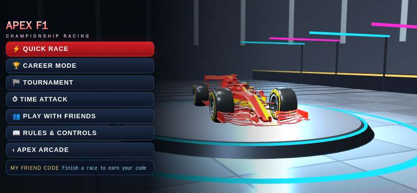 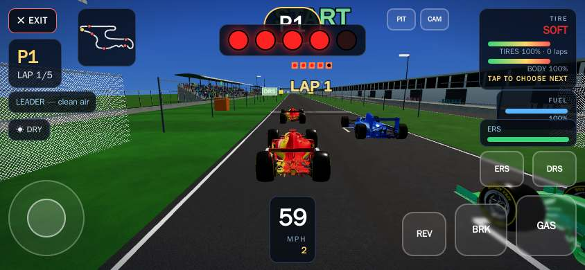 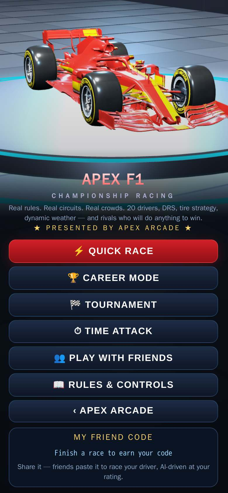 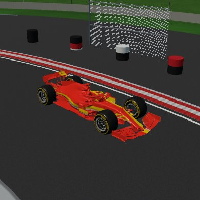

# Not changed since the last check

These games' files didn't change, so the robot kept their last result (played at main @ `a37e873`). A full check of every game runs every 4 hours.

## 🔴 FAIL — Apex Soccer

`apexsoccer.html`

- 🔴 Owner's fix NOT done yet: "Players do not play correctly - pass like real soccer" [test id: ai-builds-up-with-passes] (AI team completed only 0 passes in 16s of possession (need 3+))
- 🔴 Owner's fix NOT done yet: "Players do not play correctly - position like real soccer" [test id: team-positioning] (back line did not push up: defenders average x=-34.9 (anchors are -34) with the ball at +30)
- 🟡 No owner-approved venue - build it from venues/soccer.md (real sizes, stands all around, crowd) with venues/kit in tools/venue-viewer.html, add it to MODELS.md as WAITING OWNER
- 🟡 Stutter: 8 short freezes in 6 s of play (worst 1567 ms, normal frame 17 ms) - usually new objects made every frame (garbage), big pictures loaded mid-game or a model built during play; build everything before play starts and reuse objects (STUDIO-STANDARD.md "Phone budget")
- 🟡 looks/apexsoccer.md has no "WHERE THINGS ARE" map at the top (STUDIO-STANDARD 9.7) - add one with line numbers and keep it current
- 🟡 Play test failing: "a goal restarts from the centre spot" [test id: play-goal-restarts-centre] (after a goal the ball did not restart from the centre spot)
- 🟡 Not on the shared controls yet (kit/controls.js) - its job moves this game over; until then its own stick code is allowed
- 🟡 No friend codes yet - add a "👥 Play a friend" button (My code / Enter a friend's code) with ApexKit.friend and a 'play-friend-code' test (STORE-READY.md "Friend codes")
- 🟡 No REALITY hook yet (window.__reality) - add it so the robot can measure direction, sizes and ground contact (REALITY.md "Robot hook")
- 🟡 No close-up of the player: no player in the hook (REALITY.md hook: player)

**Owner's fix list** (9 of 12 done):
- ✅ The stadium is still not right - make it a real soccer stadium: stands all around, lights, a crowd
- ✅ The players do not steal the ball - computer players must tackle and win the ball
- ✅ Players do not play correctly - mark like real soccer
- ✅ Players do not play correctly - spread out like real soccer
- ❌ Players do not play correctly - pass like real soccer — AI team completed only 0 passes in 16s of possession (need 3+)
- ❌ Players do not play correctly - position like real soccer — back line did not push up: defenders average x=-34.9 (anchors are -34) with the ball at +30
- ✅ computer players win the ball back within 30 s
- ✅ players keep their positions (formation discipline, not everyone chasing)
- ❌ a goal restarts from the centre spot — after a goal the ball did not restart from the centre spot
- ✅ 11 v 11 - ten outfield players plus a goalkeeper per team
- ✅ kick-off starts from the centre spot
- ✅ A call, notification or hidden tab lets go of the stick, keys, sprint and a charged shot (the shot is cancelled, never fired)

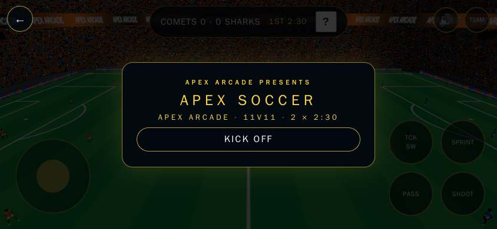 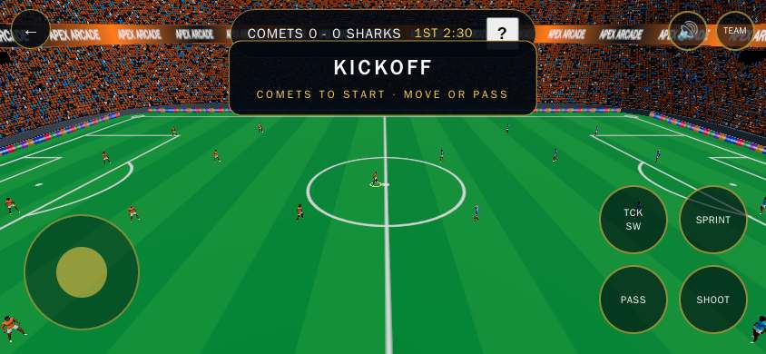 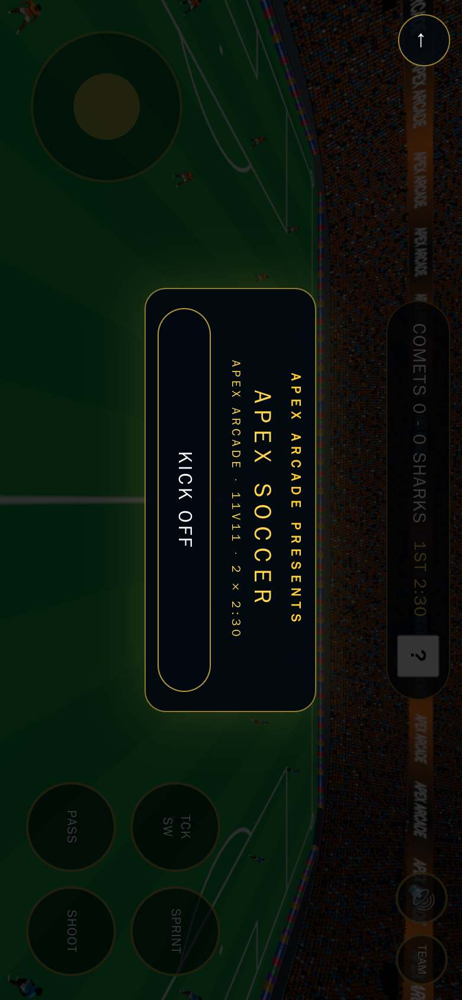

## 🔴 FAIL — Apex Track & Field

`apextrackfield.html`

- 🔴 Owner's fix NOT done yet: "FIND F-T-004 (T10-36): the career season-4 championship final can be LOST after winning most events - the meet standings are computed from rivalMark() draws, not from the marks actually achieved in the events (DONE.md section 8: results must match reality). A final lost with 3+ firsts must not happen." [test id: tester-career-final-sweep-loss] (test error: took over 60 s)
- 🔴 Owner's fix NOT done yet: "FIND F-T-005 (T10-77): a tournament head-to-head can ELIMINATE the player after they WIN the race - tournMatchDone decides advancement from a fresh rivalMark() draw, not from the mark the rival actually achieved in the race just run (same class as F-T-004, DONE.md section 8: results must match reality). Winning a round 1st must advance you; a results screen reading "(1st) - ELIMINATED" must never appear." [test id: tester-tourn-first-eliminated] (test error: took over 60 s)
- 🔴 Owner's fix NOT done yet: "NEVER (G-393): the sprinter sole sits on the track in run and start poses - no sole reading more than 1 cm under in the set crouch or the sprint" [test id: never-g-393-p1] (the sprint sole dips 2.0 cm under the track - it must sit on the track (0-1 cm))
- 🔴 Owner's fix NOT done yet: "FIND F-T-002 (T10-38 RE-OPENED): the championship results MENU and NEXT EVENT buttons stick out past the viewport - DONE.md says no interactive element is off-screen. The free-play proof test passes, but championship event-1 buttons measure bottom 509 px in a 390 px viewport (119 px past). Both buttons must sit fully inside the viewport on the championship results screen." [test id: tester-champ-results-btns-viewport] (championship results button bResMenu measures 288x48 px at 132,499 in a 844x390 viewport - it sticks out past the screen edge (F-T-002))
- 🟡 LINT fixes/apextrackfield.mjs: 27 h.eval call(s) navigate / wait / poll with no .catch (a destroyed execution context fails the test on the robot only) - first ones: real-sprint-animation line 39, runners-stand-upright line 83, career-never-stalls line 295. Add .catch(() => false) or try/catch. Run: node tools/game-check/fixes-lint.mjs tools/game-check/fixes/apextrackfield.mjs
- 🟡 Not on the shared controls yet (kit/controls.js) - its job moves this game over; until then its own stick code is allowed
- 🟡 Friend codes have no 'play-friend-code' test yet (STORE-READY.md "Friend codes")
- 🟡 REALITY: the hook has no time() - add time: () => <game seconds> and speed: () => <m/s> so a busy robot cannot mistake a sprint for walking (REALITY.md)
- 🟡 Play test failing: "A call or notification must never leave the player steering by itself: the held stick resets to centre on window blur and when the page hides" [test id: play-stick-resets-on-interruption] (test error: page.evaluate: Execution context was destroyed, most likely because of a navigation)
- 🟡 Career mode has NO playability test - add 'play-career-...' tests that start every career level, play it to the end and unlock the next (STORE-READY.md "Career mode")
- 🟡 Play test failing: "OWNER (2026-10-20): Hurdles (110m and 400m) - only the player jumps the hurdles; the other runners run through them. Every runner must jump every hurdle in his lane" [test id: play-hurdles-every-runner-jumps] (110h: runner 7 ran through hurdle 10 instead of jumping it (best height near it: 0) - every runner must jump every hurdle in his lane)
- 🟡 Play test failing: "OWNER (2026-10-20): Triple jump - play it start to finish like a real meet and fix what is not real" [test id: play-triple-jump-hop-step-jump-into-pit] (the jump does not land in the sand pit - he came down at x -17.8 and the pit runs from -29.5 to -18.5)
- 🟡 Play test failing: "Final results show ONE table and ONE menu button (not the standings twice, not MENU and BACK TO MENU together), and the top-left words sit on a dark backing" [test id: play-results-one-table-one-menu-button] (test error: page.evaluate: Execution context was destroyed, most likely because of a navigation)
- 🟡 Play test failing: "A held ACTION button (the discus hold-to-spin) must release when a call or notification interrupts - blur releases it like a finger lift" [test id: play-button-releases-on-interruption] (test error: page.evaluate: Execution context was destroyed, most likely because of a navigation)
- 🟡 Play test failing: "JOB G-83 (owner 5.png): steeplechase - every barrier is ONE barrier across the whole track (not a hurdle in the player's lane only), and the AI runners jump them too" [test id: play-steeplechase-barriers-span-track-ai-jump] (the steeplechase engine has only 0 barriers)
- 🟡 Play test failing: "G-39/G-43 fix (owner): hurdle races need hurdles in EVERY lane - a hurdle stands in front of every runner, not only in the player's lane" [test id: play-hurdles-set-in-every-lane] (the 110m hurdles never loaded (nav: stuck))

**Owner's fix list** (84 of 95 done):
- ✅ Runners must run standing upright like real sprinters
- ✅ Add running lanes and move camera angel back 10 blocks and up 15 blocks and centered behind player
- ✅ Camera 7 m behind the player's runner along the lane direction (it follows the lane around the curves), 2.8 m up, looking at a point 10 m ahead of the runner; it never goes behind the start line into the stands or through any wall - clamp it inside the stadium.
- ✅ The camera never sees a wall in front of the runner at the 100 m start and on the 400 m curve (clamped inside the stadium)
- ✅ CAREER MODE: the levels don't work - every career level must load, play and unlock the next
- ✅ Winning the career championship (final) meet must unlock the next season
- ✅ OWNER (2026-10-20): Pole vault - you can't see the player, he runs on the grass, has no pole and never goes over the bar. Make it a real vault: run down the runway holding a pole, plant it, swing up and over the bar onto the mat, camera beside him so you see it
- ✅ TESTER (G-56): real sizes - the 400m hurdles stand 0.914 m high like real ones (REALITY.md: real sizes in metres, within 15%)
- ✅ TESTER (G-56): real sizes - the 100m hurdles stand 0.838 m high like real ones (REALITY.md: real sizes in metres, within 15%)
- ✅ TESTER (G-105): mobile layout - on an upright phone (390x844) every main-menu button sits on the screen and can be tapped (DONE.md section 3: no interactive element off-screen, in portrait too)
- ✅ TESTER (G-105): controls - every main-menu button is at least the 44x44 CSS px touch target DONE.md section 2 asks for
- ✅ JOB G-83 (owner 4.png): in the 10,000m, after the start the WHOLE field (the player too) moves to lane 1, like a real distance race - nobody runs the whole race alone in an outer lane
- ✅ JOB G-83 (owner 1.png): the career meet results table lists the meet's EVENTS so its column must say EVENT (not ATHLETE), and the big time on the results screen must be the same time the race clock showed at the finish
- ✅ NEVER (G-139): every main-menu button is at least the 44x44 CSS px touch target (DONE.md section 2)
- ✅ NEVER (G-160): one board per hurdle - a hurdle is a single board facing the runner, never two full-size boards crossed at 90 degrees
- ✅ G-171 (Mac, 2026-10-22): apextrackfield.html?test=60h (any EVENTS id) opens that event in Free Play and starts it at once - no menu, no card, no story; in a hurdles event the countdown camera holds every lane’s first hurdle close in frame so the owner can check the hurdles in seconds
- ✅ G-249 r1 (owner): jumping was too hard - the green window on the timing bar was tiny (high jump 0.10-0.22 wide, ~0.1-0.2s), the long jump angle swept at 95 deg/s and you fouled running past the line while setting it, the triple jump marker ran at 1.6/s
- ✅ CHECKLIST T05 (G-260): a tailwind over +2.0 m/s means the time does not count as a record, shown as "w" (rules/trackfield.md) - the sprint results screen must show a wind reading, and a wind-aided time must carry the "w" mark instead of counting as a best
- ✅ NEVER (G-267 round 1): 10,000m - mashing the run controls faster than any human cadence must not make the player faster (tester-10000m-mash-no-speed-exploit: 30 game-s of striding on every tick must not average more than 8.6 m/s).
- ✅ NEVER (G-289): the relay changeover-zone markings are not found in the relay event on a slow load - the zones must paint at race start on the scene alone, not wait for the full 3D load
- ✅ NEVER (G-289): a tailwind over +2.0 m/s still counts as a record - the sprint results screen must show a wind reading, a wind-aided time must carry the "w" mark, and it must never be saved as a best
- ✅ CHECKLIST T11 (G-316): the long jump runway is 40 m - venues/track.md. The runway mesh length must be within 3% of 40 m.
- ✅ FIND F-T-001 (T10-1): the MUTE button is 34 px in one dimension on every screen - DONE.md says touch targets are >= 44x44 CSS px. The MUTE button must measure at least 44x44 px.
- ❌ FIND F-T-004 (T10-36): the career season-4 championship final can be LOST after winning most events - the meet standings are computed from rivalMark() draws, not from the marks actually achieved in the events (DONE.md section 8: results must match reality). A final lost with 3+ firsts must not happen. — test error: took over 60 s
- ❌ FIND F-T-005 (T10-77): a tournament head-to-head can ELIMINATE the player after they WIN the race - tournMatchDone decides advancement from a fresh rivalMark() draw, not from the mark the rival actually achieved in the race just run (same class as F-T-004, DONE.md section 8: results must match reality). Winning a round 1st must advance you; a results screen reading "(1st) - ELIMINATED" must never appear. — test error: took over 60 s
- ✅ Make camera angle always right behind player. And make the runners 3D humans from the studio. Make lanes for each tracker runner 1-7 and make finish line banner or floor marking to cross.
- ✅ Holding the stick must never block TAP RUN / HURDLE - two thumbs at once
- ✅ On the long relay / long races around the track a RED button turns on and blocks running - no button may ever block TAP RUN, and holding the stick never blocks it
- ✅ DISCUS: too many steps - make it ONE simple action (hold to spin, release to throw, like a real thrower; at most 2 taps) and the camera must show the thrower clearly from behind/side, never hidden behind the power bar
- ✅ JOB J42 (owner): 1500 m and every long race - the camera stays LOW behind the player runner and follows him around the track, never up over the stands where he is a speck
- ✅ JOB J42 (owner): DISCUS (and shot put, javelin) - after the throw, the camera follows the implement through the air and shows its landing marker
- ✅ OWNER (2026-10-20): High jump - he runs on the grass away from the bar. He must run up to the bar and go over it onto the mat
- ❌ A call or notification must never leave the player steering by itself: the held stick resets to centre on window blur and when the page hides — test error: page.evaluate: Execution context was destroyed, most likely because of a navigation
- ✅ JOB G-75 (owner + Grok audit): the main menu buttons (Career / Tournament / Free play / Code / Add rival / How to play) fall off-screen on a sideways phone - every menu control must fit inside the 844x390 screen with the panel fully shown (no scrolling)
- ✅ JOB G-75 (owner): too slow on phones - a touch device must START on the STORE-READY light path (quality level already light from the first frame, shadows and anti-aliasing off), not reach it only after seconds of low fps
- ✅ JOB G-83 (owner 3.png): the 4x100 relay must start at the REAL staggered relay start - never a line-up under the FINISH banner - and every lane has starting blocks
- ✅ G-122: on an upright phone (390x844) every main-menu button is on the screen and the far buttons can really be tapped
- ✅ TESTER (G-130): one board per hurdle - a hurdle is a single board facing the runner, not two full-size boards crossed at 90 degrees (the sideways copy sticks through the middle of every hurdle and shows as cross/plus shapes and extra hurdles between the real ones)
- ✅ G-193 r1: the relay PASS button works from the start of the exchange zone - the receiver is in reach when the carrier arrives, not only in the last metres
- ✅ G-244 (art director): the 60m field waits on ONE start line until the player starts - no rivals racing off alone, no 7th place at 0m with the clock running
- ✅ CHECKLIST T04 (G-259): the relay baton changeover zone is 30 m long (rules/trackfield.md) - the green zone markings painted on the track in the relay event must span 30 m, within 3%
- ✅ TESTER (G-234): real sport - the 300m Hurdles has 7 hurdles per lane like the real 300m hurdles (rules/short/apextrackfield.md: every event is the REAL sport start to finish).
- ✅ G-267 (owner): the live race camera never has a wall between it and the runner - the wall check ray must target the runner (its length must match the camera-to-runner distance) and 4 samples must all read clear (today the ray targets the infield centre because ox/oz are never written)
- ✅ NEVER (G-267 round 1): the 300m Hurdles has 7 hurdles per lane like the real 300m hurdles (tester-300mh-hurdle-count).
- ✅ G-289 r1: throws get 3 attempts plus 3 more for the top 8 - the Shot Put ends with 6 attempts, the Discus still ends with 1
- ✅ CHECKLIST T12 (G-326): the high jump bar is 2.0-2.4 m for men - REALITY.md. The bar height values offered in the men's high jump must all lie in 2.0-2.4 m.
- ❌ NEVER (G-393): the sprinter sole sits on the track in run and start poses - no sole reading more than 1 cm under in the set crouch or the sprint — the sprint sole dips 2.0 cm under the track - it must sit on the track (0-1 cm)
- ✅ FIND F-T-002 (T10-1): the results MENU and NEXT EVENT buttons stick out past the viewport and are cut in half by the results panel - DONE.md says no interactive element is off-screen. Both buttons must sit fully inside the viewport on the results screen.
- ✅ FIX F-T-004: the career championship standings must score each rival from the mark they actually achieved in the event (not a fresh rivalMark() draw made at meet start). Forces every rival to a hopeless mark in event 1 and fails if any rival is still credited with hundreds of points.
- ✅ FIND F-T-006 (T10-79): a tournament head-to-head can CROWN the player CHAMPION after they LOSE the race - tournMatchDone still decides advancement from a fresh rivalMark() draw on sprint events, because the sprint/distance/hurdles engines have no ENG.aiBest for the F-T-005 fix to read (only field engines do), so the fresh draw is the fallback. Losing a head-to-head round must eliminate you (DONE.md section 8: results must match reality; the tournament hint says Win your head-to-head each round); a results screen reading TOURNAMENT CHAMPION after a (2nd)-place finish must never appear. Proof test forces the worst case in the final: the live rival target time is set to 40.0 s (he wins) and the player points are scored at 1100 (above any fresh draw at 1025, below the 1200 the rival scores from his achieved mark).
- ✅ Final standings headline read 'YOU WINS THE APEX GAMES' (F-T-003)
- ✅ I can't play Track & Field - no way to control it
- ✅ Runners must run with natural arm and leg motion - a real sprint animation, not posed bones
- ✅ Sprinters wear a track singlet kit, not a soccer kit
- ✅ A real 400m oval: 8 lanes of 1.22m, lane 1 lap is 400m
- ✅ Staggered starts for 200m/400m and every runner in his own lane
- ✅ A real college track stadium: seating all the way around the oval, 30,000+ crowd
- ✅ Career mode must never stall
- ✅ Held upright the game fills the WHOLE screen sideways (the robot fails under 90%)
- ✅ KEEP - LOCKED (owner checked JOB J7, 2026-10-17, HE LIKES IT): 'how it looks and how it runs now - the stadium, crowd, track, runners, sharp picture, start camera' - no Muse may change it
- ✅ DEV-ONLY "Skip level" button (STORE-READY "Developer skip"): with dev=1 in the address, career mode shows a small Skip level button that wins the current level and moves to the next, saving like a real win; it must NEVER show without dev=1
- ✅ Hurdles don't fall if you run into them - a hurdle you hit must go down (steeplechase barriers stay up, like real ones)
- ✅ I can't jump in the long jump / triple jump - an early takeoff must still be a legal jump (measured from the board), only crossing the line is a foul
- ✅ I'm running super fast in the long races - distance races must run at real speed (no fast-forward), long ones join at 700m to go
- ✅ The 800m started everyone at the finish line under the FINISH banner - it must start staggered in lanes like the real race
- ✅ The career is only 3 events - it needs about 50 (meets) and more track & field events
- ✅ Friend codes: 'play a friend' - my TFAPEX code shows on the friend-code screen, a friend's code adds them as a rival at their rating, and they line up against you in a real race
- ❌ OWNER (2026-10-20): Hurdles (110m and 400m) - only the player jumps the hurdles; the other runners run through them. Every runner must jump every hurdle in his lane — 110h: runner 7 ran through hurdle 10 instead of jumping it (best height near it: 0) - every runner must jump every hurdle in his lane
- ✅ OWNER (2026-10-20): 4x100 relay - nobody is waiting to take the baton. Show the next teammate standing in the exchange zone, starting to run as you come, and a real baton hand-off; same for the other teams
- ✅ OWNER (2026-10-20): the FINISH banner covers the timer at the top left
- ✅ OWNER (2026-10-20): Long jump - play it start to finish like a real meet and fix what is not real
- ❌ OWNER (2026-10-20): Triple jump - play it start to finish like a real meet and fix what is not real — the jump does not land in the sand pit - he came down at x -17.8 and the pit runs from -29.5 to -18.5
- ✅ Good play can win: striding at a strong human cadence (8 taps/s, alternating) the player wins the 200m outright, matches the best rival over 100m, and podiums in the 400m - he is not locked to last place
- ❌ Final results show ONE table and ONE menu button (not the standings twice, not MENU and BACK TO MENU together), and the top-left words sit on a dark backing — test error: page.evaluate: Execution context was destroyed, most likely because of a navigation
- ❌ A held ACTION button (the discus hold-to-spin) must release when a call or notification interrupts - blur releases it like a finger lift — test error: page.evaluate: Execution context was destroyed, most likely because of a navigation
- ✅ JOB G-83 (owner 2.png): EVERY race starts with ALL runners on the start line together - nobody ahead of the line and nobody already running when the gun goes
- ❌ JOB G-83 (owner 5.png): steeplechase - every barrier is ONE barrier across the whole track (not a hurdle in the player's lane only), and the AI runners jump them too — the steeplechase engine has only 0 barriers
- ✅ TESTER (G-56): real sizes - the 300m hurdles stand 0.914 m high like real ones (REALITY.md: real sizes in metres, within 15%)
- ❌ G-39/G-43 fix (owner): hurdle races need hurdles in EVERY lane - a hurdle stands in front of every runner, not only in the player's lane — the 110m hurdles never loaded (nav: stuck)
- ✅ owner 2026-10-21: "Why are the racers so far back into the wall stands" - at the start of a straight race (110m hurdles) every racer stands ON the painted track in his own lane, never out past the end of the straight in the stands
- ✅ NEVER (G-122): the 400m and 300m hurdles stand 0.914 m high like real ones (the robot FAIL lines of G-122 round 1)
- ✅ NEVER (G-139): feet do not sink into the ground - REALITY sampling at the menu (12 samples, go(true)) finds no more than 20% of foot readings more than 5 cm under
- ✅ NEVER (G-160): one board per hurdle - a hurdle is a single board facing the runner, never two full-size boards crossed at 90 degrees
- ✅ TESTER (G-183): 10,000m - the results order matches who actually crosses the finish line first on the track (REALITY.md: finishing order = who crossed first). The player joins the leaders with 700m to go; if he runs the live segment fastest and crosses the line first, the results must place him 1st - a rival who is still short of the line cannot be credited ahead of him with a faster total time built from his own private early pace.
- ✅ NEVER (G-174, owner video 2026-10-22): hurdles facing the wrong way - a hurdle board front faces the approaching runner: dot(board normal, lane tangent) = -1 at every hurdle, never 0 (edge-on)
- ✅ OWNER 2026-10-23: after a Free Play event the results bring you back to the free play menu to pick something else, and the event menu has its BACK button at the top (to the main menu)
- ✅ TESTER (G-200, BREAK round): 10,000m - mashing the run controls faster than any human cadence must not make the player faster. Stride input needs a rate cap: after settling into the run, 30 game-seconds of striding on EVERY tick (60/s) must not average more than 8.6 m/s (honest 0.30 s alternating cadence measured 7.56 m/s average, peak 7.97, on 2026-10-22; rivals are capped near 5.5-6.3 m/s).
- ✅ TESTER (G-271, checklist T07): throws get 3 attempts (plus 3 more for the top 8) - rules/trackfield.md.
- ✅ G-249 r2 point 2 (owner, CHECKLIST T04): the relay baton changeover zone is 30 m long - the green zone markings painted on the track in the relay event must span 30 m, within 3% (today: 20.08 m on average)
- ✅ G-249 r2 point 1 (owner): runners must run with natural arm and leg motion - a real sprint animation, not posed bones (mirrors the hardened real-sprint-animation sampling: thighL range over a full cycle must reach 0.70 rad; the old 1.4s wall window read 0.43 rad on the ~3fps robot while the same clip measures 1.85+ rad over a full cycle)
- ✅ G-289 r1: relay zones paint at race start even when arriving from another race already playing (the main-check arrival)
- ✅ TESTER (G-311, checklist T10): the shot put landing sector is 34.92 degrees - venues/track.md.
- ✅ Balance: tapping with a rhythm wins medals, mashing one side is slower, and doing nothing does not reach the medals
- ✅ CHECKLIST T13 (T10-5): the pole vault pole is 4.5-5.2 m long - REALITY.md. The held pole mesh length in the running game must be inside the 4.5-5.2 m band.
- ❌ FIND F-T-002 (T10-38 RE-OPENED): the championship results MENU and NEXT EVENT buttons stick out past the viewport - DONE.md says no interactive element is off-screen. The free-play proof test passes, but championship event-1 buttons measure bottom 509 px in a 390 px viewport (119 px past). Both buttons must sit fully inside the viewport on the championship results screen. — championship results button bResMenu measures 288x48 px at 132,499 in a 844x390 viewport - it sticks out past the screen edge (F-T-002)

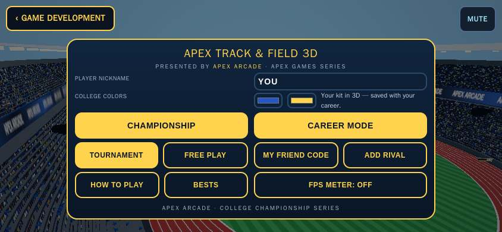 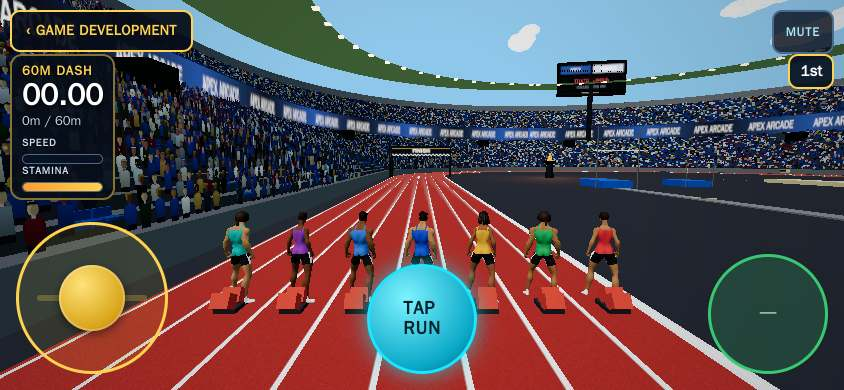 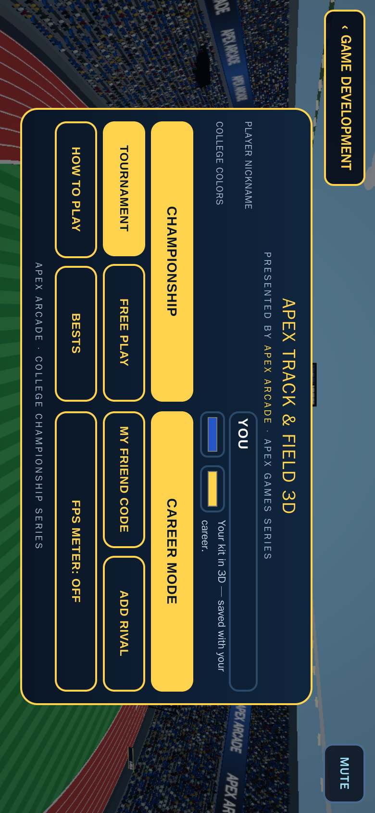 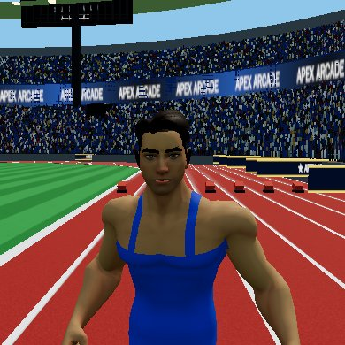

## 🟡 CHECK — Apex Baseball

`apexbaseball.html`

- 🔴 Owner's fix NOT done yet: "In the WIDE camera view the 3D area shows the ballpark and field (colourful), never a uniform gray void" [test id: tester-wide-camera-shows-field] (WIDE camera shows a uniform gray void: colourfulness 27.7 in the 3D band (AUTO view shows 70+, threshold 30))
- 🟡 No owner-approved venue - build it from venues/ballpark.md (real sizes, stands all around, crowd) with venues/kit in tools/venue-viewer.html, add it to MODELS.md as WAITING OWNER
- 🟡 LINT fixes/apexbaseball.mjs: 3 h.eval call(s) navigate / wait / poll with no .catch (a destroyed execution context fails the test on the robot only) - first ones: play-feet-within-3cm line 838, play-camera-follows-pitch line 1195, play-contact-big-at-plate line 1248. Add .catch(() => false) or try/catch. Run: node tools/game-check/fixes-lint.mjs tools/game-check/fixes/apexbaseball.mjs
- 🟡 Play test failing: "The owner's new ballpark (Apex Arcade Park) loads with its crowd, presented as the night park it is (G-40)" [test id: play-stadium-loads] (the ballpark loaded but the game still shows the old daytime look - his park is a night park (floodlights, dark sky))
- 🟡 Play test failing: "BUILD G-237: batting timing is scored on the pitch game clock, not the wall clock - a swing made as the ball crosses the plate contacts or fouls instead of always whiffing (G-184/G-237)" [test id: play-batting-timing-game-clock] (never reached a swing at the plate in 29 s (game too slow to reach a bottom-half pitch at the plate))
- 🟡 Play test failing: "BUILD G-222 (owner order Oct 22): the contact moment is big at the plate - as the pitch reaches the plate the batter fills the frame (not a speck), so you see the ball meet the bat" [test id: play-contact-big-at-plate] (the batter is still a speck when the pitch reaches the plate: 0 px tall of 390 at the contact moment (target at least 80; the frozen G-167 framing measured ~42))
- 🟡 Not on the shared controls yet (kit/controls.js) - its job moves this game over; until then its own stick code is allowed
- 🟡 REALITY (yellow - no time()/gait() in the hook, so the robot cannot tell a sprint start from walking): wheels/feet/skates FLOAT above the ground while standing/walking (3 of 3 readings over 3 cm, highest 0.26 m)
- 🟡 REALITY (yellow - no time()/gait() in the hook, so the robot cannot tell a sprint start from walking): feet/skates/wheels never touch down while moving fast - no touchdown for 2.1 s (a sprint lands a foot at least every 0.5 s; lowest 0.00 m)
- 🟡 REALITY: the hook has no time() - add time: () => <game seconds> and speed: () => <m/s> so a busy robot cannot mistake a sprint for walking (REALITY.md)
- 🟡 Stutter: 9 short freezes in 6 s of play (worst 550 ms, normal frame 50 ms) - usually new objects made every frame (garbage), big pictures loaded mid-game or a model built during play; build everything before play starts and reuse objects (STUDIO-STANDARD.md "Phone budget")
- 🟡 Play test failing: "BUILD G-394: every player sole rests on the ground - lowest posed sole vertex within 2 cm under or over the ground (ground 0, mound 0.3) for every rigged player, standing" [test id: play-feet-on-ground] (lineup5 sole -0.051 m; lineup6 sole -0.051 m — outside the 2 cm band)
- 🟡 Play test failing: "BUILD G-222 (owner order Oct 22): the camera follows the windup and the pitch in flight - it moves with the play and keeps the ball on screen until it reaches the plate" [test id: play-camera-follows-pitch] (the camera is frozen during the pitch flight: 0 distinct position(s) (owner: the camera follows the pitch in flight))
- 🟡 Friend codes have no 'play-friend-code' test yet (STORE-READY.md "Friend codes")

**Owner's fix list** (47 of 53 done):
- ✅ Make a baseball stadium
- ✅ Players are real-proportioned people, about 1.85 m tall (G-65)
- ✅ Cameras are the TV broadcast spec: field of view 40-45 degrees, and the pitching view sits high on the centre-field side behind the pitcher (G-65)
- ✅ Stick proof 2 of 3 (real touch): drag the aim pad, the touch is cancelled (pointercancel, e.g. a call comes in) - the stick resets to zero (G-85)
- ✅ Stick proof 3 of 3 (real touch): drag the aim pad, the window loses focus (blur, e.g. app switch) - the stick resets to zero (G-85)
- ✅ KEEP: everything that works and looks right now (batting flow)
- ✅ Pitcher throws the ball toward the plate
- ✅ Three outfielders visible who chase fly balls (KEEP)
- ✅ Stadium has a crowd (venue sheet: 25,000+)
- ✅ Score, inning, balls/strikes/outs track correctly
- ✅ Day lighting: batter clearly visible (KEEP: no night-dark, no green tint)
- ✅ Gameplay picture must not freeze (no slowmo)
- ✅ Menu has a Play a friend button (G-08)
- ✅ Play a friend with a friend code (G-08)
- ✅ Play baseball by its rules: a batter puts the ball in play and gets a hit (hit)
- ❌ The owner's new ballpark (Apex Arcade Park) loads with its crowd, presented as the night park it is (G-40) — the ballpark loaded but the game still shows the old daytime look - his park is a night park (floodlights, dark sky)
- ✅ The park field wears the owner's kit grass + infield dirt textures (G-51)
- ✅ TESTER: menu overlay buttons hang off the bottom of a sideways phone - Help CLOSE is fully below the screen (overlay does not scroll, so Help cannot be closed) and the Friend START/CLOSE buttons are cut off
- ✅ TESTER: the ball/strike count never resets after a strikeout or a walk - the next batter starts with the old count (the banner shows counts like 4-2), so he strikes out on one strike or walks on one ball
- ✅ TESTER: the ? (help) button at the top right sits on top of the CAM button - the CAM label is partly covered and the covered part cannot be tapped
- ❌ BUILD G-237: batting timing is scored on the pitch game clock, not the wall clock - a swing made as the ball crosses the plate contacts or fouls instead of always whiffing (G-184/G-237) — never reached a swing at the plate in 29 s (game too slow to reach a bottom-half pitch at the plate)
- ✅ BUILD G-146 (art director): every player stands ON the ground - soles measured on the skinned body (the reality robot method) across standing and the batter trot: 0 readings sunk more than 5 cm and every reading within 3 cm of the ground
- ✅ BUILD G-151 (art director): the play picture is a DAY scene - bright frame, the stands full of visible crowd people, and the batter big and lit above the bottom bar in the pitching view and with the ball in play
- ✅ the batter close-up shows his face and eyes (no helmet blob over them) and a full baseball uniform - button-front jersey in the team colour, no printed tee logo
- ✅ NEVER (G-167 fix round 1, 2026-10-22): the pitching camera sits so far back that the players are specks - zoom in so the batter and catcher read big in the play picture
- ✅ BUILD G-222 (owner order Oct 22): the pitcher stands fully inside the pitching frame - head and feet on screen, not cut off below it
- ❌ BUILD G-222 (owner order Oct 22): the contact moment is big at the plate - as the pitch reaches the plate the batter fills the frame (not a speck), so you see the ball meet the bat — the batter is still a speck when the pitch reaches the plate: 0 px tall of 390 at the contact moment (target at least 80; the frozen G-167 framing measured ~42)
- ✅ BUILD G-248: the REALITY hook reports unitsPerMetre 1.0936 (the game runs on 3 ft units, 1 unit = 0.9144 m) so the robot and testers read metres (REALITY.md Units)
- ✅ BUILD G-262: during a pitch flight window.__test.flightT reports the thrown pitch's own game time (fast 0.95 / curve 1.18 / change 1.38) so the batting-timing test judges each flight against its own T instead of a hardcoded fastball
- ✅ CHECKLIST B01: Bases are 27.4 m apart (REALITY.md) - distance between neighbouring base objects, within 3%
- ✅ tester-chk-b03
- ✅ BUILD G-269: the batting order has 9 distinct batters (rules/baseball.md) - nine bat-holding figures stand in the scene, not the same one figure for every at-bat
- ✅ The batting order has 9 batters (rules/baseball.md)
- ✅ Balance: a batter who times it well makes hard contact, a batter who never swings does not, and a beginner can still hit
- ✅ WIDE camera must show the ballpark: in wide view the field, players and ball are visible, not a gray void
- ✅ The first menu picture already shows the new ballpark: a loading screen covers the game until Apex Arcade Park has loaded, and only then does the menu open (G-79)
- ✅ Stick proof 1 of 3 (real touch): drag the aim pad, lift the finger (pointerup) - the stick lets go, nothing stays held (G-85)
- ✅ The umpire stands behind the batter (behind the catcher) - never a second man stacked on the pitcher (owner G-85 fix)
- ✅ Play baseball by its rules: a pitch is thrown toward the plate and the count moves (pitch)
- ✅ Play baseball by its rules: an out is recorded on a strikeout, a catch or a ground out (out)
- ✅ Play baseball by its rules: a run crosses the plate and the score goes up (run scores)
- ✅ Play baseball by its rules: three outs end the half inning and the other side comes in (inning ends)
- ✅ TESTER: batting timing is judged on the wall clock while the pitch flies on game time - on a slow device a fastball takes ~9-12 s of wall time to arrive (game time 0.95 s), but a swing only counts within 0.17 s of the wall-clock mark, so a swing made exactly as the ball crosses the plate is always a swinging strike (G-184: 14 timed swings, 0 contact)
- ✅ BUILD G-120: the REALITY hook exposes camera: (REALITY.md) - the game THREE camera, so the robot can take the player close-up
- ✅ BUILD G-144: the owner kits are really used - crowd, bat crack and glove samples from sounds/stadium/baseball/ decoded and ready, and the kit infield/grass textures from kit/ground/512/ on the park field LIVE material (touch path included)
- ❌ BUILD G-394: every player sole rests on the ground - lowest posed sole vertex within 2 cm under or over the ground (ground 0, mound 0.3) for every rigged player, standing — lineup5 sole -0.051 m; lineup6 sole -0.051 m — outside the 2 cm band
- ✅ NEVER (owner 2026-10-23, G-222 fix round 1): the field and players stay clear and recognizable in the pitching view (crisp rendering - texture anisotropy on the park), and the pitcher glove reads as a glove, never a big brown thing on his arm (a real mitt is ~0.32 m, not a 0.44 m smooth blob)
- ❌ BUILD G-222 (owner order Oct 22): the camera follows the windup and the pitch in flight - it moves with the play and keeps the ball on screen until it reaches the plate — the camera is frozen during the pitch flight: 0 distinct position(s) (owner: the camera follows the pitch in flight)
- ✅ BUILD G-248 (robot red line on PR #1381): on an upright phone (390x844) the Help overlay CLOSE button sits off the left edge of the screen - the rotated stage is 390 tall but the compact-card rules only fire on a sideways phone, so the card lays out 695 tall inside the 390 stage and rotation pushes CLOSE off screen; the CLOSE button must be fully on screen on an upright phone
- ✅ BUILD G-278: a pitch flight completes within its own game time plus 2 s of frame and observation lag on a loaded page (the G-262 fix round 1 cap of +0.75 s failed a correct 0.95 s fastball the robot measured at 1.91 s wall on main ef8ce80)
- ✅ TESTER: on an upright phone the Help overlay CLOSE button sits off the left edge of the screen - Help cannot be closed by tapping without rotating the phone
- ❌ In the WIDE camera view the 3D area shows the ballpark and field (colourful), never a uniform gray void — WIDE camera shows a uniform gray void: colourfulness 27.7 in the 3D band (AUTO view shows 70+, threshold 30)
- ✅ CLOSE camera must show the close-up views: low behind the pitcher while pitching, behind the batter while batting - not the high field view

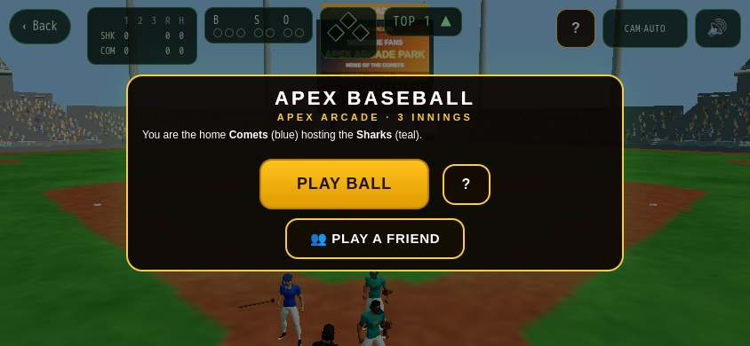 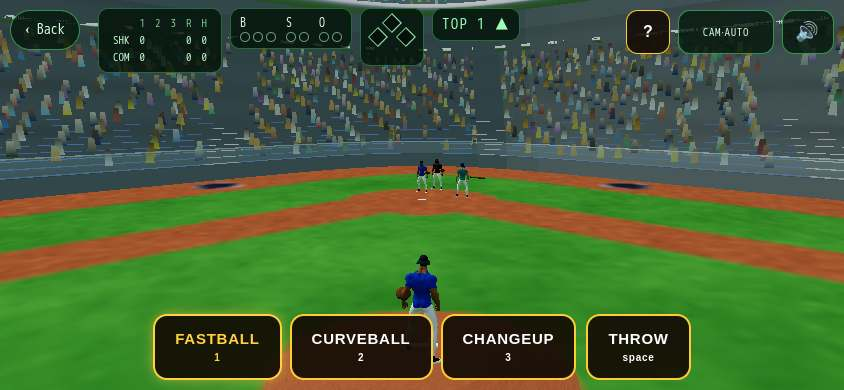 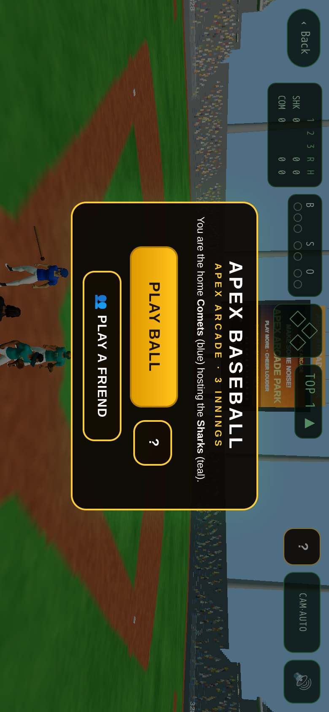 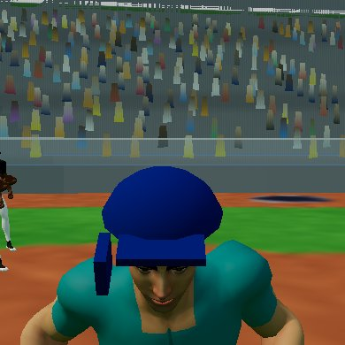

## 🟡 CHECK — Apex Ice Hockey

`apexhockey.html`

- 🔴 Owner's fix NOT done yet: "F-H-001: home AI scores competitively in a full match (not 62-2)" [test id: tester-score-balance] (test error: took over 60 s)
- 🟡 Stutter: 5 short freezes in 6 s of play (worst 1600 ms, normal frame 150 ms) - usually new objects made every frame (garbage), big pictures loaded mid-game or a model built during play; build everything before play starts and reuse objects (STUDIO-STANDARD.md "Phone budget")
- 🟡 LINT fixes/apexhockey.mjs: 3 h.eval call(s) navigate / wait / poll with no .catch (a destroyed execution context fails the test on the robot only) - first ones: play-save-shows-once-camera-holds line 1031, play-save-shows-once-camera-holds line 1043, play-stick-resets-on-blur line 1331. Add .catch(() => false) or try/catch. Run: node tools/game-check/fixes-lint.mjs tools/game-check/fixes/apexhockey.mjs
- 🟡 Play test failing: "the opening faceoff drops the puck at centre ice" [test id: play-faceoff-at-centre] (opening faceoff not at centre: (45.4, -20.8))
- 🟡 Not on the shared controls yet (kit/controls.js) - its job moves this game over; until then its own stick code is allowed
- 🟡 Play test failing: "a goal counts on the scoreboard and restarts from centre ice" [test id: play-goal-restarts-centre] (after the goal the puck did not restart from centre ice)
- 🟡 Play test failing: "the stick lets go when the app loses focus or is hidden mid-hold - hold it pushed, blur or hide the app, and the knob is back at centre (0 px) with no real touchend needed" [test id: play-stick-resets-on-blur] (could not reach live play to test the stick reset)
- 🟡 Only 4 play test(s) - every game needs 5+ tests that play it by its rules (fixes/apexhockey.mjs, ids 'play-...')
- 🟡 Friend codes have no 'play-friend-code' test yet (STORE-READY.md "Friend codes")
- 🟡 Stutter: 10 short freezes in 6 s of play (worst 1350 ms, normal frame 83 ms) - usually new objects made every frame (garbage), big pictures loaded mid-game or a model built during play; build everything before play starts and reuse objects (STUDIO-STANDARD.md "Phone budget")
- 🟡 IDLE RUN: the score "score" went 0 – 0 -> 1 – 0 with nobody touching the game - a goal/point was scored by itself (yellow for now: this game is on the warning list until its AI defends an untouched team)
- 🟡 Play test failing: "skates touch the ice the whole time while skating (gap under 3 cm - never floating above it, never sunk under it)" [test id: play-skates-touch-ice] (the blade contact markers disagree with the measured blades at rest by 7 cm - the skate grounding cannot be trusted)
- 🟡 Play test failing: "a defender takes the puck off an away rush (the rush does not score untouched)" [test id: play-defender-takes-puck] (the away rush scored - no defender took the puck)
- 🟡 Career mode has NO playability test - add 'play-career-...' tests that start every career level, play it to the end and unlock the next (STORE-READY.md "Career mode")
- 🟡 Stutter: 10 short freezes in 6 s of play (worst 1167 ms, normal frame 33 ms) - usually new objects made every frame (garbage), big pictures loaded mid-game or a model built during play; build everything before play starts and reuse objects (STUDIO-STANDARD.md "Phone budget")
- 🟡 Play test failing: "skates sit exactly on the ice and the blades show silver under the boots: the goalie dropping into a butterfly never drags his blades under the ice, and the blade steel is a bright silver that reads as metal, not black" [test id: play-goalie-blades-on-ice] (could not get a match into play to test the goalie blades)

**Owner's fix list** (26 of 33 done):
- ✅ They gave me this - blob players, upright floating sticks and scattered bits
- ✅ How do I get exactly this hockey player? (7.5 head heights, forward lean 15-20, knee flex 25-30, hips back over the heels, wide stance)
- ✅ Helmet with visor, shoulder pads, oversized gloves, padded breezers, shin guards, skates with a wider stance - like my sheet
- ✅ Upright floating sticks
- ✅ Build a nice stadium, a big crowd in the stadium (venues/rink.md)
- ✅ 5 skaters plus a goalie a side, per the rules sheet
- ❌ the opening faceoff drops the puck at centre ice — opening faceoff not at centre: (45.4, -20.8)
- ✅ Joystick must be screen-relative: push right = skate right on screen, even after the skater turns 180
- ✅ Skater must not spin in place: turn speed is limited, glides through turns
- ✅ CLOSE camera: 9m back along long axis, 5m up, never rotates with skater facing
- ✅ Offside only when attacker is really over the blue line (1.5m), not on a skate blade
- ✅ career mode: play weeks 8-10 to the end - finishing the season unlocks the semifinal
- ✅ friend codes: my code is on the menu, a friend code sets up their team, and the friend match result goes on my record
- ✅ the camera never falls through the ice when zooming in: in every view (BROADCAST, HIGH, CLOSE, PLAYER, END) it stays at least 1.5 m above the ice
- ✅ TESTER (G-88): the puck is a real puck size - 7.6 cm across and 2.5 cm thick (REALITY.md), within 15%
- ✅ TESTER (G-88): pressing PLAY in the career hub (PLAY NEXT MATCH) starts the career match
- ✅ BUILD G-110: the arena crowd is one instanced mesh, the static arena is merged, and the favicon cannot 404
- ✅ F-H-002: while skating (turns included) the skates never flip - the toe is ahead of the ankle and the blade stays flat
- ❌ a goal counts on the scoreboard and restarts from centre ice — after the goal the puck did not restart from centre ice
- ✅ career mode: start a career and play weeks 1-4 to the end - each week unlocks the next
- ✅ career mode: play weeks 5-7 to the end - each week unlocks the next
- ❌ the stick lets go when the app loses focus or is hidden mid-hold - hold it pushed, blur or hide the app, and the knob is back at centre (0 px) with no real touchend needed — could not reach live play to test the stick reset
- ❌ F-H-001: home AI scores competitively in a full match (not 62-2) — test error: took over 60 s
- ✅ offside is called when an attacker crosses the blue line before the puck
- ❌ skates touch the ice the whole time while skating (gap under 3 cm - never floating above it, never sunk under it) — the blade contact markers disagree with the measured blades at rest by 7 cm - the skate grounding cannot be trusted
- ✅ after a save, SAVED! shows exactly once (a rebound re-save in the same scramble does not show it again) and the broadcast camera does not rewind: its puck lead swings smoothly instead of snapping when the puck reverses
- ❌ a defender takes the puck off an away rush (the rush does not score untouched) — the away rush scored - no defender took the puck
- ✅ F-H-001: an idle player does not freeze the home team - his skater passes the puck on
- ✅ icing is called on an untouched clear from the defensive half
- ✅ the puck never leaves the rink during play
- ✅ career mode: play the semifinal to the end - winning it unlocks the final
- ✅ career mode: play the final to the end - winning it takes the title and unlocks the next season
- ❌ skates sit exactly on the ice and the blades show silver under the boots: the goalie dropping into a butterfly never drags his blades under the ice, and the blade steel is a bright silver that reads as metal, not black — could not get a match into play to test the goalie blades

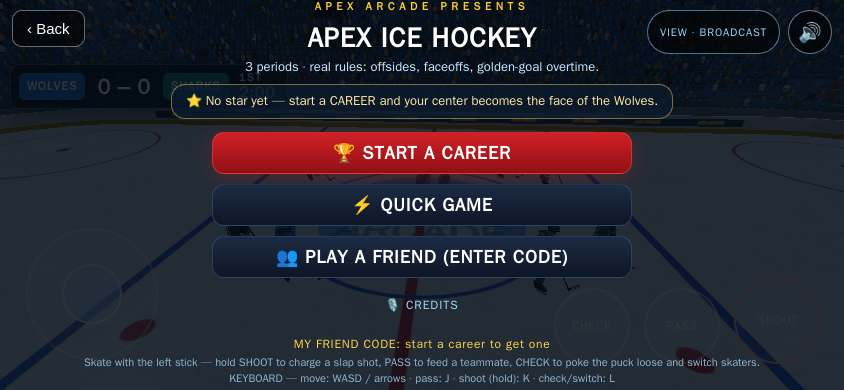 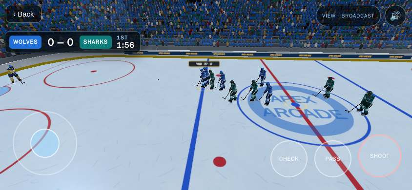

## 🟡 CHECK — Apex Monster Truck

`apexmonstertruck.html`

- 🟡 No owner-approved venue - build it from venues/truck-arena.md (real sizes, stands all around, crowd) with venues/kit in tools/venue-viewer.html, add it to MODELS.md as WAITING OWNER
- 🟡 Stutter: 12 short freezes in 6 s of play (worst 1633 ms, normal frame 17 ms) - usually new objects made every frame (garbage), big pictures loaded mid-game or a model built during play; build everything before play starts and reuse objects (STUDIO-STANDARD.md "Phone budget")
- 🟡 looks/apexmonstertruck.md has no "WHERE THINGS ARE" map at the top (STUDIO-STANDARD 9.7) - add one with line numbers and keep it current
- 🟡 LINT fixes/apexmonstertruck.mjs: 7 h.eval call(s) navigate / wait / poll with no .catch (a destroyed execution context fails the test on the robot only) - first ones: play-drive-forward line 8, play-crush-car line 28, play-jump-airtime line 46. Add .catch(() => false) or try/catch. Run: node tools/game-check/fixes-lint.mjs tools/game-check/fixes/apexmonstertruck.mjs
- 🟡 Play test failing: "Truck drives forward when given speed" [test id: play-drive-forward] (truck only moved 7.5m with sp=30 for 2s)
- 🟡 Play test failing: "Truck landing on a car crushes it and scores" [test id: play-crush-car] (car not crushed after truck dropped on it)
- 🟡 Play test failing: "Truck with upward velocity gets air and lands with gravity" [test id: play-jump-airtime] (truck did not complete jump arc)
- 🟡 Play test failing: "J45: SAME J5 truck at 2x size (~5.4m tall, ~4.2m tires)" [test id: play-real-sizes] (height 7.5m, want ~5.4m (2x J5))
- 🟡 Play test failing: "J45(2): 3-2-1 camera starts high above HIS truck and dives to its back by GO" [test id: play-j45-countdown-dive] (camera not dived by GO (y=110, want ~12.6))
- 🟡 Play test failing: "J45(4): drive stick alone reaches ~90mph with quicker pickup" [test id: play-j45-90mph] (only reached 70mph after 15s, want ~90)
- 🟡 Career mode has NO playability test - add 'play-career-...' tests that start every career level, play it to the end and unlock the next (STORE-READY.md "Career mode")
- 🟡 Not on the shared controls yet (kit/controls.js) - its job moves this game over; until then its own stick code is allowed
- 🟡 No friend codes yet - add a "👥 Play a friend" button (My code / Enter a friend's code) with ApexKit.friend and a 'play-friend-code' test (STORE-READY.md "Friend codes")
- 🟡 No REALITY hook yet (window.__reality) - add it so the robot can measure direction, sizes and ground contact (REALITY.md "Robot hook")
- 🟡 No close-up of the player: no player in the hook (REALITY.md hook: player)

**Owner's fix list** (10 of 16 done):
- ❌ Truck drives forward when given speed — truck only moved 7.5m with sp=30 for 2s
- ❌ Truck landing on a car crushes it and scores — car not crushed after truck dropped on it
- ❌ Truck with upward velocity gets air and lands with gravity — truck did not complete jump arc
- ✅ Engine sound revs with speed (J5: 35Hz idle to 180Hz)
- ✅ Menu and game music play, mute silences all (J5)
- ❌ J45: SAME J5 truck at 2x size (~5.4m tall, ~4.2m tires) — height 7.5m, want ~5.4m (2x J5)
- ✅ J45(1): full-size bowl around course - no toy kit stadium, no black slab
- ❌ J45(2): 3-2-1 camera starts high above HIS truck and dives to its back by GO — camera not dived by GO (y=110, want ~12.6)
- ✅ J45(3): BOOST button is gone
- ❌ J45(4): drive stick alone reaches ~90mph with quicker pickup — only reached 70mph after 15s, want ~90
- ✅ Owner Oct 18 7:43 PM: the truck goes 300 mph (drive stick alone)
- ✅ Owner Oct 18 6:28 / 7:25 / 9:08 PM: engine deep and separate, music has no bass under it, a little louder, steps back a bit while driving
- ✅ Owner Oct 18 9:09 PM: a big loop that launches you into the air + lots of different loops + ramps to jump high into the sky
- ✅ Owner Oct 18 9:42 PM: more individual dirt mounds to jump + dirt tracks everywhere
- ✅ Owner Oct 18 7:52 + 8:08 PM: the engine is HIS tuned recordings mixed (idle, mid, high + supercharger whine on the gas), not the synth
- ✅ A call, notification or hidden tab never leaves the truck steering or driving by itself (sticks, keys and held buttons go back to 0)

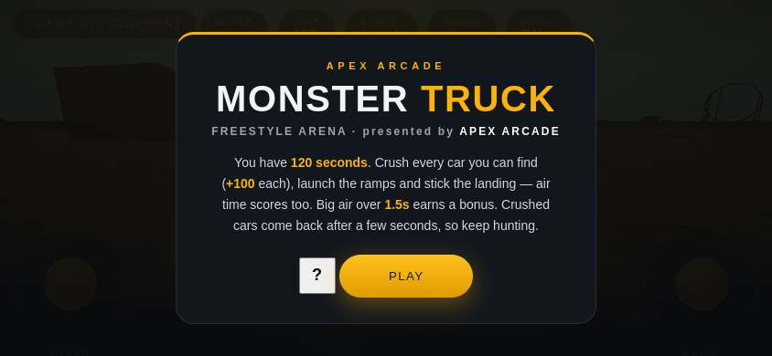 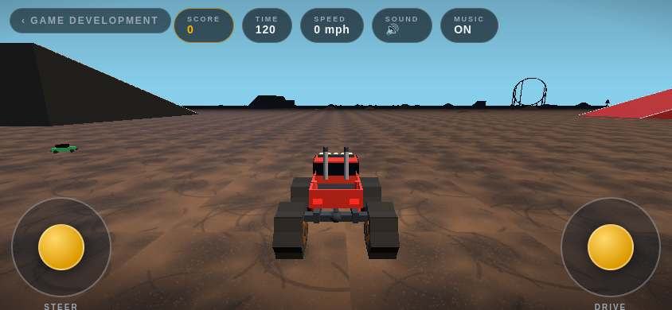 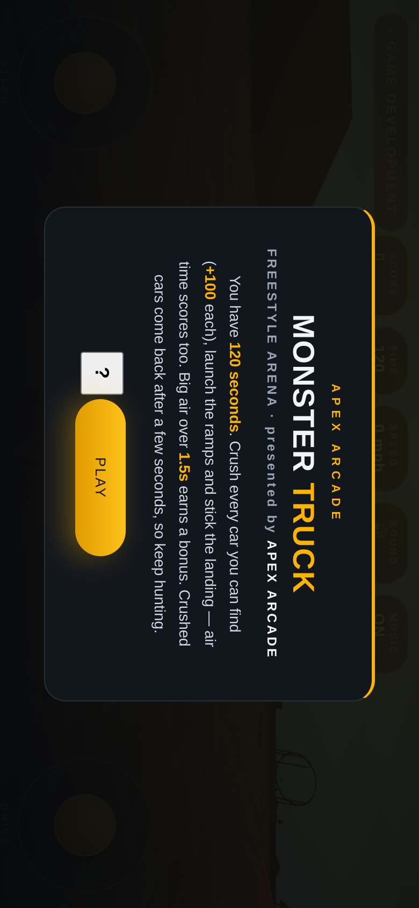

## 🟡 CHECK — Apex Moto

`apexmoto.html`

- 🟡 Stutter: 9 short freezes in 6 s of play (worst 1700 ms, normal frame 50 ms) - usually new objects made every frame (garbage), big pictures loaded mid-game or a model built during play; build everything before play starts and reuse objects (STUDIO-STANDARD.md "Phone budget")
- 🟡 Busy play screen: about 21 words during play (biggest: "‹ GAME DEVELOPMENT") - aim for only button labels and the score; instructions go behind How to play (STUDIO-STANDARD.md "Clean screen")
- 🟡 Heavy for phones: about 597 draw calls per frame (aim under 450; merge meshes - see STUDIO-STANDARD.md "Phone budget")
- 🟡 Play test failing: "Your bike speeds up and rides the track" [test id: play-player-rides] (player at 38 m/s, moved 420 m in 8 s)
- 🟡 Not on the shared controls yet (kit/controls.js) - its job moves this game over; until then its own stick code is allowed
- 🟡 No friend codes yet - add a "👥 Play a friend" button (My code / Enter a friend's code) with ApexKit.friend and a 'play-friend-code' test (STORE-READY.md "Friend codes")
- 🟡 No REALITY hook yet (window.__reality) - add it so the robot can measure direction, sizes and ground contact (REALITY.md "Robot hook")
- 🟡 No close-up of the player: no player in the hook (REALITY.md hook: player)

**Owner's fix list** (7 of 8 done):
- ✅ All the bikes he sent are in the garage, plus green / blue / orange Apex bikes
- ✅ Extra paint jobs like the Epic Cruz
- ✅ More computer racers in the line-up
- ✅ Computer racers race the circuit (no one stuck)
- ❌ Your bike speeds up and rides the track — player at 38 m/s, moved 420 m in 8 s
- ✅ Owner Oct 19: the motorcycle tires are going into the asphalt - tires always sit on top of it, not in it
- ✅ Every CC-BY bike maker is credited
- ✅ A call, notification or hidden tab never leaves the bike steering or driving by itself (sticks, keys and held buttons go back to 0)

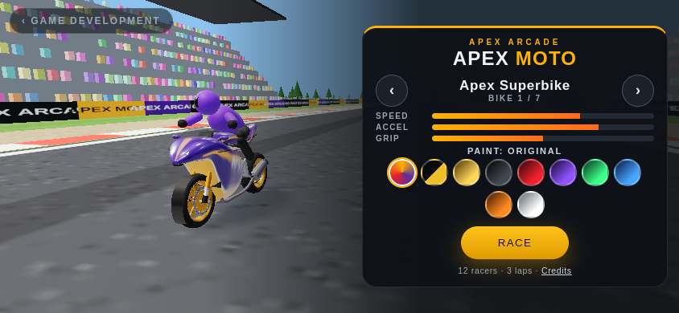 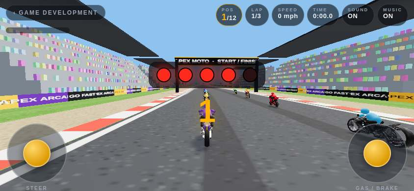 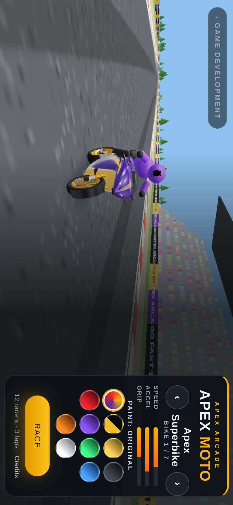

## 🟡 CHECK — Paper Plane

`apexpaperplane.html`

- 🟡 Couldn't press any start button - add/fix this game's steps in games.json
- 🟡 Busy play screen: about 24 words during play (biggest: "Hold to climb · let go to glide") - aim for only button labels and the score; instructions go behind How to play (STUDIO-STANDARD.md "Clean screen")
- 🟡 Only 0 play test(s) - every game needs 5+ tests that play it by its rules (fixes/apexpaperplane.mjs, ids 'play-...')
- 🟡 Not on the shared controls yet (kit/controls.js) - its job moves this game over; until then its own stick code is allowed
- 🟡 No friend codes yet - add a "👥 Play a friend" button (My code / Enter a friend's code) with ApexKit.friend and a 'play-friend-code' test (STORE-READY.md "Friend codes")
- 🟡 No REALITY hook yet (window.__reality) - add it so the robot can measure direction, sizes and ground contact (REALITY.md "Robot hook")
- 🟡 No close-up of the player: no player in the hook (REALITY.md hook: player)

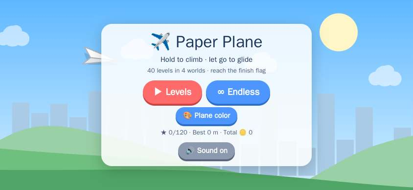 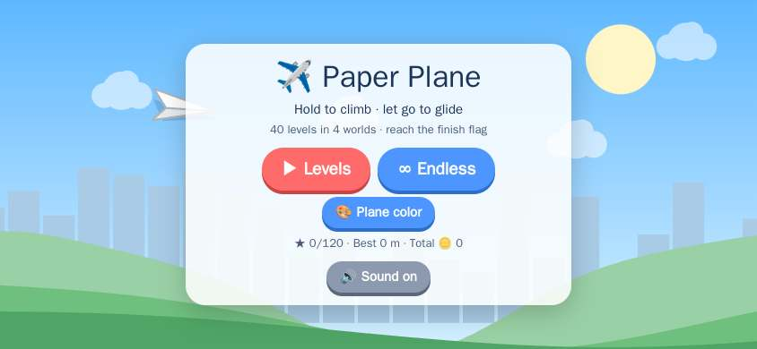 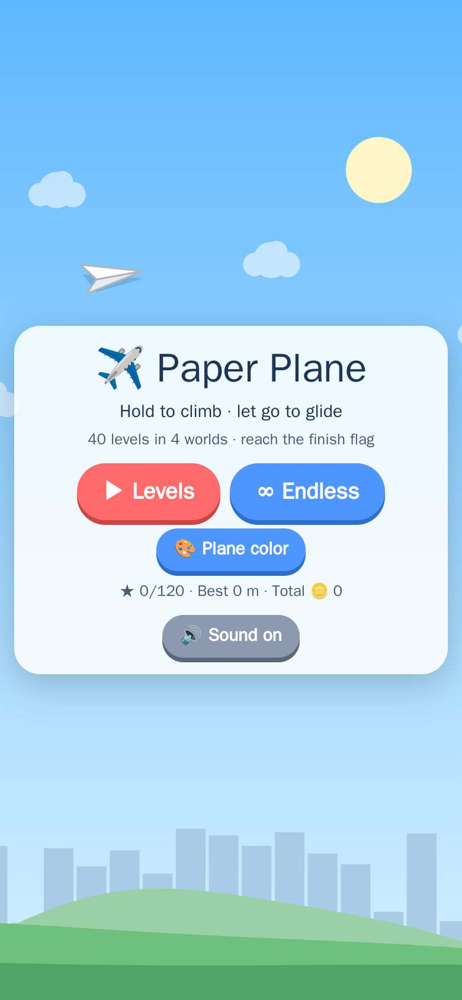

## 🟡 CHECK — Exotic Racer Club

`apexracer.html`

- 🔴 NOT RUN (robot time cap, robot side) - owner's fix not proven: "Do the fetched rims fit IN the tyre: bare rims at a real diameter, face seated at the tyre surface?"
- 🔴 NOT RUN (robot time cap, robot side) - owner's fix not proven: "Do the wraps circuit, dragon paint on the body material with the same mesh count and bounding box as No wrap?"
- 🔴 NOT RUN (robot time cap, robot side) - owner's fix not proven: "Is the brake caliper a small block on a real brake disc, not a red billboard in the wheel?"
- 🔴 Owner's fix NOT done yet: "R13: world min-Y of every car (R.cars + R.traffic) minus road height T.y, at the grid, inside [0, 0.03] m — on main the Patriot-bodied cars sit at about -0.098 m, so the test fails naming them" [test id: tester-chk-r13] (R13: at the grid 13 of 18 cars out of [0, 0.03] m: player -0.077 m; car0:Blaze -0.0977 m; car1:Viper -0.0977 m; car2:Nyx -0.0977 m; car3:Kato -0.0977 m; car4:Rook -0.0977 m; car6:Sable -0.0977 m; car7:Dante -0.0745 m; traffic2 -0.0987 m; traffic4 -0.0762 m; traffic7 -0.0762 m; traffic8 -0.0987 m; traffic9 -0.0987 m)
- 🔴 NOT RUN (robot time cap, robot side) - owner's fix not proven: "Owner Oct 31: every rim style must follow the Rim Color tab - choosing white must not leave an orange or grey rim."
- 🔴 Owner's fix NOT done yet: "Garage census of all 13 car models + New York race grid census: every wheel quadrant (vertex-based) within [0, 0.03] m of the road at rest." [test id: tester-chk-r15] (test error: took over 60 s)
- 🔴 Owner's fix NOT done yet: "After a genuine sprint finish the results table lists 8 rows whose displayed times are non-decreasing from 1st to 8th (the winner exact, the rest ~ estimates)." [test id: tester-chk-r27] (test error: took over 60 s)
- 🔴 NOT RUN (robot time cap, robot side) - owner's fix not proven: "Owner Oct 31: with a white rim colour the tyre must stay dark rubber - it must never take the rim colour."
- 🔴 Owner's fix NOT done yet: "owner 2026-10-25: 'make sure able to have a bigger size like my current rims. And bigger size lifts suspension which makes car ride higher' - Wheel Size at Max must measure a bigger rim diameter than Stock and the car must sit higher" [test id: never-g-345-p2] (bigger wheel size did not grow the rims: stock 0.596 m -> max 0.596 m)
- 🔴 NOT RUN (robot time cap, robot side) - owner's fix not proven: "Is a fetched rim never faked: real verts and colours when loaded, and no red stand-in if its model drops?"
- 🔴 NOT RUN (robot time cap, robot side) - owner's fix not proven: "Do the wraps shardcamo, graffiti, apexlg paint on the body material with the same mesh count and bounding box as No wrap?"
- 🟡 No owner-approved venue - build it from venues/circuit.md (real sizes, stands all around, crowd) with venues/kit in tools/venue-viewer.html, add it to MODELS.md as WAITING OWNER
- 🟡 Extra picture "garage" failed: page.goto: Timeout 45000ms exceeded.
- 🟡 Extra picture "garage-rims" failed: page.goto: Timeout 45000ms exceeded.
- 🟡 Extra picture "garage-rimred" failed: page.goto: Timeout 45000ms exceeded.
- 🟡 Heavy for phones: about 504 draw calls per frame (aim under 450; merge meshes - see STUDIO-STANDARD.md "Phone budget")
- 🟡 Heavy for phones: about 526 MB of pictures (textures, 183 made; aim under 300 MB - iPhone Safari closes the page past ~500 MB) - biggest: 1024x1024 413 MB, 512x512 35 MB, 1024x512 33 MB; shrink per-team / per-object copies (texCap) or share one picture
- 🟡 LINT fixes/apexracer.mjs: 28 h.eval call(s) navigate / wait / poll with no .catch (a destroyed execution context fails the test on the robot only) - first ones: play-balance-skill-matters line 20, play-race-starts line 139, play-cars-drive-forward line 160. Add .catch(() => false) or try/catch. Run: node tools/game-check/fixes-lint.mjs tools/game-check/fixes/apexracer.mjs
- 🟡 Only 0 play test(s) - every game needs 5+ tests that play it by its rules (fixes/apexracer.mjs, ids 'play-...')
- 🟡 Friend codes have no 'play-friend-code' test yet (STORE-READY.md "Friend codes")
- 🟡 Heavy for phones: about 543 MB of pictures (textures, 188 made; aim under 300 MB - iPhone Safari closes the page past ~500 MB) - biggest: 1024x1024 418 MB, 1024x512 45 MB, 512x512 35 MB; shrink per-team / per-object copies (texCap) or share one picture
- 🟡 Play test failing: "Garage buy works: buying a car adds it to the garage and selects it" [test id: play-garage-buy] (no garage card for kestrel)
- 🟡 Play test failing: "G-76: better steering - the car answers the stick quickly, turns where it points without sliding wide, and never snaps" [test id: play-steering-feel] (the car barely answered the stick: only 0.19 rad of turn in 0.5 s at 27 m/s - steering still lags)
- 🟡 Play test failing: "Owner Oct 26 2026: 'music static in and out' - the three race music stems each started the moment their own decode landed, leaving them offset against each other; the speed crossfade smeared the offset into static. The stems must start together at one context time" [test id: play-music-sync-start] (the race music stems do not start together (missing musSyncRace))
- 🟡 Play test failing: "Does the kestrel build with exactly one wrap system, four rim faces and the wing as chosen, for every wrap and rim?" [test id: play-car-census-kestrel] (test error: took over 60 s)
- 🟡 Play test failing: "Owner Nov 12 2026: the game is 'so delayed showing and getting started' - on opening, the menu must show WITHOUT waiting for all nine car models (19 MB) to download and parse first, and starting a race must reach the grid promptly with the models that race fields loaded (no stand-in cars)" [test id: play-startup-fast] (startup FAIL: the menu took 9981 ms to show on a fresh load (budget 6000 ms at runner slow x1) - booting is still gated on heavy work)
- 🟡 Play test failing: "G-372 garage tab Spoiler: opens the garage, applies every option on this tab and checks the car changed (census + robot picture); a dead option is named in the red line." [test id: play-garage-tab-aero] (G-372 garage tab Spoiler: Spoiler > None (fitted): a fitted part floats off the car at brake@210.09,0.45,-38.69 | Spoiler > None (fitted): a fitted part floats off the car at brake@211.56,0.45,-40.45 | Spoiler > None (fitted): a fitted part floats off the car at brake@212.67,0.43,-36.73 | Spoiler > None (fitted): a fitted part floats off the car at brake@213.96,0.44,-38.28 | Spoiler > None (fitted): a fitted part floats off the car at caliper@210.00,0.50,-38.77 | Spoiler > None (fitted): a fitted part floats off the car at caliper@211.47,0.50,-40.52 | +48 more)
- 🟡 Play test failing: "G-375 (owner): race place #10 loads and races - the robot starts the race there, the car drives along the track until the lap counter advances (LAP 2/2), no script error, no black screen, venue and sky draw, one picture. A failing place is named in the red line." [test id: play-place-census-009] (El Paso: the lap counter did not advance on screen (HUD reads "LAP 1/2TIME 0:00.00BEST --🇺🇸 El Paso"))
- 🟡 Play test failing: "G-375 (owner): race place #17 loads and races - the robot starts the race there, the car drives along the track until the lap counter advances (LAP 2/2), no script error, no black screen, venue and sky draw, one picture. A failing place is named in the red line." [test id: play-place-census-016] (Boston: the lap counter did not advance on screen (HUD reads "LAP 1/2TIME 0:00.00BEST --🇺🇸 Boston"))
- 🟡 Play test failing: "G-375 (owner): race place #24 loads and races - the robot starts the race there, the car drives along the track until the lap counter advances (LAP 2/2), no script error, no black screen, venue and sky draw, one picture. A failing place is named in the red line." [test id: play-place-census-023] (San Diego: the lap counter did not advance on screen (HUD reads "LAP 1/2TIME 0:00.00BEST --🇺🇸 San Diego"))
- 🟡 Play test failing: "G-375 (owner): race place #31 loads and races - the robot starts the race there, the car drives along the track until the lap counter advances (LAP 2/2), no script error, no black screen, venue and sky draw, one picture. A failing place is named in the red line." [test id: play-place-census-030] (Kansas City: the lap counter did not advance on screen (HUD reads "LAP 1/2TIME 0:00.00BEST --🇺🇸 Kansas City"))
- 🟡 WHOLE-GAME CAP: apexracer play tests stopped after 13 min of this part - 14 test(s) NOT RUN this time (play-place-census-037, play-place-census-044, play-place-census-051, play-place-census-058, play-place-census-065, play-place-census-072, ...) - robot side, not a game result
- 🟡 Heavy for phones: about 532 MB of pictures (textures, 185 made; aim under 300 MB - iPhone Safari closes the page past ~500 MB) - biggest: 1024x1024 413 MB, 1024x512 39 MB, 512x512 35 MB; shrink per-team / per-object copies (texCap) or share one picture
- 🟡 Play test failing: "Menu buttons: Race Friends, Garage, Graphics and Sound are each at least 44 px tall on a sideways phone (844x390) and the menu still fits without scrolling" [test id: play-menu-buttons-44px] (mFriends min-height 36 px (needs 44); mGarage min-height 36 px (needs 44); mQ min-height 36 px (needs 44); mSnd min-height 36 px (needs 44))
- 🟡 Play test failing: "G-163 point 3: brake lights - the rear lamps and glows flare bright red while the brake is held" [test id: play-brake-lights] (rear glow did not flare under braking (opacity 0.6 -> 0.6))
- 🟡 Play test failing: "Owner Oct 26 2026: 'Still tabs don't scroll or work' - on a portrait phone the page is rotated 90 degrees and the tab strip could not be panned, so the lower tabs (Turbo onward) were unreachable; the strips must drag-scroll on either screen axis" [test id: play-garage-tabs-drag] (the tab strips still restrict touch panning to one axis)
- 🟡 Play test failing: "Does the vanta build with exactly one wrap system, four rim faces and the wing as chosen, for every wrap and rim?" [test id: play-car-census-vanta] (test error: took over 60 s)
- 🟡 Play test failing: "G-372 garage tab Dust Cover Color: opens the garage, applies every option on this tab and checks the car changed (census + robot picture); a dead option is named in the red line." [test id: play-garage-tab-rimCol] (G-372 garage tab Dust Cover Color: Dust Cover Color > #c9cdd6 (fitted): a fitted part floats off the car at brake@-83.21,0.34,-139.07 | Dust Cover Color > #c9cdd6 (fitted): a fitted part floats off the car at brake@-83.51,0.48,-141.12 | Dust Cover Color > #c9cdd6 (fitted): a fitted part floats off the car at brake@-86.17,0.34,-138.64 | Dust Cover Color > #c9cdd6 (fitted): a fitted part floats off the car at brake@-86.46,0.48,-140.68 | Dust Cover Color > #c9cdd6 (fitted): a fitted part floats off the car at caliper@-83.32,0.39,-139.05 | Dust Cover Color > #c9cdd6 (fitted): a fitted part floats off the car at caliper@-83.62,0.53,-141.10 | +272 more)
- 🟡 Play test failing: "G-375 (owner): race place #16 loads and races - the robot starts the race there, the car drives along the track until the lap counter advances (LAP 2/2), no script error, no black screen, venue and sky draw, one picture. A failing place is named in the red line." [test id: play-place-census-015] (test error: took over 60 s)
- 🟡 Play test failing: "G-375 (owner): race place #23 loads and races - the robot starts the race there, the car drives along the track until the lap counter advances (LAP 2/2), no script error, no black screen, venue and sky draw, one picture. A failing place is named in the red line." [test id: play-place-census-022] (test error: took over 60 s)
- 🟡 WHOLE-GAME CAP: apexracer play tests stopped after 13 min of this part - 15 test(s) NOT RUN this time (play-place-census-029, play-place-census-036, play-place-census-043, play-place-census-050, play-place-census-057, play-place-census-064, ...) - robot side, not a game result
- 🟡 Heavy for phones: about 515 MB of pictures (textures, 181 made; aim under 300 MB - iPhone Safari closes the page past ~500 MB) - biggest: 1024x1024 402 MB, 512x512 35 MB, 1024x512 33 MB; shrink per-team / per-object copies (texCap) or share one picture
- 🟡 Play test failing: "APEX ARCADE name wrap: on the V12 Goblin by default, letters riding on both sides of the body" [test id: play-goblin-name-wrap] (goblin wrap is 'none' - APEX ARCADE should be on by default)
- 🟡 Play test failing: "G-80: the game uses the owner sound packs - every music and UI file it plays is in the repo at the path the code asks for" [test id: play-sound-kit] (the game code does not use the sound pack (missing gameplay_low))
- 🟡 Play test failing: "Does the phantom build with exactly one wrap system, four rim faces and the wing as chosen, for every wrap and rim?" [test id: play-car-census-phantom] (test error: took over 60 s)
- 🟡 Play test failing: "If I switch off something I bought I have to buy it again (owner Oct 28)" [test id: play-garage-no-rebuy] (test error: took over 60 s)
- 🟡 Play test failing: "G-372 garage tab Finish: opens the garage, applies every option on this tab and checks the car changed (census + robot picture); a dead option is named in the red line." [test id: play-garage-tab-fin] (G-372 garage tab Finish: Finish > Gloss: applies but changes nothing on the car | Finish > Gloss: a fitted part floats off the car at brake@231.37,0.44,-38.45 | Finish > Gloss: a fitted part floats off the car at brake@233.11,0.42,-35.71 | Finish > Gloss: a fitted part floats off the car at brake@233.16,0.44,-39.48 | Finish > Gloss: a fitted part floats off the car at brake@234.66,0.42,-36.61 | Finish > Gloss: a fitted part floats off the car at caliper@231.31,0.49,-38.55 | +120 more)
- 🟡 Play test failing: "G-372 garage tab Nitro: opens the garage, applies every option on this tab and checks the car changed (census + robot picture); a dead option is named in the red line." [test id: play-garage-tab-nos] (G-372 garage tab Nitro: Nitro > 1 Bottle (fitted): a fitted part floats off the car at brake@231.37,0.44,-38.45 | Nitro > 1 Bottle (fitted): a fitted part floats off the car at brake@233.11,0.42,-35.71 | Nitro > 1 Bottle (fitted): a fitted part floats off the car at brake@233.16,0.44,-39.48 | Nitro > 1 Bottle (fitted): a fitted part floats off the car at brake@234.66,0.42,-36.61 | Nitro > 1 Bottle (fitted): a fitted part floats off the car at caliper@231.31,0.49,-38.55 | Nitro > 1 Bottle (fitted): a fitted part floats off the car at caliper@233.05,0.46,-35.81 | +74 more)
- 🟡 Play test failing: "G-375 (owner): race place #8 loads and races - the robot starts the race there, the car drives along the track until the lap counter advances (LAP 2/2), no script error, no black screen, venue and sky draw, one picture. A failing place is named in the red line." [test id: play-place-census-007] (Austin: the lap counter did not advance on screen (HUD reads "LAP 1/2TIME 0:00.00BEST --🇺🇸 Austin"))
- 🟡 WHOLE-GAME CAP: apexracer play tests stopped after 13 min of this part - 15 test(s) NOT RUN this time (play-place-census-021, play-place-census-028, play-place-census-035, play-place-census-042, play-place-census-049, play-place-census-056, ...) - robot side, not a game result
- 🟡 Play test failing: "Cars drive forward once the race runs" [test id: play-cars-drive-forward] (AI car did not drive forward)
- 🟡 Play test failing: "Lap choices show on the race sheet and the race starts promptly - twice in a row (staged start, cached environment)" [test id: play-race-start-fast] (Race button on the menu could not be pressed)
- 🟡 Play test failing: "G-270 fix 1 (owner, supersedes G-70/G-123): the player is far faster than the field - every AI best lap is at least 25% slower than the player best, so the player laps them" [test id: play-ai-pace] (AI car Blaze best lap 32.8s is within 25% of the player best 34.9s - the player cannot lap the field)
- 🟡 Play test failing: "Does the titan build with exactly one wrap system, four rim faces and the wing as chosen, for every wrap and rim?" [test id: play-car-census-titan] (test error: took over 60 s)
- 🟡 Play test failing: "In the garage on a phone-sized screen, is the bottom panel slim enough (under 40% of the screen height) that the car stays in view on every tab?" [test id: play-garage-panel-slim] (the garage panel is 161 px of a 390 px screen (41%) on the paint tab - the car is hidden; it must stay under 40%)
- 🟡 Play test failing: "G-372 garage tab Rims: opens the garage, applies every option on this tab and checks the car changed (census + robot picture); a dead option is named in the red line." [test id: play-garage-tab-rim] (G-372 garage tab Rims: Rims > Classic 5 (fitted): a fitted part floats off the car at brake@256.27,0.45,-40.67 | Rims > Classic 5 (fitted): a fitted part floats off the car at brake@257.66,0.43,-37.74 | Rims > Classic 5 (fitted): a fitted part floats off the car at brake@258.38,0.45,-41.56 | Rims > Classic 5 (fitted): a fitted part floats off the car at brake@259.52,0.44,-38.53 | Rims > Classic 5 (fitted): a fitted part floats off the car at caliper@256.22,0.50,-40.78 | Rims > Classic 5 (fitted): a fitted part floats off the car at caliper@257.62,0.48,-37.85 | +71 more)
- 🟡 WHOLE-GAME CAP: apexracer play tests stopped after 13 min of this part - 18 test(s) NOT RUN this time (play-no-rollback, play-place-census-006, play-place-census-013, play-place-census-020, play-place-census-027, play-place-census-034, ...) - robot side, not a game result
- 🟡 Play test failing: "Lap counter goes up as cars complete laps" [test id: play-lap-goes-up] (AI car lap never went up in 3 sim-minutes)
- 🟡 Play test failing: "G-145: every car that can be hit is drawn and visible - in the scene, real car size, at its road position, with its own bright headlights and no light bars" [test id: play-colliders-visible] (racer 0 is drawn at (0,0) but collides at (231,-30) - an invisible blocker)
- 🟡 Play test failing: "Does the zenith build with exactly one wrap system, four rim faces and the wing as chosen, for every wrap and rim?" [test id: play-car-census-zenith] (test error: took over 60 s)
- 🟡 Play test failing: "Most garage options do nothing - rims do not change, wraps break the body (owner Oct 28)" [test id: play-garage-every-option-changes] (test error: took over 60 s)
- 🟡 Play test failing: "G-372 garage tab Wraps: opens the garage, applies every option on this tab and checks the car changed (census + robot picture); a dead option is named in the red line." [test id: play-garage-tab-wrap] (G-372 garage tab Wraps: Wraps > No wrap (fitted): a fitted part floats off the car at brake@210.09,0.45,-38.69 | Wraps > No wrap (fitted): a fitted part floats off the car at brake@211.56,0.45,-40.45 | Wraps > No wrap (fitted): a fitted part floats off the car at brake@212.67,0.43,-36.73 | Wraps > No wrap (fitted): a fitted part floats off the car at brake@213.96,0.44,-38.28 | Wraps > No wrap (fitted): a fitted part floats off the car at caliper@210.00,0.50,-38.77 | Wraps > No wrap (fitted): a fitted part floats off the car at caliper@211.47,0.50,-40.52 | +71 more)
- 🟡 Play test failing: "G-372 garage tab Turbo: opens the garage, applies every option on this tab and checks the car changed (census + robot picture); a dead option is named in the red line." [test id: play-garage-tab-turbo] (G-372 garage tab Turbo: Turbo > Stock (fitted): a fitted part floats off the car at brake@210.09,0.45,-38.69 | Turbo > Stock (fitted): a fitted part floats off the car at brake@211.56,0.45,-40.45 | Turbo > Stock (fitted): a fitted part floats off the car at brake@212.67,0.43,-36.73 | Turbo > Stock (fitted): a fitted part floats off the car at brake@213.96,0.44,-38.28 | Turbo > Stock (fitted): a fitted part floats off the car at caliper@210.00,0.50,-38.77 | Turbo > Stock (fitted): a fitted part floats off the car at caliper@211.47,0.50,-40.52 | +42 more)
- 🟡 Play test failing: "G-375 (owner): race place #4 loads and races - the robot starts the race there, the car drives along the track until the lap counter advances (LAP 2/2), no script error, no black screen, venue and sky draw, one picture. A failing place is named in the red line." [test id: play-place-census-003] (Miami: the race never finished building)
- 🟡 WHOLE-GAME CAP: apexracer play tests stopped after 13 min of this part - 14 test(s) NOT RUN this time (play-place-census-010, play-place-census-017, play-place-census-024, play-place-census-031, play-place-census-038, play-place-census-045, ...) - robot side, not a game result
- 🟡 Heavy for phones: about 518 MB of pictures (textures, 181 made; aim under 300 MB - iPhone Safari closes the page past ~500 MB) - biggest: 1024x1024 407 MB, 512x512 35 MB, 1024x512 31 MB; shrink per-team / per-object copies (texCap) or share one picture
- 🟡 Play test failing: "Race finishes with a results screen" [test id: play-race-finishes] (player never crossed the finish)
- 🟡 Play test failing: "Owner Oct 26 2026: 'Bigger rims only make car float' - at Wheel Size Plus and Max the whole car (its own tyres included) rose by the lift and hovered; the tyres must grow with the lift so the car rides higher AND stays on the ground" [test id: play-wheel-size-grounded] (the car no longer rides higher at Max (body top rises only 0.000 m) - the owner wants the higher ride, grounded)
- 🟡 Play test failing: "G-375 (owner): race place #2 loads and races - the robot starts the race there, the car drives along the track until the lap counter advances (LAP 2/2), no script error, no black screen, venue and sky draw, one picture. A failing place is named in the red line." [test id: play-place-census-001] (Los Angeles: the race never finished building)
- 🟡 Play test failing: "G-375 (owner): race place #5 loads and races - the robot starts the race there, the car drives along the track until the lap counter advances (LAP 2/2), no script error, no black screen, venue and sky draw, one picture. A failing place is named in the red line." [test id: play-place-census-004] (Las Vegas: the lap counter did not advance on screen (HUD reads "LAP 1/2TIME 0:00.00BEST --🇺🇸 Las Vegas"))
- 🟡 Play test failing: "G-375 (owner): race place #12 loads and races - the robot starts the race there, the car drives along the track until the lap counter advances (LAP 2/2), no script error, no black screen, venue and sky draw, one picture. A failing place is named in the red line." [test id: play-place-census-011] (Seattle: the race never finished building)
- 🟡 WHOLE-GAME CAP: apexracer play tests stopped after 13 min of this part - 15 test(s) NOT RUN this time (play-place-census-018, play-place-census-025, play-place-census-032, play-place-census-039, play-place-census-046, play-place-census-053, ...) - robot side, not a game result
- 🟡 Heavy for phones: about 537 MB of pictures (textures, 186 made; aim under 300 MB - iPhone Safari closes the page past ~500 MB) - biggest: 1024x1024 418 MB, 1024x512 39 MB, 512x512 35 MB; shrink per-team / per-object copies (texCap) or share one picture
- 🟡 Play test failing: "Every car shows its own paint: each real 3D model body material is replaced by that car paint, and grid paints are not all the same" [test id: play-paint-own-colors] (vanta paint material is not its own paint color)
- 🟡 Play test failing: "G-46 fix: proper shiny paint covers every racer car - the clearcoat paint is on the whole body shell, not a small slice, so no car can vanish into dark factory materials" [test id: play-paint-covers-car] (vanta paint is not the shiny clearcoat paint)
- 🟡 Play test failing: "G-50: city traffic cars are real fetched 3D models, each in its own paint" [test id: play-traffic-glb] (traffic car uses unknown model goblin)
- 🟡 Play test failing: "G-270 self-audit: checklists/apexracer.md exists with at least 20 lint-shaped items, and every NUMBERS token appears word for word in its SOURCE file" [test id: play-checklist] (only 0 checklist items (want 20+))
- 🟡 Play test failing: "Owner fix (Oct 23): the music plays as decoded buffers, never through media elements (the static-and-skipping pipeline on phones), and all four pack tracks are in the repo" [test id: play-music-buffers] (the music buffer store is gone)
- 🟡 Play test failing: "G-149 point 1: the APEX ARCADE name wrap sits on the door - its strip never reaches the wheel zones at either end" [test id: play-wrap-on-door] (the player goblin wears no APEX ARCADE wrap)
- 🟡 Play test failing: "G-163 point 2: at night the headlights throw a pool of light on the road ahead of the car" [test id: play-headlight-pool] (the pool is not a soft additive light pool)
- 🟡 Play test failing: "G-176: the APEX ARCADE name wrap is on BOTH doors of the Goblin - a strip on each side, each inside the door span between the axles" [test id: play-wrap-both-doors] (the player goblin wears no APEX ARCADE wrap at all)
- 🟡 Play test could not decide (tried twice): "STUDIO-STANDARD 9.7 (G-179): the WHERE THINGS ARE map at the top of looks/apexracer.md names the main parts and its line numbers match apexracer.html" (map line numbers out of date (toMenu L2730, now L2808) - yellow, never blocks: run node tools/map-refresh.mjs apexracer (VP Oct 27 2026: a stale number turned #) - make the test CREATE the situation it checks instead of waiting for luck
- 🟡 Play test failing: "Owner Oct 25 10:14 PM via G-364: he wants to see ALL the rim options at once - ?test=rims opens straight in the garage lights and shows every rim style side by side on the wheel of his car, names under each" [test id: play-rims-showcase] (test error: Unexpected value)
- 🟡 Play test failing: "Does the nova build with exactly one wrap system, four rim faces and the wing as chosen, for every wrap and rim?" [test id: play-car-census-nova] (test error: took over 60 s)
- 🟡 Play test failing: "F-R-001: start a Time trial: the HUD (lap/time box) must show the par time (m:ss.cc) during the countdown and at GO, not only on the results screen" [test id: play-race-type-trial-par-hud] (F-R-001: HUD at countdown t=-4.17 s shows no par time: "LAP 1/8TIME 0:00.00BEST --🇺🇸 New York")
- 🟡 Play test failing: "G-372 garage tab Paint: opens the garage, applies every option on this tab and checks the car changed (census + robot picture); a dead option is named in the red line." [test id: play-garage-tab-paint] (G-372 garage tab Paint: Paint > #d4142a: applies but changes nothing on the car | Paint > #d4142a: a fitted part floats off the car at brake@210.09,0.45,-38.69 | Paint > #d4142a: a fitted part floats off the car at brake@211.56,0.45,-40.45 | Paint > #d4142a: a fitted part floats off the car at brake@212.67,0.43,-36.73 | Paint > #d4142a: a fitted part floats off the car at brake@213.96,0.44,-38.28 | Paint > #d4142a: a fitted part floats off the car at caliper@210.00,0.50,-38.77 | +306 more)
- 🟡 Play test failing: "G-372 garage tab Engine: opens the garage, applies every option on this tab and checks the car changed (census + robot picture); a dead option is named in the red line." [test id: play-garage-tab-eng] (G-372 garage tab Engine: Engine > Stock (fitted): a fitted part floats off the car at brake@210.09,0.45,-38.69 | Engine > Stock (fitted): a fitted part floats off the car at brake@211.56,0.45,-40.45 | Engine > Stock (fitted): a fitted part floats off the car at brake@212.67,0.43,-36.73 | Engine > Stock (fitted): a fitted part floats off the car at brake@213.96,0.44,-38.28 | Engine > Stock (fitted): a fitted part floats off the car at caliper@210.00,0.50,-38.77 | Engine > Stock (fitted): a fitted part floats off the car at caliper@211.47,0.50,-40.52 | +54 more)
- 🟡 Play test failing: "G-375 (owner): race place #3 loads and races - the robot starts the race there, the car drives along the track until the lap counter advances (LAP 2/2), no script error, no black screen, venue and sky draw, one picture. A failing place is named in the red line." [test id: play-place-census-002] (Chicago: the lap counter did not advance on screen (HUD reads "LAP 1/2TIME 0:00.00BEST --🇺🇸 Chicago"))
- 🟡 Play test failing: "G-375 (owner): race place #6 loads and races - the robot starts the race there, the car drives along the track until the lap counter advances (LAP 2/2), no script error, no black screen, venue and sky draw, one picture. A failing place is named in the red line." [test id: play-place-census-005] (Houston: the lap counter did not advance on screen (HUD reads "LAP 1/2TIME 0:00.00BEST --🇺🇸 Houston"))
- 🟡 WHOLE-GAME CAP: apexracer play tests stopped after 13 min of this part - 15 test(s) NOT RUN this time (play-place-census-012, play-place-census-019, play-place-census-026, play-place-census-033, play-place-census-040, play-place-census-047, ...) - robot side, not a game result

**Owner's fix list** (54 of 222 done):
- ❌ Garage buy works: buying a car adds it to the garage and selects it — no garage card for kestrel
- ✅ G-270 fix 1, changed by the owner Nov 1 2026 ("I still lap them easy, make other cars fast"): all cars fast and every rival keeps up - never lapped - stock player top at least 110 m/s, every rival top at least 60 m/s, and in a driven 3-lap New York race every rival is at least 0.9 of a lap behind when the player finishes lap 3
- ❌ G-76: better steering - the car answers the stick quickly, turns where it points without sliding wide, and never snaps — the car barely answered the stick: only 0.19 rad of turn in 0.5 s at 27 m/s - steering still lags
- ✅ Owner Oct 22 2026: mountains out of the road - no tall scenery (mountains, volcano, mesas) comes within 25 m of the road
- ❌ Owner Oct 26 2026: 'music static in and out' - the three race music stems each started the moment their own decode landed, leaving them offset against each other; the speed crossfade smeared the offset into static. The stems must start together at one context time — the race music stems do not start together (missing musSyncRace)
- ❌ Does the kestrel build with exactly one wrap system, four rim faces and the wing as chosen, for every wrap and rim? — test error: took over 60 s
- ✅ R11: the race setup sheet offers circuit, sprint and time trial as selectable options (on main it offers only lap counts, so the test fails naming the missing types; the distinct-runs half cannot be exercised until a picker exists — once one lands, extend this test to select each type, start the run, and compare run structure)
- ✅ In a race, the shared kit controls are live (window.__controls.shared), the kit stick/buttons are in the DOM, and the game own #stick is gone.
- ❌ Owner Nov 12 2026: the game is 'so delayed showing and getting started' - on opening, the menu must show WITHOUT waiting for all nine car models (19 MB) to download and parse first, and starting a race must reach the grid promptly with the models that race fields loaded (no stand-in cars) — startup FAIL: the menu took 9981 ms to show on a fresh load (budget 6000 ms at runner slow x1) - booting is still gated on heavy work
- ✅ In the garage, does sweeping a finger along the long side of the screen spin the car (200 px = more than a quarter turn)?
- ❌ G-372 garage tab Spoiler: opens the garage, applies every option on this tab and checks the car changed (census + robot picture); a dead option is named in the red line. — G-372 garage tab Spoiler: Spoiler > None (fitted): a fitted part floats off the car at brake@210.09,0.45,-38.69 | Spoiler > None (fitted): a fitted part floats off the car at brake@211.56,0.45,-40.45 | Spoiler > None (fitted): a fitted part floats off the car at brake@212.67,0.43,-36.73 | Spoiler > None (fitted): a fitted part floats off the car at brake@213.96,0.44,-38.28 | Spoiler > None (fitted): a fitted part floats off the car at caliper@210.00,0.50,-38.77 | Spoiler > None (fitted): a fitted part floats off the car at caliper@211.47,0.50,-40.52 | +48 more
- ❌ G-375 (owner): race place #10 loads and races - the robot starts the race there, the car drives along the track until the lap counter advances (LAP 2/2), no script error, no black screen, venue and sky draw, one picture. A failing place is named in the red line. — El Paso: the lap counter did not advance on screen (HUD reads "LAP 1/2TIME 0:00.00BEST --🇺🇸 El Paso")
- ❌ G-375 (owner): race place #17 loads and races - the robot starts the race there, the car drives along the track until the lap counter advances (LAP 2/2), no script error, no black screen, venue and sky draw, one picture. A failing place is named in the red line. — Boston: the lap counter did not advance on screen (HUD reads "LAP 1/2TIME 0:00.00BEST --🇺🇸 Boston")
- ❌ G-375 (owner): race place #24 loads and races - the robot starts the race there, the car drives along the track until the lap counter advances (LAP 2/2), no script error, no black screen, venue and sky draw, one picture. A failing place is named in the red line. — San Diego: the lap counter did not advance on screen (HUD reads "LAP 1/2TIME 0:00.00BEST --🇺🇸 San Diego")
- ❌ G-375 (owner): race place #31 loads and races - the robot starts the race there, the car drives along the track until the lap counter advances (LAP 2/2), no script error, no black screen, venue and sky draw, one picture. A failing place is named in the red line. — Kansas City: the lap counter did not advance on screen (HUD reads "LAP 1/2TIME 0:00.00BEST --🇺🇸 Kansas City")
- ❌ G-375 (owner): race place #38 loads and races - the robot starts the race there, the car drives along the track until the lap counter advances (LAP 2/2), no script error, no black screen, venue and sky draw, one picture. A failing place is named in the red line. — not run - whole-game cap (15 min per part, robot side)
- ❌ G-375 (owner): race place #45 loads and races - the robot starts the race there, the car drives along the track until the lap counter advances (LAP 2/2), no script error, no black screen, venue and sky draw, one picture. A failing place is named in the red line. — not run - whole-game cap (15 min per part, robot side)
- ❌ G-375 (owner): race place #52 loads and races - the robot starts the race there, the car drives along the track until the lap counter advances (LAP 2/2), no script error, no black screen, venue and sky draw, one picture. A failing place is named in the red line. — not run - whole-game cap (15 min per part, robot side)
- ❌ G-375 (owner): race place #59 loads and races - the robot starts the race there, the car drives along the track until the lap counter advances (LAP 2/2), no script error, no black screen, venue and sky draw, one picture. A failing place is named in the red line. — not run - whole-game cap (15 min per part, robot side)
- ❌ G-375 (owner): race place #66 loads and races - the robot starts the race there, the car drives along the track until the lap counter advances (LAP 2/2), no script error, no black screen, venue and sky draw, one picture. A failing place is named in the red line. — not run - whole-game cap (15 min per part, robot side)
- ❌ G-375 (owner): race place #73 loads and races - the robot starts the race there, the car drives along the track until the lap counter advances (LAP 2/2), no script error, no black screen, venue and sky draw, one picture. A failing place is named in the red line. — not run - whole-game cap (15 min per part, robot side)
- ❌ G-375 (owner): race place #80 loads and races - the robot starts the race there, the car drives along the track until the lap counter advances (LAP 2/2), no script error, no black screen, venue and sky draw, one picture. A failing place is named in the red line. — not run - whole-game cap (15 min per part, robot side)
- ❌ G-375 (owner): race place #87 loads and races - the robot starts the race there, the car drives along the track until the lap counter advances (LAP 2/2), no script error, no black screen, venue and sky draw, one picture. A failing place is named in the red line. — not run - whole-game cap (15 min per part, robot side)
- ❌ G-375 (owner): race place #94 loads and races - the robot starts the race there, the car drives along the track until the lap counter advances (LAP 2/2), no script error, no black screen, venue and sky draw, one picture. A failing place is named in the red line. — not run - whole-game cap (15 min per part, robot side)
- ❌ Do the fetched rims fit IN the tyre: bare rims at a real diameter, face seated at the tyre surface? — not run - whole-game cap (15 min per part, robot side)
- ❌ Home menu Race Friends: with no racer name it asks for one on the menu; with a name it opens the friends screen. — not run - whole-game cap (15 min per part, robot side)
- ❌ End-of-race screen: it shows a title and a results table, and its Sound button changes its label. — not run - whole-game cap (15 min per part, robot side)
- ❌ End-of-race Next place button: opens the race sheet for the next place. — not run - whole-game cap (15 min per part, robot side)
- ❌ Do the wraps circuit, dragon paint on the body material with the same mesh count and bounding box as No wrap? — not run - whole-game cap (15 min per part, robot side)
- ❌ Menu buttons: Race Friends, Garage, Graphics and Sound are each at least 44 px tall on a sideways phone (844x390) and the menu still fits without scrolling — mFriends min-height 36 px (needs 44); mGarage min-height 36 px (needs 44); mQ min-height 36 px (needs 44); mSnd min-height 36 px (needs 44)
- ✅ G-70: every AI racer and traffic car is a real fetched 3D model, never the blob mockup
- ✅ G-163 point 1 + owner glow fix: no solid light blocks, and the glow sits ON the lens - no glow quad reaches past the nose or the tail, nothing floats in front of the car
- ❌ G-163 point 3: brake lights - the rear lamps and glows flare bright red while the brake is held — rear glow did not flare under braking (opacity 0.6 -> 0.6)
- ❌ Owner Oct 26 2026: 'Still tabs don't scroll or work' - on a portrait phone the page is rotated 90 degrees and the tab strip could not be panned, so the lower tabs (Turbo onward) were unreachable; the strips must drag-scroll on either screen axis — the tab strips still restrict touch panning to one axis
- ❌ Does the vanta build with exactly one wrap system, four rim faces and the wing as chosen, for every wrap and rim? — test error: took over 60 s
- ✅ Does the vortex build with exactly one wrap system, four rim faces and the wing as chosen, for every wrap and rim?
- ✅ Garage census of the 12 wheeled models: each wheel quadrant lowest vertex within [0, 0.03] m of the floor at rest (the Hover Racer has no wheels by design and is left to F-R-005).
- ✅ After a genuine Berlin sprint finish on the fixed build, the 8 results rows display non-decreasing times from 1st to 8th (winner exact, unfinished rivals ~ estimates). Fails on main before the fix: auditor measured 2nd ~19.55 above 3rd ~19.50, 8th ~19.47 under 2nd ~19.55.
- ✅ After buying a wrap and a paint once, does switching away and back cost nothing, and is the purchase kept in the saved game?
- ❌ G-372 garage tab Dust Cover Color: opens the garage, applies every option on this tab and checks the car changed (census + robot picture); a dead option is named in the red line. — G-372 garage tab Dust Cover Color: Dust Cover Color > #c9cdd6 (fitted): a fitted part floats off the car at brake@-83.21,0.34,-139.07 | Dust Cover Color > #c9cdd6 (fitted): a fitted part floats off the car at brake@-83.51,0.48,-141.12 | Dust Cover Color > #c9cdd6 (fitted): a fitted part floats off the car at brake@-86.17,0.34,-138.64 | Dust Cover Color > #c9cdd6 (fitted): a fitted part floats off the car at brake@-86.46,0.48,-140.68 | Dust Cover Color > #c9cdd6 (fitted): a fitted part floats off the car at caliper@-83.32,0.39,-139.05 | Dust Cover Color > #c9cdd6 (fitted): a fitted part floats off the car at caliper@-83.62,0.53,-141.10 | +272 more
- ✅ G-375 (owner): race place #9 loads and races - the robot starts the race there, the car drives along the track until the lap counter advances (LAP 2/2), no script error, no black screen, venue and sky draw, one picture. A failing place is named in the red line.
- ❌ G-375 (owner): race place #16 loads and races - the robot starts the race there, the car drives along the track until the lap counter advances (LAP 2/2), no script error, no black screen, venue and sky draw, one picture. A failing place is named in the red line. — test error: took over 60 s
- ❌ G-375 (owner): race place #23 loads and races - the robot starts the race there, the car drives along the track until the lap counter advances (LAP 2/2), no script error, no black screen, venue and sky draw, one picture. A failing place is named in the red line. — test error: took over 60 s
- ❌ G-375 (owner): race place #30 loads and races - the robot starts the race there, the car drives along the track until the lap counter advances (LAP 2/2), no script error, no black screen, venue and sky draw, one picture. A failing place is named in the red line. — not run - whole-game cap (15 min per part, robot side)
- ❌ G-375 (owner): race place #37 loads and races - the robot starts the race there, the car drives along the track until the lap counter advances (LAP 2/2), no script error, no black screen, venue and sky draw, one picture. A failing place is named in the red line. — not run - whole-game cap (15 min per part, robot side)
- ❌ G-375 (owner): race place #44 loads and races - the robot starts the race there, the car drives along the track until the lap counter advances (LAP 2/2), no script error, no black screen, venue and sky draw, one picture. A failing place is named in the red line. — not run - whole-game cap (15 min per part, robot side)
- ❌ G-375 (owner): race place #51 loads and races - the robot starts the race there, the car drives along the track until the lap counter advances (LAP 2/2), no script error, no black screen, venue and sky draw, one picture. A failing place is named in the red line. — not run - whole-game cap (15 min per part, robot side)
- ❌ G-375 (owner): race place #58 loads and races - the robot starts the race there, the car drives along the track until the lap counter advances (LAP 2/2), no script error, no black screen, venue and sky draw, one picture. A failing place is named in the red line. — not run - whole-game cap (15 min per part, robot side)
- ❌ G-375 (owner): race place #65 loads and races - the robot starts the race there, the car drives along the track until the lap counter advances (LAP 2/2), no script error, no black screen, venue and sky draw, one picture. A failing place is named in the red line. — not run - whole-game cap (15 min per part, robot side)
- ❌ G-375 (owner): race place #72 loads and races - the robot starts the race there, the car drives along the track until the lap counter advances (LAP 2/2), no script error, no black screen, venue and sky draw, one picture. A failing place is named in the red line. — not run - whole-game cap (15 min per part, robot side)
- ❌ G-375 (owner): race place #79 loads and races - the robot starts the race there, the car drives along the track until the lap counter advances (LAP 2/2), no script error, no black screen, venue and sky draw, one picture. A failing place is named in the red line. — not run - whole-game cap (15 min per part, robot side)
- ❌ G-375 (owner): race place #86 loads and races - the robot starts the race there, the car drives along the track until the lap counter advances (LAP 2/2), no script error, no black screen, venue and sky draw, one picture. A failing place is named in the red line. — not run - whole-game cap (15 min per part, robot side)
- ❌ G-375 (owner): race place #93 loads and races - the robot starts the race there, the car drives along the track until the lap counter advances (LAP 2/2), no script error, no black screen, venue and sky draw, one picture. A failing place is named in the red line. — not run - whole-game cap (15 min per part, robot side)
- ❌ G-375 (owner): race place #100 loads and races - the robot starts the race there, the car drives along the track until the lap counter advances (LAP 2/2), no script error, no black screen, venue and sky draw, one picture. A failing place is named in the red line. — not run - whole-game cap (15 min per part, robot side)
- ❌ Is the brake caliper a small block on a real brake disc, not a red billboard in the wheel? — not run - whole-game cap (15 min per part, robot side)
- ❌ Owner Nov 1: when a new rim is on, the car's own stock rim must be gone - never seen through the new rim. — not run - whole-game cap (15 min per part, robot side)
- ❌ Home menu Garage: the Garage button opens the garage. — not run - whole-game cap (15 min per part, robot side)
- ❌ Pause screen: the II button opens it, Resume returns to the race, and its Sound button changes its label. — not run - whole-game cap (15 min per part, robot side)
- ❌ APEX ARCADE name wrap: on the V12 Goblin by default, letters riding on both sides of the body — goblin wrap is 'none' - APEX ARCADE should be on by default
- ❌ G-80: the game uses the owner sound packs - every music and UI file it plays is in the repo at the path the code asks for — the game code does not use the sound pack (missing gameplay_low)
- ✅ owner fix (garage): every garage tab's chosen style shows on the car - underglow live, a rim face and a caliper at all 4 wheels, Limo tint on the glass, the aero wing and the body kit fitted, on the Goblin and on a Tokii car; the test restores the save it borrowed (cur + both car entries) so the next test drives the stock car
- ✅ every rim style builds a different real rim
- ✅ Is the racer-name Save button (#nmB) at least 44x44 px on the menu?
- ✅ Balance: a beginner bot finishes on the podium, a good bot is faster, and a car that never drives does not win
- ❌ Does the phantom build with exactly one wrap system, four rim faces and the wing as chosen, for every wrap and rim? — test error: took over 60 s
- ❌ R13: world min-Y of every car (R.cars + R.traffic) minus road height T.y, at the grid, inside [0, 0.03] m — on main the Patriot-bodied cars sit at about -0.098 m, so the test fails naming them — R13: at the grid 13 of 18 cars out of [0, 0.03] m: player -0.077 m; car0:Blaze -0.0977 m; car1:Viper -0.0977 m; car2:Nyx -0.0977 m; car3:Kato -0.0977 m; car4:Rook -0.0977 m; car6:Sable -0.0977 m; car7:Dante -0.0745 m; traffic2 -0.0987 m; traffic4 -0.0762 m; traffic7 -0.0762 m; traffic8 -0.0987 m; traffic9 -0.0987 m
- ✅ After a time trial finish the kit touch layer is hidden and the results buttons Race Again (#rAgain) and Garage (#rGar) are tappable: elementFromPoint at each button centre returns the button itself.
- ❌ If I switch off something I bought I have to buy it again (owner Oct 28) — test error: took over 60 s
- ❌ G-372 garage tab Finish: opens the garage, applies every option on this tab and checks the car changed (census + robot picture); a dead option is named in the red line. — G-372 garage tab Finish: Finish > Gloss: applies but changes nothing on the car | Finish > Gloss: a fitted part floats off the car at brake@231.37,0.44,-38.45 | Finish > Gloss: a fitted part floats off the car at brake@233.11,0.42,-35.71 | Finish > Gloss: a fitted part floats off the car at brake@233.16,0.44,-39.48 | Finish > Gloss: a fitted part floats off the car at brake@234.66,0.42,-36.61 | Finish > Gloss: a fitted part floats off the car at caliper@231.31,0.49,-38.55 | +120 more
- ❌ G-372 garage tab Nitro: opens the garage, applies every option on this tab and checks the car changed (census + robot picture); a dead option is named in the red line. — G-372 garage tab Nitro: Nitro > 1 Bottle (fitted): a fitted part floats off the car at brake@231.37,0.44,-38.45 | Nitro > 1 Bottle (fitted): a fitted part floats off the car at brake@233.11,0.42,-35.71 | Nitro > 1 Bottle (fitted): a fitted part floats off the car at brake@233.16,0.44,-39.48 | Nitro > 1 Bottle (fitted): a fitted part floats off the car at brake@234.66,0.42,-36.61 | Nitro > 1 Bottle (fitted): a fitted part floats off the car at caliper@231.31,0.49,-38.55 | Nitro > 1 Bottle (fitted): a fitted part floats off the car at caliper@233.05,0.46,-35.81 | +74 more
- ❌ G-375 (owner): race place #8 loads and races - the robot starts the race there, the car drives along the track until the lap counter advances (LAP 2/2), no script error, no black screen, venue and sky draw, one picture. A failing place is named in the red line. — Austin: the lap counter did not advance on screen (HUD reads "LAP 1/2TIME 0:00.00BEST --🇺🇸 Austin")
- ✅ G-375 (owner): race place #15 loads and races - the robot starts the race there, the car drives along the track until the lap counter advances (LAP 2/2), no script error, no black screen, venue and sky draw, one picture. A failing place is named in the red line.
- ❌ G-375 (owner): race place #22 loads and races - the robot starts the race there, the car drives along the track until the lap counter advances (LAP 2/2), no script error, no black screen, venue and sky draw, one picture. A failing place is named in the red line. — not run - whole-game cap (15 min per part, robot side)
- ❌ G-375 (owner): race place #29 loads and races - the robot starts the race there, the car drives along the track until the lap counter advances (LAP 2/2), no script error, no black screen, venue and sky draw, one picture. A failing place is named in the red line. — not run - whole-game cap (15 min per part, robot side)
- ❌ G-375 (owner): race place #36 loads and races - the robot starts the race there, the car drives along the track until the lap counter advances (LAP 2/2), no script error, no black screen, venue and sky draw, one picture. A failing place is named in the red line. — not run - whole-game cap (15 min per part, robot side)
- ❌ G-375 (owner): race place #43 loads and races - the robot starts the race there, the car drives along the track until the lap counter advances (LAP 2/2), no script error, no black screen, venue and sky draw, one picture. A failing place is named in the red line. — not run - whole-game cap (15 min per part, robot side)
- ❌ G-375 (owner): race place #50 loads and races - the robot starts the race there, the car drives along the track until the lap counter advances (LAP 2/2), no script error, no black screen, venue and sky draw, one picture. A failing place is named in the red line. — not run - whole-game cap (15 min per part, robot side)
- ❌ G-375 (owner): race place #57 loads and races - the robot starts the race there, the car drives along the track until the lap counter advances (LAP 2/2), no script error, no black screen, venue and sky draw, one picture. A failing place is named in the red line. — not run - whole-game cap (15 min per part, robot side)
- ❌ G-375 (owner): race place #64 loads and races - the robot starts the race there, the car drives along the track until the lap counter advances (LAP 2/2), no script error, no black screen, venue and sky draw, one picture. A failing place is named in the red line. — not run - whole-game cap (15 min per part, robot side)
- ❌ G-375 (owner): race place #71 loads and races - the robot starts the race there, the car drives along the track until the lap counter advances (LAP 2/2), no script error, no black screen, venue and sky draw, one picture. A failing place is named in the red line. — not run - whole-game cap (15 min per part, robot side)
- ❌ G-375 (owner): race place #78 loads and races - the robot starts the race there, the car drives along the track until the lap counter advances (LAP 2/2), no script error, no black screen, venue and sky draw, one picture. A failing place is named in the red line. — not run - whole-game cap (15 min per part, robot side)
- ❌ G-375 (owner): race place #85 loads and races - the robot starts the race there, the car drives along the track until the lap counter advances (LAP 2/2), no script error, no black screen, venue and sky draw, one picture. A failing place is named in the red line. — not run - whole-game cap (15 min per part, robot side)
- ❌ G-375 (owner): race place #92 loads and races - the robot starts the race there, the car drives along the track until the lap counter advances (LAP 2/2), no script error, no black screen, venue and sky draw, one picture. A failing place is named in the red line. — not run - whole-game cap (15 min per part, robot side)
- ❌ G-375 (owner): race place #99 loads and races - the robot starts the race there, the car drives along the track until the lap counter advances (LAP 2/2), no script error, no black screen, venue and sky draw, one picture. A failing place is named in the red line. — not run - whole-game cap (15 min per part, robot side)
- ❌ Owner Oct 31: every rim style must follow the Rim Color tab - choosing white must not leave an orange or grey rim. — not run - whole-game cap (15 min per part, robot side)
- ❌ Home menu labels: Graphics and Sound change their own label every press; Credits opens and its Back returns to the menu. — not run - whole-game cap (15 min per part, robot side)
- ❌ Pause screen Restart race: starts a fresh race (race screen on, pause off). — not run - whole-game cap (15 min per part, robot side)
- ❌ Cars drive forward once the race runs — AI car did not drive forward
- ❌ Lap choices show on the race sheet and the race starts promptly - twice in a row (staged start, cached environment) — Race button on the menu could not be pressed
- ❌ G-270 fix 1 (owner, supersedes G-70/G-123): the player is far faster than the field - every AI best lap is at least 25% slower than the player best, so the player laps them — AI car Blaze best lap 32.8s is within 25% of the player best 34.9s - the player cannot lap the field
- ✅ G-143: the REALITY hook reports game time and player speed - time() advances in race seconds and speed() reads the car in m/s
- ✅ Lamp glow sits on the measured body surface, lamp-sized - no floating white dots (owner, G-163 follow-up)
- ✅ Owner approved the Turbine artist wheel (MODELS.md erc-rim-turbine, LOCKED Oct 26 2026): the Turbine rim style must be the real fetched wheel exactly as it looks in the viewer - its own red finish and its own tyre, never repainted by Rim Color, never swapped without the owner
- ✅ Does the goblin build with exactly one wrap system, four rim faces and the wing as chosen, for every wrap and rim?
- ❌ Does the titan build with exactly one wrap system, four rim faces and the wing as chosen, for every wrap and rim? — test error: took over 60 s
- ❌ Garage census of all 13 car models + New York race grid census: every wheel quadrant (vertex-based) within [0, 0.03] m of the road at rest. — test error: took over 60 s
- ❌ After a genuine sprint finish the results table lists 8 rows whose displayed times are non-decreasing from 1st to 8th (the winner exact, the rest ~ estimates). — test error: took over 60 s
- ❌ In the garage on a phone-sized screen, is the bottom panel slim enough (under 40% of the screen height) that the car stays in view on every tab? — the garage panel is 161 px of a 390 px screen (41%) on the paint tab - the car is hidden; it must stay under 40%
- ❌ G-372 garage tab Rims: opens the garage, applies every option on this tab and checks the car changed (census + robot picture); a dead option is named in the red line. — G-372 garage tab Rims: Rims > Classic 5 (fitted): a fitted part floats off the car at brake@256.27,0.45,-40.67 | Rims > Classic 5 (fitted): a fitted part floats off the car at brake@257.66,0.43,-37.74 | Rims > Classic 5 (fitted): a fitted part floats off the car at brake@258.38,0.45,-41.56 | Rims > Classic 5 (fitted): a fitted part floats off the car at brake@259.52,0.44,-38.53 | Rims > Classic 5 (fitted): a fitted part floats off the car at caliper@256.22,0.50,-40.78 | Rims > Classic 5 (fitted): a fitted part floats off the car at caliper@257.62,0.48,-37.85 | +71 more
- ❌ Owner Nov 1 2026: with no gas and no brake the car never rolls backwards by itself. — not run - whole-game cap (15 min per part, robot side)
- ❌ G-375 (owner): race place #7 loads and races - the robot starts the race there, the car drives along the track until the lap counter advances (LAP 2/2), no script error, no black screen, venue and sky draw, one picture. A failing place is named in the red line. — not run - whole-game cap (15 min per part, robot side)
- ❌ G-375 (owner): race place #14 loads and races - the robot starts the race there, the car drives along the track until the lap counter advances (LAP 2/2), no script error, no black screen, venue and sky draw, one picture. A failing place is named in the red line. — not run - whole-game cap (15 min per part, robot side)
- ❌ G-375 (owner): race place #21 loads and races - the robot starts the race there, the car drives along the track until the lap counter advances (LAP 2/2), no script error, no black screen, venue and sky draw, one picture. A failing place is named in the red line. — not run - whole-game cap (15 min per part, robot side)
- ❌ G-375 (owner): race place #28 loads and races - the robot starts the race there, the car drives along the track until the lap counter advances (LAP 2/2), no script error, no black screen, venue and sky draw, one picture. A failing place is named in the red line. — not run - whole-game cap (15 min per part, robot side)
- ❌ G-375 (owner): race place #35 loads and races - the robot starts the race there, the car drives along the track until the lap counter advances (LAP 2/2), no script error, no black screen, venue and sky draw, one picture. A failing place is named in the red line. — not run - whole-game cap (15 min per part, robot side)
- ❌ G-375 (owner): race place #42 loads and races - the robot starts the race there, the car drives along the track until the lap counter advances (LAP 2/2), no script error, no black screen, venue and sky draw, one picture. A failing place is named in the red line. — not run - whole-game cap (15 min per part, robot side)
- ❌ G-375 (owner): race place #49 loads and races - the robot starts the race there, the car drives along the track until the lap counter advances (LAP 2/2), no script error, no black screen, venue and sky draw, one picture. A failing place is named in the red line. — not run - whole-game cap (15 min per part, robot side)
- ❌ G-375 (owner): race place #56 loads and races - the robot starts the race there, the car drives along the track until the lap counter advances (LAP 2/2), no script error, no black screen, venue and sky draw, one picture. A failing place is named in the red line. — not run - whole-game cap (15 min per part, robot side)
- ❌ G-375 (owner): race place #63 loads and races - the robot starts the race there, the car drives along the track until the lap counter advances (LAP 2/2), no script error, no black screen, venue and sky draw, one picture. A failing place is named in the red line. — not run - whole-game cap (15 min per part, robot side)
- ❌ G-375 (owner): race place #70 loads and races - the robot starts the race there, the car drives along the track until the lap counter advances (LAP 2/2), no script error, no black screen, venue and sky draw, one picture. A failing place is named in the red line. — not run - whole-game cap (15 min per part, robot side)
- ❌ G-375 (owner): race place #77 loads and races - the robot starts the race there, the car drives along the track until the lap counter advances (LAP 2/2), no script error, no black screen, venue and sky draw, one picture. A failing place is named in the red line. — not run - whole-game cap (15 min per part, robot side)
- ❌ G-375 (owner): race place #84 loads and races - the robot starts the race there, the car drives along the track until the lap counter advances (LAP 2/2), no script error, no black screen, venue and sky draw, one picture. A failing place is named in the red line. — not run - whole-game cap (15 min per part, robot side)
- ❌ G-375 (owner): race place #91 loads and races - the robot starts the race there, the car drives along the track until the lap counter advances (LAP 2/2), no script error, no black screen, venue and sky draw, one picture. A failing place is named in the red line. — not run - whole-game cap (15 min per part, robot side)
- ❌ G-375 (owner): race place #98 loads and races - the robot starts the race there, the car drives along the track until the lap counter advances (LAP 2/2), no script error, no black screen, venue and sky draw, one picture. A failing place is named in the red line. — not run - whole-game cap (15 min per part, robot side)
- ❌ Owner Nov 1: each new rim in the Rims tab must really change the wheels - never leave the old wheel on the car. — not run - whole-game cap (15 min per part, robot side)
- ❌ End-of-race Garage button: opens the garage. — not run - whole-game cap (15 min per part, robot side)
- ❌ End-of-race Race again button: starts a new race. — not run - whole-game cap (15 min per part, robot side)
- ❌ Lap counter goes up as cars complete laps — AI car lap never went up in 3 sim-minutes
- ❌ G-145: every car that can be hit is drawn and visible - in the scene, real car size, at its road position, with its own bright headlights and no light bars — racer 0 is drawn at (0,0) but collides at (231,-30) - an invisible blocker
- ✅ Owner Oct 22 2026: every computer car SHOWS in every city - a real model and a paint bright enough to read at dusk/night, never near-black
- ✅ G-206: at night no car blows out to a pink/white blob - the headlight pool stays low-energy on every car, pools still exist, and the ?test=night owner link is in the game
- ✅ G-207 (owner): every computer car in every city sits ON the road for the whole race - the skinned Tokii model shared one skeleton across all its cars and rendered sunk under the road (invisible cars); the pose is baked at load now, so no car may contain a skinned mesh or ride below the road while driving
- ✅ caliper sits behind the rim face along the axle
- ✅ Owner approved the Monoblock rally wheel (MODELS.md erc-rim-monoblock, LOCKED Oct 26 2026): the Monoblock rim style must be the real fetched wheel exactly as it looks in the viewer - its own white finish, never repainted by Rim Color, never swapped without the owner
- ✅ Is the menu Save button (#nmB) at least 44 px and fully on screen?
- ❌ Does the zenith build with exactly one wrap system, four rim faces and the wing as chosen, for every wrap and rim? — test error: took over 60 s
- ✅ R12: Box3 size of the player car in the garage and on the grid, converted at 1 unit = 1 m (REALITY.md: no unitsPerMetre declaration = 1), inside the +-15% bands — on main the Goblin is 5.58 m long and 2.828 m wide, so the test fails naming length and width
- ✅ At 844x390 every displayed button on the garage, friend, credits and results screens is at least 32 px in its smaller dimension (robot mobile.mjs small threshold; DONE.md §2 counts < 36 px).
- ❌ Most garage options do nothing - rims do not change, wraps break the body (owner Oct 28) — test error: took over 60 s
- ❌ G-372 garage tab Wraps: opens the garage, applies every option on this tab and checks the car changed (census + robot picture); a dead option is named in the red line. — G-372 garage tab Wraps: Wraps > No wrap (fitted): a fitted part floats off the car at brake@210.09,0.45,-38.69 | Wraps > No wrap (fitted): a fitted part floats off the car at brake@211.56,0.45,-40.45 | Wraps > No wrap (fitted): a fitted part floats off the car at brake@212.67,0.43,-36.73 | Wraps > No wrap (fitted): a fitted part floats off the car at brake@213.96,0.44,-38.28 | Wraps > No wrap (fitted): a fitted part floats off the car at caliper@210.00,0.50,-38.77 | Wraps > No wrap (fitted): a fitted part floats off the car at caliper@211.47,0.50,-40.52 | +71 more
- ❌ G-372 garage tab Turbo: opens the garage, applies every option on this tab and checks the car changed (census + robot picture); a dead option is named in the red line. — G-372 garage tab Turbo: Turbo > Stock (fitted): a fitted part floats off the car at brake@210.09,0.45,-38.69 | Turbo > Stock (fitted): a fitted part floats off the car at brake@211.56,0.45,-40.45 | Turbo > Stock (fitted): a fitted part floats off the car at brake@212.67,0.43,-36.73 | Turbo > Stock (fitted): a fitted part floats off the car at brake@213.96,0.44,-38.28 | Turbo > Stock (fitted): a fitted part floats off the car at caliper@210.00,0.50,-38.77 | Turbo > Stock (fitted): a fitted part floats off the car at caliper@211.47,0.50,-40.52 | +42 more
- ✅ G-375 (owner): race place #1 loads and races - the robot starts the race there, the car drives along the track until the lap counter advances (LAP 2/2), no script error, no black screen, venue and sky draw, one picture. A failing place is named in the red line.
- ❌ G-375 (owner): race place #4 loads and races - the robot starts the race there, the car drives along the track until the lap counter advances (LAP 2/2), no script error, no black screen, venue and sky draw, one picture. A failing place is named in the red line. — Miami: the race never finished building
- ❌ G-375 (owner): race place #11 loads and races - the robot starts the race there, the car drives along the track until the lap counter advances (LAP 2/2), no script error, no black screen, venue and sky draw, one picture. A failing place is named in the red line. — not run - whole-game cap (15 min per part, robot side)
- ❌ G-375 (owner): race place #18 loads and races - the robot starts the race there, the car drives along the track until the lap counter advances (LAP 2/2), no script error, no black screen, venue and sky draw, one picture. A failing place is named in the red line. — not run - whole-game cap (15 min per part, robot side)
- ❌ G-375 (owner): race place #25 loads and races - the robot starts the race there, the car drives along the track until the lap counter advances (LAP 2/2), no script error, no black screen, venue and sky draw, one picture. A failing place is named in the red line. — not run - whole-game cap (15 min per part, robot side)
- ❌ G-375 (owner): race place #32 loads and races - the robot starts the race there, the car drives along the track until the lap counter advances (LAP 2/2), no script error, no black screen, venue and sky draw, one picture. A failing place is named in the red line. — not run - whole-game cap (15 min per part, robot side)
- ❌ G-375 (owner): race place #39 loads and races - the robot starts the race there, the car drives along the track until the lap counter advances (LAP 2/2), no script error, no black screen, venue and sky draw, one picture. A failing place is named in the red line. — not run - whole-game cap (15 min per part, robot side)
- ❌ G-375 (owner): race place #46 loads and races - the robot starts the race there, the car drives along the track until the lap counter advances (LAP 2/2), no script error, no black screen, venue and sky draw, one picture. A failing place is named in the red line. — not run - whole-game cap (15 min per part, robot side)
- ❌ G-375 (owner): race place #53 loads and races - the robot starts the race there, the car drives along the track until the lap counter advances (LAP 2/2), no script error, no black screen, venue and sky draw, one picture. A failing place is named in the red line. — not run - whole-game cap (15 min per part, robot side)
- ❌ G-375 (owner): race place #60 loads and races - the robot starts the race there, the car drives along the track until the lap counter advances (LAP 2/2), no script error, no black screen, venue and sky draw, one picture. A failing place is named in the red line. — not run - whole-game cap (15 min per part, robot side)
- ❌ G-375 (owner): race place #67 loads and races - the robot starts the race there, the car drives along the track until the lap counter advances (LAP 2/2), no script error, no black screen, venue and sky draw, one picture. A failing place is named in the red line. — not run - whole-game cap (15 min per part, robot side)
- ❌ G-375 (owner): race place #74 loads and races - the robot starts the race there, the car drives along the track until the lap counter advances (LAP 2/2), no script error, no black screen, venue and sky draw, one picture. A failing place is named in the red line. — not run - whole-game cap (15 min per part, robot side)
- ❌ G-375 (owner): race place #81 loads and races - the robot starts the race there, the car drives along the track until the lap counter advances (LAP 2/2), no script error, no black screen, venue and sky draw, one picture. A failing place is named in the red line. — not run - whole-game cap (15 min per part, robot side)
- ❌ G-375 (owner): race place #88 loads and races - the robot starts the race there, the car drives along the track until the lap counter advances (LAP 2/2), no script error, no black screen, venue and sky draw, one picture. A failing place is named in the red line. — not run - whole-game cap (15 min per part, robot side)
- ❌ G-375 (owner): race place #95 loads and races - the robot starts the race there, the car drives along the track until the lap counter advances (LAP 2/2), no script error, no black screen, venue and sky draw, one picture. A failing place is named in the red line. — not run - whole-game cap (15 min per part, robot side)
- ❌ Owner Oct 31: with a white rim colour the tyre must stay dark rubber - it must never take the rim colour. — not run - whole-game cap (15 min per part, robot side)
- ✅ Race starts: starting a race creates the race, the player car and a full grid
- ❌ Race finishes with a results screen — player never crossed the finish
- ✅ G-207 fix 1 (owner): the finish-line sign says START on lap 1, the completed/total count on the laps between, and Finish only on the last lap
- ✅ owner 2026-10-25: 'rims look small and fake, just like a sticker with all options' - every rim face must be real 3D geometry: at least 300 vertices of spoke/barrel geometry and at least 0.03 m of depth per wheel, never a zero-thickness drawn disc (today's build: 30 vertices, 0.000 m thick)
- ❌ owner 2026-10-25: 'make sure able to have a bigger size like my current rims. And bigger size lifts suspension which makes car ride higher' - Wheel Size at Max must measure a bigger rim diameter than Stock and the car must sit higher — bigger wheel size did not grow the rims: stock 0.596 m -> max 0.596 m
- ❌ Owner Oct 26 2026: 'Bigger rims only make car float' - at Wheel Size Plus and Max the whole car (its own tyres included) rose by the lift and hovered; the tyres must grow with the lift so the car rides higher AND stays on the ground — the car no longer rides higher at Max (body top rises only 0.000 m) - the owner wants the higher ride, grounded
- ✅ Does the brute build with exactly one wrap system, four rim faces and the wing as chosen, for every wrap and rim?
- ✅ F-R-001: choose Time trial on the race sheet, start: one car only, no traffic, par time set; finishing under par ends in BEAT THE CLOCK (on main there is no Time trial chip, so the test fails)
- ✅ At 844x390 the menu, friend, credits and results screens all fit: every primary control is fully inside the 390 px viewport without scrolling.
- ✅ Owner Nov 12 2026: 'I never want to see those ugly cars glitch in ever' - while a car's real model is still downloading, the menu stage and the garage must show NO car at all (never the procedural stand-in, never a swapped-in wrong car that pops out later); when the model lands, the real car appears
- ✅ G-372 garage tab Cars: opens the garage, applies every option on this tab and checks the car changed (census + robot picture); a dead option is named in the red line.
- ✅ G-372 garage tab Underglow: opens the garage, applies every option on this tab and checks the car changed (census + robot picture); a dead option is named in the red line.
- ❌ G-375 (owner): race place #2 loads and races - the robot starts the race there, the car drives along the track until the lap counter advances (LAP 2/2), no script error, no black screen, venue and sky draw, one picture. A failing place is named in the red line. — Los Angeles: the race never finished building
- ❌ G-375 (owner): race place #5 loads and races - the robot starts the race there, the car drives along the track until the lap counter advances (LAP 2/2), no script error, no black screen, venue and sky draw, one picture. A failing place is named in the red line. — Las Vegas: the lap counter did not advance on screen (HUD reads "LAP 1/2TIME 0:00.00BEST --🇺🇸 Las Vegas")
- ❌ G-375 (owner): race place #12 loads and races - the robot starts the race there, the car drives along the track until the lap counter advances (LAP 2/2), no script error, no black screen, venue and sky draw, one picture. A failing place is named in the red line. — Seattle: the race never finished building
- ❌ G-375 (owner): race place #19 loads and races - the robot starts the race there, the car drives along the track until the lap counter advances (LAP 2/2), no script error, no black screen, venue and sky draw, one picture. A failing place is named in the red line. — not run - whole-game cap (15 min per part, robot side)
- ❌ G-375 (owner): race place #26 loads and races - the robot starts the race there, the car drives along the track until the lap counter advances (LAP 2/2), no script error, no black screen, venue and sky draw, one picture. A failing place is named in the red line. — not run - whole-game cap (15 min per part, robot side)
- ❌ G-375 (owner): race place #33 loads and races - the robot starts the race there, the car drives along the track until the lap counter advances (LAP 2/2), no script error, no black screen, venue and sky draw, one picture. A failing place is named in the red line. — not run - whole-game cap (15 min per part, robot side)
- ❌ G-375 (owner): race place #40 loads and races - the robot starts the race there, the car drives along the track until the lap counter advances (LAP 2/2), no script error, no black screen, venue and sky draw, one picture. A failing place is named in the red line. — not run - whole-game cap (15 min per part, robot side)
- ❌ G-375 (owner): race place #47 loads and races - the robot starts the race there, the car drives along the track until the lap counter advances (LAP 2/2), no script error, no black screen, venue and sky draw, one picture. A failing place is named in the red line. — not run - whole-game cap (15 min per part, robot side)
- ❌ G-375 (owner): race place #54 loads and races - the robot starts the race there, the car drives along the track until the lap counter advances (LAP 2/2), no script error, no black screen, venue and sky draw, one picture. A failing place is named in the red line. — not run - whole-game cap (15 min per part, robot side)
- ❌ G-375 (owner): race place #61 loads and races - the robot starts the race there, the car drives along the track until the lap counter advances (LAP 2/2), no script error, no black screen, venue and sky draw, one picture. A failing place is named in the red line. — not run - whole-game cap (15 min per part, robot side)
- ❌ G-375 (owner): race place #68 loads and races - the robot starts the race there, the car drives along the track until the lap counter advances (LAP 2/2), no script error, no black screen, venue and sky draw, one picture. A failing place is named in the red line. — not run - whole-game cap (15 min per part, robot side)
- ❌ G-375 (owner): race place #75 loads and races - the robot starts the race there, the car drives along the track until the lap counter advances (LAP 2/2), no script error, no black screen, venue and sky draw, one picture. A failing place is named in the red line. — not run - whole-game cap (15 min per part, robot side)
- ❌ G-375 (owner): race place #82 loads and races - the robot starts the race there, the car drives along the track until the lap counter advances (LAP 2/2), no script error, no black screen, venue and sky draw, one picture. A failing place is named in the red line. — not run - whole-game cap (15 min per part, robot side)
- ❌ G-375 (owner): race place #89 loads and races - the robot starts the race there, the car drives along the track until the lap counter advances (LAP 2/2), no script error, no black screen, venue and sky draw, one picture. A failing place is named in the red line. — not run - whole-game cap (15 min per part, robot side)
- ❌ G-375 (owner): race place #96 loads and races - the robot starts the race there, the car drives along the track until the lap counter advances (LAP 2/2), no script error, no black screen, venue and sky draw, one picture. A failing place is named in the red line. — not run - whole-game cap (15 min per part, robot side)
- ❌ Is a fetched rim never faked: real verts and colours when loaded, and no red stand-in if its model drops? — not run - whole-game cap (15 min per part, robot side)
- ❌ Home menu Race: the Race button opens the country and place list. — not run - whole-game cap (15 min per part, robot side)
- ❌ Do the wraps shardcamo, graffiti, apexlg paint on the body material with the same mesh count and bounding box as No wrap? — not run - whole-game cap (15 min per part, robot side)
- ✅ Friend code: entering a friend's RACE- code puts their car in your race
- ❌ Every car shows its own paint: each real 3D model body material is replaced by that car paint, and grid paints are not all the same — vanta paint material is not its own paint color
- ❌ G-46 fix: proper shiny paint covers every racer car - the clearcoat paint is on the whole body shell, not a small slice, so no car can vanish into dark factory materials — vanta paint is not the shiny clearcoat paint
- ✅ Home screen: slim left tile column (RACE, Garage, Race Friends, Graphics, Sound, Credits in that order), thin top stat bar with the coins, everything fits the sideways phone, and the car keeps turning on its turntable
- ❌ G-50: city traffic cars are real fetched 3D models, each in its own paint — traffic car uses unknown model goblin
- ✅ G-300 checklist R01: with the gas held through the whole countdown, the player and every rival stay on their grid spots while R.t < 0 (before the fix the worst rival slid 4.15 m sideways at speed 0 - the AI lane logic walked it to its lane), and the player drives away once GO lands
- ❌ G-270 self-audit: checklists/apexracer.md exists with at least 20 lint-shaped items, and every NUMBERS token appears word for word in its SOURCE file — only 0 checklist items (want 20+)
- ✅ G-240 fix 1 (owner): the engine must growl deep, not whine - the kit accel layers play slow (rate never above 0.8) through a 1500 Hz lowpass, so their full-throttle spectral centroid lands at or under 850 Hz (measured 683-812 Hz) instead of 1650-2323 Hz
- ✅ G-240 (owner): the engine sound is the supercar kit in sounds/engines/supercar/ - idle + accel loops crossfaded by throttle, shift and backfire one-shots, tire squeal - decoded as buffers, and every kit file is in the repo
- ❌ Owner fix (Oct 23): the music plays as decoded buffers, never through media elements (the static-and-skipping pipeline on phones), and all four pack tracks are in the repo — the music buffer store is gone
- ✅ G-137: the REALITY robot can drive the car - go(true) really moves the player (over 0.3 m between samples)
- ❌ G-149 point 1: the APEX ARCADE name wrap sits on the door - its strip never reaches the wheel zones at either end — the player goblin wears no APEX ARCADE wrap
- ✅ G-145 point 2: no car wears a light bar - the G-70 bumper bars are gone from the garage car, the race grid and traffic
- ✅ G-163: every car shines from its own headlights and tail lights - lamp meshes plus a soft glow front and rear, nothing solid
- ❌ G-163 point 2: at night the headlights throw a pool of light on the road ahead of the car — the pool is not a soft additive light pool
- ❌ G-176: the APEX ARCADE name wrap is on BOTH doors of the Goblin - a strip on each side, each inside the door span between the axles — the player goblin wears no APEX ARCADE wrap at all
- ✅ NEVER (G-176): the job report carries an OWNER CHECK IN 30 SECONDS line with the target picture link and what to look at
- ❌ STUDIO-STANDARD 9.7 (G-179): the WHERE THINGS ARE map at the top of looks/apexracer.md names the main parts and its line numbers match apexracer.html — map line numbers out of date (toMenu L2730, now L2808) - yellow, never blocks: run node tools/map-refresh.mjs apexracer (VP Oct 27 2026: a stale number turned #
- ✅ rim colour tints only the rim, never the tyre caliper or hub
- ❌ Owner Oct 25 10:14 PM via G-364: he wants to see ALL the rim options at once - ?test=rims opens straight in the garage lights and shows every rim style side by side on the wheel of his car, names under each — test error: Unexpected value
- ✅ Owner approved the Deep Dish artist wheel (MODELS.md erc-rim-deepdish, LOCKED Oct 26 2026): the Deep Dish rim style must be the real fetched wheel exactly as it looks in the viewer - its own copper finish, never repainted by Rim Color, never swapped without the owner
- ✅ Is the wrap painted on the body (no panel shells, no letter meshes - the G-413 paste)?
- ❌ Does the nova build with exactly one wrap system, four rim faces and the wing as chosen, for every wrap and rim? — test error: took over 60 s
- ❌ F-R-001: start a Time trial: the HUD (lap/time box) must show the par time (m:ss.cc) during the countdown and at GO, not only on the results screen — F-R-001: HUD at countdown t=-4.17 s shows no par time: "LAP 1/8TIME 0:00.00BEST --🇺🇸 New York"
- ✅ The page loads kit/controls.js and no pointerdown/touchstart handler sits near the words stick/joy/knob/thumb (the garage orbit-drag comment must not trip the detector).
- ✅ Owner Nov 12 2026: 'I slammed brakes to let everyone pass me and the joystick got stuck forward, had to exit app' - when the phone loses a finger's lift (several touches at once), the next touch on the stick must take over and letting go must leave the stick at zero, never stuck forward
- ❌ G-372 garage tab Paint: opens the garage, applies every option on this tab and checks the car changed (census + robot picture); a dead option is named in the red line. — G-372 garage tab Paint: Paint > #d4142a: applies but changes nothing on the car | Paint > #d4142a: a fitted part floats off the car at brake@210.09,0.45,-38.69 | Paint > #d4142a: a fitted part floats off the car at brake@211.56,0.45,-40.45 | Paint > #d4142a: a fitted part floats off the car at brake@212.67,0.43,-36.73 | Paint > #d4142a: a fitted part floats off the car at brake@213.96,0.44,-38.28 | Paint > #d4142a: a fitted part floats off the car at caliper@210.00,0.50,-38.77 | +306 more
- ❌ G-372 garage tab Engine: opens the garage, applies every option on this tab and checks the car changed (census + robot picture); a dead option is named in the red line. — G-372 garage tab Engine: Engine > Stock (fitted): a fitted part floats off the car at brake@210.09,0.45,-38.69 | Engine > Stock (fitted): a fitted part floats off the car at brake@211.56,0.45,-40.45 | Engine > Stock (fitted): a fitted part floats off the car at brake@212.67,0.43,-36.73 | Engine > Stock (fitted): a fitted part floats off the car at brake@213.96,0.44,-38.28 | Engine > Stock (fitted): a fitted part floats off the car at caliper@210.00,0.50,-38.77 | Engine > Stock (fitted): a fitted part floats off the car at caliper@211.47,0.50,-40.52 | +54 more
- ❌ G-375 (owner): race place #3 loads and races - the robot starts the race there, the car drives along the track until the lap counter advances (LAP 2/2), no script error, no black screen, venue and sky draw, one picture. A failing place is named in the red line. — Chicago: the lap counter did not advance on screen (HUD reads "LAP 1/2TIME 0:00.00BEST --🇺🇸 Chicago")
- ❌ G-375 (owner): race place #6 loads and races - the robot starts the race there, the car drives along the track until the lap counter advances (LAP 2/2), no script error, no black screen, venue and sky draw, one picture. A failing place is named in the red line. — Houston: the lap counter did not advance on screen (HUD reads "LAP 1/2TIME 0:00.00BEST --🇺🇸 Houston")
- ❌ G-375 (owner): race place #13 loads and races - the robot starts the race there, the car drives along the track until the lap counter advances (LAP 2/2), no script error, no black screen, venue and sky draw, one picture. A failing place is named in the red line. — not run - whole-game cap (15 min per part, robot side)
- ❌ G-375 (owner): race place #20 loads and races - the robot starts the race there, the car drives along the track until the lap counter advances (LAP 2/2), no script error, no black screen, venue and sky draw, one picture. A failing place is named in the red line. — not run - whole-game cap (15 min per part, robot side)
- ❌ G-375 (owner): race place #27 loads and races - the robot starts the race there, the car drives along the track until the lap counter advances (LAP 2/2), no script error, no black screen, venue and sky draw, one picture. A failing place is named in the red line. — not run - whole-game cap (15 min per part, robot side)
- ❌ G-375 (owner): race place #34 loads and races - the robot starts the race there, the car drives along the track until the lap counter advances (LAP 2/2), no script error, no black screen, venue and sky draw, one picture. A failing place is named in the red line. — not run - whole-game cap (15 min per part, robot side)
- ❌ G-375 (owner): race place #41 loads and races - the robot starts the race there, the car drives along the track until the lap counter advances (LAP 2/2), no script error, no black screen, venue and sky draw, one picture. A failing place is named in the red line. — not run - whole-game cap (15 min per part, robot side)
- ❌ G-375 (owner): race place #48 loads and races - the robot starts the race there, the car drives along the track until the lap counter advances (LAP 2/2), no script error, no black screen, venue and sky draw, one picture. A failing place is named in the red line. — not run - whole-game cap (15 min per part, robot side)
- ❌ G-375 (owner): race place #55 loads and races - the robot starts the race there, the car drives along the track until the lap counter advances (LAP 2/2), no script error, no black screen, venue and sky draw, one picture. A failing place is named in the red line. — not run - whole-game cap (15 min per part, robot side)
- ❌ G-375 (owner): race place #62 loads and races - the robot starts the race there, the car drives along the track until the lap counter advances (LAP 2/2), no script error, no black screen, venue and sky draw, one picture. A failing place is named in the red line. — not run - whole-game cap (15 min per part, robot side)
- ❌ G-375 (owner): race place #69 loads and races - the robot starts the race there, the car drives along the track until the lap counter advances (LAP 2/2), no script error, no black screen, venue and sky draw, one picture. A failing place is named in the red line. — not run - whole-game cap (15 min per part, robot side)
- ❌ G-375 (owner): race place #76 loads and races - the robot starts the race there, the car drives along the track until the lap counter advances (LAP 2/2), no script error, no black screen, venue and sky draw, one picture. A failing place is named in the red line. — not run - whole-game cap (15 min per part, robot side)
- ❌ G-375 (owner): race place #83 loads and races - the robot starts the race there, the car drives along the track until the lap counter advances (LAP 2/2), no script error, no black screen, venue and sky draw, one picture. A failing place is named in the red line. — not run - whole-game cap (15 min per part, robot side)
- ❌ G-375 (owner): race place #90 loads and races - the robot starts the race there, the car drives along the track until the lap counter advances (LAP 2/2), no script error, no black screen, venue and sky draw, one picture. A failing place is named in the red line. — not run - whole-game cap (15 min per part, robot side)
- ❌ G-375 (owner): race place #97 loads and races - the robot starts the race there, the car drives along the track until the lap counter advances (LAP 2/2), no script error, no black screen, venue and sky draw, one picture. A failing place is named in the red line. — not run - whole-game cap (15 min per part, robot side)
- ❌ Does every Rims press visibly switch the rims on the car? — not run - whole-game cap (15 min per part, robot side)
- ❌ Pause screen Quit race: returns to the home menu. — not run - whole-game cap (15 min per part, robot side)

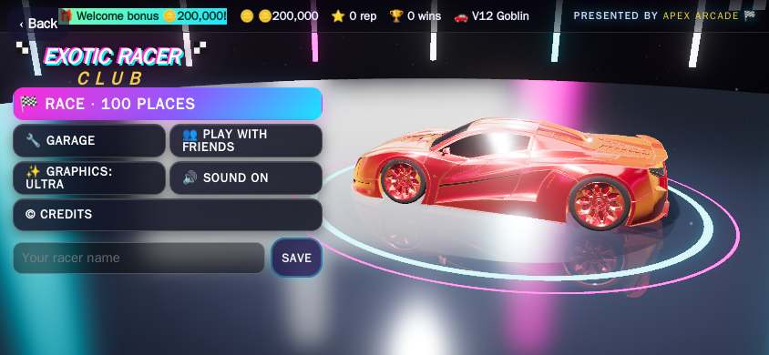 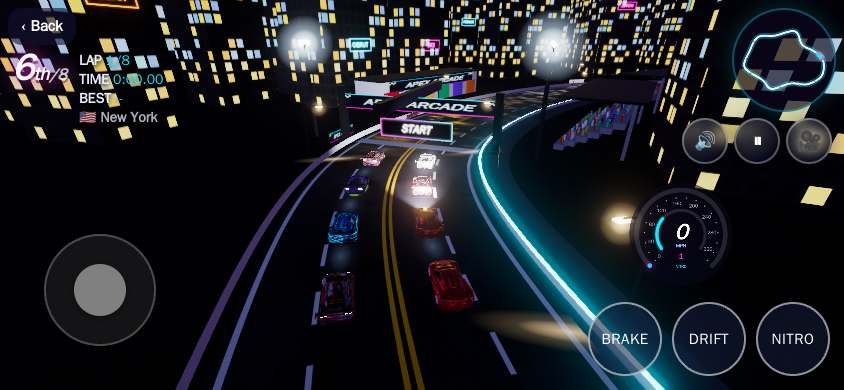 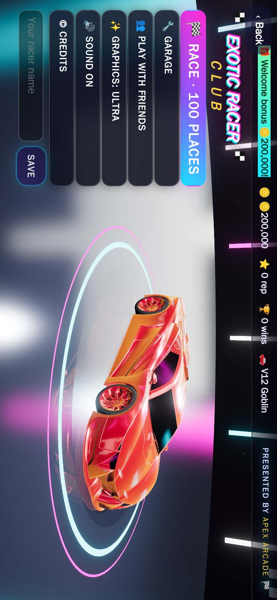 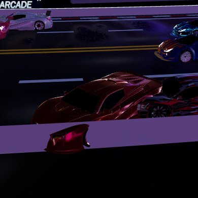

## 🟡 CHECK — Reef Dash

`apexreefdash.html`

- 🟡 Couldn't press any start button - add/fix this game's steps in games.json
- 🟡 Busy play screen: about 24 words during play (biggest: "Steer your sub to the finish gate") - aim for only button labels and the score; instructions go behind How to play (STUDIO-STANDARD.md "Clean screen")
- 🟡 Only 0 play test(s) - every game needs 5+ tests that play it by its rules (fixes/apexreefdash.mjs, ids 'play-...')
- 🟡 Not on the shared controls yet (kit/controls.js) - its job moves this game over; until then its own stick code is allowed
- 🟡 No friend codes yet - add a "👥 Play a friend" button (My code / Enter a friend's code) with ApexKit.friend and a 'play-friend-code' test (STORE-READY.md "Friend codes")
- 🟡 No REALITY hook yet (window.__reality) - add it so the robot can measure direction, sizes and ground contact (REALITY.md "Robot hook")
- 🟡 No close-up of the player: no player in the hook (REALITY.md hook: player)

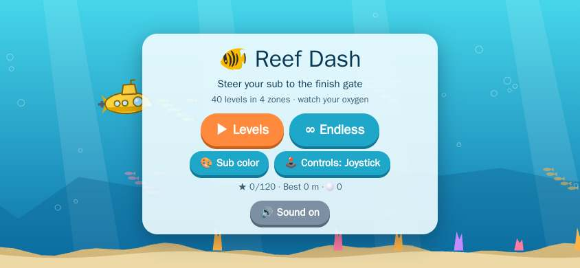 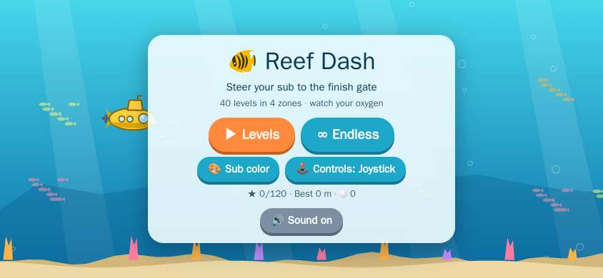 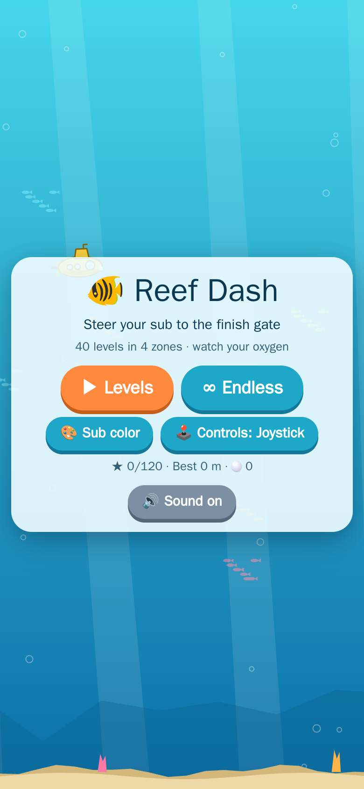

## 🟡 CHECK — Apex Flight

`apexflight.html`

- 🟡 No owner-approved venue - build it from venues/airport.md (real sizes, stands all around, crowd) with venues/kit in tools/venue-viewer.html, add it to MODELS.md as WAITING OWNER
- 🟡 Busy play screen: about 26 words during play (biggest: "SPD KT") - aim for only button labels and the score; instructions go behind How to play (STUDIO-STANDARD.md "Clean screen")
- 🟡 Heavy for phones: about 540 draw calls per frame (aim under 450; merge meshes - see STUDIO-STANDARD.md "Phone budget")
- 🟡 LINT fixes/apexflight.mjs: 29 h.eval call(s) navigate / wait / poll with no .catch (a destroyed execution context fails the test on the robot only) - first ones: play-no-easy-stall line 76, play-takeoff line 143, play-climb-and-fly line 234. Add .catch(() => false) or try/catch. Run: node tools/game-check/fixes-lint.mjs tools/game-check/fixes/apexflight.mjs
- 🟡 Play test failing: "land on the runway: a gentle approach touches down without crashing" [test id: play-land-on-runway] (never touched down after 20s of approach)
- 🟡 Play test failing: "A cancelled touch (call, notification, palm) never leaves the stick stuck: touchcancel zeroes the stick and all input at once (G-238)" [test id: play-stick-never-stays-stuck] (stick drag never deflected the jet)
- 🟡 Play test failing: "G-243 point 3: the stick zone never covers the Play-a-Friend buttons" [test id: play-g243-zone-never-covers-friend] (stick zone is visible over the menu)
- 🟡 Play test failing: "G-280: the tall THR slider is gone; a slim THR button sits in the pad row overlapping nothing and ramps the throttle while held" [test id: play-thr-button-in-row] (THR button missing from the pad row)
- 🟡 Friend codes have no 'play-friend-code' test yet (STORE-READY.md "Friend codes")
- 🟡 REALITY: the hook has no time() - add time: () => <game seconds> and speed: () => <m/s> so a busy robot cannot mistake a sprint for walking (REALITY.md)
- 🟡 Play test failing: "take off is manual: full throttle with no stick stays on the ground past rotate speed, and pulling the stick up lifts it off (owner: the plane must never lift by itself)" [test id: play-takeoff] (plane never reached rotate speed at full throttle (v 14.3 m/s))
- 🟡 Play test failing: "climb and fly: stick up gains altitude and the plane keeps flying" [test id: play-climb-and-fly] (plane barely moved (47m in 5s))
- 🟡 Play test failing: "G-117: every flight control answers within 100ms of the touch and stops at once when let go - stick, throttle lever, BOOST, BRAKE, YAW (in the air too), GEAR, trick buttons" [test id: play-controls-answer-in-100ms] (stick did not move the jet within 100ms; YAW did not turn the jet within 100ms (dead in the air))
- 🟡 Play test failing: "takeoff climbs: a full-throttle roll rotates and climbs away - no wallow back onto the gear (owner video 2026-10-23: the jet lifted, sank and collapsed its gear)" [test id: play-takeoff-climbs] (ran out of wall time (v23 at -1.0 game-s))
- 🟡 Play test failing: "turn: holding right banks the plane and changes heading" [test id: play-turn] (heading changed only 0.20 rad in 4s (want > 0.3))

**Owner's fix list** (32 of 41 done):
- ✅ throttle is a visible lever, not buttons: dragging the THR lever sets the throttle, the old THR buttons are hidden, and the lever overlaps no pad button (owner 2026-10-25)
- ❌ land on the runway: a gentle approach touches down without crashing — never touched down after 20s of approach
- ✅ Landing challenge: the jet must be able to slow to the 55-88 kt touchdown band in a descent (today: it accelerates to 130kt+ and cannot slow down, making the runway unreachable)
- ✅ G-141: the owners jet is the player plane (INSTRUCTIONS steps 1-2, 5, 6) and it starts parked ON THE RUNWAY on the ground; the step-6 look is in (PMREM environment so the paint reflects, a shadow-casting sun) - today the jet is in but the look is not: no environment, shadows off
- ✅ G-232: the stick is the shared kit/controls.js stick (the jet pack stick is gone) and letting go stops it - pointerup, pointercancel, blur and hidden tab all reset it to centre
- ❌ A cancelled touch (call, notification, palm) never leaves the stick stuck: touchcancel zeroes the stick and all input at once (G-238) — stick drag never deflected the jet
- ❌ G-243 point 3: the stick zone never covers the Play-a-Friend buttons — stick zone is visible over the menu
- ✅ G-247: 3-5 computer jets in the other styles and paints fly wide loops and stay above the ground
- ✅ NEVER (G-243): after a scored landing, flying into the ocean must still crash the plane - judged in game time so a slow runner cannot fake the failure
- ✅ G-268: the 55-88 kt band shows on the HUD during final approach in free flight too, so the robot's play picture shows it
- ❌ G-280: the tall THR slider is gone; a slim THR button sits in the pad row overlapping nothing and ramps the throttle while held — THR button missing from the pad row
- ✅ G-283: on a landing-challenge approach the TD band chip is a distinct chip nothing overlaps, so the 55-88 kt warning is actually seen
- ✅ G-334: after an earlier test leaves a ?test= URL behind, the challenge menu still engages and the off-runway reason shows and stays
- ✅ G-403: no live coaching instructions during the ground roll (Clean screen) - the roll shows only the game, the score and the buttons
- ✅ Gameplay picture frozen for 1.5 seconds
- ❌ take off is manual: full throttle with no stick stays on the ground past rotate speed, and pulling the stick up lifts it off (owner: the plane must never lift by itself) — plane never reached rotate speed at full throttle (v 14.3 m/s)
- ❌ climb and fly: stick up gains altitude and the plane keeps flying — plane barely moved (47m in 5s)
- ✅ crash: a hard nose-down impact ends the flight with the crash screen
- ✅ Landing challenge: touching down OFF the runway must tell the player why there is no score (today: silence)
- ✅ G-90: the jet control pad (12 buttons + throttle lever + stick) is on the phone screen and every button works
- ❌ G-117: every flight control answers within 100ms of the touch and stops at once when let go - stick, throttle lever, BOOST, BRAKE, YAW (in the air too), GEAR, trick buttons — stick did not move the jet within 100ms; YAW did not turn the jet within 100ms (dead in the air)
- ✅ G-158 re-check: free flight stays stable - steady cruise keeps finite position and velocity, no crash, the jet keeps moving
- ✅ G-243 point 4: in portrait (390x844, body rotated) the stick base sits on the screen and the stick answers
- ❌ takeoff climbs: a full-throttle roll rotates and climbs away - no wallow back onto the gear (owner video 2026-10-23: the jet lifted, sank and collapsed its gear) — ran out of wall time (v23 at -1.0 game-s)
- ✅ G-263: the 55-88 kt touchdown band shows during the landing approach, and says whether the speed is inside it
- ✅ G-275: runway 36 reads the correct way from behind the jet (not mirrored)
- ✅ G-290: the RESET button in the top bar overlaps nothing, least of all the VS speed box, on a challenge approach
- ✅ G-391: the QUALITY button sits fully on screen (upright and sideways), at least 44 px tall
- ✅ Menu has the old green "computer screen" look
- ✅ The plane stalls too easily when flying around - normal flying should be forgiving, stall only when you really pull up too slow
- ❌ turn: holding right banks the plane and changes heading — heading changed only 0.20 rad in 4s (want > 0.3)
- ✅ Play a friend with a friend code (My code / Enter code)
- ✅ Play every Flight mode start to finish like a real pilot: at cruise speed, full nose-down must make the plane DESCEND - it climbed instead, so you could not come down to land
- ✅ After a scored landing, flying into the ocean must still crash the plane (today: nothing happens)
- ✅ G-243 point 1: btnFree, friendGo and friendClose sit fully inside the 844x390 safe area
- ✅ G-243 point 2: the JET button does not overlap the back button
- ✅ G-243 point 5: the page declares a data: favicon so the browser never asks for /favicon.ico
- ✅ first frame: a fresh load never throws the parked jet under the world (negative frame time - lab-measured 2026-10-23: frame 2 read y=-14.4, vy=+12.6, and ground contact could never reach it again)
- ✅ NEVER (G-243): Landing challenge: touching down OFF the runway must tell the player why there is no score - the reason stays on screen while the jet sits in the grass, judged in game time
- ✅ NEVER (G-232): taking off must not crash the jet when it settles back onto the runway banked - a bounce is a roll, not a landing
- ✅ balance (master #11): on a short final a skilled pilot lands and scores GOOD or better, a pilot who never touches the stick does not score, and a stick-masher crashes - skill must matter

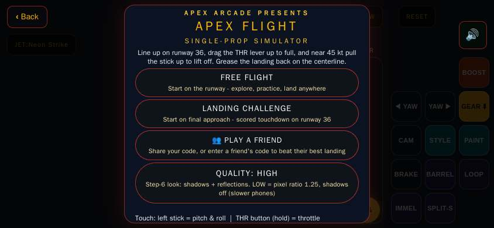 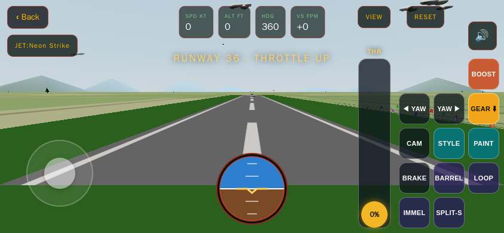 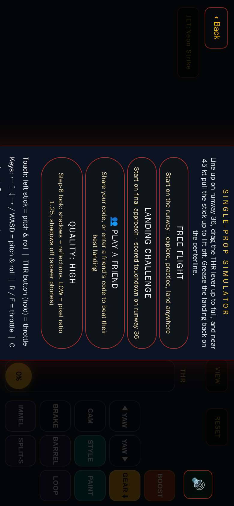 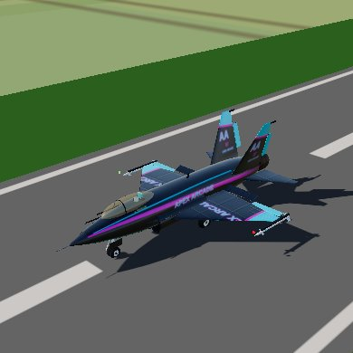

# 3D models (MODELS.md)

## Main sport motorcycle — WAITING OWNER

CODE-BUILT model · 29,628 triangles · 1.52 m tall · look: studio · drag to turn, pinch to zoom

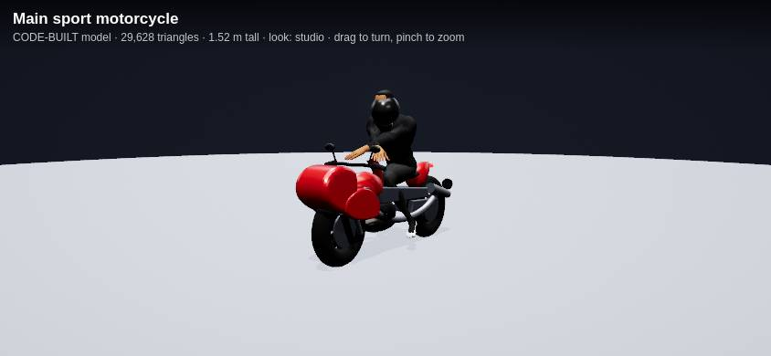 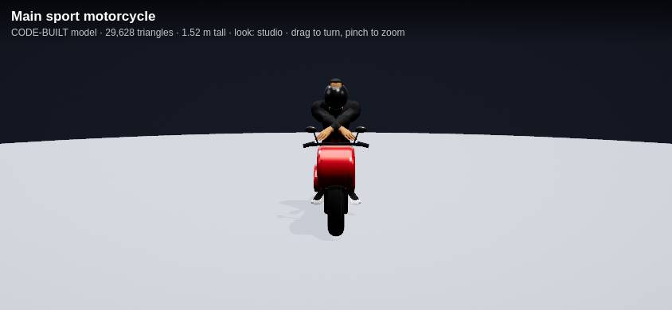 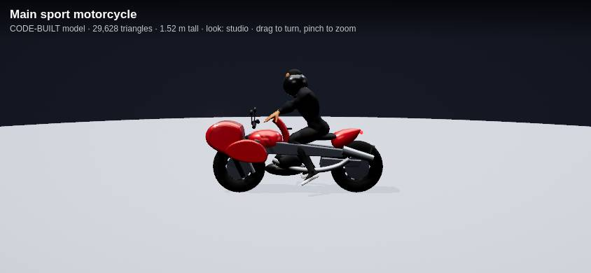

## Monster Truck Arena (stadium kit + crowd) — DISCARDED BY OWNER 2026-10-18 — DISCARDED (owner: "horrendous - throw this model away" 2026-10-18)

VENUE · 226 × 166 m · 12,000 fans · 12,000 seats · 105 draw calls · 145k triangles · look: night

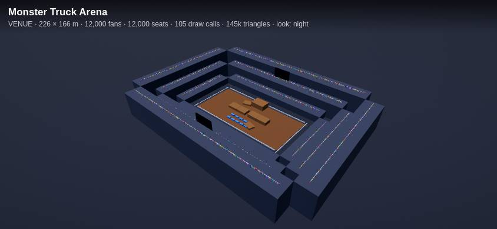 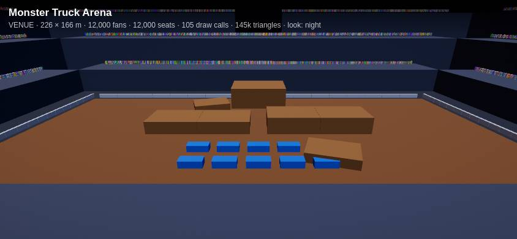 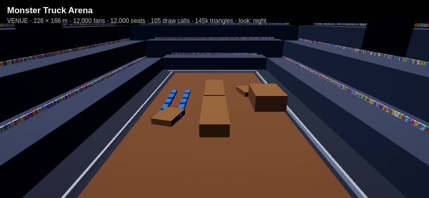

## Pebble hero (Flick Fortress) — WAITING OWNER

CODE-BUILT model · 9,136 triangles · 2.01 m tall · look: studio · drag to turn, pinch to zoom

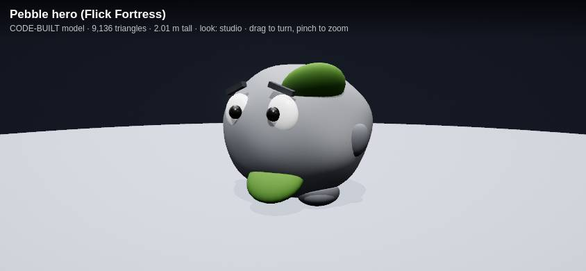 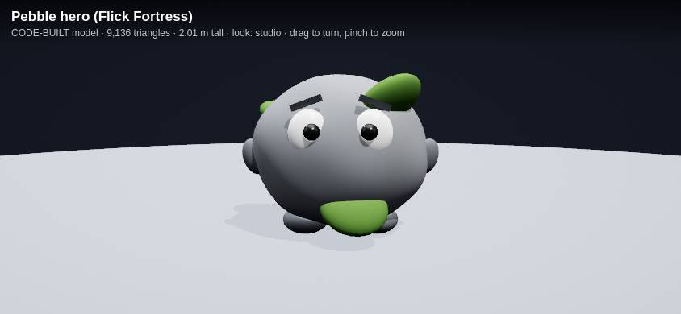 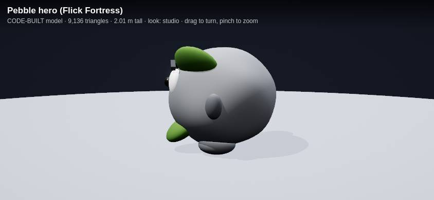

## Ballpark (baseball venue) — 

VENUE · 280 × 280 m · 64k triangles · look: field

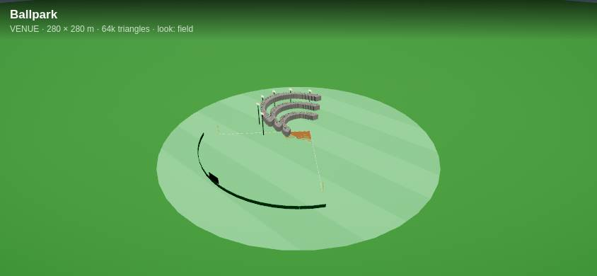 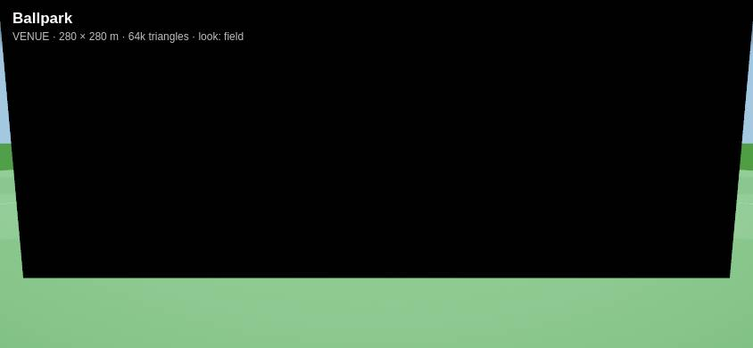 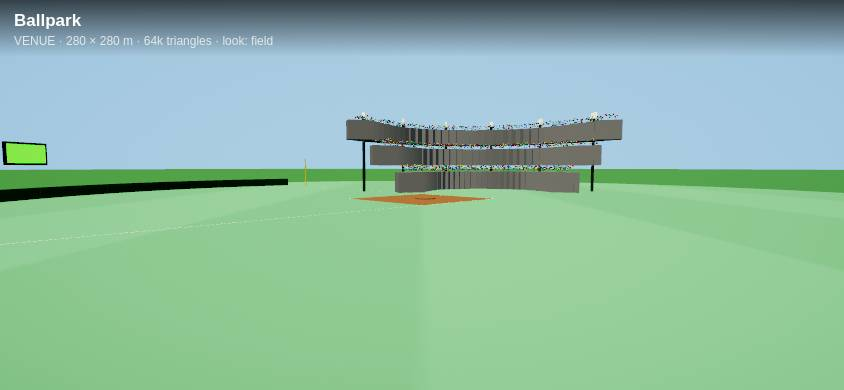

## Exotic Racer rim - Tuner mesh (rebuilt) — WAITING OWNER

55,958 triangles · 0.68 m tall · look: night · drag to turn, pinch to zoom

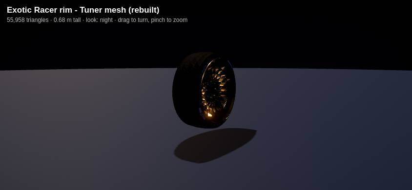  

---
Made by tools/game-check (runs after every merge to main, one robot per game side by side).
