# Game check

**Oct 24, 2026, 5:23 PM (Central)** · main @ `a4ecca6` · played side by side

**0 pass · 1 to check · 0 fail** out of 1 games.

## 🟡 CHECK — Apex Ice Hockey

`apexhockey.html`

- 🟡 Stutter: 7 short freezes in 6 s of play (worst 2150 ms, normal frame 33 ms) - usually new objects made every frame (garbage), big pictures loaded mid-game or a model built during play; build everything before play starts and reuse objects (STUDIO-STANDARD.md "Phone budget")
- 🟡 Play test failing: "G-210 (art director): at 844x390 every menu line sits inside the frame and nothing overlaps - title, subtitle, star card, the three buttons, credits, friend code and the keys lines all fully visible, and the star card never slides under the VIEW/mute buttons" (the main menu is not showing to be measured)
- 🟡 Play test failing: "OWNER VIDEO (2026-10-23): blades stay level in roll too, not only pitch - a planted blade's plate normal stays near horizontal, standing at the faceoff and in live play (the away stance stood rolled 12-26 deg; in play the plates flipped up toward the legs)" (standing at the faceoff, blades sit rolled: p90 roll 30.4 deg (bar 10) - the plates lean sideways on the ice instead of lying level)
- 🟡 Not on the shared controls yet (kit/controls.js) - its job moves this game over; until then its own stick code is allowed
- 🟡 Stutter: 11 short freezes in 6 s of play (worst 1183 ms, normal frame 17 ms) - usually new objects made every frame (garbage), big pictures loaded mid-game or a model built during play; build everything before play starts and reuse objects (STUDIO-STANDARD.md "Phone budget")
- 🟡 Play test failing: "skates touch the ice the whole time while skating (gap under 3 cm - never floating above it, never sunk under it)" (could not get a match into play to measure the skates)
- 🟡 Play test failing: "a defender takes the puck off an away rush (the rush does not score untouched)" (the away rush scored - no defender took the puck)
- 🟡 Play test failing: "with nobody touching the joystick the Sharks score in the first 10 seconds and the Wolves never contest - untouched, the Wolves AI must defend and take the puck back, so no goal is scored in the first 15 seconds" (the Sharks scored in the first 11.4 seconds of an untouched game - the Wolves never contested the puck)
- 🟡 Friend codes have no 'play-friend-code' test yet (STORE-READY.md "Friend codes")
- 🟡 Stutter: 6 short freezes in 6 s of play (worst 2250 ms, normal frame 33 ms) - usually new objects made every frame (garbage), big pictures loaded mid-game or a model built during play; build everything before play starts and reuse objects (STUDIO-STANDARD.md "Phone budget")
- 🟡 Play test failing: "the opening faceoff drops the puck at centre ice" (opening faceoff not at centre: (45.2, 0.0))
- 🟡 Play test failing: "skates sit exactly on the ice and the blades show silver under the boots: the goalie dropping into a butterfly never drags his blades under the ice, and the blade steel is a bright silver that reads as metal, not black" (could not get a match into play to test the goalie blades)
- 🟡 Stutter: 12 short freezes in 6 s of play (worst 1650 ms, normal frame 33 ms) - usually new objects made every frame (garbage), big pictures loaded mid-game or a model built during play; build everything before play starts and reuse objects (STUDIO-STANDARD.md "Phone budget")
- 🟡 IDLE RUN: the score "score" went 0 – 0 -> 0 – 1 with nobody touching the game - a goal/point was scored by itself (yellow for now: this game is on the warning list until its AI defends an untouched team)
- 🟡 Play test failing: "a goal counts on the scoreboard and restarts from centre ice" (after the goal the puck did not restart from centre ice)
- 🟡 Play test failing: "after a save, SAVED! shows exactly once (a rebound re-save in the same scramble does not show it again) and the broadcast camera does not rewind: its puck lead swings smoothly instead of snapping when the puck reverses" (could not get a match into play for the save test)
- 🟡 Play test failing: "the game clock and score run in real time: 5 seconds of play takes about 5 seconds off the clock (not 30), and a game nobody touches for 10 seconds keeps the same clock and score" (the game moved with nobody touching it: clock 118s -> 108s, score 0 – 0 -> 0 – 0)

**Owner's fix list** (67 of 77 done):
- ✅ They gave me this - blob players, upright floating sticks and scattered bits
- ✅ Build a nice stadium, a big crowd in the stadium (venues/rink.md)
- ✅ the puck never leaves the rink during play
- ✅ Skater must not spin in place: turn speed is limited, glides through turns
- ✅ career mode: play weeks 5-7 to the end - each week unlocks the next
- ✅ friend codes: my code is on the menu, a friend code sets up their team, and the friend match result goes on my record
- ✅ the camera never falls through the ice when zooming in: in every view (BROADCAST, HIGH, CLOSE, PLAYER, END) it stays at least 1.5 m above the ice
- ✅ TESTER (G-88): pressing PLAY in the career hub (PLAY NEXT MATCH) starts the career match
- ✅ TESTER (G-108): the __reality hook carries every field REALITY.md requires - camera, time() and speed() as well as kind, player, others, contact, ground, go and expect
- ✅ G-170 point 1 (owner screenshot 2026-10-22): skate blades stay DOWN flat on the ice - never pitched toe-down with the heel kicked up; the planted blade of a standing player lies flat, never kicked up at one end like the screenshot (end-to-end pitch under 5.5 cm; the shipped game read up to 8.5 cm)
- ❌ G-210 (art director): at 844x390 every menu line sits inside the frame and nothing overlaps - title, subtitle, star card, the three buttons, credits, friend code and the keys lines all fully visible, and the star card never slides under the VIEW/mute buttons — the main menu is not showing to be measured
- ✅ NEVER (G-47 REDO, owner picture 2026-10-23): in live play, not just standing still, the weight-bearing skate blade lies FLAT on the ice - the old end-to-end read went blind once a blade pitched past about 45 deg (its horizontal projection collapses), so this reads the blade true 3D tilt; on the shipped game planted blades sat at a median 12 deg tilt with a third over 16 deg and floated about 3 cm off the ice
- ❌ OWNER VIDEO (2026-10-23): blades stay level in roll too, not only pitch - a planted blade's plate normal stays near horizontal, standing at the faceoff and in live play (the away stance stood rolled 12-26 deg; in play the plates flipped up toward the legs) — standing at the faceoff, blades sit rolled: p90 roll 30.4 deg (bar 10) - the plates lean sideways on the ice instead of lying level
- ✅ TESTER (G-170): the career end-screen button that reads CAREER HUB takes the player to the career hub, not the main menu
- ✅ TESTER (G-228): rules/hockey.md broadcast look - a goal brings the horn, the crowd, the goal light, spotlights and a replay from 2 angles. A clean goal is staged; during the goal state there must be a goal-light/replay element in the DOM or the camera must cut away from the broadcast follow to replay angles. The camera staying in broadcast follow with no light and no replay is the bug (horn/crowd/flash/banner are present and not in question).
- ✅ TESTER (G-199): each goal crease is painted in FRONT of its goal (venues/rink.md: light-blue semicircle r 1.83 m in front of the goal line) - neither crease may sit behind its goal line in the trapezoid area
- ✅ NEVER (G-257): the intermission between periods shows a stats card - when the period clock runs out, the break puts the real match stats on screen (shots, saves, faceoffs won on a #statCard), not only the END OF PERIOD banner, and the card clears when the next period starts (rules/hockey.md: intermission between periods, stats card)
- ✅ NEVER (G-266): a goal brings the broadcast look (rules/hockey.md) - the red goal light lit in the DOM, the spotlights on, and the camera cutting to replay angles (a jump of more than 40 units between goal-state frames) instead of staying in the broadcast follow
- ✅ NEVER (G-273 round 1, G-228): a DELAYED penalty - a foul committed while the other team has the puck does NOT box the man at once; play goes on with the arm up until the penalised team touches the puck, and only then do the whistle blow and the man sit (rules/hockey.md)
- ✅ NEVER (G-282 round 1, G-199): the glass above the boards is about 1.8 m high along the sides and about 2.4 m at the ends (venues/rink.md) - not one height all the way round
- ✅ How do I get exactly this hockey player? (7.5 head heights, forward lean 15-20, knee flex 25-30, hips back over the heels, wide stance)
- ✅ offside is called when an attacker crosses the blue line before the puck
- ✅ 5 skaters plus a goalie a side, per the rules sheet
- ✅ CLOSE camera: 9m back along long axis, 5m up, never rotates with skater facing
- ✅ career mode: play weeks 8-10 to the end - finishing the season unlocks the semifinal
- ❌ skates touch the ice the whole time while skating (gap under 3 cm - never floating above it, never sunk under it) — could not get a match into play to measure the skates
- ❌ a defender takes the puck off an away rush (the rush does not score untouched) — the away rush scored - no defender took the puck
- ✅ BUILD G-110: the arena crowd is one instanced mesh, the static arena is merged, and the favicon cannot 404
- ❌ with nobody touching the joystick the Sharks score in the first 10 seconds and the Wolves never contest - untouched, the Wolves AI must defend and take the puck back, so no goal is scored in the first 15 seconds — the Sharks scored in the first 11.4 seconds of an untouched game - the Wolves never contested the puck
- ✅ G-178: when a match opens, the joystick sits in the LEFT half of the screen and stays there - in landscape its centre is left of halfway, and on a portrait-held phone (the stage rotates for landscape play) it also lands on the player left, never the right
- ✅ G-214 (art director): at the game (BROADCAST) camera the skaters are big enough to read numbers and stance - a faceoff ring staged at centre ice projects to at least 30 CSS px tall per skater on the 844x390 frame (they read ~20px when the camera sat ~91 units out)
- ✅ TESTER (G-227): icing is NOT called while the dumping team is shorthanded (rules/hockey.md: icing "Not called when shorthanded"). A home skater is put in the box so the power-play tag is live, then home dumps the puck untouched from behind the centre line (lastTouch home at x -30) racing to the far goal line, exactly the dump that IS whistled at full strength: play must carry on with no icing whistle and no icing faceoff while the box is occupied.
- ✅ OWNER VIDEO (2026-10-23): the two AI chasers on a puck carrier do not mirror each other - they close from different sides instead of stacking onto the same point and skating through each other
- ✅ TESTER (G-228): rules/hockey.md requires a DELAYED penalty - when a foul is committed while the other team has the puck, play goes on until the penalised team touches the puck, and only then does the whistle blow and the man sit. An away skater is parked at centre with the puck and a home skater 2.2 u directly behind him; CHECK is fired through the button's real mousedown path in the same JS turn as the staging. The offender must NOT be boxed in that same turn - boxing him instantly with no whistle and no delayed arm is the bug.
- ✅ TESTER (G-228): the end screen must name the team that actually won. A career WEEK 2 fixture vs the BEARS is started and the BEARS win it 3-0; the big title must name the BEARS, not the Sharks. Observed on current main: after a 0-2 loss to the STAMPEDE the title read "SHARKS WIN" while the scorebug correctly showed STAMPEDE (G-228 play); the title is hardcoded and the non-career sub "The Sharks steal this one. Run it back." is too.
- ✅ TESTER (G-199): the glass above the boards is about 1.8 m high along the sides and about 2.4 m at the ends (venues/rink.md) - not one 1.6 m height all the way round
- ✅ NEVER (G-261): the puck never leaves the rink under boards pressure - loose pucks fired at the end boards, the carrier parked at the end boards and at the side boards facing them with the puck on his stick, and a real shot released at the boards, with play re-established before every phase and the puck sampled every 50 ms in play: its centre must never pass the boards shell (|x| <= 100.6, |z| <= 42.9) and the sampler must collect at least 50 play samples
- ✅ NEVER (G-266, G-199): each goal crease is painted in FRONT of its goal - a light-blue semicircle of radius 1.83 m on the centre-ice side of the goal line; on the ice paint neither crease may run past its goal line (max x <= 90.5 for the +x crease, min x >= -90.5 for the -x crease)
- ✅ NEVER (G-282, G-228): the crease is protected - a goal scored while an attacker stands on the defending goalie inside the crease is waved off (no goal, whistle); the same shot with the crease clear counts (rules/hockey.md: no goal if the goalie is pushed)
- ✅ Helmet with visor, shoulder pads, oversized gloves, padded breezers, shin guards, skates with a wider stance - like my sheet
- ✅ icing is called on an untouched clear from the defensive half
- ❌ the opening faceoff drops the puck at centre ice — opening faceoff not at centre: (45.2, 0.0)
- ✅ Offside only when attacker is really over the blue line (1.5m), not on a skate blade
- ✅ career mode: play the semifinal to the end - winning it unlocks the final
- ❌ skates sit exactly on the ice and the blades show silver under the boots: the goalie dropping into a butterfly never drags his blades under the ice, and the blade steel is a bright silver that reads as metal, not black — could not get a match into play to test the goalie blades
- ✅ the stick lets go when the app loses focus or is hidden mid-hold - hold it pushed, blur or hide the app, and the knob is back at centre (0 px) with no real touchend needed
- ✅ the game does not play by itself: a faceoff waits for the player input instead of dropping on its own
- ✅ TESTER (G-131): closing the career hub disarms the ERASE button - one tap arms it, but once the hub has been closed and reopened the button must be back to un-armed, so a later single tap cannot erase the career
- ✅ G-186 (art director): the close-up helmet must not read as a plain dome with a dark bar across the eyes - the visor glass is near-clear and casts no shadow, so the face reads through it (every kitted skater: visor present, castShadow off, opacity at most 0.2, metalness at most 0.05)
- ✅ NEVER (G-216, the G-194 line): the puck never leaves the rink - with the carrier standing at the end boards and at the side boards facing them, puck on his stick, the carried puck centre stays inside the boards shell (|x| <= 100.6, |z| <= 42.9); the carried puck used to poke through the boards by the full stick reach (robot: 101.7 at the end boards, 44.2 at the side)
- ✅ NEVER (G-228): icing is NOT called when the dumping team is shorthanded (rules/hockey.md) - with a home skater in the box and the power-play tag live, the deep dump that is whistled at full strength must sail past the far goal line with no icing whistle and play carrying on
- ✅ CHECKLIST H01 (G-230): the end-zone faceoff dots sit 6.7 m either side of centre (venues/rink.md). Read the 4 end-zone dot positions from the ice paint in the running game: each end dot (red dot core at |x| beyond the blue lines) must sit with |z| within 3% of 6.7 m (21.85 units at 3.26 units per metre).
- ✅ TESTER (G-228): rules/hockey.md - the crease is protected (no goal if the goalie is pushed). The away goalie is parked in his crease and a home attacker is parked ON TOP of him (0.5 u away, inside the crease); the puck is then fired into the open net from 7 u out. The goal must NOT count while the attacker is standing on the goalie - counting it proves the crease is not protected.
- ✅ TESTER (G-199): the 4 neutral-zone faceoff dots sit 1.5 m inside the blue lines (venues/rink.md) - painted on the ice at |x| about 6.2 m from centre, inside the neutral zone, not deep in the end zones
- ✅ TESTER (G-199): the arena has two team benches on one side of the rink and the penalty boxes plus scorekeeper box on the other (venues/rink.md) - real meshes outside the boards at ice level, not bare boards with the bowl behind
- ✅ NEVER (G-261, H15): a tied game goes to 3-on-3 overtime, first goal wins, no shootout (owner decision 2026-10-23, rules/hockey.md line 20) - stage a tie at the end of period 3: exactly 3 skaters a side on the ice in overtime (plus the goalies), and the first overtime goal ends the game
- ✅ NEVER (G-272, H14): a major penalty exists - a check from behind on the puck carrier (the harshest foul the game offers) draws a 5:00 MAJOR (box penT 50 on the game clock scale, banner says MAJOR), and a major serves its full time: a power-play goal springs a boxed MINOR but never a boxed MAJOR (rules/hockey.md)
- ✅ NEVER (G-282, G-199): the arena has real bench and box meshes at ice level outside the boards - two team benches on one side, two penalty boxes and the scorekeeper box on the other (venues/rink.md)
- ✅ Upright floating sticks
- ❌ a goal counts on the scoreboard and restarts from centre ice — after the goal the puck did not restart from centre ice
- ✅ Joystick must be screen-relative: push right = skate right on screen, even after the skater turns 180
- ✅ career mode: start a career and play weeks 1-4 to the end - each week unlocks the next
- ✅ career mode: play the final to the end - winning it takes the title and unlocks the next season
- ❌ after a save, SAVED! shows exactly once (a rebound re-save in the same scramble does not show it again) and the broadcast camera does not rewind: its puck lead swings smoothly instead of snapping when the puck reverses — could not get a match into play for the save test
- ✅ TESTER (G-88): the puck is a real puck size - 7.6 cm across and 2.5 cm thick (REALITY.md), within 15%
- ❌ the game clock and score run in real time: 5 seconds of play takes about 5 seconds off the clock (not 30), and a game nobody touches for 10 seconds keeps the same clock and score — the game moved with nobody touching it: clock 118s -> 108s, score 0 – 0 -> 0 – 0
- ✅ G-159: closing the career hub disarms the ERASE button - arm it, close and reopen the hub, and a single tap must count as a fresh first tap only (the career survives)
- ✅ TESTER (G-194): the puck never leaves the rink - staged pressure at the boards (loose pucks fired at the end boards, the puck carrier standing at the end boards and at the side boards facing them with the puck on his stick, a real shot released at the boards) with the puck sampled every 50 ms in play: its centre must never pass the boards shell (|x| <= 100.6, |z| <= 42.9)
- ✅ NEVER (G-217, the G-170 line): skate blades stay DOWN flat on the ice - the planted blade of a standing player lies flat, end-to-end pitch under 5.5 cm; the away boots were still toe-down at the 0.8 rad counter-pitch (signed medians -4.8..-6.2 cm, robot median 6.6) until they took the same 1.0 rad as the home boots. ROUND 1: and the blades stay levelled while skating around too, not only when stopped - the weight-bearing blade true 3D tilt in live play stays at a median of 8 deg or less
- ✅ the end-zone faceoff dots sit 6.7 m either side of centre in the ice paint (venues/rink.md, H01)
- ✅ TESTER (G-170): quitting a career match mid-game must not bank the star goal - a goal scored mid-match must not survive a quit while the fixture stays pending and replayable
- ✅ TESTER (G-228): rules/hockey.md - intermission between periods shows a stats card. The period clock is run down so the game enters its intermission; during the intermission some stats card (shots, saves, hits, faceoffs - any period stats beyond the scorebug) must be visible. An END OF PERIOD banner alone is the bug.
- ✅ TESTER (G-199): the 4 end-zone faceoff dots sit 6.7 m either side of centre (venues/rink.md) - painted on the ice at |z| about 21.9 units, not 20
- ✅ H15: a tied game goes to 3-on-3 overtime, first goal wins, no shootout (owner decision 2026-10-23, rules/hockey.md line 20) - stage a tie at the end of period 3, then count the skaters on the ice in overtime: 3 a side (plus the goalies), and the first overtime goal must end the game
- ✅ CHECKLIST H14 (G-234): a major penalty is 5 minutes (rules/hockey.md: "Penalties (2 minutes, or 5 for major)"). Commit the harshest foul the game offers - a check from behind on the puck carrier - six times: at least one of the resulting penalties must be a 5:00 major (box clock reads 5:00 and/or the banner says MAJOR).
- ✅ NEVER (G-273, G-199): the 4 neutral-zone faceoff dots sit 1.5 m inside the blue lines - painted at |x| about 6.2 m from centre in the neutral zone (never out at |x| 12.3 m in the end zones), and an offside faceoff drops on the neutral dot on that side
- ✅ NEVER (G-282 round 1, G-228): the end screen names the team that actually won - a career fixture the BEARS win 3-0 titles the BEARS, and a home win titles the WOLVES; the away title is never hardcoded to the Sharks

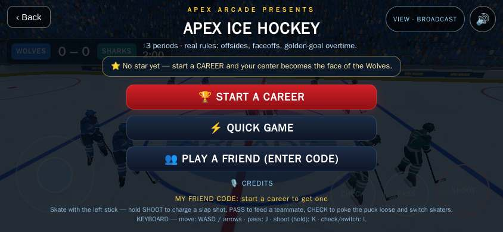 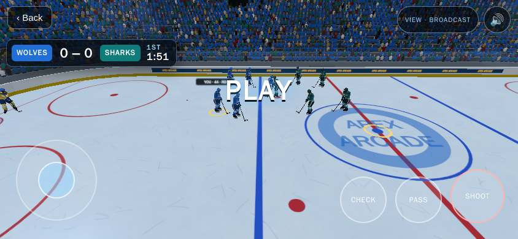 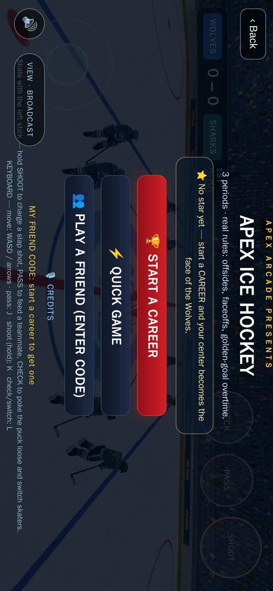 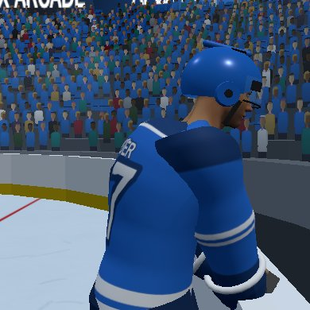

---
Made by tools/game-check (runs after every merge to main, one robot per game side by side).

# Not changed since the last check

These games' files didn't change, so the robot kept their last result (played at main @ `b6c3b66`). A full check of every game runs every 4 hours.

## 🟡 CHECK — Apex F1 Racing

`apexf1.html`

- 🟡 No owner-approved venue - build it from venues/circuit.md (real sizes, stands all around, crowd) with venues/kit in tools/venue-viewer.html, add it to MODELS.md as WAITING OWNER
- 🟡 Play test failing: "every AI car uses the real F1 car model, same quality as the player car" (KAI: drawn size 4.24 vs the player's 6.57 on footprint axis 0 - not the same car model)
- 🟡 Play test failing: "at speed the stick winds the heading gently and never steers by itself" (with the stick released the heading moved on its own (0.19 -> 0.29) - steering must come only from the stick)
- 🟡 Play test failing: "on the upright phone the stick never overlaps the PIT button" (test error: g265PortraitOverlaps is not defined)
- 🟡 Career mode has NO playability test - add 'play-career-...' tests that start every career level, play it to the end and unlock the next (STORE-READY.md "Career mode")
- 🟡 Not on the shared controls yet (kit/controls.js) - its job moves this game over; until then its own stick code is allowed
- 🟡 REALITY: the hook has no time() - add time: () => <game seconds> and speed: () => <m/s> so a busy robot cannot mistake a sprint for walking (REALITY.md)
- 🟡 Play test failing: "the slowest AI car laps within 5 percent of the player - nobody gets driven away from" (slowest AI covered only 84% of the player's distance in identical windows - the player just drives away from the field)
- 🟡 Play test failing: "the car is about 20 percent bigger" (player car draws 8.50 m long - G-73 wants about 20% bigger than the old 6.45 m (about 7.7 m))
- 🟡 Play test failing: "The circuit wears the owner ground kit (asphalt + kerb textures from kit/ground/512) and the engine is the owner grand_prix sound kit: idle/accel loops crossfaded by throttle, shift sounds, tire squeal" (test error: h.poll is not a function)
- 🟡 Play test failing: "The player drives (owner recordings, G-239): the stick turns the car and a driven line stays on the road; let go and the nose HOLDS its world heading - it does not straighten itself back onto the road (that self-straightening was the autopilot)" (letting go of the stick still turned the car: world heading moved 0.11 rad in 2.5 s - the nose must HOLD and the driver must steer)
- 🟡 Play test failing: "on the upright phone the stick never overlaps the CAM button" (test error: g265PortraitOverlaps is not defined)
- 🟡 Friend codes have no 'play-friend-code' test yet (STORE-READY.md "Friend codes")
- 🟡 Play test failing: "the fastest AI car laps within 5 percent of the player - same real F1 pace" (fastest AI covered only 88% of the player's distance in identical windows - the player just drives away from the field)

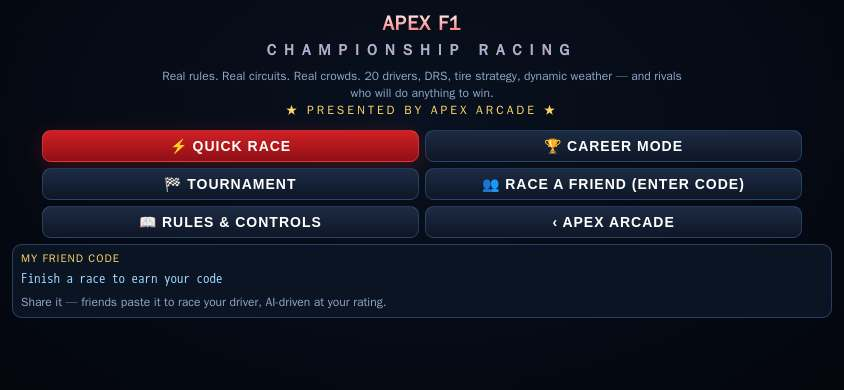 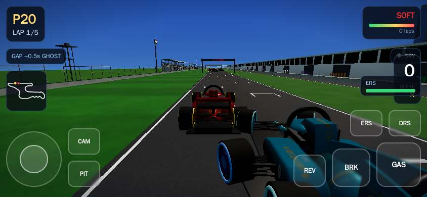

## 🟡 CHECK — Apex Flight

`apexflight.html`

- 🟡 No owner-approved venue - build it from venues/airport.md (real sizes, stands all around, crowd) with venues/kit in tools/venue-viewer.html, add it to MODELS.md as WAITING OWNER
- 🟡 Busy play screen: about 33 words during play (biggest: "SPD KT") - aim for only button labels and the score; instructions go behind How to play (STUDIO-STANDARD.md "Clean screen")
- 🟡 Heavy for phones: about 557 draw calls per frame (aim under 450; merge meshes - see STUDIO-STANDARD.md "Phone budget")
- 🟡 Play test failing: "take off: full throttle on the runway lifts the plane into the air" (plane rolled but never lifted off)
- 🟡 Play test failing: "land on the runway: a gentle approach touches down without crashing" (never touched down after 20s of approach)
- 🟡 Play test failing: "A cancelled touch (call, notification, palm) never leaves the stick stuck: touchcancel zeroes the stick and all input at once (G-238)" (stick drag never deflected the jet)
- 🟡 Play test failing: "G-243 point 3: the stick zone never covers the Play-a-Friend buttons" (stick zone is visible over the menu)
- 🟡 Friend codes have no 'play-friend-code' test yet (STORE-READY.md "Friend codes")
- 🟡 REALITY: the hook has no time() - add time: () => <game seconds> and speed: () => <m/s> so a busy robot cannot mistake a sprint for walking (REALITY.md)
- 🟡 Busy play screen: about 32 words during play (biggest: "SPD KT") - aim for only button labels and the score; instructions go behind How to play (STUDIO-STANDARD.md "Clean screen")
- 🟡 Heavy for phones: about 559 draw calls per frame (aim under 450; merge meshes - see STUDIO-STANDARD.md "Phone budget")
- 🟡 Play test failing: "climb and fly: stick up gains altitude and the plane keeps flying" (plane barely moved (96m in 5s))
- 🟡 Play test failing: "takeoff climbs: a full-throttle roll rotates and climbs away - no wallow back onto the gear (owner video 2026-10-23: the jet lifted, sank and collapsed its gear)" (ran out of wall time (v23 at -1.0 game-s))
- 🟡 Heavy for phones: about 558 draw calls per frame (aim under 450; merge meshes - see STUDIO-STANDARD.md "Phone budget")
- 🟡 Play test failing: "turn: holding right banks the plane and changes heading" (heading changed only 0.21 rad in 4s (want > 0.3))
- 🟡 Play test failing: "G-117: every flight control answers within 100ms of the touch and stops at once when let go - stick, THR+, THR-, BOOST, BRAKE, YAW (in the air too), GEAR, trick buttons" (stick did not move the jet within 100ms; THR+ did not raise the throttle within 100ms; THR- did not lower the throttle within 100ms; YAW did not turn the jet within 100ms (dead in the air))
- 🟡 REALITY: the player did not move in 5 s with go(true) - add go() to the hook so the robot can drive/run

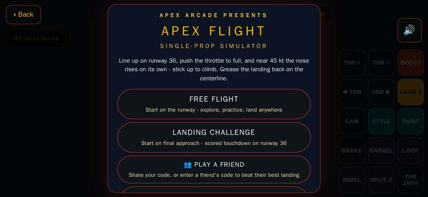 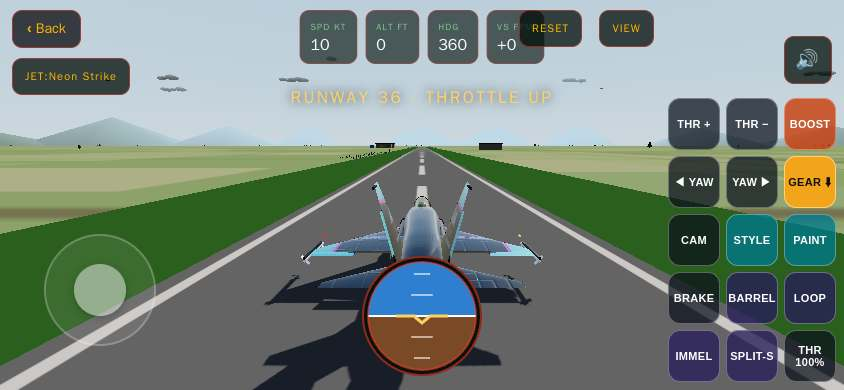

## 🟡 CHECK — Exotic Racer Club

`apexracer.html`

- 🟡 No owner-approved venue - build it from venues/circuit.md (real sizes, stands all around, crowd) with venues/kit in tools/venue-viewer.html, add it to MODELS.md as WAITING OWNER
- 🟡 Play test failing: "Every car shows its own paint: each real 3D model body material is replaced by that car paint, and grid paints are not all the same" (no race)
- 🟡 Play test failing: "APEX ARCADE name wrap: on the V12 Goblin by default, letters riding on both sides of the body" (Garage button on the menu could not be pressed)
- 🟡 Play test failing: "Home screen: slim left tile column (RACE, Garage, Race Friends, Graphics, Sound, Credits in that order), thin top stat bar with the coins, everything fits the sideways phone, and the car keeps turning on its turntable" (car is not turning on the home screen (spin moved 0.02 rad in 1.4s))
- 🟡 Play test failing: "G-50: city traffic cars are real fetched 3D models, each in its own paint" (traffic car uses unknown model goblin)
- 🟡 Play test failing: "G-76: better steering - the car answers the stick quickly, turns where it points without sliding wide, and never snaps" (the car barely answered the stick: only 0.18 rad of turn in 0.5 s at 27 m/s - steering still lags)
- 🟡 Play test failing: "G-163 point 2: at night the headlights throw a pool of light on the road ahead of the car" (the pool is not a soft additive light pool)
- 🟡 Play test failing: "Owner Oct 22 2026: mountains out of the road - no tall scenery (mountains, volcano, mesas) comes within 25 m of the road" (tall scenery comes within 1 m of the road at Honolulu - mountains belong off the road)
- 🟡 Not on the shared controls yet (kit/controls.js) - its job moves this game over; until then its own stick code is allowed

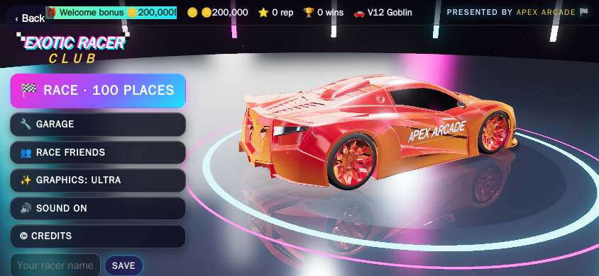 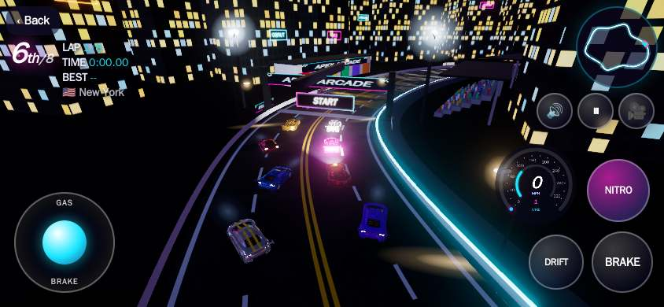

## 🟡 CHECK — Apex Baseball

`apexbaseball.html`

- 🟡 No owner-approved venue - build it from venues/ballpark.md (real sizes, stands all around, crowd) with venues/kit in tools/venue-viewer.html, add it to MODELS.md as WAITING OWNER
- 🟡 Stutter: 3 short freezes in 6 s of play (worst 650 ms, normal frame 67 ms) - usually new objects made every frame (garbage), big pictures loaded mid-game or a model built during play; build everything before play starts and reuse objects (STUDIO-STANDARD.md "Phone budget")
- 🟡 Play test failing: "The owner's new ballpark (Apex Arcade Park) loads with its crowd, presented as the night park it is (G-40)" (the ballpark loaded but the game still shows the old daytime look - his park is a night park (floodlights, dark sky))
- 🟡 Play test failing: "BUILD G-222 (owner order Oct 22): the contact moment is big at the plate - as the pitch reaches the plate the batter fills the frame (not a speck), so you see the ball meet the bat" (the batter is still a speck when the pitch reaches the plate: 0 px tall of 390 at the contact moment (target at least 80; the frozen G-167 framing measured ~42))
- 🟡 Not on the shared controls yet (kit/controls.js) - its job moves this game over; until then its own stick code is allowed
- 🟡 REALITY (yellow - no time()/gait() in the hook, so the robot cannot tell a sprint start from walking): feet/skates/wheels never touch down while moving fast - no touchdown for 2.8 s (a sprint lands a foot at least every 0.5 s; lowest 0.02 m)
- 🟡 REALITY: the hook has no time() - add time: () => <game seconds> and speed: () => <m/s> so a busy robot cannot mistake a sprint for walking (REALITY.md)
- 🟡 Stutter: 8 short freezes in 6 s of play (worst 1267 ms, normal frame 17 ms) - usually new objects made every frame (garbage), big pictures loaded mid-game or a model built during play; build everything before play starts and reuse objects (STUDIO-STANDARD.md "Phone budget")
- 🟡 Play test failing: "the batter close-up shows his face and eyes (no helmet blob over them) and a full baseball uniform - button-front jersey in the team colour, no printed tee logo" (a dark blob still covers the eyes: 76% of the eye area is dark (the old face-covering helmet measured 94%))
- 🟡 Friend codes have no 'play-friend-code' test yet (STORE-READY.md "Friend codes")
- 🟡 REALITY (yellow - no time()/gait() in the hook, so the robot cannot tell a sprint start from walking): wheels/feet/skates FLOAT above the ground while standing/walking (7 of 8 readings over 3 cm, highest 0.28 m)
- 🟡 REALITY (yellow - no time()/gait() in the hook, so the robot cannot tell a sprint start from walking): feet/skates/wheels never touch down while moving fast - no touchdown for 4.1 s (a sprint lands a foot at least every 0.5 s; lowest 0.00 m)

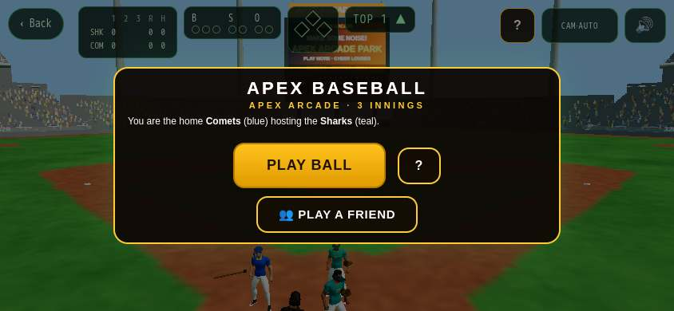 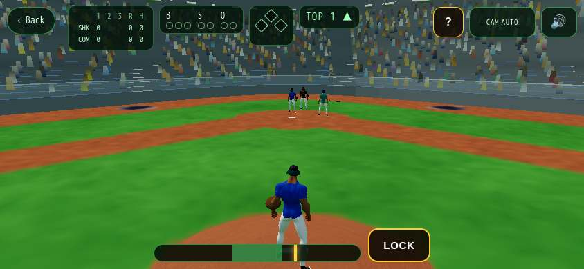

## 🔴 FAIL — Apex Monster Truck

`apexmonstertruck.html`

- 🔴 STICK: the touch controls can get stuck - add window blur + visibilitychange handlers that set the stick and every held button back to 0 (a call or notification on the phone must never leave the player moving or steering by itself)
- 🟡 No owner-approved venue - build it from venues/truck-arena.md (real sizes, stands all around, crowd) with venues/kit in tools/venue-viewer.html, add it to MODELS.md as WAITING OWNER
- 🟡 Stutter: 11 short freezes in 6 s of play (worst 2617 ms, normal frame 17 ms) - usually new objects made every frame (garbage), big pictures loaded mid-game or a model built during play; build everything before play starts and reuse objects (STUDIO-STANDARD.md "Phone budget")
- 🟡 looks/apexmonstertruck.md has no "WHERE THINGS ARE" map at the top (STUDIO-STANDARD 9.7) - add one with line numbers and keep it current
- 🟡 Play test failing: "Truck drives forward when given speed" (truck only moved 8.2m with sp=30 for 2s)
- 🟡 Play test failing: "Truck landing on a car crushes it and scores" (car not crushed after truck dropped on it)
- 🟡 Play test failing: "Truck with upward velocity gets air and lands with gravity" (truck did not complete jump arc)
- 🟡 Play test failing: "J45: SAME J5 truck at 2x size (~5.4m tall, ~4.2m tires)" (height 7.5m, want ~5.4m (2x J5))
- 🟡 Play test failing: "J45(2): 3-2-1 camera starts high above HIS truck and dives to its back by GO" (camera not dived by GO (y=103, want ~12.6))
- 🟡 Play test failing: "J45(4): drive stick alone reaches ~90mph with quicker pickup" (reached 90mph but took 11.1s (too slow))
- 🟡 Career mode has NO playability test - add 'play-career-...' tests that start every career level, play it to the end and unlock the next (STORE-READY.md "Career mode")
- 🟡 Not on the shared controls yet (kit/controls.js) - its job moves this game over; until then its own stick code is allowed
- 🟡 No friend codes yet - add a "👥 Play a friend" button (My code / Enter a friend's code) with ApexKit.friend and a 'play-friend-code' test (STORE-READY.md "Friend codes")
- 🟡 No REALITY hook yet (window.__reality) - add it so the robot can measure direction, sizes and ground contact (REALITY.md "Robot hook")
- 🟡 No close-up of the player: no player in the hook (REALITY.md hook: player)

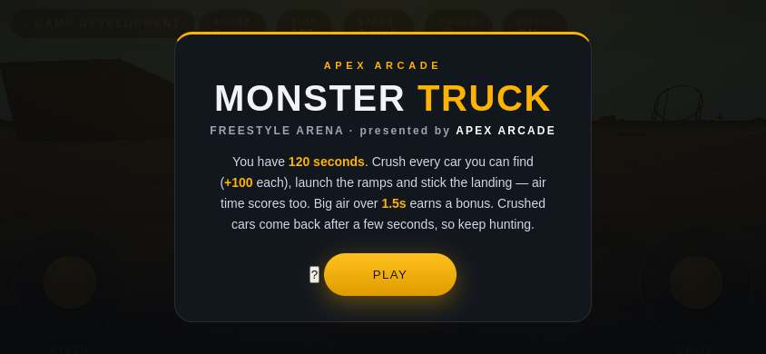 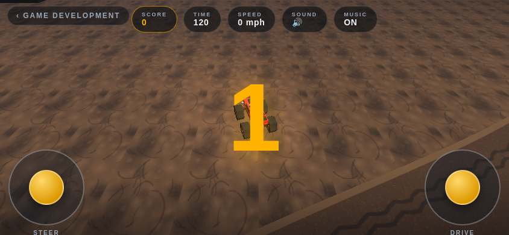

## 🔴 FAIL — Apex Moto

`apexmoto.html`

- 🔴 STICK: the touch controls can get stuck - add window blur + visibilitychange handlers that set the stick and every held button back to 0 (a call or notification on the phone must never leave the player moving or steering by itself)
- 🟡 Stutter: 5 short freezes in 6 s of play (worst 2733 ms, normal frame 17 ms) - usually new objects made every frame (garbage), big pictures loaded mid-game or a model built during play; build everything before play starts and reuse objects (STUDIO-STANDARD.md "Phone budget")
- 🟡 Busy play screen: about 21 words during play (biggest: "‹ GAME DEVELOPMENT") - aim for only button labels and the score; instructions go behind How to play (STUDIO-STANDARD.md "Clean screen")
- 🟡 Heavy for phones: about 646 draw calls per frame (aim under 450; merge meshes - see STUDIO-STANDARD.md "Phone budget")
- 🟡 Not on the shared controls yet (kit/controls.js) - its job moves this game over; until then its own stick code is allowed
- 🟡 No friend codes yet - add a "👥 Play a friend" button (My code / Enter a friend's code) with ApexKit.friend and a 'play-friend-code' test (STORE-READY.md "Friend codes")
- 🟡 No REALITY hook yet (window.__reality) - add it so the robot can measure direction, sizes and ground contact (REALITY.md "Robot hook")
- 🟡 No close-up of the player: no player in the hook (REALITY.md hook: player)

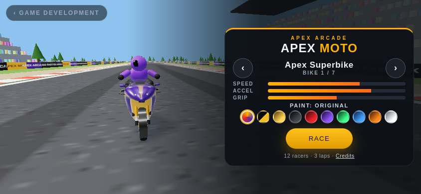 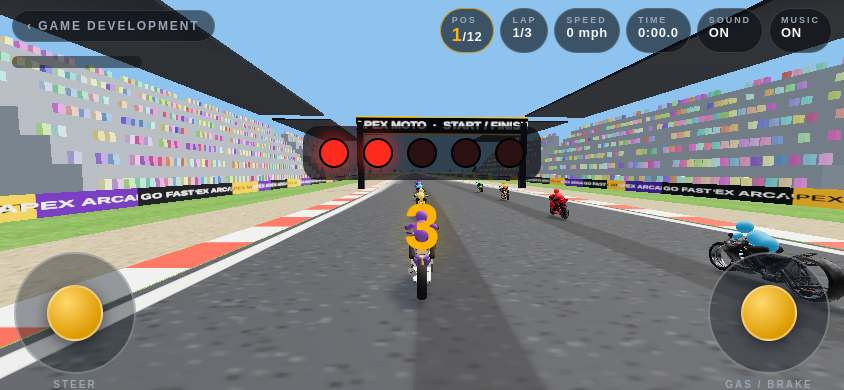

## 🟡 CHECK — Paper Plane

`apexpaperplane.html`

- 🟡 Couldn't press any start button - add/fix this game's steps in games.json
- 🟡 Busy play screen: about 24 words during play (biggest: "Hold to climb · let go to glide") - aim for only button labels and the score; instructions go behind How to play (STUDIO-STANDARD.md "Clean screen")
- 🟡 Only 0 play test(s) - every game needs 5+ tests that play it by its rules (fixes/apexpaperplane.mjs, ids 'play-...')
- 🟡 Not on the shared controls yet (kit/controls.js) - its job moves this game over; until then its own stick code is allowed
- 🟡 No friend codes yet - add a "👥 Play a friend" button (My code / Enter a friend's code) with ApexKit.friend and a 'play-friend-code' test (STORE-READY.md "Friend codes")
- 🟡 No REALITY hook yet (window.__reality) - add it so the robot can measure direction, sizes and ground contact (REALITY.md "Robot hook")
- 🟡 No close-up of the player: no player in the hook (REALITY.md hook: player)

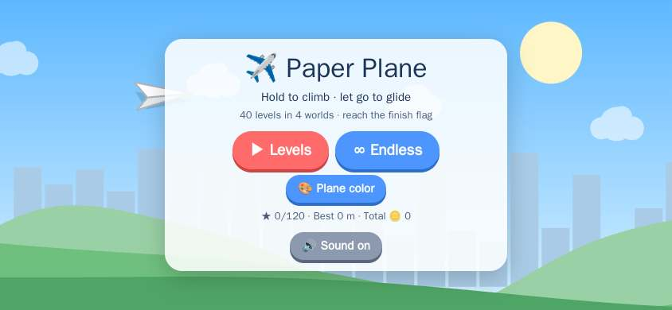 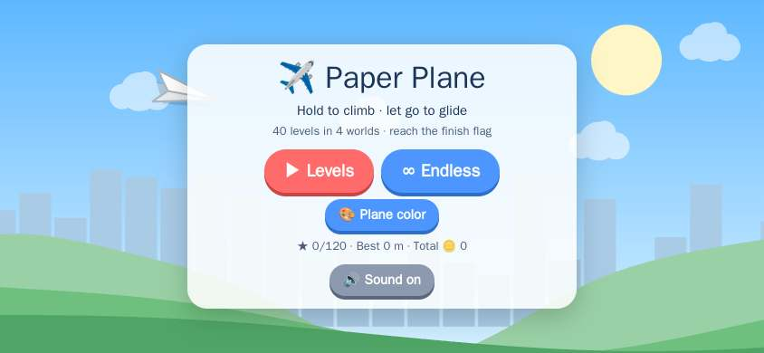

## 🟡 CHECK — Reef Dash

`apexreefdash.html`

- 🟡 Couldn't press any start button - add/fix this game's steps in games.json
- 🟡 Busy play screen: about 24 words during play (biggest: "Steer your sub to the finish gate") - aim for only button labels and the score; instructions go behind How to play (STUDIO-STANDARD.md "Clean screen")
- 🟡 Only 0 play test(s) - every game needs 5+ tests that play it by its rules (fixes/apexreefdash.mjs, ids 'play-...')
- 🟡 Not on the shared controls yet (kit/controls.js) - its job moves this game over; until then its own stick code is allowed
- 🟡 No friend codes yet - add a "👥 Play a friend" button (My code / Enter a friend's code) with ApexKit.friend and a 'play-friend-code' test (STORE-READY.md "Friend codes")
- 🟡 No REALITY hook yet (window.__reality) - add it so the robot can measure direction, sizes and ground contact (REALITY.md "Robot hook")
- 🟡 No close-up of the player: no player in the hook (REALITY.md hook: player)

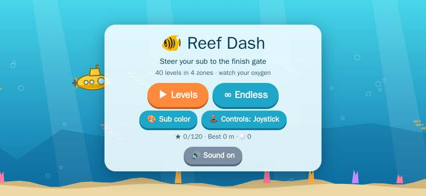 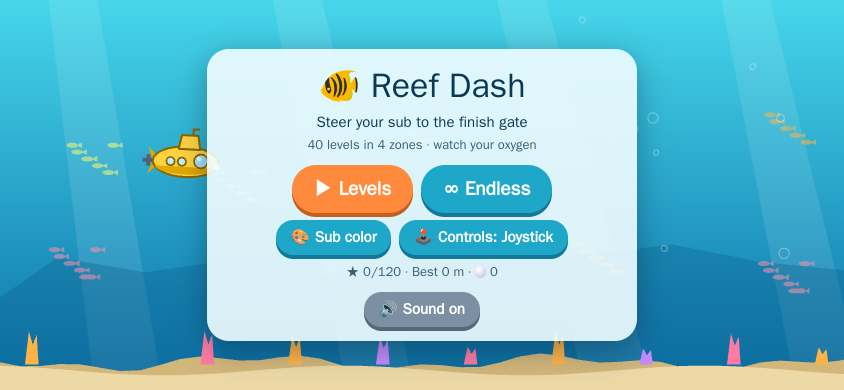

## 🔴 FAIL — Apex Soccer

`apexsoccer.html`

- 🔴 Owner's fix NOT done yet: "The players do not steal the ball - computer players must tackle and win the ball" (defending AI won the ball 2x and kept it 0x in 22s (need 2 steals, 1 kept))
- 🔴 Owner's fix NOT done yet: "Players do not play correctly - pass like real soccer" (AI team completed only 1 passes in 16s of possession (need 3+))
- 🔴 Owner's fix NOT done yet: "Players do not play correctly - position like real soccer" (back line did not push up: defenders average x=-36.2 (anchors are -34) with the ball at +30)
- 🔴 STICK: the touch controls can get stuck - add window blur + visibilitychange handlers that set the stick and every held button back to 0 (a call or notification on the phone must never leave the player moving or steering by itself)
- 🟡 No owner-approved venue - build it from venues/soccer.md (real sizes, stands all around, crowd) with venues/kit in tools/venue-viewer.html, add it to MODELS.md as WAITING OWNER
- 🟡 Stutter: 10 short freezes in 6 s of play (worst 1617 ms, normal frame 17 ms) - usually new objects made every frame (garbage), big pictures loaded mid-game or a model built during play; build everything before play starts and reuse objects (STUDIO-STANDARD.md "Phone budget")
- 🟡 looks/apexsoccer.md has no "WHERE THINGS ARE" map at the top (STUDIO-STANDARD 9.7) - add one with line numbers and keep it current
- 🟡 Play test failing: "a goal restarts from the centre spot" (after a goal the ball did not restart from the centre spot)
- 🟡 Not on the shared controls yet (kit/controls.js) - its job moves this game over; until then its own stick code is allowed
- 🟡 No friend codes yet - add a "👥 Play a friend" button (My code / Enter a friend's code) with ApexKit.friend and a 'play-friend-code' test (STORE-READY.md "Friend codes")
- 🟡 No REALITY hook yet (window.__reality) - add it so the robot can measure direction, sizes and ground contact (REALITY.md "Robot hook")
- 🟡 No close-up of the player: no player in the hook (REALITY.md hook: player)

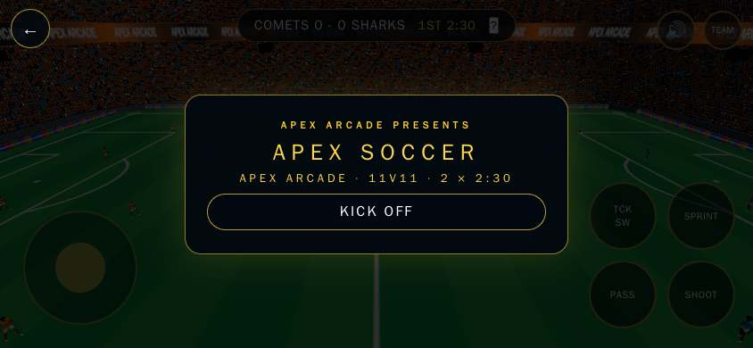 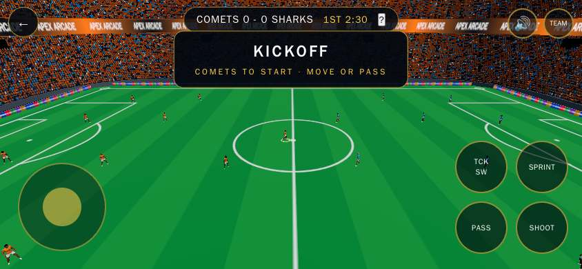

## 🔴 FAIL — Apex Track & Field

`apextrackfield.html`

- 🔴 Owner's fix NOT done yet: "TESTER (G-200, BREAK round): 10,000m - mashing the run controls faster than any human cadence must not make the player faster. Stride input needs a rate cap: after settling into the run, 30 game-seconds of striding on EVERY tick (60/s) must not average more than 8.6 m/s (honest 0.30 s alternating cadence measured 7.56 m/s average, peak 7.97, on 2026-10-22; rivals are capped near 5.5-6.3 m/s)." (mashing the run controls on every tick (60 strides/s) for 30 game-s moved the player 316.7m - an average of 10.56 m/s, peak 10.56 m/s - while honest 0.30 s alternating taps average 7.56 m/s and the rivals are capped near 5.5-6.3 m/s. There is no cap on stride rate, so inhuman tapping buys inhuman speed in the 10,000m (UNFAIR: the rivals obey caps the player can tap past))
- 🔴 Owner's fix NOT done yet: "CHECKLIST T04 (G-259): the relay baton changeover zone is 30 m long (rules/trackfield.md) - the green zone markings painted on the track in the relay event must span 30 m, within 3%" (no relay changeover-zone markings found in the relay event)
- 🔴 Owner's fix NOT done yet: "TESTER (G-234): real sport - the 300m Hurdles has 7 hurdles per lane like the real 300m hurdles (rules/short/apextrackfield.md: every event is the REAL sport start to finish)." (the 300m Hurdles places 8 hurdles per lane (64 hurdle instances for 8 lanes) - the real 300m hurdles has 7 hurdles per lane (rules/short/apextrackfield.md: every event is the REAL sport start to finish))
- 🔴 Owner's fix NOT done yet: "CHECKLIST T05 (G-260): a tailwind over +2.0 m/s means the time does not count as a record, shown as "w" (rules/trackfield.md) - the sprint results screen must show a wind reading, and a wind-aided time must carry the "w" mark instead of counting as a best" (the game models no wind at all: the sprint engine has no wind value (0 wind keys), the results screen shows "05.47  (1st)" with no wind reading and no "w" mark, and the time was saved as a best ({"60m":0.85}) - so a tailwind over +2.0 m/s (rules/trackfield.md: the time does not count as a record, shown as "w") can never apply)
- 🔴 Owner's fix NOT done yet: "TESTER (G-271, checklist T07): throws get 3 attempts (plus 3 more for the top 8) - rules/trackfield.md." (the Shot Put ended after 3 attempts (attMax 3) and no athlete got 3 more attempts - rules/trackfield.md says throws get 3 attempts (plus 3 more for the top 8))
- 🟡 Play test failing: "Final results show ONE table and ONE menu button (not the standings twice, not MENU and BACK TO MENU together), and the top-left words sit on a dark backing" (test error: page.evaluate: Execution context was destroyed, most likely because of a navigation)
- 🟡 Not on the shared controls yet (kit/controls.js) - its job moves this game over; until then its own stick code is allowed
- 🟡 REALITY (yellow - no time()/gait() in the hook, so the robot cannot tell a sprint start from walking): wheels/feet/skates FLOAT above the ground while standing/walking (1 of 3 readings over 3 cm, highest 0.03 m)
- 🟡 REALITY (yellow - no time()/gait() in the hook, so the robot cannot tell a sprint start from walking): feet/skates/wheels never touch down while moving fast - no touchdown for 3.7 s (a sprint lands a foot at least every 0.5 s; lowest 0.00 m)
- 🟡 REALITY: the hook has no time() - add time: () => <game seconds> and speed: () => <m/s> so a busy robot cannot mistake a sprint for walking (REALITY.md)
- 🟡 Play test failing: "Winning the career championship (final) meet must unlock the next season" (won/played the championship meet but the next season never unlocked (career still at season 2))
- 🟡 Play test failing: "OWNER (2026-10-20): Triple jump - play it start to finish like a real meet and fix what is not real" (the jump does not land in the sand pit - he came down at x -17.8 and the pit runs from -29.5 to -18.5)
- 🟡 Play test failing: "A call or notification must never leave the player steering by itself: the held stick resets to centre on window blur and when the page hides" (test error: page.evaluate: Execution context was destroyed, most likely because of a navigation)
- 🟡 Play test failing: "JOB G-83 (owner 4.png): in the 10,000m, after the start the WHOLE field (the player too) moves to lane 1, like a real distance race - nobody runs the whole race alone in an outer lane" (the 10,000m draw never reported the field lanes)
- 🟡 Career mode broken: "Winning the career championship (final) meet must unlock the next season"
- 🟡 Friend codes have no 'play-friend-code' test yet (STORE-READY.md "Friend codes")
- 🟡 REALITY (yellow - no time()/gait() in the hook, so the robot cannot tell a sprint start from walking): feet/skates/wheels never touch down while moving fast - no touchdown for 2.8 s (a sprint lands a foot at least every 0.5 s; lowest -0.05 m)
- 🟡 Play test failing: "A held ACTION button (the discus hold-to-spin) must release when a call or notification interrupts - blur releases it like a finger lift" (test error: page.evaluate: Execution context was destroyed, most likely because of a navigation)
- 🟡 Play test failing: "JOB G-83 (owner 3.png): the 4x100 relay must start at the REAL staggered relay start - never a line-up under the FINISH banner - and every lane has starting blocks" (the relay start shows 7 starting blocks - every one of the 8 lanes must have blocks)

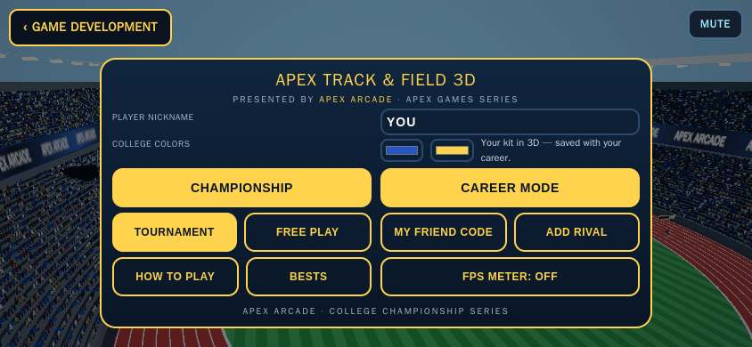 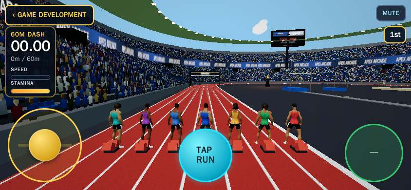

