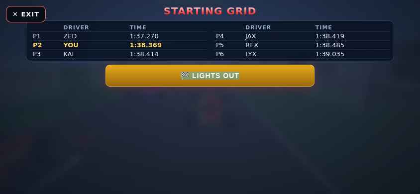
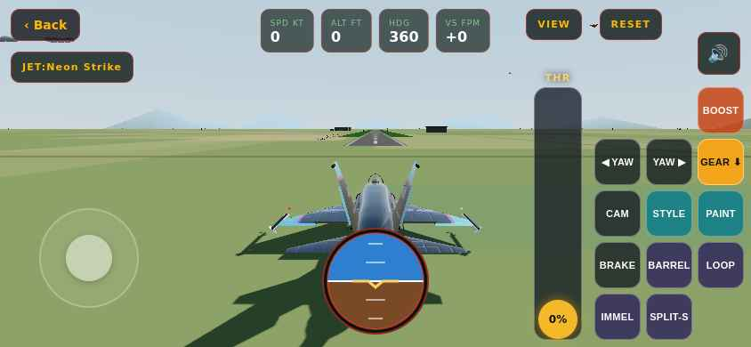
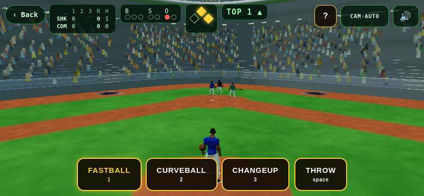
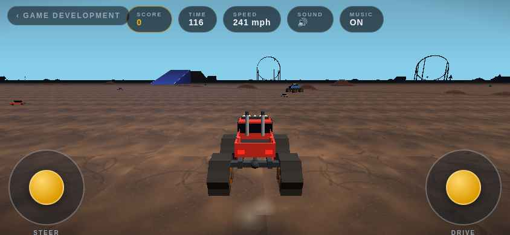
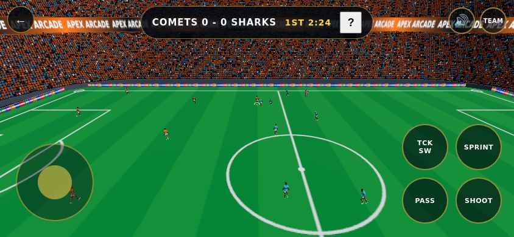

# 🎮 Play testers

**Nov 21, 2026, 4:02 AM (Central)** · main @ `e6dda30`

4 robot testers really PLAYED each game for a few minutes in 3 styles (gas = holds drive, masher = taps every button, swiper = drags across the screen) and wrote down what went wrong. Muses: fix your game's lines, then the next round checks it again. Made by tools/playtest.

## 🔴 Apex F1 Racing — `apexf1.html`

- swiper: playing it changed the screen only 0% of the time (controls may not respond) ([picture](img/apexf1-swiper-dull.jpg))

gas: moving 100%, rounds ended 0 · masher: moving 100%, rounds ended 0 · swiper: moving 0%, rounds ended 0

## 🔴 Apex Flight — `apexflight.html`

- gas: playing it changed the screen only 11% of the time (controls may not respond) ([picture](img/apexflight-gas-dull.jpg))

gas: moving 11%, rounds ended 0 · masher: moving 94%, rounds ended 0 · swiper: moving 33%, rounds ended 0

## 🔴 Apex Track & Field — `apextrackfield.html`

- masher: the robot couldn't take a picture (the game may have frozen the phone)

gas: moving 100%, rounds ended 0 · masher: moving 100%, rounds ended 0 · swiper: moving 100%, rounds ended 0

## ✅ Apex Baseball — `apexbaseball.html`

- Played all 3 styles, nothing wrong.

gas: moving 100%, rounds ended 0 · masher: moving 86%, rounds ended 0 · swiper: moving 100%, rounds ended 0

## ✅ Apex Ice Hockey — `apexhockey.html`

- Played all 3 styles, nothing wrong.

gas: moving 100%, rounds ended 0 · masher: moving 100%, rounds ended 0 · swiper: moving 100%, rounds ended 0

## ✅ Apex Monster Truck — `apexmonstertruck.html`

- Played all 3 styles, nothing wrong.

gas: moving 100%, rounds ended 0 · masher: moving 67%, rounds ended 0 · swiper: moving 33%, rounds ended 0

## ✅ Apex Moto — `apexmoto.html`

- Played all 3 styles, nothing wrong.

gas: moving 86%, rounds ended 0 · masher: moving 100%, rounds ended 0 · swiper: moving 100%, rounds ended 0

## ✅ Paper Plane — `apexpaperplane.html`

- Played all 3 styles, nothing wrong.

gas: moving 89%, rounds ended 0 · masher: moving 100%, rounds ended 0 · swiper: moving 100%, rounds ended 0

## ✅ Exotic Racer Club — `apexracer.html`

- Played all 3 styles, nothing wrong.

gas: moving 100%, rounds ended 0 · masher: moving 100%, rounds ended 0 · swiper: moving 100%, rounds ended 0

## ✅ Reef Dash — `apexreefdash.html`

- Played all 3 styles, nothing wrong.

gas: moving 100%, rounds ended 1 · masher: moving 100%, rounds ended 7 · swiper: moving 100%, rounds ended 6 · first round ended after 2 s

## ✅ Apex Soccer — `apexsoccer.html`

- Played all 3 styles, nothing wrong.

gas: moving 100%, rounds ended 0 · masher: moving 100%, rounds ended 0 · swiper: moving 100%, rounds ended 0

