# 🎮 Play testers

**Nov 7, 2026, 3:03 AM (Central)** · main @ `12244f6`

4 robot testers really PLAYED each game for a few minutes in 3 styles (gas = holds drive, masher = taps every button, swiper = drags across the screen) and wrote down what went wrong. Muses: fix your game's lines, then the next round checks it again. Made by tools/playtest.

## 🔴 Apex Flight — `apexflight.html`

- gas: playing it changed the screen only 20% of the time (controls may not respond) ([picture](img/apexflight-gas-dull.jpg))

gas: moving 20%, rounds ended 0 · masher: moving 75%, rounds ended 0 · swiper: moving 100%, rounds ended 0

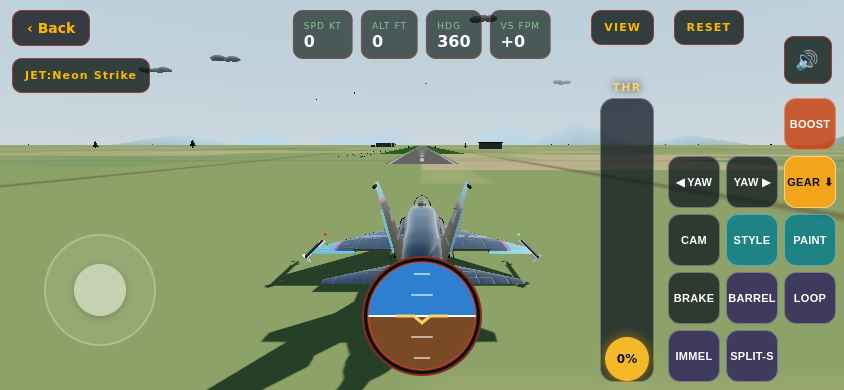

## 🔴 Exotic Racer Club — `apexracer.html`

- swiper: the robot couldn't take a picture (the game may have frozen the phone)
- swiper: playing it changed the screen only 0% of the time (controls may not respond) ([picture](img/apexracer-swiper-dull.jpg))

gas: moving 100%, rounds ended 0 · masher: moving 100%, rounds ended 0 · swiper: moving 0%, rounds ended 0

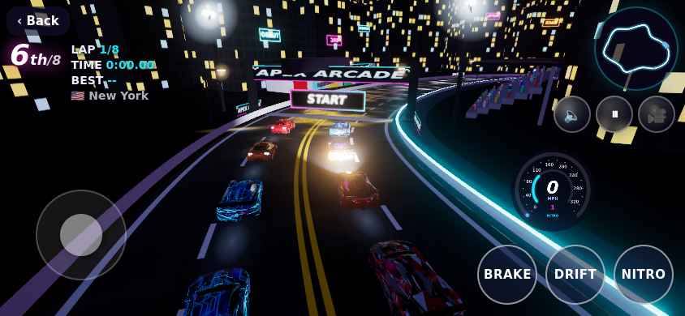

## ✅ Apex Baseball — `apexbaseball.html`

- Played all 3 styles, nothing wrong.

gas: moving 100%, rounds ended 0 · masher: moving 89%, rounds ended 0 · swiper: moving 100%, rounds ended 0

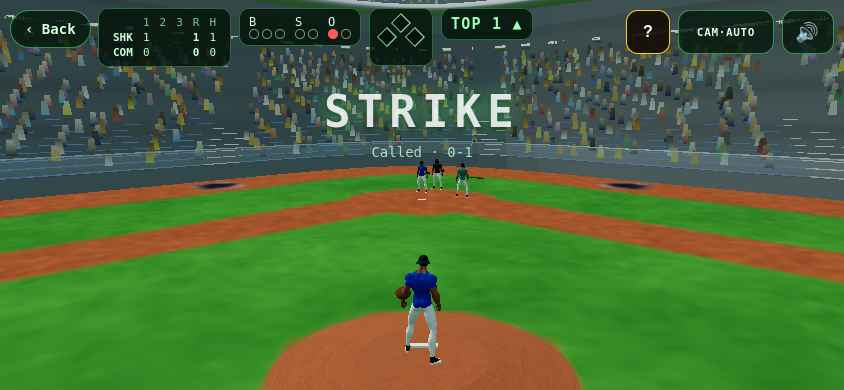

## ✅ Apex F1 Racing — `apexf1.html`

- Played all 3 styles, nothing wrong.

gas: moving 100%, rounds ended 0 · masher: moving 67%, rounds ended 0 · swiper: moving 67%, rounds ended 0

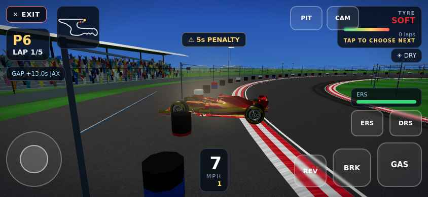

## ✅ Apex Ice Hockey — `apexhockey.html`

- Played all 3 styles, nothing wrong.

gas: moving 100%, rounds ended 0 · masher: moving 100%, rounds ended 0 · swiper: moving 100%, rounds ended 0

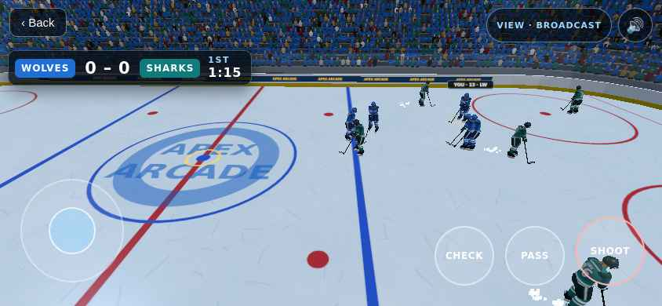

## ✅ Apex Monster Truck — `apexmonstertruck.html`

- Played all 3 styles, nothing wrong.

gas: moving 100%, rounds ended 0 · masher: moving 50%, rounds ended 0 · swiper: moving 50%, rounds ended 0

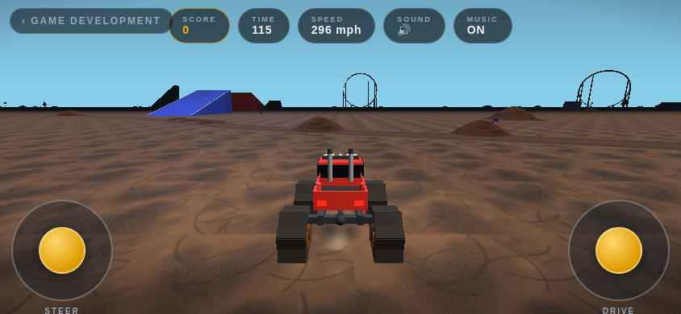

## ✅ Apex Moto — `apexmoto.html`

- Played all 3 styles, nothing wrong.

gas: moving 100%, rounds ended 0 · masher: moving 100%, rounds ended 0 · swiper: moving 100%, rounds ended 0

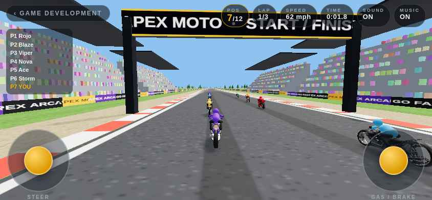

## ✅ Paper Plane — `apexpaperplane.html`

- Played all 3 styles, nothing wrong.

gas: moving 90%, rounds ended 0 · masher: moving 100%, rounds ended 0 · swiper: moving 77%, rounds ended 0

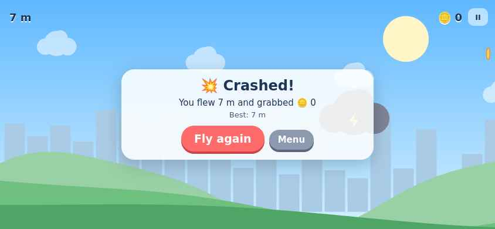

## ✅ Reef Dash — `apexreefdash.html`

- Played all 3 styles, nothing wrong.

gas: moving 100%, rounds ended 1 · masher: moving 100%, rounds ended 4 · swiper: moving 100%, rounds ended 2 · first round ended after 13 s

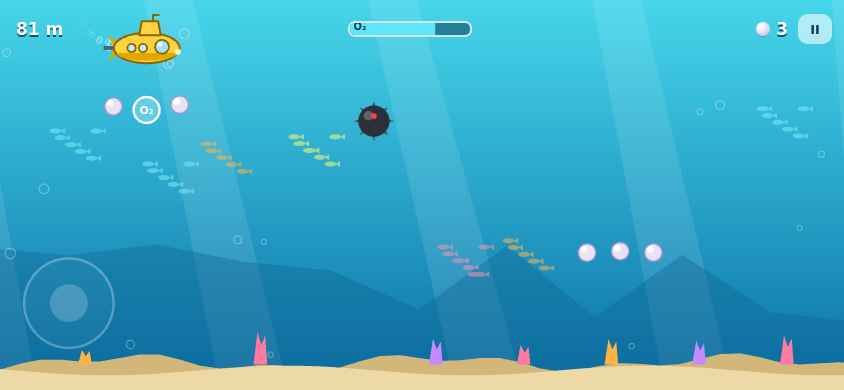

## ✅ Apex Soccer — `apexsoccer.html`

- Played all 3 styles, nothing wrong.

gas: moving 100%, rounds ended 0 · masher: moving 80%, rounds ended 0 · swiper: moving 100%, rounds ended 0

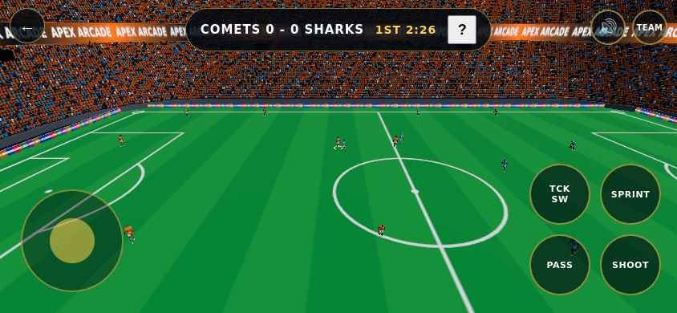

## ✅ Apex Track & Field — `apextrackfield.html`

- Played all 3 styles, nothing wrong.

gas: moving 100%, rounds ended 0 · masher: moving 100%, rounds ended 0 · swiper: moving 100%, rounds ended 0

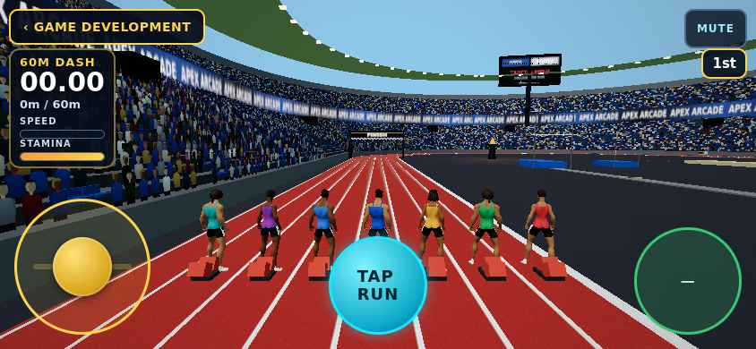

