# Game check

**Oct 31, 2026, 10:03 AM (Central)** · main @ `47aa83e` · played side by side

**0 pass · 10 to check · 1 fail** out of 11 games (11 played this run, 0 kept from the last check).

## 🔴 FAIL — Apex Soccer

`apexsoccer.html`

- 🔴 Owner's fix NOT done yet: "Players do not play correctly - mark like real soccer" [test id: defenders-mark-men] (an attacker at (-40,12) has no marker within 6m (nearest 6.2m))
- 🔴 Owner's fix NOT done yet: "Players do not play correctly - pass like real soccer" [test id: ai-builds-up-with-passes] (AI team completed only 1 passes in 16s of possession (need 3+))
- 🔴 Owner's fix NOT done yet: "Players do not play correctly - position like real soccer" [test id: team-positioning] (back line did not push up: defenders average x=-30.2 (anchors are -34) with the ball at +30)
- 🟡 No owner-approved venue - build it from venues/soccer.md (real sizes, stands all around, crowd) with venues/kit in tools/venue-viewer.html, add it to MODELS.md as WAITING OWNER
- 🟡 Stutter: 15 short freezes in 6 s of play (worst 683 ms, normal frame 17 ms) - usually new objects made every frame (garbage), big pictures loaded mid-game or a model built during play; build everything before play starts and reuse objects (STUDIO-STANDARD.md "Phone budget")
- 🟡 looks/apexsoccer.md has no "WHERE THINGS ARE" map at the top (STUDIO-STANDARD 9.7) - add one with line numbers and keep it current
- 🟡 Play test failing: "a goal restarts from the centre spot" [test id: play-goal-restarts-centre] (after a goal the ball did not restart from the centre spot)
- 🟡 Not on the shared controls yet (kit/controls.js) - its job moves this game over; until then its own stick code is allowed
- 🟡 No friend codes yet - add a "👥 Play a friend" button (My code / Enter a friend's code) with ApexKit.friend and a 'play-friend-code' test (STORE-READY.md "Friend codes")
- 🟡 No REALITY hook yet (window.__reality) - add it so the robot can measure direction, sizes and ground contact (REALITY.md "Robot hook")
- 🟡 No close-up of the player: no player in the hook (REALITY.md hook: player)

**Owner's fix list** (8 of 12 done):
- ✅ The stadium is still not right - make it a real soccer stadium: stands all around, lights, a crowd
- ✅ The players do not steal the ball - computer players must tackle and win the ball
- ❌ Players do not play correctly - mark like real soccer — an attacker at (-40,12) has no marker within 6m (nearest 6.2m)
- ✅ Players do not play correctly - spread out like real soccer
- ❌ Players do not play correctly - pass like real soccer — AI team completed only 1 passes in 16s of possession (need 3+)
- ❌ Players do not play correctly - position like real soccer — back line did not push up: defenders average x=-30.2 (anchors are -34) with the ball at +30
- ✅ computer players win the ball back within 30 s
- ✅ players keep their positions (formation discipline, not everyone chasing)
- ❌ a goal restarts from the centre spot — after a goal the ball did not restart from the centre spot
- ✅ 11 v 11 - ten outfield players plus a goalkeeper per team
- ✅ kick-off starts from the centre spot
- ✅ A call, notification or hidden tab lets go of the stick, keys, sprint and a charged shot (the shot is cancelled, never fired)

  

## 🟡 CHECK — Apex Baseball

`apexbaseball.html`

- 🟡 No owner-approved venue - build it from venues/ballpark.md (real sizes, stands all around, crowd) with venues/kit in tools/venue-viewer.html, add it to MODELS.md as WAITING OWNER
- 🟡 Stutter: 14 short freezes in 6 s of play (worst 967 ms, normal frame 17 ms) - usually new objects made every frame (garbage), big pictures loaded mid-game or a model built during play; build everything before play starts and reuse objects (STUDIO-STANDARD.md "Phone budget")
- 🟡 LINT fixes/apexbaseball.mjs: 3 h.eval call(s) navigate / wait / poll with no .catch (a destroyed execution context fails the test on the robot only) - first ones: play-feet-within-3cm line 838, play-camera-follows-pitch line 1195, play-contact-big-at-plate line 1248. Add .catch(() => false) or try/catch. Run: node tools/game-check/fixes-lint.mjs tools/game-check/fixes/apexbaseball.mjs
- 🟡 Play test failing: "BUILD G-394: every player sole rests on the ground - lowest posed sole vertex within 2 cm under or over the ground (ground 0, mound 0.3) for every rigged player, standing" [test id: play-feet-on-ground] (lineup3 sole -0.050 m; lineup4 sole -0.050 m — outside the 2 cm band)
- 🟡 Not on the shared controls yet (kit/controls.js) - its job moves this game over; until then its own stick code is allowed
- 🟡 Friend codes have no 'play-friend-code' test yet (STORE-READY.md "Friend codes")
- 🟡 REALITY (yellow - no time()/gait() in the hook, so the robot cannot tell a sprint start from walking): wheels/feet/skates FLOAT above the ground while standing/walking (7 of 9 readings over 3 cm, highest 0.27 m)
- 🟡 REALITY (yellow - no time()/gait() in the hook, so the robot cannot tell a sprint start from walking): feet/skates/wheels never touch down while moving fast - no touchdown for 3.7 s (a sprint lands a foot at least every 0.5 s; lowest 0.00 m)
- 🟡 REALITY: the hook has no time() - add time: () => <game seconds> and speed: () => <m/s> so a busy robot cannot mistake a sprint for walking (REALITY.md)
- 🟡 Play test failing: "Play baseball by its rules: three outs end the half inning and the other side comes in (inning ends)" [test id: play-rules-inning-ends] (the half inning never ended in 29 s of real play (still TOP 1 ▲))
- 🟡 Play test failing: "The owner's new ballpark (Apex Arcade Park) loads with its crowd, presented as the night park it is (G-40)" [test id: play-stadium-loads] (the ballpark loaded but the game still shows the old daytime look - his park is a night park (floodlights, dark sky))
- 🟡 Play test failing: "BUILD G-237: batting timing is scored on the pitch game clock, not the wall clock - a swing made as the ball crosses the plate contacts or fouls instead of always whiffing (G-184/G-237)" [test id: play-batting-timing-game-clock] (never reached a swing at the plate in 29 s (game too slow to reach a bottom-half pitch at the plate))
- 🟡 Play test failing: "BUILD G-222 (owner order Oct 22): the camera follows the windup and the pitch in flight - it moves with the play and keeps the ball on screen until it reaches the plate" [test id: play-camera-follows-pitch] (the camera is frozen during the windup: 1 distinct position(s) (owner: the camera follows the windup))

**Owner's fix list** (45 of 50 done):
- ✅ Stick proof 1 of 3 (real touch): drag the aim pad, lift the finger (pointerup) - the stick lets go, nothing stays held (G-85)
- ✅ Stick proof 2 of 3 (real touch): drag the aim pad, the touch is cancelled (pointercancel, e.g. a call comes in) - the stick resets to zero (G-85)
- ✅ The umpire stands behind the batter (behind the catcher) - never a second man stacked on the pitcher (owner G-85 fix)
- ✅ Pitcher throws the ball toward the plate
- ✅ Play baseball by its rules: a batter puts the ball in play and gets a hit (hit)
- ✅ Play baseball by its rules: an out is recorded on a strikeout, a catch or a ground out (out)
- ✅ TESTER: the ball/strike count never resets after a strikeout or a walk - the next batter starts with the old count (the banner shows counts like 4-2), so he strikes out on one strike or walks on one ball
- ✅ BUILD G-146 (art director): every player stands ON the ground - soles measured on the skinned body (the reality robot method) across standing and the batter trot: 0 readings sunk more than 5 cm and every reading within 3 cm of the ground
- ❌ BUILD G-394: every player sole rests on the ground - lowest posed sole vertex within 2 cm under or over the ground (ground 0, mound 0.3) for every rigged player, standing — lineup3 sole -0.050 m; lineup4 sole -0.050 m — outside the 2 cm band
- ✅ BUILD G-151 (art director): the play picture is a DAY scene - bright frame, the stands full of visible crowd people, and the batter big and lit above the bottom bar in the pitching view and with the ball in play
- ✅ the batter close-up shows his face and eyes (no helmet blob over them) and a full baseball uniform - button-front jersey in the team colour, no printed tee logo
- ✅ BUILD G-222 (owner order Oct 22): the pitcher stands fully inside the pitching frame - head and feet on screen, not cut off below it
- ✅ BUILD G-222 (owner order Oct 22): the contact moment is big at the plate - as the pitch reaches the plate the batter fills the frame (not a speck), so you see the ball meet the bat
- ✅ BUILD G-278: a pitch flight completes within its own game time plus 2 s of frame and observation lag on a loaded page (the G-262 fix round 1 cap of +0.75 s failed a correct 0.95 s fastball the robot measured at 1.91 s wall on main ef8ce80)
- ✅ Make a baseball stadium
- ✅ Players are real-proportioned people, about 1.85 m tall (G-65)
- ✅ Cameras are the TV broadcast spec: field of view 40-45 degrees, and the pitching view sits high on the centre-field side behind the pitcher (G-65)
- ✅ The first menu picture already shows the new ballpark: a loading screen covers the game until Apex Arcade Park has loaded, and only then does the menu open (G-79)
- ✅ Stick proof 3 of 3 (real touch): drag the aim pad, the window loses focus (blur, e.g. app switch) - the stick resets to zero (G-85)
- ✅ KEEP: everything that works and looks right now (batting flow)
- ✅ Three outfielders visible who chase fly balls (KEEP)
- ✅ Stadium has a crowd (venue sheet: 25,000+)
- ✅ Score, inning, balls/strikes/outs track correctly
- ✅ Day lighting: batter clearly visible (KEEP: no night-dark, no green tint)
- ✅ Gameplay picture must not freeze (no slowmo)
- ✅ Menu has a Play a friend button (G-08)
- ✅ Play a friend with a friend code (G-08)
- ✅ Play baseball by its rules: a pitch is thrown toward the plate and the count moves (pitch)
- ✅ Play baseball by its rules: a run crosses the plate and the score goes up (run scores)
- ❌ Play baseball by its rules: three outs end the half inning and the other side comes in (inning ends) — the half inning never ended in 29 s of real play (still TOP 1 ▲)
- ❌ The owner's new ballpark (Apex Arcade Park) loads with its crowd, presented as the night park it is (G-40) — the ballpark loaded but the game still shows the old daytime look - his park is a night park (floodlights, dark sky)
- ✅ The park field wears the owner's kit grass + infield dirt textures (G-51)
- ✅ TESTER: menu overlay buttons hang off the bottom of a sideways phone - Help CLOSE is fully below the screen (overlay does not scroll, so Help cannot be closed) and the Friend START/CLOSE buttons are cut off
- ✅ TESTER: the ? (help) button at the top right sits on top of the CAM button - the CAM label is partly covered and the covered part cannot be tapped
- ❌ BUILD G-237: batting timing is scored on the pitch game clock, not the wall clock - a swing made as the ball crosses the plate contacts or fouls instead of always whiffing (G-184/G-237) — never reached a swing at the plate in 29 s (game too slow to reach a bottom-half pitch at the plate)
- ✅ TESTER: batting timing is judged on the wall clock while the pitch flies on game time - on a slow device a fastball takes ~9-12 s of wall time to arrive (game time 0.95 s), but a swing only counts within 0.17 s of the wall-clock mark, so a swing made exactly as the ball crosses the plate is always a swinging strike (G-184: 14 timed swings, 0 contact)
- ✅ BUILD G-120: the REALITY hook exposes camera: (REALITY.md) - the game THREE camera, so the robot can take the player close-up
- ✅ BUILD G-144: the owner kits are really used - crowd, bat crack and glove samples from sounds/stadium/baseball/ decoded and ready, and the kit infield/grass textures from kit/ground/512/ on the park field LIVE material (touch path included)
- ✅ NEVER (owner 2026-10-23, G-222 fix round 1): the field and players stay clear and recognizable in the pitching view (crisp rendering - texture anisotropy on the park), and the pitcher glove reads as a glove, never a big brown thing on his arm (a real mitt is ~0.32 m, not a 0.44 m smooth blob)
- ✅ NEVER (G-167 fix round 1, 2026-10-22): the pitching camera sits so far back that the players are specks - zoom in so the batter and catcher read big in the play picture
- ❌ BUILD G-222 (owner order Oct 22): the camera follows the windup and the pitch in flight - it moves with the play and keeps the ball on screen until it reaches the plate — the camera is frozen during the windup: 1 distinct position(s) (owner: the camera follows the windup)
- ✅ BUILD G-248: the REALITY hook reports unitsPerMetre 1.0936 (the game runs on 3 ft units, 1 unit = 0.9144 m) so the robot and testers read metres (REALITY.md Units)
- ✅ BUILD G-248 (robot red line on PR #1381): on an upright phone (390x844) the Help overlay CLOSE button sits off the left edge of the screen - the rotated stage is 390 tall but the compact-card rules only fire on a sideways phone, so the card lays out 695 tall inside the 390 stage and rotation pushes CLOSE off screen; the CLOSE button must be fully on screen on an upright phone
- ✅ BUILD G-262: during a pitch flight window.__test.flightT reports the thrown pitch's own game time (fast 0.95 / curve 1.18 / change 1.38) so the batting-timing test judges each flight against its own T instead of a hardcoded fastball
- ✅ CHECKLIST B01: Bases are 27.4 m apart (REALITY.md) - distance between neighbouring base objects, within 3%
- ✅ tester-chk-b03
- ✅ TESTER: on an upright phone the Help overlay CLOSE button sits off the left edge of the screen - Help cannot be closed by tapping without rotating the phone
- ✅ BUILD G-269: the batting order has 9 distinct batters (rules/baseball.md) - nine bat-holding figures stand in the scene, not the same one figure for every at-bat
- ✅ The batting order has 9 batters (rules/baseball.md)
- ✅ Balance: a batter who times it well makes hard contact, a batter who never swings does not, and a beginner can still hit

   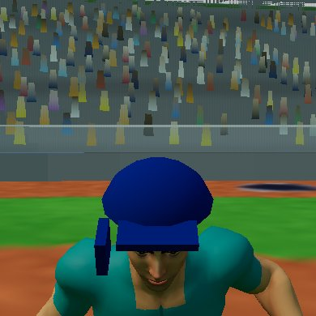

## 🟡 CHECK — Apex Ice Hockey

`apexhockey.html`

- 🟡 Stutter: 6 short freezes in 6 s of play (worst 850 ms, normal frame 100 ms) - usually new objects made every frame (garbage), big pictures loaded mid-game or a model built during play; build everything before play starts and reuse objects (STUDIO-STANDARD.md "Phone budget")
- 🟡 LINT fixes/apexhockey.mjs: 6 h.eval call(s) navigate / wait / poll with no .catch (a destroyed execution context fails the test on the robot only) - first ones: play-save-shows-once-camera-holds line 1067, play-save-shows-once-camera-holds line 1079, play-stick-resets-on-blur line 1367. Add .catch(() => false) or try/catch. Run: node tools/game-check/fixes-lint.mjs tools/game-check/fixes/apexhockey.mjs
- 🟡 Play test failing: "skates sit exactly on the ice and the blades show silver under the boots: the goalie dropping into a butterfly never drags his blades under the ice, and the blade steel is a bright silver that reads as metal, not black" [test id: play-goalie-blades-on-ice] (could not get a match into play to test the goalie blades)
- 🟡 Play test failing: "G-210 (art director): at 844x390 every menu line sits inside the frame and nothing overlaps - title, subtitle, star card, the three buttons, credits, friend code and the keys lines all fully visible, and the star card never slides under the VIEW/mute buttons" [test id: play-menu-fits-frame] (menu lines are clipped by the frame at 844x390: DIV "APEX ARCADE PRESENTS" spans y -10..5; keys "Skate with the left stic" spans y 365..396 - every line must sit inside the frame)
- 🟡 Not on the shared controls yet (kit/controls.js) - its job moves this game over; until then its own stick code is allowed
- 🟡 Friend codes have no 'play-friend-code' test yet (STORE-READY.md "Friend codes")
- 🟡 Stutter: 5 short freezes in 6 s of play (worst 1350 ms, normal frame 150 ms) - usually new objects made every frame (garbage), big pictures loaded mid-game or a model built during play; build everything before play starts and reuse objects (STUDIO-STANDARD.md "Phone budget")
- 🟡 Play test failing: "after a save, SAVED! shows exactly once (a rebound re-save in the same scramble does not show it again) and the broadcast camera does not rewind: its puck lead swings smoothly instead of snapping when the puck reverses" [test id: play-save-shows-once-camera-holds] (could not get a match into play for the save test)
- 🟡 Play test failing: "a defender takes the puck off an away rush (the rush does not score untouched)" [test id: play-defender-takes-puck] (no defender took the puck within 20 game-seconds of the rush)
- 🟡 Play test failing: "skates touch the ice the whole time while skating (gap under 3 cm - never floating above it, never sunk under it)" [test id: play-skates-touch-ice] (could not get a match into play to measure the skates)
- 🟡 Play test failing: "the game clock and score run in real time: 5 seconds of play takes about 5 seconds off the clock (not 30), and a game nobody touches for 10 seconds keeps the same clock and score" [test id: play-clock-real-time] (the game moved with nobody touching it: clock 117s -> 108s, score 0 – 0 -> 0 – 0)
- 🟡 Stutter: 10 short freezes in 6 s of play (worst 1217 ms, normal frame 17 ms) - usually new objects made every frame (garbage), big pictures loaded mid-game or a model built during play; build everything before play starts and reuse objects (STUDIO-STANDARD.md "Phone budget")
- 🟡 Play test failing: "a goal counts on the scoreboard and restarts from centre ice" [test id: play-goal-restarts-centre] (after the goal the puck did not restart from centre ice)
- 🟡 Play test failing: "the opening faceoff drops the puck at centre ice" [test id: play-faceoff-at-centre] (opening faceoff not at centre: (45.1, 9.2))
- 🟡 Career mode has NO playability test - add 'play-career-...' tests that start every career level, play it to the end and unlock the next (STORE-READY.md "Career mode")

**Owner's fix list** (72 of 80 done):
- ✅ career mode: play weeks 5-7 to the end - each week unlocks the next
- ✅ career mode: play weeks 8-10 to the end - finishing the season unlocks the semifinal
- ❌ skates sit exactly on the ice and the blades show silver under the boots: the goalie dropping into a butterfly never drags his blades under the ice, and the blade steel is a bright silver that reads as metal, not black — could not get a match into play to test the goalie blades
- ✅ G-159: closing the career hub disarms the ERASE button - arm it, close and reopen the hub, and a single tap must count as a fresh first tap only (the career survives)
- ❌ G-210 (art director): at 844x390 every menu line sits inside the frame and nothing overlaps - title, subtitle, star card, the three buttons, credits, friend code and the keys lines all fully visible, and the star card never slides under the VIEW/mute buttons — menu lines are clipped by the frame at 844x390: DIV "APEX ARCADE PRESENTS" spans y -10..5; keys "Skate with the left stic" spans y 365..396 - every line must sit inside the frame
- ✅ G-214 (art director): at the game (BROADCAST) camera the skaters are big enough to read numbers and stance - a faceoff ring staged at centre ice projects to at least 30 CSS px tall per skater on the 844x390 frame (they read ~20px when the camera sat ~91 units out)
- ✅ OWNER VIDEO (2026-10-23): blades stay level in roll too, not only pitch - a planted blade's plate normal stays near horizontal, standing at the faceoff and in live play (the away stance stood rolled 12-26 deg; in play the plates flipped up toward the legs)
- ✅ OWNER VIDEO (2026-10-23): the two AI chasers on a puck carrier do not mirror each other - they close from different sides instead of stacking onto the same point and skating through each other
- ✅ TESTER (G-228): rules/hockey.md broadcast look - a goal brings the horn, the crowd, the goal light, spotlights and a replay from 2 angles. A clean goal is staged; during the goal state there must be a goal-light/replay element in the DOM or the camera must cut away from the broadcast follow to replay angles. The camera staying in broadcast follow with no light and no replay is the bug (horn/crowd/flash/banner are present and not in question).
- ✅ TESTER (G-199): the 4 end-zone faceoff dots sit 6.7 m either side of centre (venues/rink.md) - painted on the ice at |z| about 21.9 units, not 20
- ✅ NEVER (G-266): a goal brings the broadcast look (rules/hockey.md) - the red goal light lit in the DOM, the spotlights on, and the camera cutting to replay angles (a jump of more than 40 units between goal-state frames) instead of staying in the broadcast follow
- ✅ NEVER (G-272, H14): a major penalty exists - a check from behind on the puck carrier (the harshest foul the game offers) draws a 5:00 MAJOR (box penT 50 on the game clock scale, banner says MAJOR), and a major serves its full time: a power-play goal springs a boxed MINOR but never a boxed MAJOR (rules/hockey.md)
- ✅ NEVER (G-273, G-199): the 4 neutral-zone faceoff dots sit 1.5 m inside the blue lines - painted at |x| about 6.2 m from centre in the neutral zone (never out at |x| 12.3 m in the end zones), and an offside faceoff drops on the neutral dot on that side
- ✅ NEVER (G-282 round 1, G-228): the end screen names the team that actually won - a career fixture the BEARS win 3-0 titles the BEARS, and a home win titles the WOLVES; the away title is never hardcoded to the Sharks
- ✅ NEVER (G-392): the CREDITS button on the main menu is a real tap target - its box is at least 44 px tall and it sits fully on screen on a phone held upright and held sideways (the robot phone-layout check measured the bare text button at 90x17 px)
- ✅ career mode: play the semifinal to the end - winning it unlocks the final
- ✅ career mode: play the final to the end - winning it takes the title and unlocks the next season
- ❌ after a save, SAVED! shows exactly once (a rebound re-save in the same scramble does not show it again) and the broadcast camera does not rewind: its puck lead swings smoothly instead of snapping when the puck reverses — could not get a match into play for the save test
- ❌ a defender takes the puck off an away rush (the rush does not score untouched) — no defender took the puck within 20 game-seconds of the rush
- ✅ with nobody touching the joystick the Sharks score in the first 10 seconds and the Wolves never contest - untouched, the Wolves AI must defend and take the puck back, so no goal is scored in the first 15 seconds
- ✅ TESTER (G-131): closing the career hub disarms the ERASE button - one tap arms it, but once the hub has been closed and reopened the button must be back to un-armed, so a later single tap cannot erase the career
- ✅ G-170 point 1 (owner screenshot 2026-10-22): skate blades stay DOWN flat on the ice - never pitched toe-down with the heel kicked up; the planted blade of a standing player lies flat, never kicked up at one end like the screenshot (end-to-end pitch under 5.5 cm; the shipped game read up to 8.5 cm)
- ✅ NEVER (G-216, the G-194 line): the puck never leaves the rink - with the carrier standing at the end boards and at the side boards facing them, puck on his stick, the carried puck centre stays inside the boards shell (|x| <= 100.6, |z| <= 42.9); the carried puck used to poke through the boards by the full stick reach (robot: 101.7 at the end boards, 44.2 at the side)
- ✅ NEVER (G-217, the G-170 line): skate blades stay DOWN flat on the ice - the planted blade of a standing player lies flat, end-to-end pitch under 5.5 cm; the away boots were still toe-down at the 0.8 rad counter-pitch (signed medians -4.8..-6.2 cm, robot median 6.6) until they took the same 1.0 rad as the home boots. ROUND 1: and the blades stay levelled while skating around too, not only when stopped - the weight-bearing blade true 3D tilt in live play stays at a median of 8 deg or less
- ✅ TESTER (G-227): icing is NOT called while the dumping team is shorthanded (rules/hockey.md: icing "Not called when shorthanded"). A home skater is put in the box so the power-play tag is live, then home dumps the puck untouched from behind the centre line (lastTouch home at x -30) racing to the far goal line, exactly the dump that IS whistled at full strength: play must carry on with no icing whistle and no icing faceoff while the box is occupied.
- ✅ TESTER (G-228): rules/hockey.md - intermission between periods shows a stats card. The period clock is run down so the game enters its intermission; during the intermission some stats card (shots, saves, hits, faceoffs - any period stats beyond the scorebug) must be visible. An END OF PERIOD banner alone is the bug.
- ✅ TESTER (G-228): the end screen must name the team that actually won. A career WEEK 2 fixture vs the BEARS is started and the BEARS win it 3-0; the big title must name the BEARS, not the Sharks. Observed on current main: after a 0-2 loss to the STAMPEDE the title read "SHARKS WIN" while the scorebug correctly showed STAMPEDE (G-228 play); the title is hardcoded and the non-career sub "The Sharks steal this one. Run it back." is too.
- ✅ TESTER (G-199): each goal crease is painted in FRONT of its goal (venues/rink.md: light-blue semicircle r 1.83 m in front of the goal line) - neither crease may sit behind its goal line in the trapezoid area
- ✅ TESTER (G-199): the arena has two team benches on one side of the rink and the penalty boxes plus scorekeeper box on the other (venues/rink.md) - real meshes outside the boards at ice level, not bare boards with the bowl behind
- ✅ NEVER (G-273 round 1, G-228): a DELAYED penalty - a foul committed while the other team has the puck does NOT box the man at once; play goes on with the arm up until the penalised team touches the puck, and only then do the whistle blow and the man sit (rules/hockey.md)
- ✅ NEVER (G-282, G-228): the crease is protected - a goal scored while an attacker stands on the defending goalie inside the crease is waved off (no goal, whistle); the same shot with the crease clear counts (rules/hockey.md: no goal if the goalie is pushed)
- ✅ offside is called when an attacker crosses the blue line before the puck
- ✅ career mode: start a career and play weeks 1-4 to the end - each week unlocks the next
- ❌ skates touch the ice the whole time while skating (gap under 3 cm - never floating above it, never sunk under it) — could not get a match into play to measure the skates
- ✅ the stick lets go when the app loses focus or is hidden mid-hold - hold it pushed, blur or hide the app, and the knob is back at centre (0 px) with no real touchend needed
- ❌ the game clock and score run in real time: 5 seconds of play takes about 5 seconds off the clock (not 30), and a game nobody touches for 10 seconds keeps the same clock and score — the game moved with nobody touching it: clock 117s -> 108s, score 0 – 0 -> 0 – 0
- ✅ TESTER (G-108): the __reality hook carries every field REALITY.md requires - camera, time() and speed() as well as kind, player, others, contact, ground, go and expect
- ✅ TESTER (G-194): the puck never leaves the rink - staged pressure at the boards (loose pucks fired at the end boards, the puck carrier standing at the end boards and at the side boards facing them with the puck on his stick, a real shot released at the boards) with the puck sampled every 50 ms in play: its centre must never pass the boards shell (|x| <= 100.6, |z| <= 42.9)
- ✅ NEVER (G-47 REDO, owner picture 2026-10-23): in live play, not just standing still, the weight-bearing skate blade lies FLAT on the ice - the old end-to-end read went blind once a blade pitched past about 45 deg (its horizontal projection collapses), so this reads the blade true 3D tilt; on the shipped game planted blades sat at a median 12 deg tilt with a third over 16 deg and floated about 3 cm off the ice
- ✅ NEVER (G-228): icing is NOT called when the dumping team is shorthanded (rules/hockey.md) - with a home skater in the box and the power-play tag live, the deep dump that is whistled at full strength must sail past the far goal line with no icing whistle and play carrying on
- ✅ TESTER (G-170): the career end-screen button that reads CAREER HUB takes the player to the career hub, not the main menu
- ✅ TESTER (G-228): rules/hockey.md requires a DELAYED penalty - when a foul is committed while the other team has the puck, play goes on until the penalised team touches the puck, and only then does the whistle blow and the man sit. An away skater is parked at centre with the puck and a home skater 2.2 u directly behind him; CHECK is fired through the button's real mousedown path in the same JS turn as the staging. The offender must NOT be boxed in that same turn - boxing him instantly with no whistle and no delayed arm is the bug.
- ✅ TESTER (G-228): rules/hockey.md - the crease is protected (no goal if the goalie is pushed). The away goalie is parked in his crease and a home attacker is parked ON TOP of him (0.5 u away, inside the crease); the puck is then fired into the open net from 7 u out. The goal must NOT count while the attacker is standing on the goalie - counting it proves the crease is not protected.
- ✅ NEVER (G-257): the intermission between periods shows a stats card - when the period clock runs out, the break puts the real match stats on screen (shots, saves, faceoffs won on a #statCard), not only the END OF PERIOD banner, and the card clears when the next period starts (rules/hockey.md: intermission between periods, stats card)
- ✅ NEVER (G-266, G-199): each goal crease is painted in FRONT of its goal - a light-blue semicircle of radius 1.83 m on the centre-ice side of the goal line; on the ice paint neither crease may run past its goal line (max x <= 90.5 for the +x crease, min x >= -90.5 for the -x crease)
- ✅ NEVER (G-343): on a sideways phone no button sits on top of another - in the portrait-held presentation (the stage rotates for landscape play) the VIEW button and the mute button must not overlap the joystick, and none of the three may overlap each other, so every button can be pressed
- ✅ They gave me this - blob players, upright floating sticks and scattered bits
- ✅ How do I get exactly this hockey player? (7.5 head heights, forward lean 15-20, knee flex 25-30, hips back over the heels, wide stance)
- ✅ Helmet with visor, shoulder pads, oversized gloves, padded breezers, shin guards, skates with a wider stance - like my sheet
- ✅ Upright floating sticks
- ✅ Build a nice stadium, a big crowd in the stadium (venues/rink.md)
- ✅ icing is called on an untouched clear from the defensive half
- ❌ a goal counts on the scoreboard and restarts from centre ice — after the goal the puck did not restart from centre ice
- ✅ the puck never leaves the rink during play
- ✅ 5 skaters plus a goalie a side, per the rules sheet
- ❌ the opening faceoff drops the puck at centre ice — opening faceoff not at centre: (45.1, 9.2)
- ✅ Joystick must be screen-relative: push right = skate right on screen, even after the skater turns 180
- ✅ Skater must not spin in place: turn speed is limited, glides through turns
- ✅ CLOSE camera: 9m back along long axis, 5m up, never rotates with skater facing
- ✅ Offside only when attacker is really over the blue line (1.5m), not on a skate blade
- ✅ friend codes: my code is on the menu, a friend code sets up their team, and the friend match result goes on my record
- ✅ the camera never falls through the ice when zooming in: in every view (BROADCAST, HIGH, CLOSE, PLAYER, END) it stays at least 1.5 m above the ice
- ✅ TESTER (G-88): the puck is a real puck size - 7.6 cm across and 2.5 cm thick (REALITY.md), within 15%
- ✅ TESTER (G-88): pressing PLAY in the career hub (PLAY NEXT MATCH) starts the career match
- ✅ BUILD G-110: the arena crowd is one instanced mesh, the static arena is merged, and the favicon cannot 404
- ✅ the game does not play by itself: a faceoff waits for the player input instead of dropping on its own
- ✅ G-178: when a match opens, the joystick sits in the LEFT half of the screen and stays there - in landscape its centre is left of halfway, and on a portrait-held phone (the stage rotates for landscape play) it also lands on the player left, never the right
- ✅ G-186 (art director): the close-up helmet must not read as a plain dome with a dark bar across the eyes - the visor glass is near-clear and casts no shadow, so the face reads through it (every kitted skater: visor present, castShadow off, opacity at most 0.2, metalness at most 0.05)
- ✅ the end-zone faceoff dots sit 6.7 m either side of centre in the ice paint (venues/rink.md, H01)
- ✅ CHECKLIST H01 (G-230): the end-zone faceoff dots sit 6.7 m either side of centre (venues/rink.md). Read the 4 end-zone dot positions from the ice paint in the running game: each end dot (red dot core at |x| beyond the blue lines) must sit with |z| within 3% of 6.7 m (21.85 units at 3.26 units per metre).
- ✅ TESTER (G-170): quitting a career match mid-game must not bank the star goal - a goal scored mid-match must not survive a quit while the fixture stays pending and replayable
- ✅ TESTER (G-199): the 4 neutral-zone faceoff dots sit 1.5 m inside the blue lines (venues/rink.md) - painted on the ice at |x| about 6.2 m from centre, inside the neutral zone, not deep in the end zones
- ✅ TESTER (G-199): the glass above the boards is about 1.8 m high along the sides and about 2.4 m at the ends (venues/rink.md) - not one 1.6 m height all the way round
- ✅ H15: a tied game goes to 3-on-3 overtime, first goal wins, no shootout (owner decision 2026-10-23, rules/hockey.md line 20) - stage a tie at the end of period 3, then count the skaters on the ice in overtime: 3 a side (plus the goalies), and the first overtime goal must end the game
- ✅ NEVER (G-261): the puck never leaves the rink under boards pressure - loose pucks fired at the end boards, the carrier parked at the end boards and at the side boards facing them with the puck on his stick, and a real shot released at the boards, with play re-established before every phase and the puck sampled every 50 ms in play: its centre must never pass the boards shell (|x| <= 100.6, |z| <= 42.9) and the sampler must collect at least 50 play samples
- ✅ NEVER (G-261, H15): a tied game goes to 3-on-3 overtime, first goal wins, no shootout (owner decision 2026-10-23, rules/hockey.md line 20) - stage a tie at the end of period 3: exactly 3 skaters a side on the ice in overtime (plus the goalies), and the first overtime goal ends the game
- ✅ CHECKLIST H14 (G-234): a major penalty is 5 minutes (rules/hockey.md: "Penalties (2 minutes, or 5 for major)"). Commit the harshest foul the game offers - a check from behind on the puck carrier - six times: at least one of the resulting penalties must be a 5:00 major (box clock reads 5:00 and/or the banner says MAJOR).
- ✅ NEVER (G-282, G-199): the arena has real bench and box meshes at ice level outside the boards - two team benches on one side, two penalty boxes and the scorekeeper box on the other (venues/rink.md)
- ✅ NEVER (G-282 round 1, G-199): the glass above the boards is about 1.8 m high along the sides and about 2.4 m at the ends (venues/rink.md) - not one height all the way round
- ✅ Balance: a player who plays can score, a player who does nothing cannot, and the computer does not run away

 

## 🟡 CHECK — Apex Monster Truck

`apexmonstertruck.html`

- 🟡 No owner-approved venue - build it from venues/truck-arena.md (real sizes, stands all around, crowd) with venues/kit in tools/venue-viewer.html, add it to MODELS.md as WAITING OWNER
- 🟡 Gameplay picture frozen for 1.5 seconds
- 🟡 Stutter: 9 short freezes in 6 s of play (worst 2150 ms, normal frame 17 ms) - usually new objects made every frame (garbage), big pictures loaded mid-game or a model built during play; build everything before play starts and reuse objects (STUDIO-STANDARD.md "Phone budget")
- 🟡 looks/apexmonstertruck.md has no "WHERE THINGS ARE" map at the top (STUDIO-STANDARD 9.7) - add one with line numbers and keep it current
- 🟡 LINT fixes/apexmonstertruck.mjs: 7 h.eval call(s) navigate / wait / poll with no .catch (a destroyed execution context fails the test on the robot only) - first ones: play-drive-forward line 8, play-crush-car line 28, play-jump-airtime line 46. Add .catch(() => false) or try/catch. Run: node tools/game-check/fixes-lint.mjs tools/game-check/fixes/apexmonstertruck.mjs
- 🟡 Play test failing: "Truck drives forward when given speed" [test id: play-drive-forward] (truck only moved 5.2m with sp=30 for 2s)
- 🟡 Play test failing: "Truck landing on a car crushes it and scores" [test id: play-crush-car] (car not crushed after truck dropped on it)
- 🟡 Play test failing: "Truck with upward velocity gets air and lands with gravity" [test id: play-jump-airtime] (truck did not complete jump arc)
- 🟡 Play test failing: "J45: SAME J5 truck at 2x size (~5.4m tall, ~4.2m tires)" [test id: play-real-sizes] (height 7.5m, want ~5.4m (2x J5))
- 🟡 Play test failing: "J45(2): 3-2-1 camera starts high above HIS truck and dives to its back by GO" [test id: play-j45-countdown-dive] (camera not dived by GO (y=116, want ~12.6))
- 🟡 Play test failing: "J45(4): drive stick alone reaches ~90mph with quicker pickup" [test id: play-j45-90mph] (only reached 62mph after 15s, want ~90)
- 🟡 Career mode has NO playability test - add 'play-career-...' tests that start every career level, play it to the end and unlock the next (STORE-READY.md "Career mode")
- 🟡 Not on the shared controls yet (kit/controls.js) - its job moves this game over; until then its own stick code is allowed
- 🟡 No friend codes yet - add a "👥 Play a friend" button (My code / Enter a friend's code) with ApexKit.friend and a 'play-friend-code' test (STORE-READY.md "Friend codes")
- 🟡 No REALITY hook yet (window.__reality) - add it so the robot can measure direction, sizes and ground contact (REALITY.md "Robot hook")
- 🟡 No close-up of the player: no player in the hook (REALITY.md hook: player)

**Owner's fix list** (10 of 16 done):
- ❌ Truck drives forward when given speed — truck only moved 5.2m with sp=30 for 2s
- ❌ Truck landing on a car crushes it and scores — car not crushed after truck dropped on it
- ❌ Truck with upward velocity gets air and lands with gravity — truck did not complete jump arc
- ✅ Engine sound revs with speed (J5: 35Hz idle to 180Hz)
- ✅ Menu and game music play, mute silences all (J5)
- ❌ J45: SAME J5 truck at 2x size (~5.4m tall, ~4.2m tires) — height 7.5m, want ~5.4m (2x J5)
- ✅ J45(1): full-size bowl around course - no toy kit stadium, no black slab
- ❌ J45(2): 3-2-1 camera starts high above HIS truck and dives to its back by GO — camera not dived by GO (y=116, want ~12.6)
- ✅ J45(3): BOOST button is gone
- ❌ J45(4): drive stick alone reaches ~90mph with quicker pickup — only reached 62mph after 15s, want ~90
- ✅ Owner Oct 18 7:43 PM: the truck goes 300 mph (drive stick alone)
- ✅ Owner Oct 18 6:28 / 7:25 / 9:08 PM: engine deep and separate, music has no bass under it, a little louder, steps back a bit while driving
- ✅ Owner Oct 18 9:09 PM: a big loop that launches you into the air + lots of different loops + ramps to jump high into the sky
- ✅ Owner Oct 18 9:42 PM: more individual dirt mounds to jump + dirt tracks everywhere
- ✅ Owner Oct 18 7:52 + 8:08 PM: the engine is HIS tuned recordings mixed (idle, mid, high + supercharger whine on the gas), not the synth
- ✅ A call, notification or hidden tab never leaves the truck steering or driving by itself (sticks, keys and held buttons go back to 0)

  

## 🟡 CHECK — Apex Moto

`apexmoto.html`

- 🟡 Stutter: 10 short freezes in 6 s of play (worst 1517 ms, normal frame 17 ms) - usually new objects made every frame (garbage), big pictures loaded mid-game or a model built during play; build everything before play starts and reuse objects (STUDIO-STANDARD.md "Phone budget")
- 🟡 Busy play screen: about 21 words during play (biggest: "‹ GAME DEVELOPMENT") - aim for only button labels and the score; instructions go behind How to play (STUDIO-STANDARD.md "Clean screen")
- 🟡 Heavy for phones: about 597 draw calls per frame (aim under 450; merge meshes - see STUDIO-STANDARD.md "Phone budget")
- 🟡 Not on the shared controls yet (kit/controls.js) - its job moves this game over; until then its own stick code is allowed
- 🟡 No friend codes yet - add a "👥 Play a friend" button (My code / Enter a friend's code) with ApexKit.friend and a 'play-friend-code' test (STORE-READY.md "Friend codes")
- 🟡 No REALITY hook yet (window.__reality) - add it so the robot can measure direction, sizes and ground contact (REALITY.md "Robot hook")
- 🟡 No close-up of the player: no player in the hook (REALITY.md hook: player)

**Owner's fix list** (8 of 8 done):
- ✅ All the bikes he sent are in the garage, plus green / blue / orange Apex bikes
- ✅ Extra paint jobs like the Epic Cruz
- ✅ More computer racers in the line-up
- ✅ Computer racers race the circuit (no one stuck)
- ✅ Your bike speeds up and rides the track
- ✅ Owner Oct 19: the motorcycle tires are going into the asphalt - tires always sit on top of it, not in it
- ✅ Every CC-BY bike maker is credited
- ✅ A call, notification or hidden tab never leaves the bike steering or driving by itself (sticks, keys and held buttons go back to 0)

  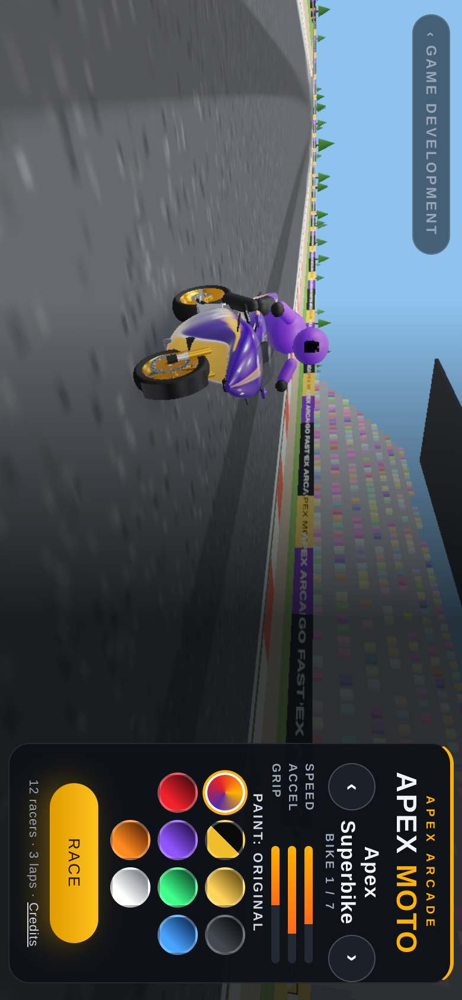

## 🟡 CHECK — Paper Plane

`apexpaperplane.html`

- 🟡 Couldn't press any start button - add/fix this game's steps in games.json
- 🟡 Busy play screen: about 24 words during play (biggest: "Hold to climb · let go to glide") - aim for only button labels and the score; instructions go behind How to play (STUDIO-STANDARD.md "Clean screen")
- 🟡 Only 0 play test(s) - every game needs 5+ tests that play it by its rules (fixes/apexpaperplane.mjs, ids 'play-...')
- 🟡 Not on the shared controls yet (kit/controls.js) - its job moves this game over; until then its own stick code is allowed
- 🟡 No friend codes yet - add a "👥 Play a friend" button (My code / Enter a friend's code) with ApexKit.friend and a 'play-friend-code' test (STORE-READY.md "Friend codes")
- 🟡 No REALITY hook yet (window.__reality) - add it so the robot can measure direction, sizes and ground contact (REALITY.md "Robot hook")
- 🟡 No close-up of the player: no player in the hook (REALITY.md hook: player)

  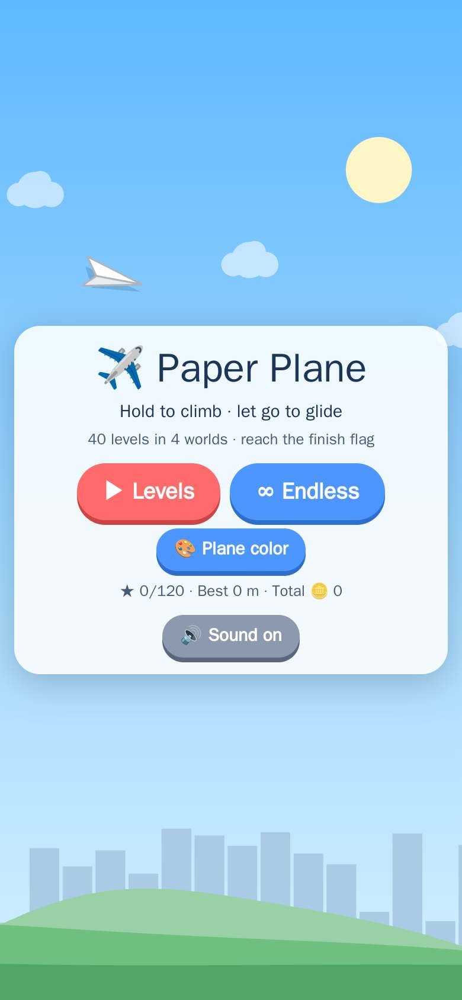

## 🟡 CHECK — Exotic Racer Club

`apexracer.html`

- 🔴 NOT RUN (robot time cap, robot side) - owner's fix not proven: "Is the wrap painted on the body (no panel shells, no letter meshes - the G-413 paste)?"
- 🔴 NOT RUN (robot time cap, robot side) - owner's fix not proven: "Is the brake caliper a small block on a real brake disc, not a red billboard in the wheel?"
- 🔴 NOT RUN (robot time cap, robot side) - owner's fix not proven: "Do the wraps camo, split, neon paint on the body material with the same mesh count and bounding box as No wrap?"
- 🔴 NOT RUN (robot time cap, robot side) - owner's fix not proven: "Is a fetched rim never faked: real verts and colours when loaded, and no red stand-in if its model drops?"
- 🔴 NOT RUN (robot time cap, robot side) - owner's fix not proven: "Do the wraps name, stripes, flames, shards paint on the body material with the same mesh count and bounding box as No wrap?"
- 🔴 NOT RUN (robot time cap, robot side) - owner's fix not proven: "Do the wraps bolt, checker, race, apex paint on the body material with the same mesh count and bounding box as No wrap?"
- 🟡 No owner-approved venue - build it from venues/circuit.md (real sizes, stands all around, crowd) with venues/kit in tools/venue-viewer.html, add it to MODELS.md as WAITING OWNER
- 🟡 Extra picture "garage" failed: page.screenshot: Timeout 60000ms exceeded.
- 🟡 SKIPPED (robot side, not a game result): extra picture "garage-rims" did not finish in 2 min
- 🟡 SLOW: extra picture "garage-rims" took 120 s (robot side)
- 🟡 SKIPPED (robot side, not a game result): extra picture "garage-rimred" did not finish in 2 min
- 🟡 SLOW: extra picture "garage-rimred" took 120 s (robot side)
- 🟡 LINT fixes/apexracer.mjs: 28 h.eval call(s) navigate / wait / poll with no .catch (a destroyed execution context fails the test on the robot only) - first ones: play-balance-skill-matters line 20, play-race-starts line 139, play-cars-drive-forward line 160. Add .catch(() => false) or try/catch. Run: node tools/game-check/fixes-lint.mjs tools/game-check/fixes/apexracer.mjs
- 🟡 Only 0 play test(s) - every game needs 5+ tests that play it by its rules (fixes/apexracer.mjs, ids 'play-...')
- 🟡 Not on the shared controls yet (kit/controls.js) - its job moves this game over; until then its own stick code is allowed
- 🟡 Friend codes have no 'play-friend-code' test yet (STORE-READY.md "Friend codes")
- 🟡 SKIPPED (whole-game cap, robot side, not a game result): reality + close-up + phone layout - this part ran past 15 min, so this phase was not run instead of letting the job hit the 35-min limit with no results
- 🟡 SKIPPED (whole-game cap, robot side, not a game result): upright phone check - this part ran past 15 min, so this phase was not run instead of letting the job hit the 35-min limit with no results
- 🟡 Play test failing: "Menu buttons: Race Friends, Garage, Graphics and Sound are each at least 44 px tall on a sideways phone (844x390) and the menu still fits without scrolling" [test id: play-menu-buttons-44px] (mFriends min-height 36 px (needs 44); mGarage min-height 36 px (needs 44); mQ min-height 36 px (needs 44); mSnd min-height 36 px (needs 44))
- 🟡 Play test failing: "Race starts: starting a race creates the race, the player car and a full grid" [test id: play-race-starts] (lap/HUD readout not shown)
- 🟡 Play test failing: "Lap counter goes up as cars complete laps" [test id: play-lap-goes-up] (AI car lap never went up in 3 sim-minutes)
- 🟡 Play test failing: "Every car shows its own paint: each real 3D model body material is replaced by that car paint, and grid paints are not all the same" [test id: play-paint-own-colors] (kestrel paint material is not its own paint color)
- 🟡 Play test failing: "APEX ARCADE name wrap: on the V12 Goblin by default, letters riding on both sides of the body" [test id: play-goblin-name-wrap] (player Goblin has 0 APEX ARCADE decals - need both sides)
- 🟡 Play test failing: "Home screen: slim left tile column (RACE, Garage, Race Friends, Graphics, Sound, Credits in that order), thin top stat bar with the coins, everything fits the sideways phone, and the car keeps turning on its turntable" [test id: play-menu-turntable] (car is not turning on the home screen (spin moved 0.00 rad in 1.4s))
- 🟡 Play test failing: "G-145: every car that can be hit is drawn and visible - in the scene, real car size, at its road position, with its own bright headlights and no light bars" [test id: play-colliders-visible] (racer 0 is drawn at (0,0) but collides at (231,-30) - an invisible blocker)
- 🟡 Play test failing: "G-375 (owner): every race place loads and races - this group: Houston, Dallas, Austin, San Antonio, El Paso: for each place the robot starts the race there, the car drives forward along the track until the lap counter advances (LAP 2/2), no script error, no black screen, venue and sky draw, one picture per place. A failing place is named in the red line." [test id: play-places-census-02] (test error: took over 60 s)
- 🟡 Play test failing: "G-375 (owner): every race place loads and races - this group: Munich, Hamburg, Amsterdam, Rotterdam, Zurich: for each place the robot starts the race there, the car drives forward along the track until the lap counter advances (LAP 2/2), no script error, no black screen, venue and sky draw, one picture per place. A failing place is named in the red line." [test id: play-places-census-13] (test error: took over 60 s)
- 🟡 Play test failing: "G-375 (owner): every race place loads and races - this group: Dubai, Abu Dhabi, Doha, Cairo, Cape Town: for each place the robot starts the race there, the car drives forward along the track until the lap counter advances (LAP 2/2), no script error, no black screen, venue and sky draw, one picture per place. A failing place is named in the red line." [test id: play-places-census-15] (test error: took over 60 s)
- 🟡 WHOLE-GAME CAP: apexracer play tests stopped after 13 min of this part - 3 test(s) NOT RUN this time (never-name-wrap-no-panels, play-car-census-nova, never-caliper-billboard) - robot side, not a game result
- 🟡 Play test failing: "Race finishes with a results screen" [test id: play-race-finishes] (player never crossed the finish)
- 🟡 Play test failing: "Lap choices show on the race sheet and the race starts promptly - twice in a row (staged start, cached environment)" [test id: play-race-start-fast] (no place card could be pressed)
- 🟡 Play test failing: "G-372 (extends the G-365 sweep, PR #1857, split so each group fits the robot per-test clock): garage body: Spoiler, Body Kit, Underglow - opens the garage, applies each option on these tabs and takes a robot picture per tab, failing with the tab and option named when an option changes nothing or looks broken (floating, black, wrong colour, parts missing)" [test id: play-garage-sweep-c] (G-372 garage sweep c: Spoiler > Lip: applies but changes nothing on the car | Spoiler > Lip: no spoiler wing on the car | Spoiler > Wing: applies but changes nothing on the car | Spoiler > Wing: no spoiler wing on the car | Spoiler > GT Wing: applies but changes nothing on the car | Spoiler > GT Wing: no spoiler wing on the car | +18 more)
- 🟡 Play test failing: "G-375 (owner): every race place loads and races - this group: New York, Los Angeles, Chicago, Miami, Las Vegas: for each place the robot starts the race there, the car drives forward along the track until the lap counter advances (LAP 2/2), no script error, no black screen, venue and sky draw, one picture per place. A failing place is named in the red line." [test id: play-places-census-01] (test error: took over 60 s)
- 🟡 Play test failing: "G-375 (owner): every race place loads and races - this group: Milan, Barcelona, Madrid, Lisbon, Berlin: for each place the robot starts the race there, the car drives forward along the track until the lap counter advances (LAP 2/2), no script error, no black screen, venue and sky draw, one picture per place. A failing place is named in the red line." [test id: play-places-census-12] (test error: took over 60 s)
- 🟡 Play test failing: "G-375 (owner): every race place loads and races - this group: Nashville, Orlando, Tampa, San Diego, Portland: for each place the robot starts the race there, the car drives forward along the track until the lap counter advances (LAP 2/2), no script error, no black screen, venue and sky draw, one picture per place. A failing place is named in the red line." [test id: play-places-census-05] (test error: took over 60 s)
- 🟡 Play test failing: "G-375 (owner): every race place loads and races - this group: Minneapolis, Salt Lake City, Honolulu, Anchorage, Charlotte: for each place the robot starts the race there, the car drives forward along the track until the lap counter advances (LAP 2/2), no script error, no black screen, venue and sky draw, one picture per place. A failing place is named in the red line." [test id: play-places-census-06] (test error: took over 60 s)
- 🟡 Play test failing: "G-375 (owner): every race place loads and races - this group: Cancún, Rio de Janeiro, São Paulo, Buenos Aires, Santiago: for each place the robot starts the race there, the car drives forward along the track until the lap counter advances (LAP 2/2), no script error, no black screen, venue and sky draw, one picture per place. A failing place is named in the red line." [test id: play-places-census-09] (test error: took over 60 s)
- 🟡 Play test failing: "G-375 (owner): every race place loads and races - this group: Gold Coast, Auckland, Queenstown, Kuala Lumpur, Taipei: for each place the robot starts the race there, the car drives forward along the track until the lap counter advances (LAP 2/2), no script error, no black screen, venue and sky draw, one picture per place. A failing place is named in the red line." [test id: play-places-census-20] (test error: took over 60 s)
- 🟡 Play test failing: "Owner Oct 26 2026: 'Bigger rims only make car float' - at Wheel Size Plus and Max the whole car (its own tyres included) rose by the lift and hovered; the tyres must grow with the lift so the car rides higher AND stays on the ground" [test id: play-wheel-size-grounded] (the car no longer rides higher at Max (body top rises only 0.000 m) - the owner wants the higher ride, grounded)
- 🟡 Play test failing: "Does the brute build with exactly one wrap system, four rim faces and the wing as chosen, for every wrap and rim?" [test id: play-car-census-brute] (test error: took over 60 s)
- 🟡 WHOLE-GAME CAP: apexracer play tests stopped after 13 min of this part - 2 test(s) NOT RUN this time (play-garage-no-rebuy, never-wrap-adds-no-meshes-c) - robot side, not a game result
- 🟡 Play test failing: "G-46 fix: proper shiny paint covers every racer car - the clearcoat paint is on the whole body shell, not a small slice, so no car can vanish into dark factory materials" [test id: play-paint-covers-car] (kestrel (goblin) wears its paint on only 23% of the car - the rest is dark factory material and the car vanishes at night)
- 🟡 Play test failing: "G-50: city traffic cars are real fetched 3D models, each in its own paint" [test id: play-traffic-glb] (traffic car uses unknown model goblin)
- 🟡 Play test failing: "G-149 point 1: the APEX ARCADE name wrap sits on the door - its strip never reaches the wheel zones at either end" [test id: play-wrap-on-door] (the player goblin wears no APEX ARCADE wrap)
- 🟡 Play test failing: "G-163 point 2: at night the headlights throw a pool of light on the road ahead of the car" [test id: play-headlight-pool] (the pool is not a soft additive light pool)
- 🟡 Play test failing: "G-176: the APEX ARCADE name wrap is on BOTH doors of the Goblin - a strip on each side, each inside the door span between the axles" [test id: play-wrap-both-doors] (the player goblin wears no APEX ARCADE wrap at all)
- 🟡 Play test failing: "Owner Oct 25 10:14 PM via G-364: he wants to see ALL the rim options at once - ?test=rims opens straight in the garage lights and shows every rim style side by side on the wheel of his car, names under each" [test id: play-rims-showcase] (test error: Unexpected value)
- 🟡 Play test failing: "G-372 (extends the G-365 sweep, PR #1857, split so each group fits the robot per-test clock): garage looks: Cars, Paint, Wraps, Wrap Color, Finish - opens the garage, applies each option on these tabs and takes a robot picture per tab, failing with the tab and option named when an option changes nothing or looks broken (floating, black, wrong colour, parts missing)" [test id: play-garage-sweep-a] (test error: took over 60 s)
- 🟡 Play test failing: "G-372 (extends the G-365 sweep, PR #1857, split so each group fits the robot per-test clock): garage performance: Tires, Engine, Turbo, Nitro - opens the garage, applies each option on these tabs and takes a robot picture per tab, failing with the tab and option named when an option changes nothing or looks broken (floating, black, wrong colour, parts missing)" [test id: play-garage-sweep-d] (test error: took over 60 s)
- 🟡 Play test failing: "G-375 (owner): every race place loads and races - this group: Kansas City, St. Louis, Baltimore, Pittsburgh, Memphis: for each place the robot starts the race there, the car drives forward along the track until the lap counter advances (LAP 2/2), no script error, no black screen, venue and sky draw, one picture per place. A failing place is named in the red line." [test id: play-places-census-07] (test error: took over 60 s)
- 🟡 Play test could not decide (tried twice): "Is the racer-name Save button (#nmB) at least 44x44 px on the menu?" (no #nmB button on the menu (a racer name is already saved in this profile)) - make the test CREATE the situation it checks instead of waiting for luck
- 🟡 WHOLE-GAME CAP: apexracer play tests stopped after 13 min of this part - 3 test(s) NOT RUN this time (play-balance-skill-matters, play-car-census-phantom, never-rim-fake) - robot side, not a game result
- 🟡 Play test failing: "G-375 (owner): every race place loads and races - this group: Paris, Nice, Monte Carlo, Venice, Rome: for each place the robot starts the race there, the car drives forward along the track until the lap counter advances (LAP 2/2), no script error, no black screen, venue and sky draw, one picture per place. A failing place is named in the red line." [test id: play-places-census-11] (test error: took over 60 s)
- 🟡 Play test failing: "G-375 (owner): every race place loads and races - this group: Oslo, Stockholm, Reykjavik, Athens, Istanbul: for each place the robot starts the race there, the car drives forward along the track until the lap counter advances (LAP 2/2), no script error, no black screen, venue and sky draw, one picture per place. A failing place is named in the red line." [test id: play-places-census-14] (test error: took over 60 s)
- 🟡 Play test failing: "G-375 (owner): every race place loads and races - this group: Shenzhen, Hong Kong, Singapore, Bangkok, Mumbai: for each place the robot starts the race there, the car drives forward along the track until the lap counter advances (LAP 2/2), no script error, no black screen, venue and sky draw, one picture per place. A failing place is named in the red line." [test id: play-places-census-18] (test error: took over 60 s)
- 🟡 Play test failing: "Cars drive forward once the race runs" [test id: play-cars-drive-forward] (AI car did not drive forward)
- 🟡 Play test failing: "G-372 (extends the G-365 sweep, PR #1857, split so each group fits the robot per-test clock): garage wheels: Rims, Rim Color, Wheel Size, Calipers, Tint - opens the garage, applies each option on these tabs and takes a robot picture per tab, failing with the tab and option named when an option changes nothing or looks broken (floating, black, wrong colour, parts missing)" [test id: play-garage-sweep-b] (test error: took over 60 s)
- 🟡 Play test failing: "G-375 (owner): every race place loads and races - this group: Phoenix, Boston, Washington DC, Philadelphia, New Orleans: for each place the robot starts the race there, the car drives forward along the track until the lap counter advances (LAP 2/2), no script error, no black screen, venue and sky draw, one picture per place. A failing place is named in the red line." [test id: play-places-census-04] (test error: took over 60 s)
- 🟡 Play test failing: "G-375 (owner): every race place loads and races - this group: Oklahoma City, Toronto, Vancouver, Montreal, Mexico City: for each place the robot starts the race there, the car drives forward along the track until the lap counter advances (LAP 2/2), no script error, no black screen, venue and sky draw, one picture per place. A failing place is named in the red line." [test id: play-places-census-08] (test error: took over 60 s)
- 🟡 Play test failing: "G-375 (owner): every race place loads and races - this group: Yokohama, Seoul, Busan, Shanghai, Beijing: for each place the robot starts the race there, the car drives forward along the track until the lap counter advances (LAP 2/2), no script error, no black screen, venue and sky draw, one picture per place. A failing place is named in the red line." [test id: play-places-census-17] (test error: took over 60 s)
- 🟡 Play test failing: "Owner Oct 26 2026: 'Still tabs don't scroll or work' - on a portrait phone the page is rotated 90 degrees and the tab strip could not be panned, so the lower tabs (Turbo onward) were unreachable; the strips must drag-scroll on either screen axis" [test id: play-garage-tabs-drag] (the tab strips still restrict touch panning to one axis)
- 🟡 WHOLE-GAME CAP: apexracer play tests stopped after 13 min of this part - 2 test(s) NOT RUN this time (play-car-census-vortex, never-wrap-adds-no-meshes) - robot side, not a game result
- 🟡 Play test failing: "G-375 (owner): every race place loads and races - this group: San Francisco, Seattle, Atlanta, Detroit, Denver: for each place the robot starts the race there, the car drives forward along the track until the lap counter advances (LAP 2/2), no script error, no black screen, venue and sky draw, one picture per place. A failing place is named in the red line." [test id: play-places-census-03] (test error: took over 60 s)
- 🟡 Play test failing: "G-375 (owner): every race place loads and races - this group: Lima, Medellín, London, Manchester, Edinburgh: for each place the robot starts the race there, the car drives forward along the track until the lap counter advances (LAP 2/2), no script error, no black screen, venue and sky draw, one picture per place. A failing place is named in the red line." [test id: play-places-census-10] (test error: took over 60 s)
- 🟡 Play test failing: "G-375 (owner): every race place loads and races - this group: Johannesburg, Marrakesh, Tokyo, Osaka, Kyoto: for each place the robot starts the race there, the car drives forward along the track until the lap counter advances (LAP 2/2), no script error, no black screen, venue and sky draw, one picture per place. A failing place is named in the red line." [test id: play-places-census-16] (test error: took over 60 s)
- 🟡 Play test failing: "G-375 (owner): every race place loads and races - this group: Delhi, Bali, Manila, Sydney, Melbourne: for each place the robot starts the race there, the car drives forward along the track until the lap counter advances (LAP 2/2), no script error, no black screen, venue and sky draw, one picture per place. A failing place is named in the red line." [test id: play-places-census-19] (test error: took over 60 s)
- 🟡 Play test failing: "Owner Oct 26 2026: 'music static in and out' - the three race music stems each started the moment their own decode landed, leaving them offset against each other; the speed crossfade smeared the offset into static. The stems must start together at one context time" [test id: play-music-sync-start] (the race music stems do not start together (missing musSyncRace))
- 🟡 Play test failing: "Does the kestrel build with exactly one wrap system, four rim faces and the wing as chosen, for every wrap and rim?" [test id: play-car-census-kestrel] (test error: took over 60 s)
- 🟡 WHOLE-GAME CAP: apexracer play tests stopped after 13 min of this part - 2 test(s) NOT RUN this time (play-garage-every-option-changes, never-wrap-adds-no-meshes-b) - robot side, not a game result

**Owner's fix list** (42 of 100 done):
- ❌ Menu buttons: Race Friends, Garage, Graphics and Sound are each at least 44 px tall on a sideways phone (844x390) and the menu still fits without scrolling — mFriends min-height 36 px (needs 44); mGarage min-height 36 px (needs 44); mQ min-height 36 px (needs 44); mSnd min-height 36 px (needs 44)
- ❌ Race starts: starting a race creates the race, the player car and a full grid — lap/HUD readout not shown
- ❌ Lap counter goes up as cars complete laps — AI car lap never went up in 3 sim-minutes
- ❌ Every car shows its own paint: each real 3D model body material is replaced by that car paint, and grid paints are not all the same — kestrel paint material is not its own paint color
- ❌ APEX ARCADE name wrap: on the V12 Goblin by default, letters riding on both sides of the body — player Goblin has 0 APEX ARCADE decals - need both sides
- ❌ Home screen: slim left tile column (RACE, Garage, Race Friends, Graphics, Sound, Credits in that order), thin top stat bar with the coins, everything fits the sideways phone, and the car keeps turning on its turntable — car is not turning on the home screen (spin moved 0.00 rad in 1.4s)
- ❌ G-145: every car that can be hit is drawn and visible - in the scene, real car size, at its road position, with its own bright headlights and no light bars — racer 0 is drawn at (0,0) but collides at (231,-30) - an invisible blocker
- ✅ G-143: the REALITY hook reports game time and player speed - time() advances in race seconds and speed() reads the car in m/s
- ✅ Lamp glow sits on the measured body surface, lamp-sized - no floating white dots (owner, G-163 follow-up)
- ✅ Owner Oct 22 2026: every computer car SHOWS in every city - a real model and a paint bright enough to read at dusk/night, never near-black
- ✅ G-207 (owner): every computer car in every city sits ON the road for the whole race - the skinned Tokii model shared one skeleton across all its cars and rendered sunk under the road (invisible cars); the pose is baked at load now, so no car may contain a skinned mesh or ride below the road while driving
- ✅ owner 2026-10-25: 'rims look small and fake, just like a sticker with all options' - every rim face must be real 3D geometry: at least 300 vertices of spoke/barrel geometry and at least 0.03 m of depth per wheel, never a zero-thickness drawn disc (today's build: 30 vertices, 0.000 m thick)
- ✅ rim colour tints only the rim, never the tyre caliper or hub
- ❌ G-375 (owner): every race place loads and races - this group: Houston, Dallas, Austin, San Antonio, El Paso: for each place the robot starts the race there, the car drives forward along the track until the lap counter advances (LAP 2/2), no script error, no black screen, venue and sky draw, one picture per place. A failing place is named in the red line. — test error: took over 60 s
- ❌ G-375 (owner): every race place loads and races - this group: Munich, Hamburg, Amsterdam, Rotterdam, Zurich: for each place the robot starts the race there, the car drives forward along the track until the lap counter advances (LAP 2/2), no script error, no black screen, venue and sky draw, one picture per place. A failing place is named in the red line. — test error: took over 60 s
- ❌ G-375 (owner): every race place loads and races - this group: Dubai, Abu Dhabi, Doha, Cairo, Cape Town: for each place the robot starts the race there, the car drives forward along the track until the lap counter advances (LAP 2/2), no script error, no black screen, venue and sky draw, one picture per place. A failing place is named in the red line. — test error: took over 60 s
- ❌ Is the wrap painted on the body (no panel shells, no letter meshes - the G-413 paste)? — not run - whole-game cap (15 min per part, robot side)
- ❌ Does the nova build with exactly one wrap system, four rim faces and the wing as chosen, for every wrap and rim? — not run - whole-game cap (15 min per part, robot side)
- ❌ Is the brake caliper a small block on a real brake disc, not a red billboard in the wheel? — not run - whole-game cap (15 min per part, robot side)
- ❌ Race finishes with a results screen — player never crossed the finish
- ❌ Lap choices show on the race sheet and the race starts promptly - twice in a row (staged start, cached environment) — no place card could be pressed
- ✅ G-163 point 3: brake lights - the rear lamps and glows flare bright red while the brake is held
- ✅ G-206: at night no car blows out to a pink/white blob - the headlight pool stays low-energy on every car, pools still exist, and the ?test=night owner link is in the game
- ❌ G-372 (extends the G-365 sweep, PR #1857, split so each group fits the robot per-test clock): garage body: Spoiler, Body Kit, Underglow - opens the garage, applies each option on these tabs and takes a robot picture per tab, failing with the tab and option named when an option changes nothing or looks broken (floating, black, wrong colour, parts missing) — G-372 garage sweep c: Spoiler > Lip: applies but changes nothing on the car | Spoiler > Lip: no spoiler wing on the car | Spoiler > Wing: applies but changes nothing on the car | Spoiler > Wing: no spoiler wing on the car | Spoiler > GT Wing: applies but changes nothing on the car | Spoiler > GT Wing: no spoiler wing on the car | +18 more
- ❌ G-375 (owner): every race place loads and races - this group: New York, Los Angeles, Chicago, Miami, Las Vegas: for each place the robot starts the race there, the car drives forward along the track until the lap counter advances (LAP 2/2), no script error, no black screen, venue and sky draw, one picture per place. A failing place is named in the red line. — test error: took over 60 s
- ❌ G-375 (owner): every race place loads and races - this group: Milan, Barcelona, Madrid, Lisbon, Berlin: for each place the robot starts the race there, the car drives forward along the track until the lap counter advances (LAP 2/2), no script error, no black screen, venue and sky draw, one picture per place. A failing place is named in the red line. — test error: took over 60 s
- ✅ Owner approved the Monoblock rally wheel (MODELS.md erc-rim-monoblock, LOCKED Oct 26 2026): the Monoblock rim style must be the real fetched wheel exactly as it looks in the viewer - its own white finish, never repainted by Rim Color, never swapped without the owner
- ✅ Is the menu Save button (#nmB) at least 44 px and fully on screen?
- ✅ Does the zenith build with exactly one wrap system, four rim faces and the wing as chosen, for every wrap and rim?
- ✅ Do the fetched rims fit IN the tyre: bare rims at a real diameter, face seated at the tyre surface?
- ✅ G-270 fix 1 (owner, supersedes G-70/G-123): the player is far faster than the field - every AI best lap is at least 25% slower than the player best, so the player laps them
- ✅ G-207 fix 1 (owner): the finish-line sign says START on lap 1, the completed/total count on the laps between, and Finish only on the last lap
- ✅ caliper sits behind the rim face along the axle
- ❌ G-375 (owner): every race place loads and races - this group: Nashville, Orlando, Tampa, San Diego, Portland: for each place the robot starts the race there, the car drives forward along the track until the lap counter advances (LAP 2/2), no script error, no black screen, venue and sky draw, one picture per place. A failing place is named in the red line. — test error: took over 60 s
- ❌ G-375 (owner): every race place loads and races - this group: Minneapolis, Salt Lake City, Honolulu, Anchorage, Charlotte: for each place the robot starts the race there, the car drives forward along the track until the lap counter advances (LAP 2/2), no script error, no black screen, venue and sky draw, one picture per place. A failing place is named in the red line. — test error: took over 60 s
- ❌ G-375 (owner): every race place loads and races - this group: Cancún, Rio de Janeiro, São Paulo, Buenos Aires, Santiago: for each place the robot starts the race there, the car drives forward along the track until the lap counter advances (LAP 2/2), no script error, no black screen, venue and sky draw, one picture per place. A failing place is named in the red line. — test error: took over 60 s
- ❌ G-375 (owner): every race place loads and races - this group: Gold Coast, Auckland, Queenstown, Kuala Lumpur, Taipei: for each place the robot starts the race there, the car drives forward along the track until the lap counter advances (LAP 2/2), no script error, no black screen, venue and sky draw, one picture per place. A failing place is named in the red line. — test error: took over 60 s
- ❌ Owner Oct 26 2026: 'Bigger rims only make car float' - at Wheel Size Plus and Max the whole car (its own tyres included) rose by the lift and hovered; the tyres must grow with the lift so the car rides higher AND stays on the ground — the car no longer rides higher at Max (body top rises only 0.000 m) - the owner wants the higher ride, grounded
- ❌ Does the brute build with exactly one wrap system, four rim faces and the wing as chosen, for every wrap and rim? — test error: took over 60 s
- ❌ If I switch off something I bought I have to buy it again (owner Oct 28) — not run - whole-game cap (15 min per part, robot side)
- ❌ Do the wraps camo, split, neon paint on the body material with the same mesh count and bounding box as No wrap? — not run - whole-game cap (15 min per part, robot side)
- ✅ Friend code: entering a friend's RACE- code puts their car in your race
- ❌ G-46 fix: proper shiny paint covers every racer car - the clearcoat paint is on the whole body shell, not a small slice, so no car can vanish into dark factory materials — kestrel (goblin) wears its paint on only 23% of the car - the rest is dark factory material and the car vanishes at night
- ❌ G-50: city traffic cars are real fetched 3D models, each in its own paint — traffic car uses unknown model goblin
- ✅ G-70: every AI racer and traffic car is a real fetched 3D model, never the blob mockup
- ✅ G-300 checklist R01: with the gas held through the whole countdown, the player and every rival stay on their grid spots while R.t < 0 (before the fix the worst rival slid 4.15 m sideways at speed 0 - the AI lane logic walked it to its lane), and the player drives away once GO lands
- ✅ G-76: better steering - the car answers the stick quickly, turns where it points without sliding wide, and never snaps
- ✅ G-80: the game uses the owner sound packs - every music and UI file it plays is in the repo at the path the code asks for
- ✅ G-270 self-audit: checklists/apexracer.md exists with at least 20 lint-shaped items, and every NUMBERS token appears word for word in its SOURCE file
- ✅ G-240 fix 1 (owner): the engine must growl deep, not whine - the kit accel layers play slow (rate never above 0.8) through a 1500 Hz lowpass, so their full-throttle spectral centroid lands at or under 850 Hz (measured 683-812 Hz) instead of 1650-2323 Hz
- ✅ G-240 (owner): the engine sound is the supercar kit in sounds/engines/supercar/ - idle + accel loops crossfaded by throttle, shift and backfire one-shots, tire squeal - decoded as buffers, and every kit file is in the repo
- ❌ G-149 point 1: the APEX ARCADE name wrap sits on the door - its strip never reaches the wheel zones at either end — the player goblin wears no APEX ARCADE wrap
- ✅ G-145 point 2: no car wears a light bar - the G-70 bumper bars are gone from the garage car, the race grid and traffic
- ✅ G-163: every car shines from its own headlights and tail lights - lamp meshes plus a soft glow front and rear, nothing solid
- ❌ G-163 point 2: at night the headlights throw a pool of light on the road ahead of the car — the pool is not a soft additive light pool
- ❌ G-176: the APEX ARCADE name wrap is on BOTH doors of the Goblin - a strip on each side, each inside the door span between the axles — the player goblin wears no APEX ARCADE wrap at all
- ✅ NEVER (G-176): the job report carries an OWNER CHECK IN 30 SECONDS line with the target picture link and what to look at
- ✅ STUDIO-STANDARD 9.7 (G-179): the WHERE THINGS ARE map at the top of looks/apexracer.md names the main parts and its line numbers match apexracer.html
- ✅ Owner Oct 22 2026: mountains out of the road - no tall scenery (mountains, volcano, mesas) comes within 25 m of the road
- ❌ Owner Oct 25 10:14 PM via G-364: he wants to see ALL the rim options at once - ?test=rims opens straight in the garage lights and shows every rim style side by side on the wheel of his car, names under each — test error: Unexpected value
- ❌ G-372 (extends the G-365 sweep, PR #1857, split so each group fits the robot per-test clock): garage looks: Cars, Paint, Wraps, Wrap Color, Finish - opens the garage, applies each option on these tabs and takes a robot picture per tab, failing with the tab and option named when an option changes nothing or looks broken (floating, black, wrong colour, parts missing) — test error: took over 60 s
- ❌ G-372 (extends the G-365 sweep, PR #1857, split so each group fits the robot per-test clock): garage performance: Tires, Engine, Turbo, Nitro - opens the garage, applies each option on these tabs and takes a robot picture per tab, failing with the tab and option named when an option changes nothing or looks broken (floating, black, wrong colour, parts missing) — test error: took over 60 s
- ✅ Owner approved the Deep Dish artist wheel (MODELS.md erc-rim-deepdish, LOCKED Oct 26 2026): the Deep Dish rim style must be the real fetched wheel exactly as it looks in the viewer - its own copper finish, never repainted by Rim Color, never swapped without the owner
- ❌ G-375 (owner): every race place loads and races - this group: Kansas City, St. Louis, Baltimore, Pittsburgh, Memphis: for each place the robot starts the race there, the car drives forward along the track until the lap counter advances (LAP 2/2), no script error, no black screen, venue and sky draw, one picture per place. A failing place is named in the red line. — test error: took over 60 s
- ❌ Is the racer-name Save button (#nmB) at least 44x44 px on the menu? — no #nmB button on the menu (a racer name is already saved in this profile)
- ❌ Balance: a beginner bot finishes on the podium, a good bot is faster, and a car that never drives does not win — not run - whole-game cap (15 min per part, robot side)
- ❌ Does the phantom build with exactly one wrap system, four rim faces and the wing as chosen, for every wrap and rim? — not run - whole-game cap (15 min per part, robot side)
- ❌ Is a fetched rim never faked: real verts and colours when loaded, and no red stand-in if its model drops? — not run - whole-game cap (15 min per part, robot side)
- ✅ G-270 fix 1 (owner): all cars fast and the player laps the whole field - stock player top at least 110 m/s, every rival top at least 60 m/s, and in a driven 3-lap New York race every rival is at least 0.9 of a lap behind when the player finishes lap 3
- ✅ owner fix (garage): every garage tab's chosen style shows on the car - underglow live, a rim face and a caliper at all 4 wheels, Limo tint on the glass, the aero wing and the body kit fitted, on the Goblin and on a Tokii car; the test restores the save it borrowed (cur + both car entries) so the next test drives the stock car
- ✅ owner 2026-10-25: 'make sure able to have a bigger size like my current rims. And bigger size lifts suspension which makes car ride higher' - Wheel Size at Max must measure a bigger rim diameter than Stock and the car must sit higher
- ❌ G-375 (owner): every race place loads and races - this group: Paris, Nice, Monte Carlo, Venice, Rome: for each place the robot starts the race there, the car drives forward along the track until the lap counter advances (LAP 2/2), no script error, no black screen, venue and sky draw, one picture per place. A failing place is named in the red line. — test error: took over 60 s
- ❌ G-375 (owner): every race place loads and races - this group: Oslo, Stockholm, Reykjavik, Athens, Istanbul: for each place the robot starts the race there, the car drives forward along the track until the lap counter advances (LAP 2/2), no script error, no black screen, venue and sky draw, one picture per place. A failing place is named in the red line. — test error: took over 60 s
- ❌ G-375 (owner): every race place loads and races - this group: Shenzhen, Hong Kong, Singapore, Bangkok, Mumbai: for each place the robot starts the race there, the car drives forward along the track until the lap counter advances (LAP 2/2), no script error, no black screen, venue and sky draw, one picture per place. A failing place is named in the red line. — test error: took over 60 s
- ✅ Owner approved the Turbine artist wheel (MODELS.md erc-rim-turbine, LOCKED Oct 26 2026): the Turbine rim style must be the real fetched wheel exactly as it looks in the viewer - its own red finish and its own tyre, never repainted by Rim Color, never swapped without the owner
- ✅ Does the goblin build with exactly one wrap system, four rim faces and the wing as chosen, for every wrap and rim?
- ✅ Does the titan build with exactly one wrap system, four rim faces and the wing as chosen, for every wrap and rim?
- ✅ Does every Rims press visibly switch the rims on the car?
- ❌ Cars drive forward once the race runs — AI car did not drive forward
- ✅ Owner fix (Oct 23): the music plays as decoded buffers, never through media elements (the static-and-skipping pipeline on phones), and all four pack tracks are in the repo
- ✅ G-137: the REALITY robot can drive the car - go(true) really moves the player (over 0.3 m between samples)
- ❌ G-372 (extends the G-365 sweep, PR #1857, split so each group fits the robot per-test clock): garage wheels: Rims, Rim Color, Wheel Size, Calipers, Tint - opens the garage, applies each option on these tabs and takes a robot picture per tab, failing with the tab and option named when an option changes nothing or looks broken (floating, black, wrong colour, parts missing) — test error: took over 60 s
- ❌ G-375 (owner): every race place loads and races - this group: Phoenix, Boston, Washington DC, Philadelphia, New Orleans: for each place the robot starts the race there, the car drives forward along the track until the lap counter advances (LAP 2/2), no script error, no black screen, venue and sky draw, one picture per place. A failing place is named in the red line. — test error: took over 60 s
- ❌ G-375 (owner): every race place loads and races - this group: Oklahoma City, Toronto, Vancouver, Montreal, Mexico City: for each place the robot starts the race there, the car drives forward along the track until the lap counter advances (LAP 2/2), no script error, no black screen, venue and sky draw, one picture per place. A failing place is named in the red line. — test error: took over 60 s
- ❌ G-375 (owner): every race place loads and races - this group: Yokohama, Seoul, Busan, Shanghai, Beijing: for each place the robot starts the race there, the car drives forward along the track until the lap counter advances (LAP 2/2), no script error, no black screen, venue and sky draw, one picture per place. A failing place is named in the red line. — test error: took over 60 s
- ❌ Owner Oct 26 2026: 'Still tabs don't scroll or work' - on a portrait phone the page is rotated 90 degrees and the tab strip could not be panned, so the lower tabs (Turbo onward) were unreachable; the strips must drag-scroll on either screen axis — the tab strips still restrict touch panning to one axis
- ✅ Does the vanta build with exactly one wrap system, four rim faces and the wing as chosen, for every wrap and rim?
- ❌ Does the vortex build with exactly one wrap system, four rim faces and the wing as chosen, for every wrap and rim? — not run - whole-game cap (15 min per part, robot side)
- ❌ Do the wraps name, stripes, flames, shards paint on the body material with the same mesh count and bounding box as No wrap? — not run - whole-game cap (15 min per part, robot side)
- ✅ Garage buy works: buying a car adds it to the garage and selects it
- ✅ G-163 point 1 + owner glow fix: no solid light blocks, and the glow sits ON the lens - no glow quad reaches past the nose or the tail, nothing floats in front of the car
- ✅ every rim style builds a different real rim
- ❌ G-375 (owner): every race place loads and races - this group: San Francisco, Seattle, Atlanta, Detroit, Denver: for each place the robot starts the race there, the car drives forward along the track until the lap counter advances (LAP 2/2), no script error, no black screen, venue and sky draw, one picture per place. A failing place is named in the red line. — test error: took over 60 s
- ❌ G-375 (owner): every race place loads and races - this group: Lima, Medellín, London, Manchester, Edinburgh: for each place the robot starts the race there, the car drives forward along the track until the lap counter advances (LAP 2/2), no script error, no black screen, venue and sky draw, one picture per place. A failing place is named in the red line. — test error: took over 60 s
- ❌ G-375 (owner): every race place loads and races - this group: Johannesburg, Marrakesh, Tokyo, Osaka, Kyoto: for each place the robot starts the race there, the car drives forward along the track until the lap counter advances (LAP 2/2), no script error, no black screen, venue and sky draw, one picture per place. A failing place is named in the red line. — test error: took over 60 s
- ❌ G-375 (owner): every race place loads and races - this group: Delhi, Bali, Manila, Sydney, Melbourne: for each place the robot starts the race there, the car drives forward along the track until the lap counter advances (LAP 2/2), no script error, no black screen, venue and sky draw, one picture per place. A failing place is named in the red line. — test error: took over 60 s
- ❌ Owner Oct 26 2026: 'music static in and out' - the three race music stems each started the moment their own decode landed, leaving them offset against each other; the speed crossfade smeared the offset into static. The stems must start together at one context time — the race music stems do not start together (missing musSyncRace)
- ❌ Does the kestrel build with exactly one wrap system, four rim faces and the wing as chosen, for every wrap and rim? — test error: took over 60 s
- ❌ Most garage options do nothing - rims do not change, wraps break the body (owner Oct 28) — not run - whole-game cap (15 min per part, robot side)
- ❌ Do the wraps bolt, checker, race, apex paint on the body material with the same mesh count and bounding box as No wrap? — not run - whole-game cap (15 min per part, robot side)

 

## 🟡 CHECK — Apex F1 Racing

`apexf1.html`

- 🟡 No owner-approved venue - build it from venues/circuit.md (real sizes, stands all around, crowd) with venues/kit in tools/venue-viewer.html, add it to MODELS.md as WAITING OWNER
- 🟡 LINT fixes/apexf1.mjs: 5 h.eval call(s) navigate / wait / poll with no .catch (a destroyed execution context fails the test on the robot only) - first ones: play-cameras-above-ground line 774, play-steering-holds-the-line line 891, play-broadcast-cam-steady line 1015. Add .catch(() => false) or try/catch. Run: node tools/game-check/fixes-lint.mjs tools/game-check/fixes/apexf1.mjs
- 🟡 Play test failing: "Every CAM view (chase, cockpit, broadcast helicopter, onboard) stays above the road with the car and the track ahead in view, sideways and upright - the owner saw the helicopter cam under the ground" [test id: play-cameras-above-ground] (upright phone: COCKPIT lost the car / track ahead (1/2 settled frames in view))
- 🟡 Play test failing: "a dropped engine-kit fetch must not leave the synth carrying the race: the kit keeps retrying until it loads" [test id: play-kit-retries-until-loaded] (the race never started)
- 🟡 Not on the shared controls yet (kit/controls.js) - its job moves this game over; until then its own stick code is allowed
- 🟡 REALITY: the hook has no time() - add time: () => <game seconds> and speed: () => <m/s> so a busy robot cannot mistake a sprint for walking (REALITY.md)
- 🟡 Play test failing: "The player drives (owner recordings, G-239): the stick turns the car and a driven line stays on the road; let go and the nose HOLDS its world heading - it does not straighten itself back onto the road (that self-straightening was the autopilot)" [test id: play-steering-holds-the-line] (letting go of the stick still turned the car: world heading moved 0.09 rad in 2.5 s - the nose must HOLD and the driver must steer)
- 🟡 Career mode has NO playability test - add 'play-career-...' tests that start every career level, play it to the end and unlock the next (STORE-READY.md "Career mode")
- 🟡 Friend codes have no 'play-friend-code' test yet (STORE-READY.md "Friend codes")
- 🟡 Play test failing: "every AI car uses the real F1 car model, same quality as the player car" [test id: play-ai-cars-full-model] (KAI: drawn size 3.38 vs the player's 6.59 on footprint axis 0 - not the same car model)
- 🟡 Play test failing: "at speed the stick winds the heading gently and never steers by itself" [test id: play-car-holds-heading-at-speed] (with the stick released the heading moved on its own (0.18 -> 0.29) - steering must come only from the stick)
- 🟡 Play test failing: "the car is about 20 percent bigger" [test id: play-car-grew-20-percent] (player car draws 8.50 m long - G-73 wants about 20% bigger than the old 6.45 m (about 7.7 m))
- 🟡 Play test failing: "Apex F1: race start opens on the player car with big start lights, reds one by one then green (G-77)" [test id: play-start-on-car-with-lights] (start lights never flashed green for GO)
- 🟡 Play test failing: "holding gas only, stick centred, the car does not drive itself round the track" [test id: play-gas-only-never-laps] (race never started)

**Owner's fix list** (39 of 47 done):
- ✅ cars stay on the track
- ✅ lap counter goes up
- ✅ career mode works end to end
- ✅ career mode works end to end
- ✅ friend codes: my code is shown in my career hub, a bad code is rejected, and a friend code puts that driver on my grid at their coded rating (G-101)
- ❌ Every CAM view (chase, cockpit, broadcast helicopter, onboard) stays above the road with the car and the track ahead in view, sideways and upright - the owner saw the helicopter cam under the ground — upright phone: COCKPIT lost the car / track ahead (1/2 settled frames in view)
- ✅ Owner check link: apexf1.html?test=grid opens straight at the starting grid with LIGHTS OUT on screen and no scrolling (G-204)
- ✅ Pack fix: the qualifying field stays spread out - no start-line spin pile-up, no tangled pack sitting in the contact box
- ✅ Gas alone must not drive the car (owner recordings, G-239): stick untouched, the car leaves the road - on the old build it covered 2,192 m in 60 s dead centre, hands-free
- ✅ The broadcast (helicopter) camera is steady (owner, G-239): it rides BEHIND the car in the car frame - the old camera hung on a fixed point 26 m to the side, and that arm swung the picture around every corner
- ✅ The quali GAP readout is real (owner recordings, G-239): before any lap is banked it must not sit at a fake +0.0s - it shows no-data until a best-lap delta exists
- ✅ SKIP QUALI must not sit on the speedometer (owner recordings, G-239): in every frame the pill hid the speed digits - the two rects must not overlap
- ✅ play-test entries are shaped right: play-car-holds-heading-at-speed and play-car-grew-20-percent expose test, not run
- ✅ on the upright phone the stick never overlaps the CAM button
- ❌ a dropped engine-kit fetch must not leave the synth carrying the race: the kit keeps retrying until it loads — the race never started
- ✅ in the cockpit camera the world ahead stays visible: the driver-eye view never goes black while the HUD stays live (G-369 masher point)
- ✅ the race runs on the owner's Grand Prix track (G-380): 5627 m circuit, 20-car grid, kit scenery live
- ✅ AI cars finish a lap
- ✅ braking slows the car
- ✅ throttle accelerates the car
- ✅ the race ends with results
- ✅ the player car starts facing the right way and drives the same way as the AI cars and the checkpoints
- ✅ steering is smooth and controllable with the stick
- ✅ the slowest AI car laps within 5 percent of the player - nobody gets driven away from
- ❌ The player drives (owner recordings, G-239): the stick turns the car and a driven line stays on the road; let go and the nose HOLDS its world heading - it does not straighten itself back onto the road (that self-straightening was the autopilot) — letting go of the stick still turned the car: world heading moved 0.09 rad in 2.5 s - the nose must HOLD and the driver must steer
- ✅ CONTACT! is the player news only (owner recordings, G-239): two AI cars hitting each other must never shout CONTACT! on the player screen
- ✅ No track-limits fine for being shoved (owner recordings, G-239): off-road time while a rival shove is fresh must not accrue, brief brushes decay, and a chosen excursion still accrues
- ✅ The engine the player hears is the grand_prix kit (owner: the synth sounds like a rubber chicken, G-239): the kit must be decoded and ready in a session, and no media elements exist anywhere (factory music rule)
- ✅ play-test entries are shaped right: play-start-on-car-with-lights exposes test and ask, not run and title
- ✅ Apex F1: checklists/apexf1.md exists with one measurable item per line, each carrying SOURCE, NUMBERS, MEASURE and a tester-chk TEST id (G-286)
- ✅ on the upright phone the stick, REV and CAM never overlap: the landscape compact rules do not apply upright, so portrait needs its own compact block
- ✅ Balance: a good driver runs near the front, a beginner can still drive, and the field is not trivially easy or impossible
- ✅ Game does not start
- ✅ every car that can be hit is drawn and visible where it actually is
- ❌ every AI car uses the real F1 car model, same quality as the player car — KAI: drawn size 3.38 vs the player's 6.59 on footprint axis 0 - not the same car model
- ✅ the fastest AI car laps within 5 percent of the player - same real F1 pace
- ❌ at speed the stick winds the heading gently and never steers by itself — with the stick released the heading moved on its own (0.18 -> 0.29) - steering must come only from the stick
- ❌ the car is about 20 percent bigger — player car draws 8.50 m long - G-73 wants about 20% bigger than the old 6.45 m (about 7.7 m)
- ❌ Apex F1: race start opens on the player car with big start lights, reds one by one then green (G-77) — start lights never flashed green for GO
- ✅ The circuit wears the owner ground kit (asphalt + kerb textures from kit/ground/512) and the engine is the owner grand_prix sound kit: idle/accel loops crossfaded by throttle, shift sounds, tire squeal
- ✅ Start button on the screen: LIGHTS OUT and every menu fits 844x390 with no scrolling (the owner had to scroll to start the race)
- ✅ the 2 small buttons are at least 44px: SKIP QUALI in qualifying and LIGHTS OUT on the starting grid (G-224)
- ❌ holding gas only, stick centred, the car does not drive itself round the track — race never started
- ✅ on the upright phone teamMenu fits with no scrolling
- ✅ on the upright phone the stick never overlaps the PIT button
- ✅ Apex F1: gas after all 5 reds, before GO, is a jump start worth 5 seconds (G-312)
- ✅ Apex F1: pit-lane speed never exceeds 80 km/h from the entry line on (G-321)

   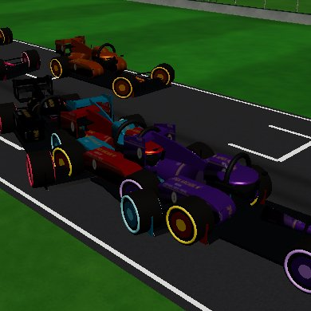

## 🟡 CHECK — Reef Dash

`apexreefdash.html`

- 🟡 Couldn't press any start button - add/fix this game's steps in games.json
- 🟡 Busy play screen: about 24 words during play (biggest: "Steer your sub to the finish gate") - aim for only button labels and the score; instructions go behind How to play (STUDIO-STANDARD.md "Clean screen")
- 🟡 Only 0 play test(s) - every game needs 5+ tests that play it by its rules (fixes/apexreefdash.mjs, ids 'play-...')
- 🟡 Not on the shared controls yet (kit/controls.js) - its job moves this game over; until then its own stick code is allowed
- 🟡 No friend codes yet - add a "👥 Play a friend" button (My code / Enter a friend's code) with ApexKit.friend and a 'play-friend-code' test (STORE-READY.md "Friend codes")
- 🟡 No REALITY hook yet (window.__reality) - add it so the robot can measure direction, sizes and ground contact (REALITY.md "Robot hook")
- 🟡 No close-up of the player: no player in the hook (REALITY.md hook: player)

  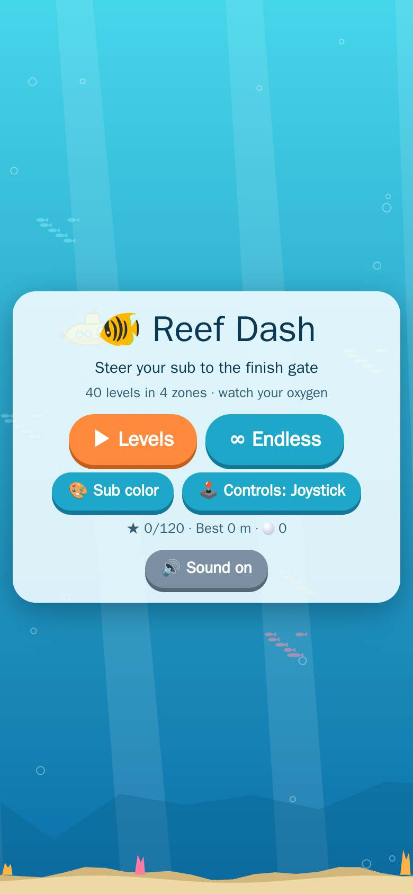

## 🟡 CHECK — Apex Track & Field

`apextrackfield.html`

- 🟡 LINT fixes/apextrackfield.mjs: 27 h.eval call(s) navigate / wait / poll with no .catch (a destroyed execution context fails the test on the robot only) - first ones: real-sprint-animation line 29, runners-stand-upright line 73, career-never-stalls line 285. Add .catch(() => false) or try/catch. Run: node tools/game-check/fixes-lint.mjs tools/game-check/fixes/apextrackfield.mjs
- 🟡 Play test failing: "Winning the career championship (final) meet must unlock the next season" [test id: play-career-championship-unlocks-next-season] (won/played the championship meet but the next season never unlocked (career still at season 2))
- 🟡 Play test failing: "A call or notification must never leave the player steering by itself: the held stick resets to centre on window blur and when the page hides" [test id: play-stick-resets-on-interruption] (test error: page.evaluate: Execution context was destroyed, most likely because of a navigation)
- 🟡 Career mode broken: "Winning the career championship (final) meet must unlock the next season"
- 🟡 Not on the shared controls yet (kit/controls.js) - its job moves this game over; until then its own stick code is allowed
- 🟡 Friend codes have no 'play-friend-code' test yet (STORE-READY.md "Friend codes")
- 🟡 REALITY (yellow - no time()/gait() in the hook, so the robot cannot tell a sprint start from walking): feet/skates/wheels never touch down while moving fast - no touchdown for 1.6 s (a sprint lands a foot at least every 0.5 s; lowest 0.01 m)
- 🟡 REALITY: the hook has no time() - add time: () => <game seconds> and speed: () => <m/s> so a busy robot cannot mistake a sprint for walking (REALITY.md)
- 🟡 Play test failing: "OWNER (2026-10-20): Hurdles (110m and 400m) - only the player jumps the hurdles; the other runners run through them. Every runner must jump every hurdle in his lane" [test id: play-hurdles-every-runner-jumps] (110h: runner 6 ran through hurdle 10 instead of jumping it (best height near it: 0) - every runner must jump every hurdle in his lane)
- 🟡 Play test failing: "OWNER (2026-10-20): Triple jump - play it start to finish like a real meet and fix what is not real" [test id: play-triple-jump-hop-step-jump-into-pit] (the jump does not land in the sand pit - he came down at x -17.8 and the pit runs from -29.5 to -18.5)
- 🟡 Play test failing: "Final results show ONE table and ONE menu button (not the standings twice, not MENU and BACK TO MENU together), and the top-left words sit on a dark backing" [test id: play-results-one-table-one-menu-button] (test error: page.evaluate: Execution context was destroyed, most likely because of a navigation)
- 🟡 Play test failing: "A held ACTION button (the discus hold-to-spin) must release when a call or notification interrupts - blur releases it like a finger lift" [test id: play-button-releases-on-interruption] (test error: page.evaluate: Execution context was destroyed, most likely because of a navigation)
- 🟡 Play test failing: "JOB G-83 (owner 5.png): steeplechase - every barrier is ONE barrier across the whole track (not a hurdle in the player's lane only), and the AI runners jump them too" [test id: play-steeplechase-barriers-span-track-ai-jump] (the steeplechase engine has only 0 barriers)

**Owner's fix list** (79 of 86 done):
- ✅ Make camera angle always right behind player. And make the runners 3D humans from the studio. Make lanes for each tracker runner 1-7 and make finish line banner or floor marking to cross.
- ✅ The camera never sees a wall in front of the runner at the 100 m start and on the 400 m curve (clamped inside the stadium)
- ❌ Winning the career championship (final) meet must unlock the next season — won/played the championship meet but the next season never unlocked (career still at season 2)
- ✅ DISCUS: too many steps - make it ONE simple action (hold to spin, release to throw, like a real thrower; at most 2 taps) and the camera must show the thrower clearly from behind/side, never hidden behind the power bar
- ❌ A call or notification must never leave the player steering by itself: the held stick resets to centre on window blur and when the page hides — test error: page.evaluate: Execution context was destroyed, most likely because of a navigation
- ✅ JOB G-75 (owner): too slow on phones - a touch device must START on the STORE-READY light path (quality level already light from the first frame, shadows and anti-aliasing off), not reach it only after seconds of low fps
- ✅ JOB G-83 (owner 3.png): the 4x100 relay must start at the REAL staggered relay start - never a line-up under the FINISH banner - and every lane has starting blocks
- ✅ TESTER (G-56): real sizes - the 400m hurdles stand 0.914 m high like real ones (REALITY.md: real sizes in metres, within 15%)
- ✅ TESTER (G-56): real sizes - the 300m hurdles stand 0.914 m high like real ones (REALITY.md: real sizes in metres, within 15%)
- ✅ TESTER (G-56): real sizes - the 100m hurdles stand 0.838 m high like real ones (REALITY.md: real sizes in metres, within 15%)
- ✅ TESTER (G-105): controls - every main-menu button is at least the 44x44 CSS px touch target DONE.md section 2 asks for
- ✅ JOB G-83 (owner 1.png): the career meet results table lists the meet's EVENTS so its column must say EVENT (not ATHLETE), and the big time on the results screen must be the same time the race clock showed at the finish
- ✅ NEVER (G-139): every main-menu button is at least the 44x44 CSS px touch target (DONE.md section 2)
- ✅ TESTER (G-130): one board per hurdle - a hurdle is a single board facing the runner, not two full-size boards crossed at 90 degrees (the sideways copy sticks through the middle of every hurdle and shows as cross/plus shapes and extra hurdles between the real ones)
- ✅ NEVER (G-160): one board per hurdle - a hurdle is a single board facing the runner, never two full-size boards crossed at 90 degrees
- ✅ G-171 (Mac, 2026-10-22): apextrackfield.html?test=60h (any EVENTS id) opens that event in Free Play and starts it at once - no menu, no card, no story; in a hurdles event the countdown camera holds every lane’s first hurdle close in frame so the owner can check the hurdles in seconds
- ✅ G-193 r1: the relay PASS button works from the start of the exchange zone - the receiver is in reach when the carrier arrives, not only in the last metres
- ✅ G-244 (art director): the 60m field waits on ONE start line until the player starts - no rivals racing off alone, no 7th place at 0m with the clock running
- ✅ G-249 r1 (owner): jumping was too hard - the green window on the timing bar was tiny (high jump 0.10-0.22 wide, ~0.1-0.2s), the long jump angle swept at 95 deg/s and you fouled running past the line while setting it, the triple jump marker ran at 1.6/s
- ✅ CHECKLIST T05 (G-260): a tailwind over +2.0 m/s means the time does not count as a record, shown as "w" (rules/trackfield.md) - the sprint results screen must show a wind reading, and a wind-aided time must carry the "w" mark instead of counting as a best
- ✅ NEVER (G-267 round 1): 10,000m - mashing the run controls faster than any human cadence must not make the player faster (tester-10000m-mash-no-speed-exploit: 30 game-s of striding on every tick must not average more than 8.6 m/s).
- ✅ NEVER (G-289): the relay changeover-zone markings are not found in the relay event on a slow load - the zones must paint at race start on the scene alone, not wait for the full 3D load
- ✅ I can't play Track & Field - no way to control it
- ✅ Sprinters wear a track singlet kit, not a soccer kit
- ✅ A real 400m oval: 8 lanes of 1.22m, lane 1 lap is 400m
- ✅ Staggered starts for 200m/400m and every runner in his own lane
- ✅ A real college track stadium: seating all the way around the oval, 30,000+ crowd
- ✅ Holding the stick must never block TAP RUN / HURDLE - two thumbs at once
- ✅ Held upright the game fills the WHOLE screen sideways (the robot fails under 90%)
- ✅ KEEP - LOCKED (owner checked JOB J7, 2026-10-17, HE LIKES IT): 'how it looks and how it runs now - the stadium, crowd, track, runners, sharp picture, start camera' - no Muse may change it
- ✅ On the long relay / long races around the track a RED button turns on and blocks running - no button may ever block TAP RUN, and holding the stick never blocks it
- ✅ DEV-ONLY "Skip level" button (STORE-READY "Developer skip"): with dev=1 in the address, career mode shows a small Skip level button that wins the current level and moves to the next, saving like a real win; it must NEVER show without dev=1
- ✅ JOB J42 (owner): 1500 m and every long race - the camera stays LOW behind the player runner and follows him around the track, never up over the stands where he is a speck
- ✅ JOB J42 (owner): DISCUS (and shot put, javelin) - after the throw, the camera follows the implement through the air and shows its landing marker
- ✅ Hurdles don't fall if you run into them - a hurdle you hit must go down (steeplechase barriers stay up, like real ones)
- ✅ I can't jump in the long jump / triple jump - an early takeoff must still be a legal jump (measured from the board), only crossing the line is a foul
- ✅ I'm running super fast in the long races - distance races must run at real speed (no fast-forward), long ones join at 700m to go
- ✅ The 800m started everyone at the finish line under the FINISH banner - it must start staggered in lanes like the real race
- ✅ The career is only 3 events - it needs about 50 (meets) and more track & field events
- ✅ Friend codes: 'play a friend' - my TFAPEX code shows on the friend-code screen, a friend's code adds them as a rival at their rating, and they line up against you in a real race
- ❌ OWNER (2026-10-20): Hurdles (110m and 400m) - only the player jumps the hurdles; the other runners run through them. Every runner must jump every hurdle in his lane — 110h: runner 6 ran through hurdle 10 instead of jumping it (best height near it: 0) - every runner must jump every hurdle in his lane
- ✅ OWNER (2026-10-20): 4x100 relay - nobody is waiting to take the baton. Show the next teammate standing in the exchange zone, starting to run as you come, and a real baton hand-off; same for the other teams
- ✅ OWNER (2026-10-20): the FINISH banner covers the timer at the top left
- ✅ OWNER (2026-10-20): High jump - he runs on the grass away from the bar. He must run up to the bar and go over it onto the mat
- ✅ OWNER (2026-10-20): Long jump - play it start to finish like a real meet and fix what is not real
- ❌ OWNER (2026-10-20): Triple jump - play it start to finish like a real meet and fix what is not real — the jump does not land in the sand pit - he came down at x -17.8 and the pit runs from -29.5 to -18.5
- ✅ Good play can win: striding at a strong human cadence (8 taps/s, alternating) the player wins the 200m outright, matches the best rival over 100m, and podiums in the 400m - he is not locked to last place
- ❌ Final results show ONE table and ONE menu button (not the standings twice, not MENU and BACK TO MENU together), and the top-left words sit on a dark backing — test error: page.evaluate: Execution context was destroyed, most likely because of a navigation
- ❌ A held ACTION button (the discus hold-to-spin) must release when a call or notification interrupts - blur releases it like a finger lift — test error: page.evaluate: Execution context was destroyed, most likely because of a navigation
- ✅ JOB G-83 (owner 2.png): EVERY race starts with ALL runners on the start line together - nobody ahead of the line and nobody already running when the gun goes
- ❌ JOB G-83 (owner 5.png): steeplechase - every barrier is ONE barrier across the whole track (not a hurdle in the player's lane only), and the AI runners jump them too — the steeplechase engine has only 0 barriers
- ✅ TESTER (G-105): mobile layout - on an upright phone (390x844) every main-menu button sits on the screen and can be tapped (DONE.md section 3: no interactive element off-screen, in portrait too)
- ✅ G-39/G-43 fix (owner): hurdle races need hurdles in EVERY lane - a hurdle stands in front of every runner, not only in the player's lane
- ✅ G-122: on an upright phone (390x844) every main-menu button is on the screen and the far buttons can really be tapped
- ✅ NEVER (G-160): one board per hurdle - a hurdle is a single board facing the runner, never two full-size boards crossed at 90 degrees
- ✅ CHECKLIST T04 (G-259): the relay baton changeover zone is 30 m long (rules/trackfield.md) - the green zone markings painted on the track in the relay event must span 30 m, within 3%
- ✅ TESTER (G-234): real sport - the 300m Hurdles has 7 hurdles per lane like the real 300m hurdles (rules/short/apextrackfield.md: every event is the REAL sport start to finish).
- ✅ G-249 r2 point 2 (owner, CHECKLIST T04): the relay baton changeover zone is 30 m long - the green zone markings painted on the track in the relay event must span 30 m, within 3% (today: 20.08 m on average)
- ✅ G-267 (owner): the live race camera never has a wall between it and the runner - the wall check ray must target the runner (its length must match the camera-to-runner distance) and 4 samples must all read clear (today the ray targets the infield centre because ox/oz are never written)
- ✅ NEVER (G-267 round 1): the 300m Hurdles has 7 hurdles per lane like the real 300m hurdles (tester-300mh-hurdle-count).
- ✅ G-289 r1: throws get 3 attempts plus 3 more for the top 8 - the Shot Put ends with 6 attempts, the Discus still ends with 1
- ✅ TESTER (G-311, checklist T10): the shot put landing sector is 34.92 degrees - venues/track.md.
- ✅ CHECKLIST T12 (G-326): the high jump bar is 2.0-2.4 m for men - REALITY.md. The bar height values offered in the men's high jump must all lie in 2.0-2.4 m.
- ✅ NEVER (G-393): the sprinter sole sits on the track in run and start poses - no sole reading more than 1 cm under in the set crouch or the sprint
- ✅ Runners must run with natural arm and leg motion - a real sprint animation, not posed bones
- ✅ Runners must run standing upright like real sprinters
- ✅ Add running lanes and move camera angel back 10 blocks and up 15 blocks and centered behind player
- ✅ Camera 7 m behind the player's runner along the lane direction (it follows the lane around the curves), 2.8 m up, looking at a point 10 m ahead of the runner; it never goes behind the start line into the stands or through any wall - clamp it inside the stadium.
- ✅ Career mode must never stall
- ✅ CAREER MODE: the levels don't work - every career level must load, play and unlock the next
- ✅ OWNER (2026-10-20): Pole vault - you can't see the player, he runs on the grass, has no pole and never goes over the bar. Make it a real vault: run down the runway holding a pole, plant it, swing up and over the bar onto the mat, camera beside him so you see it
- ✅ JOB G-75 (owner + Grok audit): the main menu buttons (Career / Tournament / Free play / Code / Add rival / How to play) fall off-screen on a sideways phone - every menu control must fit inside the 844x390 screen with the panel fully shown (no scrolling)
- ✅ JOB G-83 (owner 4.png): in the 10,000m, after the start the WHOLE field (the player too) moves to lane 1, like a real distance race - nobody runs the whole race alone in an outer lane
- ✅ owner 2026-10-21: "Why are the racers so far back into the wall stands" - at the start of a straight race (110m hurdles) every racer stands ON the painted track in his own lane, never out past the end of the straight in the stands
- ✅ NEVER (G-122): the 400m and 300m hurdles stand 0.914 m high like real ones (the robot FAIL lines of G-122 round 1)
- ✅ NEVER (G-139): feet do not sink into the ground - REALITY sampling at the menu (12 samples, go(true)) finds no more than 20% of foot readings more than 5 cm under
- ✅ TESTER (G-183): 10,000m - the results order matches who actually crosses the finish line first on the track (REALITY.md: finishing order = who crossed first). The player joins the leaders with 700m to go; if he runs the live segment fastest and crosses the line first, the results must place him 1st - a rival who is still short of the line cannot be credited ahead of him with a faster total time built from his own private early pace.
- ✅ NEVER (G-174, owner video 2026-10-22): hurdles facing the wrong way - a hurdle board front faces the approaching runner: dot(board normal, lane tangent) = -1 at every hurdle, never 0 (edge-on)
- ✅ OWNER 2026-10-23: after a Free Play event the results bring you back to the free play menu to pick something else, and the event menu has its BACK button at the top (to the main menu)
- ✅ TESTER (G-200, BREAK round): 10,000m - mashing the run controls faster than any human cadence must not make the player faster. Stride input needs a rate cap: after settling into the run, 30 game-seconds of striding on EVERY tick (60/s) must not average more than 8.6 m/s (honest 0.30 s alternating cadence measured 7.56 m/s average, peak 7.97, on 2026-10-22; rivals are capped near 5.5-6.3 m/s).
- ✅ TESTER (G-271, checklist T07): throws get 3 attempts (plus 3 more for the top 8) - rules/trackfield.md.
- ✅ G-249 r2 point 1 (owner): runners must run with natural arm and leg motion - a real sprint animation, not posed bones (mirrors the hardened real-sprint-animation sampling: thighL range over a full cycle must reach 0.70 rad; the old 1.4s wall window read 0.43 rad on the ~3fps robot while the same clip measures 1.85+ rad over a full cycle)
- ✅ NEVER (G-289): a tailwind over +2.0 m/s still counts as a record - the sprint results screen must show a wind reading, a wind-aided time must carry the "w" mark, and it must never be saved as a best
- ✅ G-289 r1: relay zones paint at race start even when arriving from another race already playing (the main-check arrival)
- ✅ CHECKLIST T11 (G-316): the long jump runway is 40 m - venues/track.md. The runway mesh length must be within 3% of 40 m.
- ✅ Balance: tapping with a rhythm wins medals, mashing one side is slower, and doing nothing does not reach the medals

   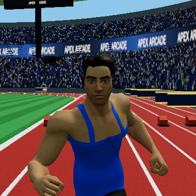

## 🟡 CHECK — Apex Flight

`apexflight.html`

- 🟡 No owner-approved venue - build it from venues/airport.md (real sizes, stands all around, crowd) with venues/kit in tools/venue-viewer.html, add it to MODELS.md as WAITING OWNER
- 🟡 Busy play screen: about 26 words during play (biggest: "SPD KT") - aim for only button labels and the score; instructions go behind How to play (STUDIO-STANDARD.md "Clean screen")
- 🟡 Heavy for phones: about 552 draw calls per frame (aim under 450; merge meshes - see STUDIO-STANDARD.md "Phone budget")
- 🟡 LINT fixes/apexflight.mjs: 29 h.eval call(s) navigate / wait / poll with no .catch (a destroyed execution context fails the test on the robot only) - first ones: play-no-easy-stall line 76, play-takeoff line 143, play-climb-and-fly line 234. Add .catch(() => false) or try/catch. Run: node tools/game-check/fixes-lint.mjs tools/game-check/fixes/apexflight.mjs
- 🟡 Play test failing: "land on the runway: a gentle approach touches down without crashing" [test id: play-land-on-runway] (never touched down after 20s of approach)
- 🟡 Play test failing: "A cancelled touch (call, notification, palm) never leaves the stick stuck: touchcancel zeroes the stick and all input at once (G-238)" [test id: play-stick-never-stays-stuck] (stick drag never deflected the jet)
- 🟡 Play test failing: "G-243 point 3: the stick zone never covers the Play-a-Friend buttons" [test id: play-g243-zone-never-covers-friend] (stick zone is visible over the menu)
- 🟡 Play test failing: "G-280: the tall THR slider is gone; a slim THR button sits in the pad row overlapping nothing and ramps the throttle while held" [test id: play-thr-button-in-row] (THR button missing from the pad row)
- 🟡 Play test failing: "G-334: after an earlier test leaves a ?test= URL behind, the challenge menu still engages and the off-runway reason shows and stays" [test id: play-g334-dirty-url-challenge] (test error: took over 60 s)
- 🟡 Friend codes have no 'play-friend-code' test yet (STORE-READY.md "Friend codes")
- 🟡 REALITY: the player did not move in 5 s with go(true) - add go() to the hook so the robot can drive/run
- 🟡 REALITY: the hook has no time() - add time: () => <game seconds> and speed: () => <m/s> so a busy robot cannot mistake a sprint for walking (REALITY.md)
- 🟡 Play test failing: "take off is manual: full throttle with no stick stays on the ground past rotate speed, and pulling the stick up lifts it off (owner: the plane must never lift by itself)" [test id: play-takeoff] (plane never reached rotate speed at full throttle (v 16.8 m/s))
- 🟡 Play test failing: "climb and fly: stick up gains altitude and the plane keeps flying" [test id: play-climb-and-fly] (plane barely moved (37m in 5s))
- 🟡 Play test failing: "G-117: every flight control answers within 100ms of the touch and stops at once when let go - stick, throttle lever, BOOST, BRAKE, YAW (in the air too), GEAR, trick buttons" [test id: play-controls-answer-in-100ms] (stick did not move the jet within 100ms; YAW did not turn the jet within 100ms (dead in the air))
- 🟡 Play test failing: "takeoff climbs: a full-throttle roll rotates and climbs away - no wallow back onto the gear (owner video 2026-10-23: the jet lifted, sank and collapsed its gear)" [test id: play-takeoff-climbs] (ran out of wall time (v23 at 5.2 game-s))
- 🟡 Play test failing: "turn: holding right banks the plane and changes heading" [test id: play-turn] (heading changed only 0.15 rad in 4s (want > 0.3))

**Owner's fix list** (31 of 41 done):
- ✅ throttle is a visible lever, not buttons: dragging the THR lever sets the throttle, the old THR buttons are hidden, and the lever overlaps no pad button (owner 2026-10-25)
- ❌ land on the runway: a gentle approach touches down without crashing — never touched down after 20s of approach
- ✅ Landing challenge: the jet must be able to slow to the 55-88 kt touchdown band in a descent (today: it accelerates to 130kt+ and cannot slow down, making the runway unreachable)
- ✅ G-141: the owners jet is the player plane (INSTRUCTIONS steps 1-2, 5, 6) and it starts parked ON THE RUNWAY on the ground; the step-6 look is in (PMREM environment so the paint reflects, a shadow-casting sun) - today the jet is in but the look is not: no environment, shadows off
- ✅ G-232: the stick is the shared kit/controls.js stick (the jet pack stick is gone) and letting go stops it - pointerup, pointercancel, blur and hidden tab all reset it to centre
- ❌ A cancelled touch (call, notification, palm) never leaves the stick stuck: touchcancel zeroes the stick and all input at once (G-238) — stick drag never deflected the jet
- ❌ G-243 point 3: the stick zone never covers the Play-a-Friend buttons — stick zone is visible over the menu
- ✅ G-247: 3-5 computer jets in the other styles and paints fly wide loops and stay above the ground
- ✅ NEVER (G-243): after a scored landing, flying into the ocean must still crash the plane - judged in game time so a slow runner cannot fake the failure
- ✅ G-268: the 55-88 kt band shows on the HUD during final approach in free flight too, so the robot's play picture shows it
- ❌ G-280: the tall THR slider is gone; a slim THR button sits in the pad row overlapping nothing and ramps the throttle while held — THR button missing from the pad row
- ✅ G-283: on a landing-challenge approach the TD band chip is a distinct chip nothing overlaps, so the 55-88 kt warning is actually seen
- ❌ G-334: after an earlier test leaves a ?test= URL behind, the challenge menu still engages and the off-runway reason shows and stays — test error: took over 60 s
- ✅ balance (master #11): on a short final a skilled pilot lands and scores GOOD or better, a pilot who never touches the stick does not score, and a stick-masher crashes - skill must matter
- ✅ Gameplay picture frozen for 1.5 seconds
- ❌ take off is manual: full throttle with no stick stays on the ground past rotate speed, and pulling the stick up lifts it off (owner: the plane must never lift by itself) — plane never reached rotate speed at full throttle (v 16.8 m/s)
- ❌ climb and fly: stick up gains altitude and the plane keeps flying — plane barely moved (37m in 5s)
- ✅ crash: a hard nose-down impact ends the flight with the crash screen
- ✅ Landing challenge: touching down OFF the runway must tell the player why there is no score (today: silence)
- ✅ G-90: the jet control pad (12 buttons + throttle lever + stick) is on the phone screen and every button works
- ❌ G-117: every flight control answers within 100ms of the touch and stops at once when let go - stick, throttle lever, BOOST, BRAKE, YAW (in the air too), GEAR, trick buttons — stick did not move the jet within 100ms; YAW did not turn the jet within 100ms (dead in the air)
- ✅ G-158 re-check: free flight stays stable - steady cruise keeps finite position and velocity, no crash, the jet keeps moving
- ✅ G-243 point 4: in portrait (390x844, body rotated) the stick base sits on the screen and the stick answers
- ❌ takeoff climbs: a full-throttle roll rotates and climbs away - no wallow back onto the gear (owner video 2026-10-23: the jet lifted, sank and collapsed its gear) — ran out of wall time (v23 at 5.2 game-s)
- ✅ G-263: the 55-88 kt touchdown band shows during the landing approach, and says whether the speed is inside it
- ✅ G-275: runway 36 reads the correct way from behind the jet (not mirrored)
- ✅ G-290: the RESET button in the top bar overlaps nothing, least of all the VS speed box, on a challenge approach
- ✅ G-391: the QUALITY button sits fully on screen (upright and sideways), at least 44 px tall
- ✅ Menu has the old green "computer screen" look
- ✅ The plane stalls too easily when flying around - normal flying should be forgiving, stall only when you really pull up too slow
- ❌ turn: holding right banks the plane and changes heading — heading changed only 0.15 rad in 4s (want > 0.3)
- ✅ Play a friend with a friend code (My code / Enter code)
- ✅ Play every Flight mode start to finish like a real pilot: at cruise speed, full nose-down must make the plane DESCEND - it climbed instead, so you could not come down to land
- ✅ After a scored landing, flying into the ocean must still crash the plane (today: nothing happens)
- ✅ G-243 point 1: btnFree, friendGo and friendClose sit fully inside the 844x390 safe area
- ✅ G-243 point 2: the JET button does not overlap the back button
- ✅ G-243 point 5: the page declares a data: favicon so the browser never asks for /favicon.ico
- ✅ first frame: a fresh load never throws the parked jet under the world (negative frame time - lab-measured 2026-10-23: frame 2 read y=-14.4, vy=+12.6, and ground contact could never reach it again)
- ✅ NEVER (G-243): Landing challenge: touching down OFF the runway must tell the player why there is no score - the reason stays on screen while the jet sits in the grass, judged in game time
- ✅ NEVER (G-232): taking off must not crash the jet when it settles back onto the runway banked - a bounce is a roll, not a landing
- ✅ G-403: no live coaching instructions during the ground roll (Clean screen) - the roll shows only the game, the score and the buttons

   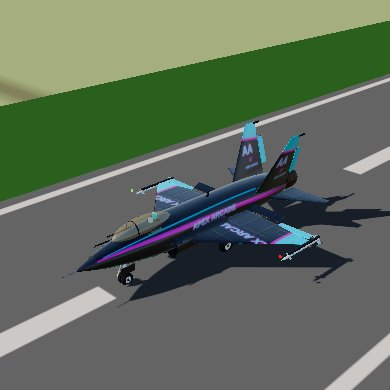

# 3D models (MODELS.md)

## Main sport motorcycle — WAITING OWNER

CODE-BUILT model · 29,628 triangles · 1.52 m tall · look: studio · drag to turn, pinch to zoom

  

## Monster Truck Arena (stadium kit + crowd) — DISCARDED BY OWNER 2026-10-18 — DISCARDED (owner: "horrendous - throw this model away" 2026-10-18)

VENUE · 226 × 166 m · 12,000 fans · 12,000 seats · 105 draw calls · 145k triangles · look: night

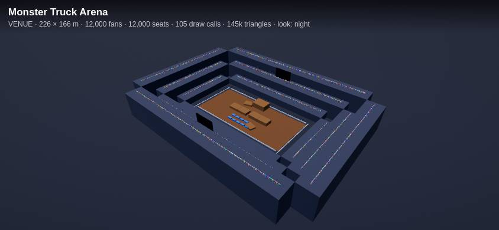 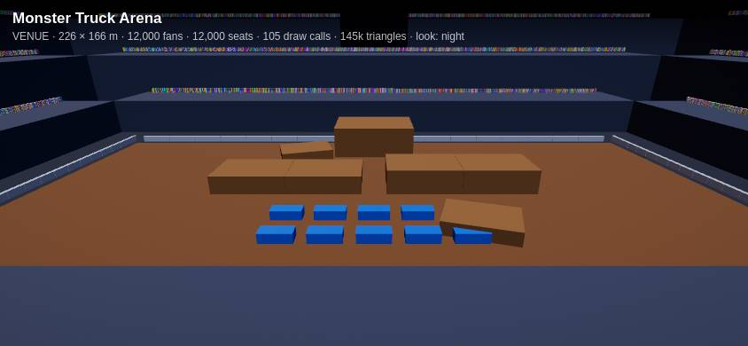 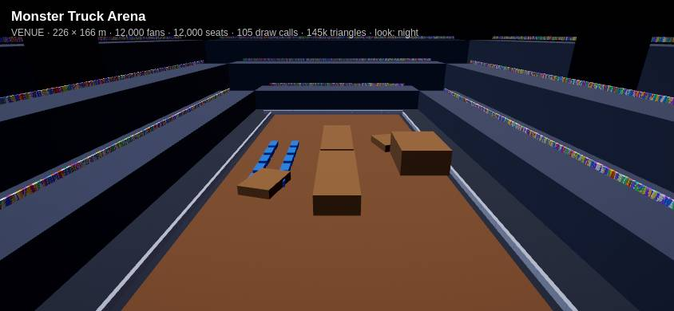

## Pebble hero (Flick Fortress) — WAITING OWNER

CODE-BUILT model · 9,136 triangles · 2.01 m tall · look: studio · drag to turn, pinch to zoom

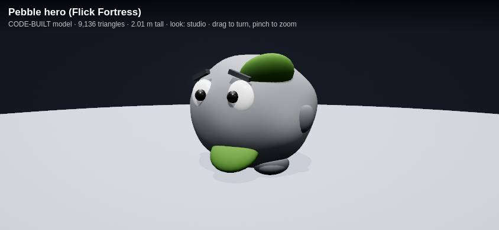 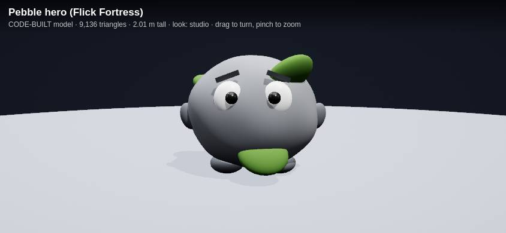 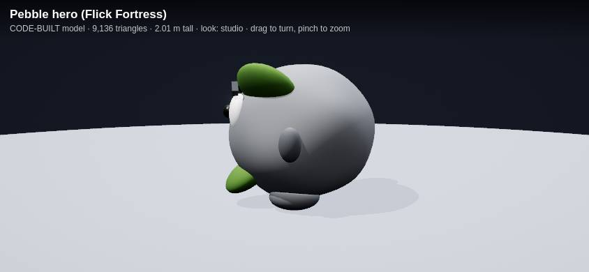

## Ballpark (baseball venue) — 

VENUE · 280 × 280 m · 64k triangles · look: field

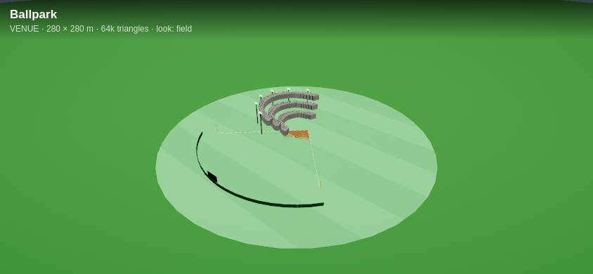 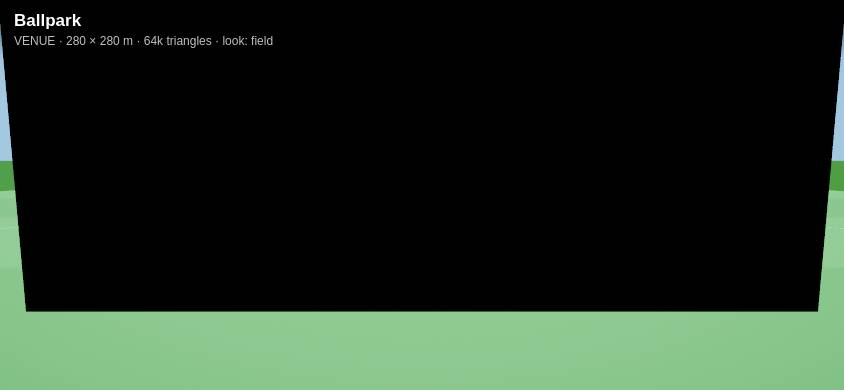 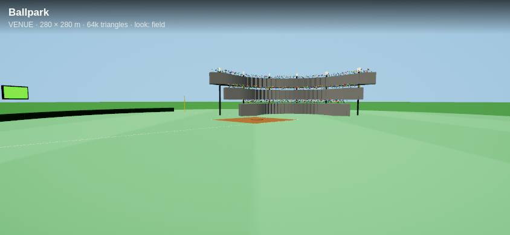

## Exotic Racer rim - Tuner mesh (rebuilt) — WAITING OWNER

55,958 triangles · 0.68 m tall · look: night · drag to turn, pinch to zoom

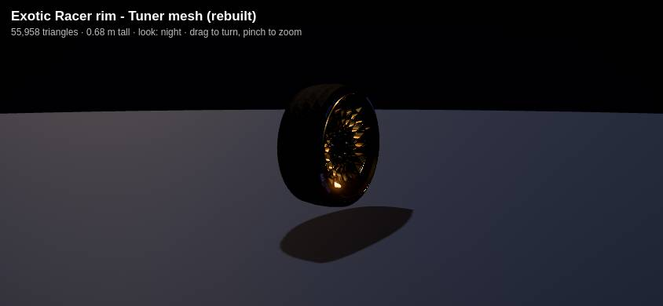 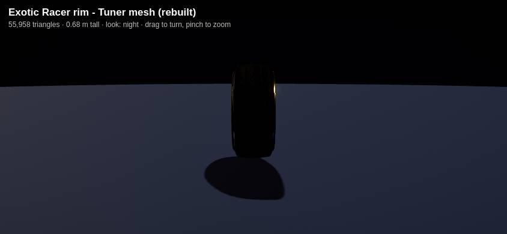 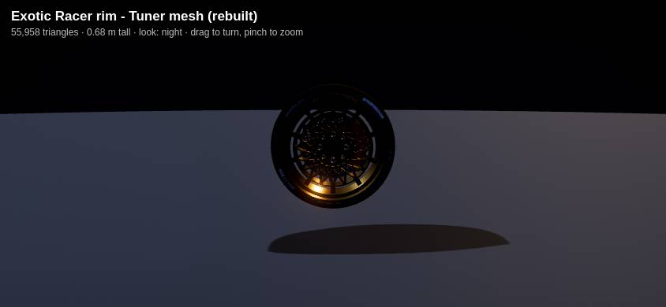

---
Made by tools/game-check (runs after every merge to main, one robot per game side by side).
