# Game check

**Oct 17, 2026, 2:00 PM (Central)** · main @ `29ba2dc`

**0 pass · 6 to check · 2 fail** out of 8 games.

Each game was opened like a phone held sideways, started with its own buttons, then opened upright.
Pictures: opening screen · gameplay · upright.

## 🔴 FAIL — Apex Soccer

`apexsoccer.html`

- 🔴 Owner's fix NOT done yet: "The players do not steal the ball - computer players must tackle and win the ball" (defending AI won the ball 0x and kept it 0x in 22s (need 2 steals, 1 kept))
- 🔴 Owner's fix NOT done yet: "Players do not play correctly - mark like real soccer" (an attacker at (-39,10) has no marker within 6m (nearest 9.8m); an attacker at (-36,3) has no marker within 6m (nearest 16.9m); an attacker at (-36,-13) has no marker within 6m (nearest 11.9m); an attacker at (-42,-4) has no marker within 6m (nearest 16.9m))
- 🔴 Owner's fix NOT done yet: "Players do not play correctly - spread out like real soccer" (team is bunched: only 34m wide (need 40m+ of the 68m pitch))
- 🔴 Owner's fix NOT done yet: "Players do not play correctly - pass like real soccer" (AI team completed only 1 passes in 16s of possession (need 3+))
- 🔴 Owner's fix NOT done yet: "Players do not play correctly - position like real soccer" (back line did not push up: defenders average x=-30.7 (anchors are -34) with the ball at +30)
- 🟡 No owner-approved venue - build it from venues/soccer.md (real sizes, stands all around, crowd) with venues/kit in tools/venue-viewer.html, add it to MODELS.md as WAITING OWNER
- 🟡 Play test failing: "computer players win the ball back within 30 s" (test error: took over 30 s)
- 🟡 Play test failing: "a goal restarts from the centre spot" (after a goal the ball did not restart from the centre spot)
- 🟡 Play test failing: "11 v 11 - ten outfield players plus a goalkeeper per team" (wrong team sizes: 7 v 7 (rules: 11 v 11))

**Owner's fix list** (3 of 11 done):
- ✅ The stadium is still not right - make it a real soccer stadium: stands all around, lights, a crowd
- ❌ The players do not steal the ball - computer players must tackle and win the ball — defending AI won the ball 0x and kept it 0x in 22s (need 2 steals, 1 kept)
- ❌ Players do not play correctly - mark like real soccer — an attacker at (-39,10) has no marker within 6m (nearest 9.8m); an attacker at (-36,3) has no marker within 6m (nearest 16.9m); an attacker at (-36,-13) has no marker within 6m (nearest 11.9m); an attacker at (-42,-4) has no marker within 6m (nearest 16.9m)
- ❌ Players do not play correctly - spread out like real soccer — team is bunched: only 34m wide (need 40m+ of the 68m pitch)
- ❌ Players do not play correctly - pass like real soccer — AI team completed only 1 passes in 16s of possession (need 3+)
- ❌ Players do not play correctly - position like real soccer — back line did not push up: defenders average x=-30.7 (anchors are -34) with the ball at +30
- ❌ computer players win the ball back within 30 s — test error: took over 30 s
- ✅ players keep their positions (formation discipline, not everyone chasing)
- ❌ a goal restarts from the centre spot — after a goal the ball did not restart from the centre spot
- ❌ 11 v 11 - ten outfield players plus a goalkeeper per team — wrong team sizes: 7 v 7 (rules: 11 v 11)
- ✅ kick-off starts from the centre spot

  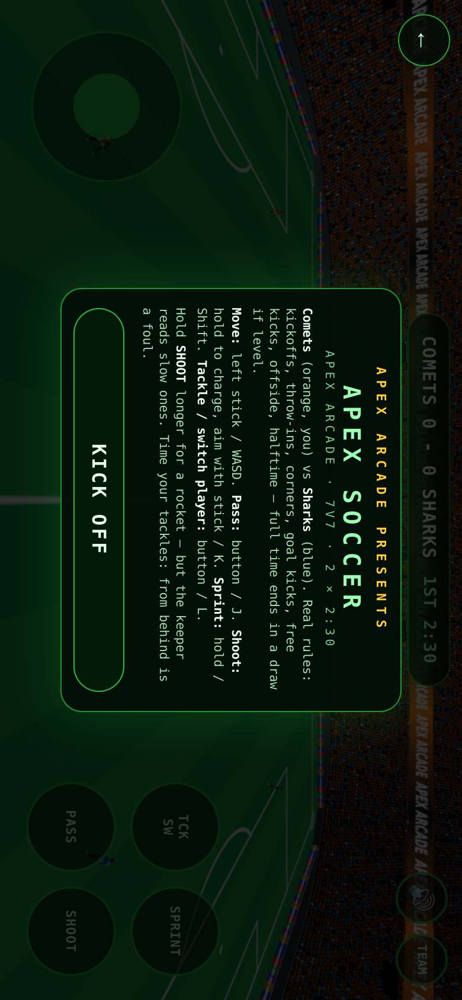

## 🔴 FAIL — Apex Track & Field

`apextrackfield.html`

- 🔴 Owner's fix NOT done yet: "Career mode must never stall" (could not get back to the menu (a race or results screen is stuck))
- 🔴 Owner's fix NOT done yet: "Holding the stick must never block TAP RUN / HURDLE - two thumbs at once" (test error: page.target is not a function)
- 🔴 Owner's fix NOT done yet: "Held upright the game fills the WHOLE screen sideways (the robot fails under 90%)" (test error: page.setViewport is not a function)
- 🟡 Only 0 play test(s) - every game needs 5+ tests that play it by its rules (fixes/apextrackfield.mjs, ids 'play-...')

**Owner's fix list** (11 of 14 done):
- ✅ I can't play Track & Field - no way to control it
- ✅ Runners must run with natural arm and leg motion - a real sprint animation, not posed bones
- ✅ Runners must run standing upright like real sprinters
- ✅ Sprinters wear a track singlet kit, not a soccer kit
- ✅ A real 400m oval: 8 lanes of 1.22m, lane 1 lap is 400m
- ✅ Staggered starts for 200m/400m and every runner in his own lane
- ✅ A real college track stadium: seating all the way around the oval, 30,000+ crowd
- ✅ Add running lanes and move camera angel back 10 blocks and up 15 blocks and centered behind player
- ✅ Make camera angle always right behind player. And make the runners 3D humans from the studio. Make lanes for each tracker runner 1-7 and make finish line banner or floor marking to cross.
- ✅ Camera 7 m behind the player's runner along the lane direction (it follows the lane around the curves), 2.8 m up, looking at a point 10 m ahead of the runner; it never goes behind the start line into the stands or through any wall - clamp it inside the stadium.
- ✅ The camera never sees a wall in front of the runner at the 100 m start and on the 400 m curve (clamped inside the stadium)
- ❌ Career mode must never stall — could not get back to the menu (a race or results screen is stuck)
- ❌ Holding the stick must never block TAP RUN / HURDLE - two thumbs at once — test error: page.target is not a function
- ❌ Held upright the game fills the WHOLE screen sideways (the robot fails under 90%) — test error: page.setViewport is not a function

  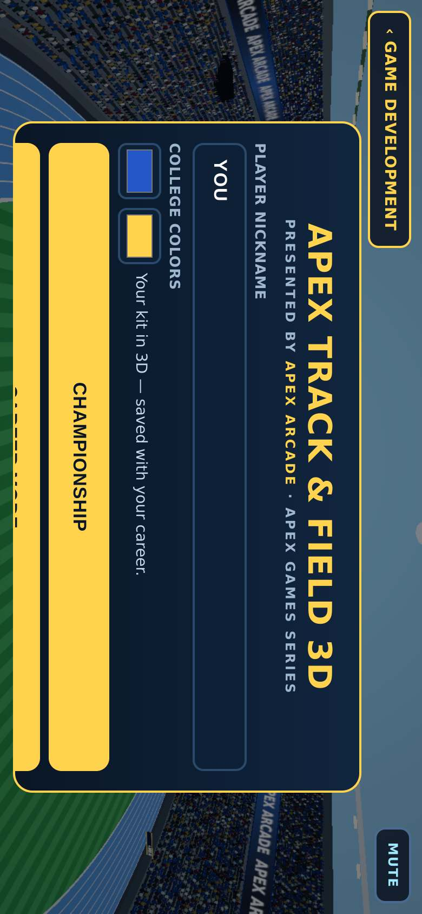

## 🟡 CHECK — Apex Baseball

`apexbaseball.html`

- 🟡 No owner-approved venue - build it from venues/ballpark.md (real sizes, stands all around, crowd) with venues/kit in tools/venue-viewer.html, add it to MODELS.md as WAITING OWNER
- 🟡 Only 0 play test(s) - every game needs 5+ tests that play it by its rules (fixes/apexbaseball.mjs, ids 'play-...')

  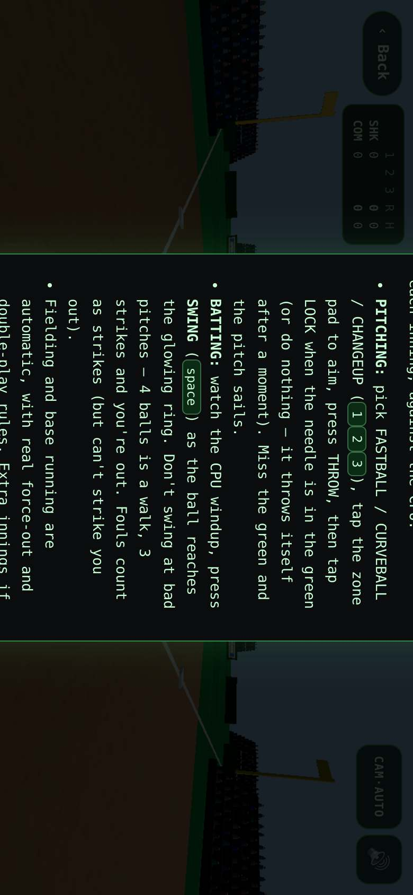

## 🟡 CHECK — Apex F1 Racing

`apexf1.html`

- 🟡 No owner-approved venue - build it from venues/circuit.md (real sizes, stands all around, crowd) with venues/kit in tools/venue-viewer.html, add it to MODELS.md as WAITING OWNER
- 🟡 Only 0 play test(s) - every game needs 5+ tests that play it by its rules (fixes/apexf1.mjs, ids 'play-...')
- 🟡 Blurry picture: the 3D game is drawn at 0.18x on a 2x phone screen - players and lines look soft. Draw at 1.5x (renderer.setPixelRatio(Math.min(devicePixelRatio, 1.5)) or the kit/apex-gfx "sharp" setting) - STUDIO-STANDARD.md "Sharp picture"
- 🟡 Script error: W is not defined

  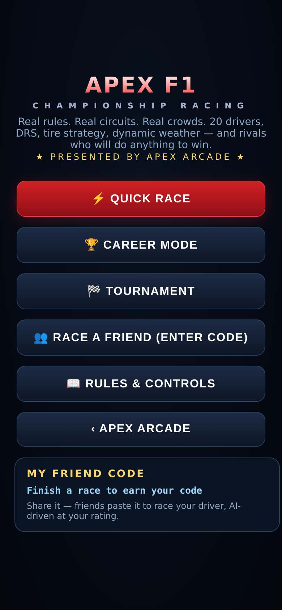

## 🟡 CHECK — Apex Flight

`apexflight.html`

- 🟡 No owner-approved venue - build it from venues/airport.md (real sizes, stands all around, crowd) with venues/kit in tools/venue-viewer.html, add it to MODELS.md as WAITING OWNER
- 🟡 Gameplay picture frozen for 1.5 seconds
- 🟡 Only 0 play test(s) - every game needs 5+ tests that play it by its rules (fixes/apexflight.mjs, ids 'play-...')

  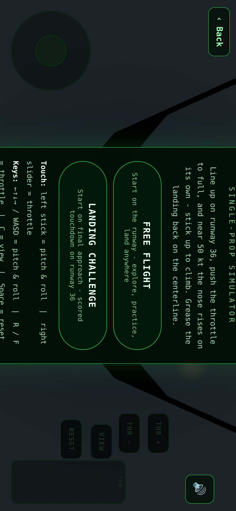

## 🟡 CHECK — Apex Ice Hockey

`apexhockey.html`

- 🟡 Only 0 play test(s) - every game needs 5+ tests that play it by its rules (fixes/apexhockey.mjs, ids 'play-...')

**Owner's fix list** (6 of 6 done):
- ✅ They gave me this - blob players, upright floating sticks and scattered bits
- ✅ How do I get exactly this hockey player? (7.5 head heights, forward lean 15-20, knee flex 25-30, hips back over the heels, wide stance)
- ✅ Helmet with visor, shoulder pads, oversized gloves, padded breezers, shin guards, skates with a wider stance - like my sheet
- ✅ Upright floating sticks
- ✅ Build a nice stadium, a big crowd in the stadium (venues/rink.md)
- ✅ Why do I get offsides every time

  

## 🟡 CHECK — Apex Monster Truck

`apexmonstertruck.html`

- 🟡 No owner-approved venue - build it from venues/truck-arena.md (real sizes, stands all around, crowd) with venues/kit in tools/venue-viewer.html, add it to MODELS.md as WAITING OWNER
- 🟡 Play test failing: "Truck drives forward when given speed" (truck only moved 7.6m with sp=30 for 2s)

**Owner's fix list** (5 of 6 done):
- ❌ Truck drives forward when given speed — truck only moved 7.6m with sp=30 for 2s
- ✅ Truck landing on a car crushes it and scores
- ✅ Truck with upward velocity gets air and lands with gravity
- ✅ Engine sound revs with speed (J5: 35Hz idle to 180Hz)
- ✅ Menu and game music play, mute silences all (J5)
- ✅ J5: truck ~2.7m tall with ~2.1m tires next to 4.4m cars

  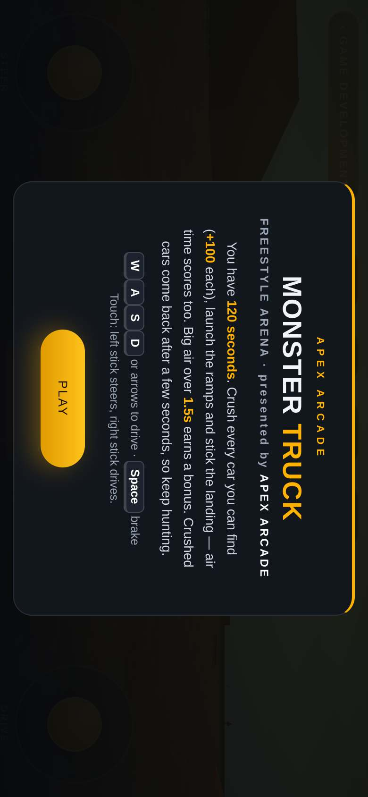

## 🟡 CHECK — Exotic Racer Club

`apexracer.html`

- 🟡 No owner-approved venue - build it from venues/circuit.md (real sizes, stands all around, crowd) with venues/kit in tools/venue-viewer.html, add it to MODELS.md as WAITING OWNER
- 🟡 Only 0 play test(s) - every game needs 5+ tests that play it by its rules (fixes/apexracer.mjs, ids 'play-...')

  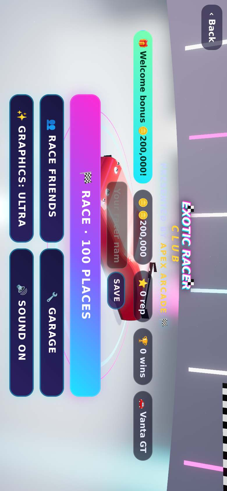

# 3D models (MODELS.md)

Each one photographed in tools/model-viewer.html with its game's lighting.

## Main sport motorcycle — WAITING OWNER

CODE-BUILT model · 29,628 triangles · 1.52 m tall · look: studio · drag to turn, pinch to zoom

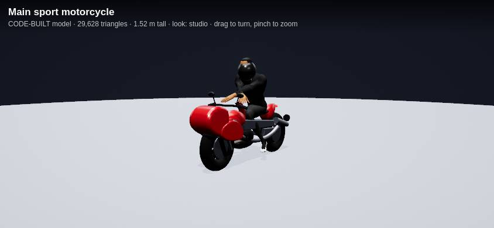 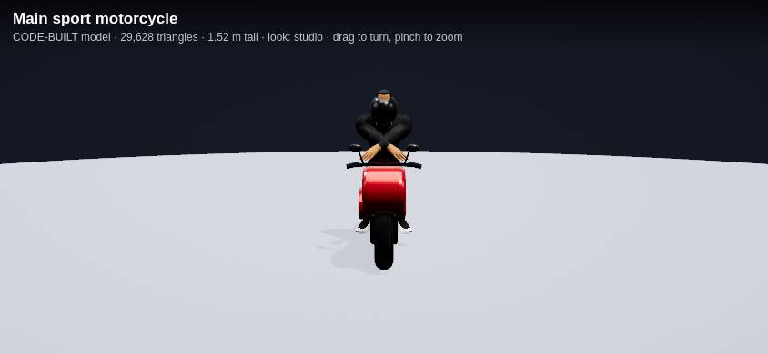 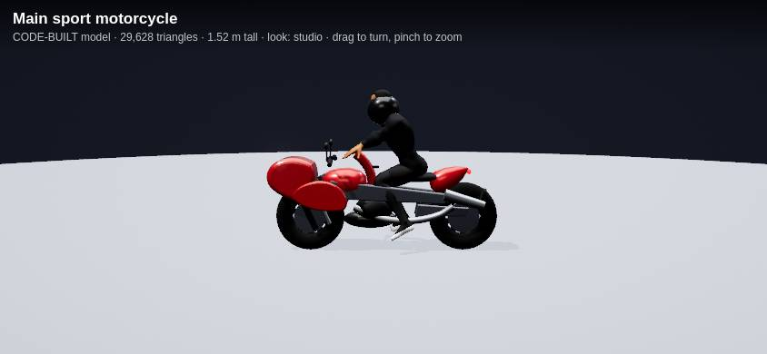

---
Made by tools/game-check (runs after every merge to main). To check your game again, merge to main or run the "Game check" workflow by hand.

## 📱 iPhone Safari pass

Every game opened in Safari's engine as an iPhone held sideways.

**Apex Baseball** — ok

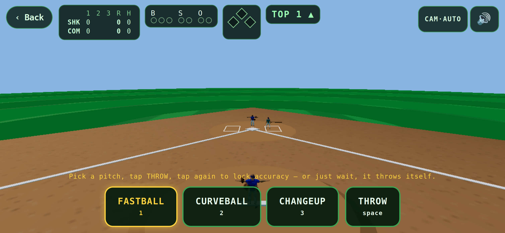

**Apex F1 Racing** — iPhone Safari: script error: Can't find variable: W

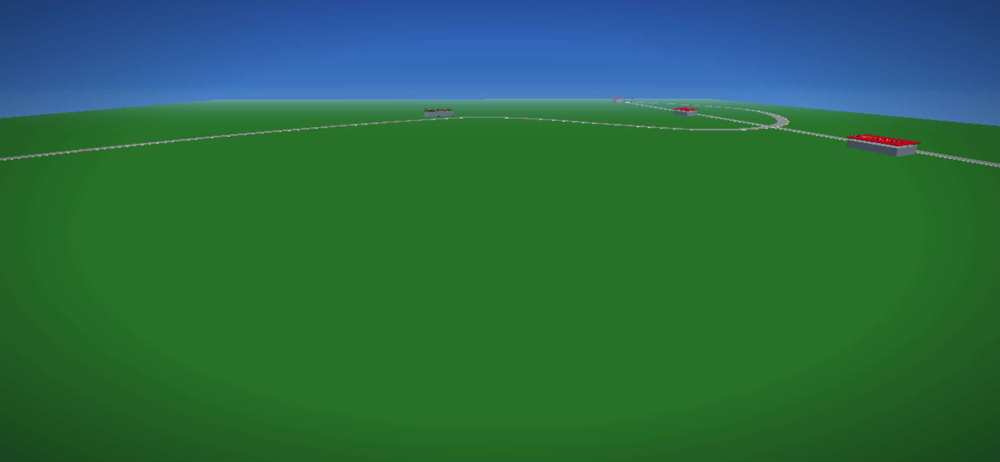

**Apex Flight** — ok

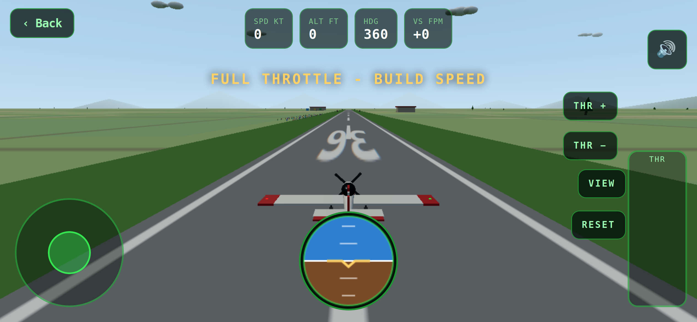

**Apex Ice Hockey** — ok

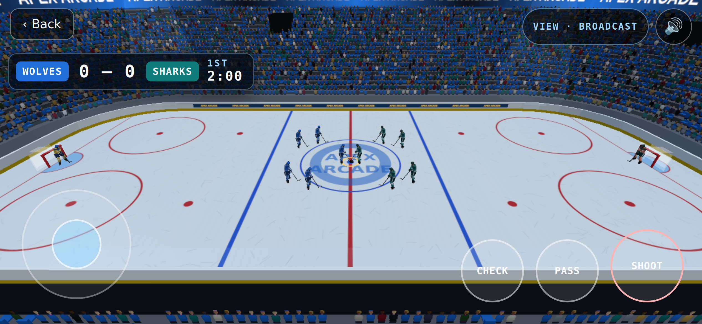

**Apex Monster Truck** — ok

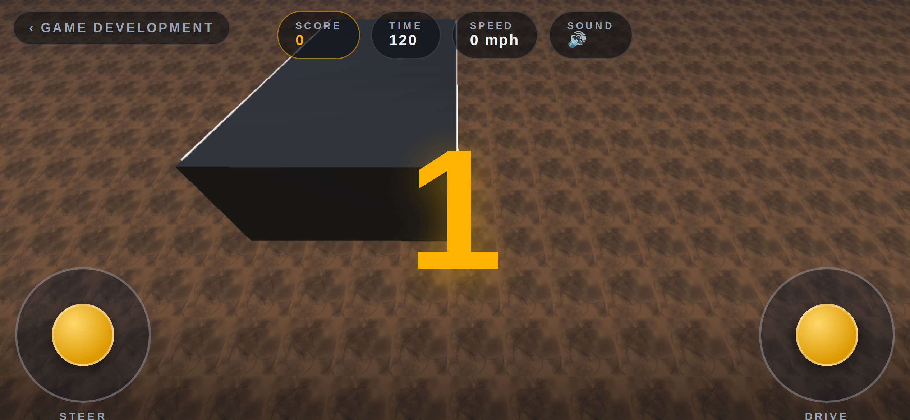

**Exotic Racer Club** — ok

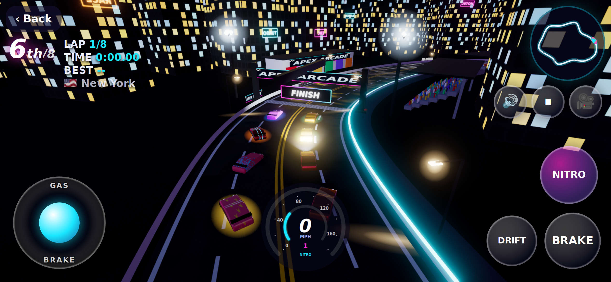

**Apex Soccer** — ok

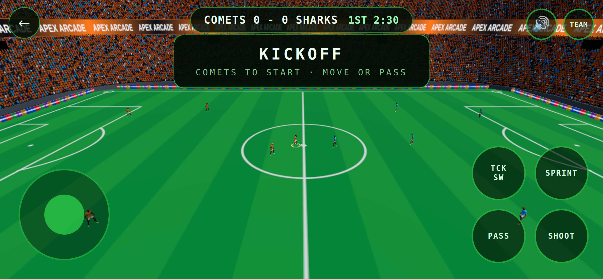

**Apex Track & Field** — ok

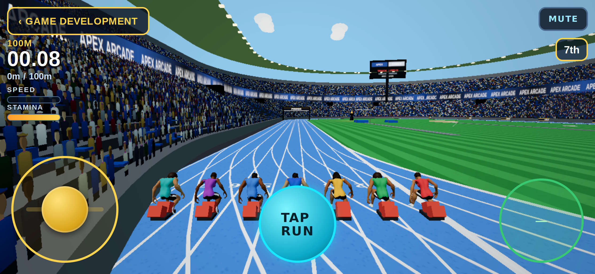

