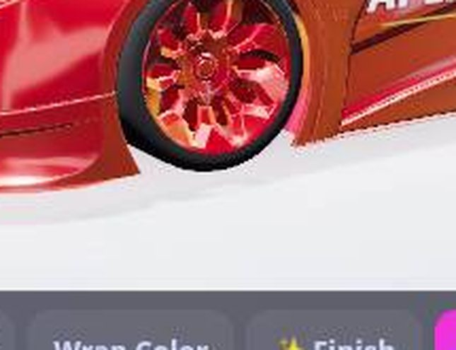

# G-355 · apexracer.html · window 6
TARGET: PR #1794 (G-345 fix round 2) - the owner's three rim complaints get their own proofs: style buttons change nothing, the rim colour repaints the whole wheel, the caliper block sits on the wheel face
STATUS: CHANGED
VERSION: a3474f5b4486d3707d77666091220668a4db9a17 (PR #1794 merged 2026-10-26T02:12:57Z per GitHub; check status PASSED, updated 2026-10-26 02:10 UTC per GitHub)
OLD: on the shipped build the six rim styles were identical, the locked wheel took the rim colour over its whole single material (owner's screenshots: a fully red wheel), and the caliper front measured 0.230-0.235 m against a rim face plane of 0.224-0.229 m - in front of the face
POINT 1: YES - every style builds a different rim: bench signatures differ per style (Classic barrel 410 verts + spokes, Mesh the 32,582-vert locked wheel); on main all six signatures were identical
POINT 2: YES - the colour stays on the rim: with magenta saved, main's locked wheel measured ff00ff on all four faces; the shipped build's locked wheel keeps its own grey (9d9d9d), the procedural rim wears the colour, calipers stay e01b2b, nothing outside the wheels takes it
POINT 3: YES - the caliper sits behind the face: shipped build front 0.165-0.169 m vs face 0.224-0.229 m (locked wheel), 0.037 m vs 0.076 m (Classic); it is seated from the fitted rim's own depth, not the tyre's width
CHANGED:
- rim styles - each of six styles builds different real rim geometry; guard never-g-355-p1 censuses every style's wheel signature and fails under five different rims
- rim colour - tint touches the rim only, locked wheel keeps viewer finish; guard never-g-355-p2 checks faces, calipers and everything outside the wheels with a magenta save
- caliper seat - caliper moved behind the rim's face plane for good; guard never-g-355-p3 measures caliper front against the rim's own vertex face plane on two styles
NOTES: the same PR also repaired never-g-345-p2 (the wheel-size proof): startRace is swallowed while a build is loading and its staged build outran the old wait, so the robot censused a stale race and read stock 0.596 m twice; the test now waits out the loading state, waits for the new race object, and fails closed instead of censusing a stale race. Robot check on PR #1794 after the repair: PASSED (above), merged a3474f5b.
PICTURE: the garage on the Rims tab, Deep Dish (style 3) fitted, rim colour red - close view of the front wheel: real dished 3D rim, spokes with depth, no block on the face.

OWNER CHECK IN 30 SECONDS: https://attacked-kraken.github.io/18-Games-Casino/apexracer.html?test=rim - the garage opens on the Rims tab with Deep Dish and red rims fitted: chunky real 3D wheels, and no red block sitting on the wheel face
